# Reading hidden runs at a benchmark-level cold start: a pair-rate oracle, test-like regimes and a calibrated hierarchical predictor

Technical report for the Predictive AI Evaluation Competition (PAIEC), NeurIPS 2026 [PAIEC organisers 2026].

Author: Nikita L. Polomoshnov

Affiliation: Moscow State University

Email: nikitapol@fbb.msu.ru

Code: https://github.com/doctawho42/PAIEC (MIT License)

Keywords: predictive evaluation, Brier score decomposition, benchmark-level cold start, item response theory, evaluation methodology, PAIEC

---

## Abstract

PAIEC asks for the probability that an AI system answers a benchmark item correctly, given 0 to 31 revealed labels, and scores the area under the Brier learning curve (ALC) on benchmarks absent from the public data, so judging a predictor from five public benchmarks and three small formative runs is hard. For one prediction per pair, Brier is the squared calibration error plus $p(1-p)$, so the organisers' tables give V, the score of an oracle that knows each pair's success rate: 0.1536, 0.1797 and 0.1608 (exact for our first run, estimated for the others). Our hierarchical item-response predictor, with a level prior calibrated on test-like runs tuned to our first run, exceeds V by 0.0171, about what an ideal learner of the pair rate pays (0.016 to 0.032); an estimated 78 to 89 percent of the remaining loss is item level. Adjusted for V, our first submission trails it by 0.0405 (SE 0.019, unpaired) on the hidden runs, consistent with 0.0419 (SE 0.0037) on held-out test-like runs, a check partly in sample on the first submission's side. On a typical run (V 0.160) no predictor of pair rates reaches the best leaderboard score, 0.117. Our predictor's hidden curves are flat after seven labels, no transferable item signal exceeds a within-pair correlation of 0.15 (our harness needs about 0.25), and a refit on the expanded public release was not carried, under a rule committed and pushed before any scoring.

---

## 1 Introduction

For each subject $s$ (an AI system) and item $i$, a submission's `predict` reads a subject dictionary (eight string fields), an item dictionary with an anonymous benchmark_id and `labeled`, the outcomes revealed so far, and returns the probability $\hat p_{si}$ that $s$ answers $i$ correctly [P§ Interfaces].[^psfs] As workers are recreated at every checkpoint, `predict` is a pure function of (input, `labeled`) [P§ Flow]. Each subject-benchmark pair $(s, b)$ with at least 80 distinct items is split 50/50 into an acquisition pool, which reveals labels, and an evaluation pool, on which the pair's Brier score $B_k$ is taken at each budget $k \in \mathcal K = \lbrace 0, 1, 3, 7, 15, 31\rbrace$ [Brier 1950; Gneiting and Raftery 2007]. The pair's score is the area under its learning curve (ALC; lower is better), with weights $w_k$:

$$
\mathrm{ALC} = 0.1\,B_0 + 0.2\,B_1 + 0.2\,B_3 + 0.2\,B_7 + 0.2\,B_{15} + 0.1\,B_{31}
$$

so $B_0$ and $B_1$ carry 0.3 of the weight [P§ Scoring]. A run scores the mean pair ALC. A formative run, at most 1,000 entries and so at most 12 pairs [P§ Runs], scores a submission on hidden benchmarks, and the organisers' tables of each pair's Brier score and expected calibration error (ECE) [Naeini et al. 2015] by budget are the feedback.

[^psfs]: P§ and F§ cite `docs/protocol.md` and `docs/findings.md` by section title (App H.1).

**The test is a benchmark-level cold start.** No public benchmark is hidden, and a benchmark's level (its mean pair-accuracy logit) set from the other four public ones misses by 0.86 logit on average (F§ "The step-2 analyses behind the model"). **The outside evidence is three small draws.** Our formative runs held 9, 8 and 9 pairs on the same 7 hidden benchmarks, 16 of their 26 appearances alone on their benchmark (App D.1), and the tables do not say on which side of 0.5 a pair's rate lies. Run 1 scored LegacyP (`paiec/predict.py`), our first predictor, a per-pair logistic model with a multiple-choice floor, item difficulty from a joint IRT fit and an attribute prior on subject ability with a linear date term; runs 2 and 3 scored hier-ship, the submitted one (§5). Our contributions are these.

1. **A root-free reading of formative scores** (§3, §6.1). For one prediction per pair, Brier equals $\mathrm{ECE}^2 + p(1-p)$, so $V_{sb} = B_0 - \mathrm{ECE}_0^2$ is each hidden pair's rate-oracle score. It splits a score into $V$, a rate-learning cost and an item-level remainder, and cuts hier-ship's single-run sds on replica runs (0.023 to 0.030 for ALC, 0.009 to 0.011 for ALC minus $V$). The algebra is known; its use on the organisers' tables is new.
2. **Test-like regimes, checked against the hidden runs** (§4, §6.2), which reject public runs as a description of our first submission ($z$ +8.9 at $B_0$).
3. **The submitted predictor, hier-ship** (§5, §6), a hierarchical item-response model that learns pair rates at the level of an ideal learner; its structure helps only once its level is calibrated.
4. **An acceptance harness and a catalogue of negative results** (§4.3, §6.4).
5. **A refit on the expanded public pool, under a rule committed and pushed in advance** (§7). None was carried.

**Related work.** hier is a hierarchical item-response model in the Rasch tradition [Rasch 1960; Patz and Junker 1999; Fox 2010]. IRT has built, compared and shrunk ML test sets [Lalor et al. 2016; Martínez-Plumed et al. 2019; Rodriguez et al. 2021; Maia Polo et al. 2024; Vivek et al. 2024; Li et al. 2025]; here a new benchmark's level dominates the error. Performance has been predicted from other evaluations [Ye et al. 2023; Zhang et al. 2024; Ruan et al. 2024; Zhou et al. 2026] and by instance-level assessors, which lose their advantage out of distribution [Pacchiardi et al. 2024]; setting a new benchmark's level resembles correcting for label shift [Saerens et al. 2002; Lipton et al. 2018]. Item difficulty has been predicted from text [Benedetto et al. 2023; Truong et al. 2025], task metadata [Ge et al. 2026; Kwa et al. 2025] and model internals [Lugoloobi and Russell 2025; Lugoloobi et al. 2026; Moreno Cencerrado et al. 2026; Krsteski and Meyer 2026]; §6.4 tests such signals on held-out benchmarks.

---

## 2 Data, protocol and the replica

**Data.** We use only measurement-db, the organisers' public training release [Truong et al. 2026], gated and licensed CC-BY-SA-4.0, at revision `bc8204d8…` for archive-3 (our final submission) and every experiment of §3 to §6: 571,921 responses over 287 subjects and six benchmarks [P§ Data]. Without the fraction-valued mmdocrag and matharena's 0.1% non-binary tail, pairs with at least 80 distinct items leave 221 pairs and 225,843 responses on multi_swebench, matharena, researchcodebench, real_webagents and swe_rebench (App A.1). Revision `54074453` (2026-10-07, 252 public benchmarks) enters only §7 (App G.2).

**The protocol as verified.** We read the organisers' streaming client (`tools/streaming_ingestion.py` at commit `82d330dd` [PAIEC baseline repository 2026]) and the competition page [PAIEC organisers 2026; P§]. Scoring is budget-major: every pair is evaluated at $B_0$ with `labeled` empty, then at $B_1$ once every pair holds up to one label, and so on. At $B_k$ one shared `labeled` list holds the first $k$ labels of every pair in the run, other subjects' and benchmarks' included. Splits are fixed, and labels are acquired by a sha256 rule that a submission may replace (archive-3 does not; App A.3). Our replica (`paiec/official.py`) matches the client decision for decision (App A.4); the split scope (per pair or per benchmark item), which the client leaves open, is a parameter, 'pair' unless stated. Pooling other subjects' labels, which our first, *legacy* replica never showed a target (App A.2), lowers hier-ship's ALC by 0.0300 and 0.0142 on *dense* runs (every eligible pair of one benchmark) under the two scopes, but only by 0.0010 and 0.0004 on the platform's small runs (F§ "Pooling under the verified protocol").

---

## 3 Reading hidden runs through a pair-rate oracle

### 3.1 The identity

Suppose a pair's evaluated responses $\mathcal R_{sb}$, repeated trials included, with success rate $\bar y_{sb}$, all receive one prediction $\hat p$ at budget $k$. The ECE is response-weighted over ten equal-width bins [P§ Scoring], so these responses share one bin and

$$
B_k = (\hat p - \bar y_{sb})^2 + \bar y_{sb}(1 - \bar y_{sb}), \qquad \mathrm{ECE}_k = \lvert \hat p - \bar y_{sb}\rvert
$$

Hence $V_{sb} = B_k - \mathrm{ECE}_k^2 = \bar y_{sb}(1 - \bar y_{sb})$ is the Brier score of the pair-rate oracle, which predicts the pair's rate for every item, and $V$ (`v` in the results files) is its run mean: the one-bin case of Murphy's partition [Murphy 1973] (App D.5). In run 1, whose LegacyP predictions moved between budgets, $B_k - \mathrm{ECE}_k^2$ varies per pair by at most $1.13 \times 10^{-6}$ over the six budgets. hier spreads its predictions within a pair, so for runs 2 and 3 we estimate $V_{sb}$ at $B_0$, where the spread is smallest, with a bias of -0.0002 to -0.00005 on replica rows (sd 0.0010 to 0.0016; App D.5). $V_{sb}$ fixes the rate only up to its two roots, $\bar y_{sb}$ and $1 - \bar y_{sb}$, so $V$ reads no level.

### 3.2 The decomposition and the ideal learner

Because the ALC weights sum to one,

$$
\mathrm{ALC} = V + \sum_{k \in \mathcal K} w_k\,(B_k - V), \qquad B_k - V = \mathrm{ECE}_k^2 - R_k
$$

where $R_k = V - (B_k - \mathrm{ECE}_k^2)$ is the within-pair resolution, zero for one prediction per pair. ALC minus $V$ is thus the cost of not knowing each pair's rate, net of that resolution, split by budget (App D.6). Its reference is the *ideal pair-rate learner*, which knows a logit-normal population prior, sees only the pair's own labels and predicts the posterior mean rate, simulated on the hidden pairs' own $V_{sb}$ under three priors, with each pair's rate at the lower root or at either root weighted by the prior (App D.7). hier-ship sees more, so we never call it optimal.

### 3.3 The item-level share and what a run's composition allows

Pair-level tables do not identify the item oracle, which knows each item's probability; we borrow its ratio to the pair-rate oracle from replica runs (0.438 to 0.542), so the item-level share of the loss is an estimate. A predictor with one probability per pair has $B_k \ge V_{sb}$, so a run's $V$ bounds it. Runs of 9 pairs bootstrapped from the 26 appearances, stratified by benchmark, have $V$ of 0.160 (sd 0.017) and $\Pr(V \le 0.117)$ of 0.0066, and with known rates, reaching 0.117 needs an item covariate whose within-pair correlation with the true item logits is 0.81 to 0.95 (App D.9). The value 0.117 is the leaderboard's best formative score (0.1172, read on 2026-09-24); the bound says nothing about any entry.

### 3.4 What the reading can and cannot claim

Run 1 is partly in sample: TL (§4.1) took its target level, and every test-like regime its date shift, from it, and three RS regimes took level targets from readings of runs 1 and 2 (App G.6). Its agreement with them is therefore out of sample only at $B_3$ to $B_{15}$, and the LegacyP side of any comparison with runs 2 and 3 is partly in sample. Run 1 against public runs and hier-ship's ALC minus $V$ were never tuning targets, and the analysis is post hoc and chose nothing (App G.6).

---

## 4 Test-like regimes and the acceptance harness

### 4.1 Test-like runs

Test-like (TL) runs (`paiec/testlike.py`; App C.1) use real responses only. The public benchmarks are cut into anonymous *pseudo-benchmarks*, each with a *parent* benchmark; without the single-subject swe_rebench four parents remain. A run draws 5 to 12 pairs, about one per pseudo-benchmark. A *level tilt* pulls the draw toward a target distribution of pair logits (mean -1.6, sd 1.5; realised -1.29, sd 1.70, cluster SE 0.16), and a *date shift* moves visible release and access dates 1.25 years later, the grid point closest to run 1 at $B_0$ and $B_1$, which through LegacyP's linear date term reproduces run 1's optimism there. The regime-sensitivity (RS) study redraws test-like runs at seed 11 under five level targets (tuned, TL's defaults; audit; mixture; reading; flat), 80 runs each, beside public formative-like runs (R1) weighted benchmark-first (R1-bf) or pair-uniform (R1-pu), 60 runs each (Table 2).

### 4.2 Leave-one-parent-out, statistics and selection

Each target's subject prior and empirical-Bayes hyperparameters are fitted without its parent (leave one parent out, LOPO), and studies choose by nested LOPO (App C.2). Comparisons are paired on the same runs, checkpoints and acquisitions, with $\Delta = \mathrm{ALC}(A) - \mathrm{ALC}(B)$. **A number in parentheses after a difference is its pair-cluster bootstrap SE, unless named otherwise.** A *single-run sd*, the spread of one run's ALC over a regime's runs, is the noise of one formative run, not an SE. We choose on TL runs 0 to 99, confirm on 100 to 199 and hold out 200 to 299, all from one catalogue.

### 4.3 The acceptance harness

The harness (`experiments/harness.py`; App C.4) adds an item covariate, centred on the pair's labelled items, to hier-ship's logit as a capped offset with a slope *transferred* from the other parents or fitted *per pair*; a covariate is *transferable* if defined on every benchmark and fitted without the target's. A component ships only if nested selection picks it in at least 3 of 4 parent folds, the nested test-like $\Delta \le -0.002$, no parent loses more than 0.002 and no public weighting more than 0.001. By degraded oracles, a transferred slope needs a correlation $r$ of about 0.3 with an *honest* difficulty fitted without the target subjects (0.25 within a pair, where one draw passes with probability 0.68), and a per-pair slope about 0.46 (Figure C1). The rules were fixed in the studies' plans (App C.3).

---

## 5 The submitted predictor, hier-ship

### 5.1 Model

hier (`paiec/hier.py`) models the log-odds $\eta_{si}$ that subject $s$ answers item $i$ of benchmark $b$ correctly:

$$
\eta_{si} = \mu_b + \theta_s + \delta_{sb} - g_i - e_i, \qquad
\hat p_{si} = c_i + (1 - c_i - \varepsilon)\,\mathbb{E}\big[\operatorname{logit}^{-1}(\eta_{si}) \mid \mathcal L\big]
$$

The expectation is over the posterior given `labeled`; $\mu_b$ is the benchmark's level, $\theta_s$ the subject's standing, $\delta_{sb}$ the pair's deviation, $g_i$ item_features group effects [Fischer 1973; De Boeck and Wilson 2004] and $e_i$ the item's residual. The floor $c_i = \omega f_i$, a guess weight $\omega = 0.5$ times a multiple-choice floor $f_i$ read from the item text, and the slip $\varepsilon$ are four-parameter logistic asymptotes [Barton and Lord 1981]. The priors are $\mu_b \sim \mathcal N(\mu_0, \sigma_\mu^2)$, $\delta_{sb} \sim \mathcal N(0, \sigma_\delta^2)$, $g_i \sim \mathcal N(0, \sigma_g^2)$ and $e_i \sim \mathcal N(0, \sigma_d^2)$, and $\theta_s$ is Gaussian around $\gamma\,\hat\theta^{\mathrm{attr}}_s$, an attribute ridge's prediction scaled by the attribute scale $\gamma$ (App B.1). Untouched components stay at their prior, so at $B_0$ the prediction is the level and attribute priors, integrated.

### 5.2 Inference

A joint mode, penalised quasi-likelihood [Breslow and Clayton 1993], is biased with binary responses and large random effects [Rodríguez and Goldman 1995; Breslow and Lin 1995]. In hier, each $e_i$ is integrated by adaptive Gauss-Hermite quadrature with 20 nodes [Liu and Pierce 1994; Pinheiro and Bates 1995], and Newton's method finds the other components' mode (App B.1). Because the Laplace posterior [Tierney and Kadane 1986] under-reacts to a pair's first labels by 0.013 to 0.02 in probability (`paiec/hier.py` docstring), hier reads the target's informed linear predictor along the Gaussian conditional mean with the exact log posterior, following the Laplace strategy of the integrated nested Laplace approximation [Rue, Martino and Chopin 2009, §3.2.2]. At dense $B_1$, hier minus the exact posterior predictive of its own model is -0.00035 (95% interval -0.00152 to +0.00079; App B.7).

### 5.3 Offline prior and the level prior

The offline prior (`paiec/prior.py`) fits an item-level model per public benchmark by Laplace-EM, an attribute ridge on its subject standings and empirical-Bayes hyperparameters [Morris 1983], refitted LOPO in every experiment (App B.1). The level prior, set for the hidden test, is LEVEL: $\mu_0 = -2.5$, $\sigma_\mu = 2.5$, $\gamma = 0.5$ (`submission/model.py`). On TL's selection runs (0 to 99), under a guard of at most 0.003 lost to LegacyP on both public weightings, the selection rule picked $\mu_0 = -3.5$, $\gamma = 0.25$; a level audit that also read run 1 per pair moved the choice to the milder LEVEL (App C.5). Under our conduct rule the feedback may set only *global* hyperparameters of the predictor's level distribution, here three numbers, $\mu_0$, $\sigma_\mu$ and $\gamma$; for the expanded-pool candidate C1m (§7; App G.6), $\mu_0$ is the same hyperparameter, set by a fixed rule that matches archive-3's level centre under the feedback's date shift.

### 5.4 Run time and robustness

`predict` caches its fits under a fingerprint of `labeled`, never lets an exception escape and falls back to the prediction without labels, then to 0.5. The CPU, numpy-only archive (a scope choice; App A.3) is built only if every check passes, the organisers' validator included (App B.2). A call takes 1.34 ms on average on formative-size runs. Under stress, 45,500 calls to archive-3 through the organisers' loader (fuzzed inputs, a replay, a dense run at every checkpoint, 16 parallel workers) raised no exception and gave finite outputs in (0, 1); read on all calls pooled, a disclosed deviation, p99 was 0.516 s and the maximum 20.21 s, within the plan's gate of 2 s and 30 s, while the fuzz part alone, with inputs of up to 20,000 labels, has p99 2.146 s (App B.8).

---

## 6 Results

### 6.1 The hidden runs decomposed

hier-ship pays 0.0130 and 0.0208 for not knowing pair rates, LegacyP 0.0577 (Table 1, Figure 1); $B_0$, $B_1$ and $B_3$ carry 0.88, 0.93 and 0.87 of it in runs 1, 2 and 3.

*Table 1: The hidden runs read through the identity.*

| run | predictor | pairs | ALC | $V$ | ALC $-\,V$ (pair SE) | $0.1\,(B_0 - V)$ | $0.2\,(B_1 + B_3 + B_7 + B_{15} - 4V)$ | $0.1\,(B_{31} - V)$ | item-level share |
|---|---|---|---|---|---|---|---|---|---|
| 1 | LegacyP | 9 | 0.2113 | 0.1536 | 0.0577 (0.0190) | 0.0205 | 0.0368 | 0.0003 | 55% to 60% |
| 2 | hier-ship | 8 | 0.1926 | 0.1797 | 0.0130 (0.0046) | 0.0057 | 0.0069 | 0.0004 | 86% to 89% |
| 3 | hier-ship | 9 | 0.1817 | 0.1608 | 0.0208 (0.0026) | 0.0074 | 0.0130 | 0.0004 | 78% to 81% |
| 2 and 3 | hier-ship | 17 | 0.1868 | 0.1697 | 0.0171 (0.0027) | | | | |

Sources: `experiments/hidden_runs.py`, `results/hidden_runs.json`. $V$ exact for run 1, estimated at $B_0$ for runs 2 and 3; the share is estimated with the ratio 0.438 to 0.542 (§3.3); run 2's archive predates two library fixes worth 0.0003 of ALC (App D.1).

Pooled over runs 2 and 3, hier-ship's 0.0171 lies between the ideal learner's 0.0161 at the lower roots (prior logit mean -1.6, sd 1.5) and 0.0250 to 0.0322 weighted by the prior (App D.7). Its $B_1 - V$ of 0.0208, against the prior-weighted learners' 0.039 to 0.053, may reflect favourable first labels, since its $B_3$ then exceeds its $B_1$ by more than 0.01 in 8 of the 17 pairs (8 or more have probability 0.011 to 0.040 for an ideal learner; App D.10). From $B_7$ on it pays less than every variant of the learner (App D.7). What remains is mostly item level: an estimated 78% to 89% of the distance from hier-ship's ALC to the item oracle lies below $V$ (Table 1), while its within-pair resolution at $B_{31}$ is only 0.0038 and 0.0024 (App D.10).

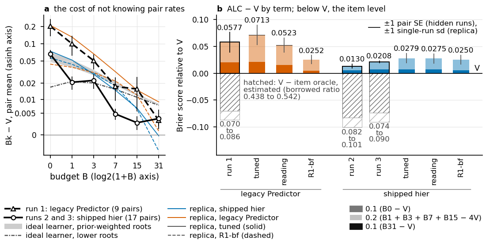

*Figure 1.* (a) $B_k - V$ by budget (pair mean ±1 pair SE, asinh axis) for run 1 (LegacyP, "legacy Predictor") and runs 2 and 3 pooled (hier-ship, "shipped hier"), with the ideal learner on the same 17 pairs (grey; lower-root line, prior-weighted band) and the replica's tuned and R1-bf regimes (thin lines). (b) ALC minus $V$ by its $B_0$, $B_1$ to $B_{15}$ and $B_{31}$ terms beside replica regimes; hatched below $V$, the estimated item-level remainder.

### 6.2 The test-like regimes checked against the hidden runs

Out of sample, run 1 rejects public runs as a description of LegacyP on the hidden test: adjusted for $V$ it sits at $z$ +8.87 and +7.21 at $B_0$ and +3.78 and +2.93 on ALC minus $V$ against R1-bf and R1-pu, while its raw ALC lies within -0.07 to +0.69 single-run sds of every regime (Figure 2b; App D.8). Against the test-like regimes it sits at $z$ -1.25 to +1.01 at every budget, out of sample only at $B_3$ to $B_{15}$. hier-ship's ALC minus $V$, never a tuning target, is below every regime's mean (Table 2; App D.8). Hidden pairs sit nearer a rate of 0.5 ($V$ 0.154 to 0.180, against 0.134 to 0.161 test-like). From $B_7$ to $B_{31}$ hier-ship's hidden curve (17 pairs) moves by -0.0012 (pair SE 0.0028), against -0.0145 on TL and -0.0215 and -0.0229 on public runs for 17 replica pairs with the same rate mix (probability 1.1%, 0.065% and 0.21%, treating pairs as independent; App D.10), so replica gains from $B_7$ on are upper bounds here.

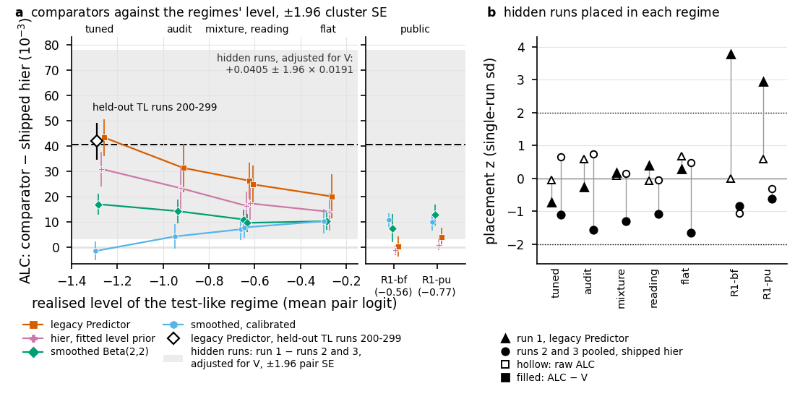

*Figure 2.* (a) LegacyP ("legacy Predictor"), hier-fit (hier at its default level, "hier, fitted level prior"), the $\mathrm{Beta}(2, 2)$-smoothed mean and Smooth-cal ("smoothed, calibrated") minus hier-ship ("shipped hier"), ALC in $10^{-3}$, ±1.96 cluster SE, against the test-like regimes' realised level; public runs apart. Diamond: LegacyP on held-out TL runs. Band: the hidden $V$-adjusted LegacyP difference (unpaired), +0.0405 ± 1.96 pair SE (0.0191), level unidentified. (b) Placement $z$: hollow, raw ALC; filled, ALC minus $V$.

*Table 2: The regimes, the baselines and the hidden runs on one scale. Left: $V$, hier-ship's ALC minus $V$ (single-run sd) and the hidden runs' $z$ on it. Right: comparator minus hier-ship, ALC (cluster SE), positive when hier-ship is better.*

| regime (realised level) | $V$ | hier-ship ALC $-\,V$ (sd) | run 1's $z$ | runs 2 and 3's $z$ | LegacyP | EmpMean | Smooth-cal | 1PL-ship | hier-fit |
|---|---|---|---|---|---|---|---|---|---|
| tuned (-1.28) | 0.1411 | 0.0279 (0.0097) | -0.73 | -1.11 | +0.0434 (0.0037) | +0.0339 (0.0030) | -0.0015 (0.0019) | -0.0017 (0.0013) | +0.0309 (0.0035) |
| audit (-0.93) | 0.1343 | 0.0307 (0.0086) | -0.26 | -1.57 | +0.0313 (0.0049) | +0.0252 (0.0028) | +0.0043 (0.0024) | +0.0027 (0.0018) | +0.0233 (0.0042) |
| mixture (-0.64) | 0.1540 | 0.0290 (0.0091) | +0.17 | -1.30 | +0.0263 (0.0037) | +0.0319 (0.0032) | +0.0071 (0.0021) | +0.0048 (0.0016) | +0.0164 (0.0028) |
| reading (-0.63) | 0.1607 | 0.0275 (0.0095) | +0.39 | -1.08 | +0.0248 (0.0037) | +0.0337 (0.0028) | +0.0078 (0.0021) | +0.0042 (0.0015) | +0.0173 (0.0032) |
| flat (-0.28) | 0.1412 | 0.0328 (0.0094) | +0.28 | -1.67 | +0.0200 (0.0044) | +0.0256 (0.0031) | +0.0103 (0.0024) | +0.0064 (0.0018) | +0.0140 (0.0038) |
| public R1-bf | 0.1864 | 0.0250 (0.0092) | +3.78 | -0.85 | +0.0002 (0.0020) | +0.0464 (0.0027) | +0.0108 (0.0014) | +0.0048 (0.0007) | -0.0010 (0.0010) |
| public R1-pu | 0.1709 | 0.0239 (0.0109) | +2.93 | -0.62 | +0.0039 (0.0019) | +0.0449 (0.0030) | +0.0100 (0.0018) | +0.0050 (0.0007) | +0.0009 (0.0011) |
| hidden runs | 0.154 to 0.180 | 0.0130, 0.0208 | | | +0.0405 (0.019) | | | | |

Sources, in `results/`: `hidden_runs.json`, `regime_sensitivity.json`, `e1_baselines_rs.json`, `baselines_p1.json`; RS runs at seed 11, archive-3 library. $z$: in single-run sds of formative-size runs; hidden row: run 1's LegacyP minus runs 2 and 3's hier-ship, adjusted for $V$, unpaired (pair SE). EmpMean: the organisers' empirical mean; Smooth-cal: the $\mathrm{Beta}(2, 2)$-smoothed mean at a calibrated prior (at the default level, Smooth, in Figure 2a and App E.2); 1PL-ship: a plain 1PL at hier-ship's level, its test-like gaps within noise at the parent level (App E.4); hier-fit: hier at its default level. Raw ALCs: App D.8.

### 6.3 Against the baselines, on the same runs

The headline is a replica result: on held-out TL runs 200 to 299 (seed 2, run-2 library; App E.2) LegacyP is 0.0419 worse than hier-ship (0.0037; parent-level 0.0378 ± 0.0075; per parent 0.021 to 0.057), and 0.0144 (0.0024) without the date shift (TL-noshift, runs 0 to 99); across the test-like RS regimes it falls as the level rises (Table 2). Adjusted for $V$, the hidden runs give +0.0405 (pair SE 0.019), against +0.0245 raw, consistent with the held-out gain ($z = -0.07$), but unpaired, on the same 7 benchmarks with different pairs and subjects; their LegacyP side is partly in sample (§3.4), and they cannot rank the tuned regime against the reading regime's 0.0248. EmpMean leads LegacyP by 0.0095 (0.0049; within noise at the parent level) in the tuned regime, so much of that headline is LegacyP's own prior under the date shift (App E.4).

In a paired factorial of model (smoothed mean or hier) by level (default or calibrated), calibrating helps hier by 0.0140 to 0.0309 in every test-like regime and the smoothed mean by 0.0000 to 0.0185, and at the default level hier trails the smoothed mean by 0.0037 to 0.0139. The interaction, -0.0125 to -0.0155 (cluster SE 0.0015 to 0.0021), is negative in every test-like regime and parent and absent on public runs: hier's structure pays only once its level is calibrated (App E.4). No replacement for LEVEL, the ablations at LEVEL included (App B.3), passed the RS rule, a gain of at least 0.002 in the reading and audit regimes with a 95% upper bound below zero (App E.2).

### 6.4 What does not transfer

Transferable item signals (text maps, language-model judges and probes, label-conditional layers, known-sign cues), subject-side variants, post-hoc maps and acquisition policies all fail (Table F.1a, App F). The best transferable within-pair correlation is 0.15 [0.12, 0.17] (two rubric scales of a 14B language model); the best nested differences are -0.00097 (0.00033) on the subject side and -0.00084 (0.00043) for the 14B rubric; the best post-hoc map gains 0.00034 (0.00018); acquisition policies give -0.00192 to +0.00038 against two random arms. Centred covariates are zero at $B_0$ and per-pair slopes at $B_1$, which carry 0.3 of ALC's weight, and the item headroom (0.063 of Brier on TL runs, an estimated 0.070 to 0.101 on the hidden runs) needs a within-pair $r$ of 0.25 to pass the gate and 0.81 to 0.95 to reach 0.117 (§3.3).

---

## 7 The pool evaluation

As benchmarks were assigned to the training and test pools at random before curation [PAIEC organisers 2026], a held-out public benchmark stands in for a hidden one. Under a rule committed and pushed in advance (lock `831ef7d`, 2026-10-13 22:48 UTC, before any predictor was scored on the pool), we tested hier's priors refitted on 137 eligible benchmarks, less each run's benchmarks and their source families, against archive-3's: C1 kept LEVEL, C1m moved $\mu_0$ to -2.046 to match archive-3's $B_0$ centre under the 1.25-year date shift, and C2 took the pool's empirical-Bayes level ($\mu_0 = 0.131$, $\sigma_\mu = 2.35$). On 44 of the 132 new benchmarks (88 more, split by source family, kept for confirmation), a candidate had to gain at least 0.001 on average in two regimes tilted to the readings' levels, not lose with every subject's dates shifted (the twins), and keep bounded losses elsewhere. None was carried (`365664c`; Table C.6a): C1 gained 0.0007; C1m gained 0.0017 but lost 0.00017 in one twin against a bound of 0 (SE 0.0010); C2 lost on average and broke the loss bounds, its 0.0122 in the untilted regime being what a pool level earns there by construction. Archive-3 stays final; as the twin bounds have no tolerance, this does not show that no refit can help (App C.6, which discloses one deviation: two descriptive steps did not run).

---

## 8 Limitations

Five public benchmarks and four parents carry the replica, so the headline's parent-level SE is twice its cluster SE, and several hyperparameters were set with all five in view (App C.2). TL is self-built and partly in sample (§3.4); its date shift sets the headline's size (§6.3), and it matches the readings' level, not the hidden benchmarks' kind (App A.1). hier-ship's hidden curves are flat after $B_7$ and replica curves are not; TL's pseudo-benchmarks carry less item structure than public benchmarks (App C.1). hier-ship's $V$ is estimated, its error entering ALC minus $V$ with the opposite sign (App D.5); pair SEs ignore shared benchmarks and the pair that recurs in runs 1 and 3. 1PL-ship borrows hier's calibrated $\mu_0$, and BLE, the organisers' language-model predictor, was not run: the baseline study's evaluation runs alone would need 569,838 paid agent runs (App E.5). On swe_rebench, the one single-subject benchmark, hier-ship loses +0.0094 ± 0.0016 (SE over appearances) to LegacyP (App E.6). A dense summative subset would expose hier's possible cost of pooling other subjects' first labels at dense $B_1$ on one benchmark, shared by the exact posterior predictive of its own model (App B.7), and LegacyP's, unexamined (App I.1); a full dense run projects to 133 s over 16 workers (limit 28,800 s). On runs bootstrapped from its 17 hidden pairs, hier-ship's ALC has an sd of 0.014 to 0.020; adjusted for $V$, run 3 minus run 2 is +0.0079 (SE 0.0053), against -0.0110 raw. Three records are missing (App H.3).

---

## Code, data and conduct

Our only training data is measurement-db, at the revisions of §2 (App G.2). To rerun from https://github.com/doctawho42/PAIEC: `pip install -e ".[dev]"`; accept the dataset's terms and run `python -m paiec.fetch` (with `HF_TOKEN`); clone the organisers' baseline repository at `82d330dd` into `third_party/paiec_baseline/`; `python tools/build_submission.py` (if every check passes, builds `dist/paiec.zip`); `python experiments/hidden_runs.py --no-rows` (Table 1, from the tables in `results/formative/`); `python tools/report_figures.py`; `pytest`. Archive-3 has sha256 `4a882cc7…`; App G gives every command, App H every number's source.

The formative feedback set global quantities only (the test-like regimes' settings, LEVEL's three numbers and, through them, §7's regimes and C1m's $\mu_0$). Nothing is keyed on an anonymous id, no level reading, matching or tuning was done on run 3, and the root-free analysis, run after the code froze (2026-10-06), uses the ids only to find the pair that recurs in two runs and to group bootstraps. The leaderboard's organisers' entry (0.1801) and best entry (0.1172) enter only the bound of §3.3 and App D.9, and Figure A1. An inventory scan cloned the repositories of the organisers' benchmark inventory, which may include hidden-test benchmarks; whether files were opened is not recorded, and nothing from it enters `paiec/`, `submission/` or `tools/`. Qwen3-Embedding-0.6B, Qwen3-4B-Instruct-2507 and Qwen3-14B-AWQ computed offline research features only, and a Claude model, whose prompt is undocumented, gave the blind difficulty ratings of App F.3; the submission uses no pretrained model. We developed the code, experiments and report with Claude Code, and no other team contributed; App G.6 gives every disclosure.

---

## Acknowledgments and Disclosure of Funding

This work received no specific funding. The author declares no competing interests.

---

## References

Author-year; the venue's year where a venue exists, with the arXiv id of every arXiv-first work. Checked on 2026-10-02 against arXiv, Crossref, Semantic Scholar, the venues and the dataset card (`docs/report/references_check.md`), and Murphy (1973) on 2026-10-14 against Crossref; the one preprint without a venue is marked.

- Barton, M. A. and Lord, F. M. (1981). An upper asymptote for the three-parameter logistic item-response model. *ETS Research Report Series* 1981(1). doi:10.1002/j.2333-8504.1981.tb01255.x
- Benedetto, L., Cremonesi, P., Caines, A., Buttery, P., Cappelli, A., Giussani, A. and Turrin, R. (2023). A survey on recent approaches to question difficulty estimation from text. *ACM Computing Surveys* 55(9): 1-37. doi:10.1145/3556538
- Breslow, N. E. and Clayton, D. G. (1993). Approximate inference in generalized linear mixed models. *Journal of the American Statistical Association* 88(421): 9-25. doi:10.1080/01621459.1993.10594284
- Breslow, N. E. and Lin, X. (1995). Bias correction in generalised linear mixed models with a single component of dispersion. *Biometrika* 82(1): 81-91. doi:10.1093/biomet/82.1.81
- Brier, G. W. (1950). Verification of forecasts expressed in terms of probability. *Monthly Weather Review* 78(1): 1-3. doi:10.1175/1520-0493(1950)078<0001:VOFEIT>2.0.CO;2
- De Boeck, P. and Wilson, M. (eds.) (2004). *Explanatory item response models: a generalized linear and nonlinear approach.* New York: Springer. doi:10.1007/978-1-4757-3990-9
- Fischer, G. H. (1973). The linear logistic test model as an instrument in educational research. *Acta Psychologica* 37(6): 359-374. doi:10.1016/0001-6918(73)90003-6
- Fox, J.-P. (2010). *Bayesian item response modeling: theory and applications.* New York: Springer. doi:10.1007/978-1-4419-0742-4
- Ge, C., Kryvosheieva, D., Fried, D., Girit, U. and Hariharan, K. (2026). Agent psychometrics: task-level performance prediction in agentic coding benchmarks. In *Conference on Language Modeling (COLM 2026)*. arXiv:2604.00594
- Gneiting, T. and Raftery, A. E. (2007). Strictly proper scoring rules, prediction, and estimation. *Journal of the American Statistical Association* 102(477): 359-378. doi:10.1198/016214506000001437
- Krsteski, S. and Meyer, C. (2026). Predicting task difficulty without rollouts. *COLM 2026 Workshop on Agent Behavior*. arXiv:2608.05797
- Kwa, T., West, B., Becker, J., et al. (2025). Measuring AI ability to complete long software tasks. In *Advances in Neural Information Processing Systems (NeurIPS 2025)*. arXiv:2503.14499
- Lalor, J. P., Wu, H. and Yu, H. (2016). Building an evaluation scale using item response theory. In *Proceedings of EMNLP 2016*, 648-657. doi:10.18653/v1/D16-1062. arXiv:1605.08889
- Li, Y., Ma, J., Ballesteros, M., Benajiba, Y. and Horwood, G. (2025). Active evaluation acquisition for efficient LLM benchmarking. In *Proceedings of the 42nd International Conference on Machine Learning*, PMLR 267: 35581-35602. arXiv:2410.05952
- Lipton, Z. C., Wang, Y.-X. and Smola, A. (2018). Detecting and correcting for label shift with black box predictors. In *Proceedings of the 35th International Conference on Machine Learning (ICML 2018)*, PMLR 80: 3122-3130. arXiv:1802.03916
- Liu, Q. and Pierce, D. A. (1994). A note on Gauss-Hermite quadrature. *Biometrika* 81(3): 624-629. doi:10.1093/biomet/81.3.624
- Lugoloobi, W. and Russell, C. (2025). LLMs encode how difficult problems are. arXiv:2510.18147 (preprint; no venue found)
- Lugoloobi, W., Foster, T., Bankes, W. and Russell, C. (2026). LLMs encode their failures: predicting success from pre-generation activations. In *Conference on Language Modeling (COLM 2026)*. arXiv:2602.09924
- Maia Polo, F., Weber, L., Choshen, L., Sun, Y., Xu, G. and Yurochkin, M. (2024). tinyBenchmarks: evaluating LLMs with fewer examples. In *Proceedings of the 41st International Conference on Machine Learning*, PMLR 235: 34303-34326. arXiv:2402.14992
- Martínez-Plumed, F., Prudêncio, R. B. C., Martínez-Usó, A. and Hernández-Orallo, J. (2019). Item response theory in AI: analysing machine learning classifiers at the instance level. *Artificial Intelligence* 271: 18-42. doi:10.1016/j.artint.2018.09.004
- Moreno Cencerrado, I. V., Padrés Masdemont, A., Gonzalvez Hawthorne, A., Africa, D. D. and Pacchiardi, L. (2026). No answer needed: predicting LLM answer accuracy from question-only linear probes. *ICLR 2026 Workshop on Principled Design for Trustworthy AI*. arXiv:2509.10625
- Morris, C. N. (1983). Parametric empirical Bayes inference: theory and applications. *Journal of the American Statistical Association* 78(381): 47-55. doi:10.1080/01621459.1983.10477920
- Murphy, A. H. (1973). A new vector partition of the probability score. *Journal of Applied Meteorology* 12(4): 595-600. doi:10.1175/1520-0450(1973)012<0595:ANVPOT>2.0.CO;2
- Naeini, M. P., Cooper, G. F. and Hauskrecht, M. (2015). Obtaining well calibrated probabilities using Bayesian binning. In *Proceedings of the AAAI Conference on Artificial Intelligence* 29(1). doi:10.1609/aaai.v29i1.9602
- Pacchiardi, L., Cheke, L. G. and Hernández-Orallo, J. (2024). 100 instances is all you need: predicting the success of a new LLM on unseen data by testing on a few instances. *KDD 2024 Workshop on Evaluation and Trustworthiness of Generative AI Models*. arXiv:2409.03563
- PAIEC baseline repository (2026). https://github.com/aims-foundations/paiec_baseline, commit `82d330dd` (App G.2).
- PAIEC organisers (2026). Predictive AI Evaluation Competition at NeurIPS 2026. https://aimslab.stanford.edu/competition (read 2026-10-02).
- Patz, R. J. and Junker, B. W. (1999). A straightforward approach to Markov chain Monte Carlo methods for item response models. *Journal of Educational and Behavioral Statistics* 24(2): 146-178. doi:10.3102/10769986024002146
- Pinheiro, J. C. and Bates, D. M. (1995). Approximations to the log-likelihood function in the nonlinear mixed-effects model. *Journal of Computational and Graphical Statistics* 4(1): 12-35. doi:10.1080/10618600.1995.10474663
- Rasch, G. (1960). *Probabilistic models for some intelligence and attainment tests.* Copenhagen: Danish Institute for Educational Research. Expanded edition 1980, Chicago: University of Chicago Press.
- Rodriguez, P., Barrow, J., Hoyle, A. M., Lalor, J. P., Jia, R. and Boyd-Graber, J. (2021). Evaluation examples are not equally informative: how should that change NLP leaderboards? In *Proceedings of ACL-IJCNLP 2021 (Volume 1: Long Papers)*, 4486-4503. doi:10.18653/v1/2021.acl-long.346
- Rodríguez, G. and Goldman, N. (1995). An assessment of estimation procedures for multilevel models with binary responses. *Journal of the Royal Statistical Society, Series A* 158(1): 73-89. doi:10.2307/2983404
- Ruan, Y., Maddison, C. J. and Hashimoto, T. (2024). Observational scaling laws and the predictability of language model performance. In *Advances in Neural Information Processing Systems (NeurIPS 2024)*. arXiv:2405.10938
- Rue, H., Martino, S. and Chopin, N. (2009). Approximate Bayesian inference for latent Gaussian models by using integrated nested Laplace approximations. *Journal of the Royal Statistical Society, Series B* 71(2): 319-392. doi:10.1111/j.1467-9868.2008.00700.x
- Saerens, M., Latinne, P. and Decaestecker, C. (2002). Adjusting the outputs of a classifier to new a priori probabilities: a simple procedure. *Neural Computation* 14(1): 21-41. doi:10.1162/089976602753284446
- Tierney, L. and Kadane, J. B. (1986). Accurate approximations for posterior moments and marginal densities. *Journal of the American Statistical Association* 81(393): 82-86. doi:10.1080/01621459.1986.10478240
- Truong, N., Truong, S. T. and Koyejo, S. (2026). The AI Measurement Data Bank (measurement-db). AIMS Lab, Stanford University. https://aimslab.stanford.edu/measurement-db; Hugging Face dataset `aims-foundations/measurement-db`, revision `bc8204d811823da849c6686bf124d4ca9f82e4de`, CC-BY-SA-4.0.
- Truong, S. T., Tu, Y., Liang, P., Li, B. and Koyejo, S. (2025). Reliable and efficient amortized model-based evaluation. In *Proceedings of the 42nd International Conference on Machine Learning*, PMLR 267: 60238-60265. arXiv:2503.13335
- Vivek, R., Ethayarajh, K., Yang, D. and Kiela, D. (2024). Anchor points: benchmarking models with much fewer examples. In *Proceedings of EACL 2024 (Volume 1: Long Papers)*, 1576-1601. doi:10.18653/v1/2024.eacl-long.95. arXiv:2309.08638
- Ye, Q., Fu, H. Y., Ren, X. and Jia, R. (2023). How predictable are large language model capabilities? A case study on BIG-bench. In *Findings of EMNLP 2023*, 7493-7517. doi:10.18653/v1/2023.findings-emnlp.503. arXiv:2305.14947
- Zhang, Q., Lyu, F., Liu, X. and Ma, C. (2024). Collaborative performance prediction for large language models. In *Proceedings of EMNLP 2024*, 2576-2596. doi:10.18653/v1/2024.emnlp-main.150. arXiv:2407.01300
- Zhou, L., Pacchiardi, L., Martínez-Plumed, F., Collins, K. M., et al. (2026). General scales unlock AI evaluation with explanatory and predictive power. *Nature* 652(8108): 58-67. doi:10.1038/s41586-026-10303-2. arXiv:2503.06378

---

## Appendix A: data, protocol and the legacy replica

### A.1 Data sources and the inventory classification

We exclude the fraction-valued mmdocrag (only 4.8% of its responses are 0 or 1), as the test excludes non-binary benchmarks, and drop matharena's 0.1% non-binary tail. Keeping pairs with at least 80 distinct items leaves 221 pairs and 225,843 responses:

| benchmark | pairs | distinct items | mean accuracy | item_features key (levels, share of item variance) |
|---|---|---|---|---|
| multi_swebench | 82 | 2,126 | 0.219 | lang (8, 0.05) |
| matharena | 81 | 1,633 | 0.607 | competition (25, 0.50) |
| researchcodebench | 31 | 212 | 0.354 | paper (20, 0.43) |
| real_webagents | 26 | 233 | 0.330 | website (12, 0.24) |
| swe_rebench | 1 | 6,306 | 0.479 | none |

Sources: the next paragraphs, with the script that recounts the table.

Few subject ids cross benchmarks, but more of the underlying model names do. Only 22 of 287 subjects appear on more than one benchmark [P§ Data], and the `interactors` field is empty everywhere.

In hier, a subject's standing $\theta_s$ (the model's term for how strong the subject is) is keyed on the coarser canonical name: `normalized_name`, else the source model name. Keyed this way, 117 of the 220 pairs of the four multi-subject benchmarks share a canonical name with a pair on another benchmark (F§ "The step-2 analyses behind the model"). On current evidence the link adds almost nothing on top of the attributes, and we treat that reading as provisional (App B.1).

Four other properties of the data shaped the method:

- Repeated responses (one subject answering one item more than once) are uneven across benchmarks: 99.8% of matharena items have them, as do 99.6% of swe_rebench's and 0.4% of multi_swebench's [P§ Data].
- Some subject attributes exist on a single benchmark: harness strings on multi_swebench (81 of 82 pairs, 12 strings) and reasoning_effort on matharena (23 of 81 pairs; F§ "Subject side at budgets 0 and 1").
- Part of matharena is textless: a third of its items have no task text, and its 336 Kangaroo items are five-option multiple choice with the options in an image (below).
- Raw solve rates confound difficulty, because items attempted only by recent subjects look easy. When we predict item difficulty, the target is therefore a Rasch estimate (`paiec/rasch.py`).

The counts and shares in the table above come from these sources. Pair counts come from [P§ Data], and distinct-item counts from `results/harness_thresholds.json` (`meta.oracle_info`), except swe_rebench's, which come from P§ Data. The script `experiments/data_counts.py` recounts the pairs, responses and distinct items from `data/` and gets the same numbers (`results/data_counts.json`). Mean accuracies come from the R2 table in F§ "Under the official protocol" and, for swe_rebench, from F§ "How much there is to win". Variance shares come from F§ "The step-2 analyses behind the model" (`experiments/hier_design/item_signal.py`); we quote its recorded output and did not rerun it.

For matharena, the table's row and the note on textless items above rest on further counts. In eligible pairs, matharena's 1,633 items span 25 competitions. The competition's 0.50 share of matharena's item variance was estimated on all 1,751 items with a binary response, which span 27 competitions; imc_2025 and miklos_2025 occur only on subjects below the 80-item floor (`results/data_counts.json`, `matharena`). The textless items hold only an image placeholder or fragments of a system prompt, and all 336 Kangaroo items are in eligible pairs (`results/data_counts.json`; see F§ "What transfers between benchmarks" and F§ "The multiple-choice floor, corrected"). F§ "What transfers between benchmarks" also records that raw solve rates confound difficulty and that Rasch targets fix it.

On these public pairs a constant 0.5 scores a Brier of 0.25, knowing each pair's rate 0.176 and, on items with repeated responses, knowing each item's probability 0.0433, so most of the possible gain is per item (F§ "How much there is to win"). <!-- moved from §1 ("The test is a benchmark-level cold start") on 2026-10-20 (fix-1), for room -->

The hidden benchmarks come from the organisers' inventory of 161 candidate benchmarks, which they assigned at random to the training and test pools before curation. Keyword rules read only the titles (no description, paper or item) and class 108 of the 161 (67%) as evaluations of AI systems. Of those 108, 39% are text QA, 30% images, 15% agents, 6.5% code, 4.6% video, 2.8% math and 2.8% audio.

We checked the rules on 80 labelled titles from the organisers' full sheet. They agree with the labels on which titles are evaluations for 82.5% of them, and on the category for 38 of the 40 that both call evaluations (95%). An AI agent assigned the 80 labels by reading each title; no person labelled them (`experiments/inventory_classes.py`, `results/inventory_classes.json`; F§ "What this could do on the hidden test"). These are keyword classes of candidate titles before curation, and nothing says which of them are the formative runs' seven benchmarks.

### A.2 The legacy replica, and the pooling decomposition in full

We built our first replica (`paiec/evaluator.py`) before the organisers' streaming client was public, and we keep it as the *legacy* replica so that its numbers stay reproducible. It differed from the protocol in five ways [P§ The legacy replica]:

1. The replica scored pair-major: each pair went through all six budgets before the next pair started, with one predictor instance throughout. A stateful predictor therefore held earlier pairs' full 31-label trajectories while the replica scored it at budget 0.
2. `labeled` held only the target subject's own labels, never other subjects'.
3. One session held all 221 pairs instead of 5 to 12 pairs.
4. The replica passed private identifiers and raw benchmark names to `predict`.
5. The legacy replica's first version keyed the split on Python's `hash()`, which Python salts per process, so the "fixed" split changed between runs. Both replicas hash by digest in the current code.

These differences changed the results: on the legacy replica, evaluation order alone moved the assembled run-time predictor from 0.1898 to 0.1725 (F§ "Evaluation order is worth 0.017", `experiments/order_sensitivity.py`). The legacy predictor ladder (predictors of growing complexity) made pooled item difficulty look worth about 0.020 ALC (F§ "The predictor ladder", `experiments/ladder.py`), and that pointed our research at cross-subject pooling.

On the legacy replica, mixing the training mean into LegacyP's level prior cost 0.004 (legacy). Under the official protocol the training mean is the better centre for hier: centring its level prior at 0 instead costs 0.0011 on public runs (App B.3).

We re-measured the baselines and the pooling gain on the official replica over the 600 formative-sized runs of R1 (F§ "Under the official protocol", `experiments/official_baselines.py`):

- The organisers' empirical-mean baseline is no better than answering 0.5: it scores 0.2526 ± 0.0014 against 0.2500, because one label sends it to 0 or 1 (0.3746 at $B_1$).
- LegacyP beats Smooth by only 0.0026 ± 0.0009 (cluster SE) with a strict prior, or 0.0069 ± 0.0016 with a LOPO prior.
- Pooled difficulty adds about 0.0007 to LegacyP at formative size (600 runs, seed 0). LegacyP pools difficulty only once a benchmark has 64 distinct labelled items (its WARMUP threshold), and a formative run has about two pairs per benchmark.

Run size, and not the information set, made the pooling lever vanish. The legacy ladder and the official R1 runs differ in run size and in split scope as well as in the information set. To separate the three, we switched pooling on and off on the official replica, under both split scopes, on dense runs and on formative-size runs. We then reweighted the formative runs to the platform's own composition: of the 26 appearances in formative runs 1 to 3, 16 were alone on their benchmark and 10 had one companion.

For hier-ship, pooling off restricts `labeled` to the target pair's own entries, and a level per pair separates the pooled level's share from the items' share. For LegacyP, pooling off sets the WARMUP threshold out of reach; that threshold is the switch behind the 0.0007 (F§ "Pooling under the verified protocol"; `experiments/pooling_decomposition.py`, `results/pooling_decomposition.json`).

| pooling on minus off, ALC | dense, scope 'pair' | dense, 'benchmark' | formative, 'pair' | formative, 'benchmark' | platform mix, 'pair' / 'benchmark' |
|---|---|---|---|---|---|
| hier-ship, everything from other subjects | -0.0300 ± 0.0099 | -0.0142 ± 0.0059 | -0.0033 ± 0.0004 / 0.0006 / 0.0005 | -0.0020 ± 0.0004 / 0.0005 / 0.0004 | -0.0010 / -0.0004 (cluster SE 0.0003) |
| of which the pooled level | -0.0043 ± 0.0014 | -0.0029 ± 0.0009 | -0.0015 | -0.0012 | -0.0007 / -0.0003 |
| of which pooled item difficulty | -0.0258 ± 0.0088 | -0.0114 ± 0.0055 | -0.0018 | -0.0008 | -0.0004 / -0.0002 |
| LegacyP, pooled difficulty | -0.0237 ± 0.0065 | -0.0086 ± 0.0038 | -0.0010 ± 0.0001 / 0.0002 / 0.0001 | -0.0004 ± 0.0001 / 0.0001 / 0.0001 | 0 / 0 |

Dense: the four multi-subject benchmarks, mean ± SE across them; researchcodebench, matharena and multi_swebench are scored on at most 32 evaluation items per pair, with the full dense `labeled` list, and real_webagents is scored whole. Formative: 100 runs (seed 11, R1-bf), ± run / cluster / stratified SE. Entries are negative where pooling helps. An earlier version of the pooling study's script scored its rows, and the script's summary code changed afterwards; five tasks re-scored by the current script are bit-identical.

- Under the verified protocol, pooling is still a large lever on dense runs: 0.009 to 0.030 ALC by scope and predictor, which brackets the legacy ladder's 0.020. Most of hier-ship's dense value is pooled item difficulty.
- At formative size pooling is worth 0.002 to 0.003 to hier-ship and 0.0004 to 0.001 to LegacyP. At the platform's composition it is worth 0.0004 to 0.001 to hier-ship and exactly 0 to LegacyP: two pairs never reach the 64 distinct items of the WARMUP threshold. In the replica's formative runs (scope 'pair'), its value to hier-ship grows with company, from nothing for a pair alone on its benchmark to 0.0027 with one companion and 0.0053 with more.
- Per-benchmark splits halve it on dense runs (ratios 0.47 for hier-ship and 0.36 for LegacyP).

The first replica therefore did not invent the lever, but the platform's runs are too small to use it, and per-benchmark splits would halve what is left. The legacy numbers still ranked predictors under a different information set. We quote the legacy replica only where a number is marked "legacy".

On public runs reweighted to the platform's composition (most pairs alone on their benchmark), hier-ship is not distinguishable from LegacyP under per-pair splits, +0.0024 ± 0.0023 ($z$ about 1.0), and is behind it by +0.0045 ± 0.0024 under per-benchmark splits (cluster SEs). We also broke this comparison down by class of pair. In the replica, 87 of the 193 pairs alone on their benchmark are swe_rebench, which is alone in every run. Without swe_rebench the two differences become +0.0004 ± 0.0026 and +0.0017 ± 0.0022, and those of the 'alone' class (pairs alone on their benchmark) go from +0.0050 and +0.0075 to +0.0019 ± 0.0033 and +0.0030 ± 0.0028. So that cost belongs mostly to the single-subject benchmark and not to pairs alone on a multi-subject benchmark (F§ "Pooling under the verified protocol", "Not explained"; `results/pooling_decomposition.json`, `single_subject_confound`).

### A.3 Protocol details, split scope and other open points

§2 gives the three properties of the organisers' streaming client that matter most here. Three more complete the protocol as we verified it [P§]:

- The platform recreates its evaluation workers (up to 16) from the submission at every checkpoint, and identical inputs are predicted once per checkpoint.
- The default acquisition policy is a hash rule. A candidate is taken if and only if $u < \min(1,\, n_{\mathrm{lab}} / n_{\mathrm{items}})$, where $n_{\mathrm{lab}}$ is `labels_remaining` and $n_{\mathrm{items}}$ is `items_remaining`. Here $u \in [0, 1)$ is the first 8 bytes of a sha256 digest of the candidate and its context, read as an integer and divided by $2^{64}$.
- The runtime rejects bad outputs (non-finite or out of range) and signals failures by exit codes 40, 41 and 42.

**Interfaces and scoring.** The subject dictionary's eight string fields include normalized_name, provider and release_date, and the item dictionary holds item_content, item_features, interactors and the anonymous benchmark_id [P§ Interfaces]. At each budget $k$, once $k$ labels per pair are revealed, the platform takes the pair's Brier score over $\mathcal R_{sb}$, the recorded responses $(i, y)$ on the items of the pair's evaluation pool $\mathcal E_{sb}$, every repeated trial counted [Brier 1950; Gneiting and Raftery 2007]:

$$
B_k = \frac{1}{\lvert \mathcal R_{sb} \rvert} \sum_{(i, y) \in \mathcal R_{sb}} \big(\hat p^{(k)}_{si} - y\big)^2
$$

The first label enters every budget from $B_1$ on and carries 0.9 of the ALC's weight; $B_0$ and $B_1$ together carry 0.3 (§1) [P§ Scoring]. <!-- moved from §1 on 2026-10-20 -->

**Resources.** The platform allows a GPU, up to five model repositories of at most 300B parameters and approved inference APIs [PAIEC organisers 2026]. Archive-3 runs on CPU with numpy alone. That is a scope choice, which plan P2 kept on 2026-10-06 (`docs/plans/p2_final_plan.md`, section 1, decision 1).

**Split scope.** The replica keeps what the organisers' client leaves open as parameters and assumes no value for them [P§ Still unknown]. The main one is `split_scope`, which decides whether the 50/50 split is drawn per pair or per benchmark item.

- Under per-pair splits, other subjects' acquired labels land on most of a target's evaluation items on dense runs (83% to 99.5% at $B_{31}$).
- Under per-benchmark splits, that coverage falls to 0% to 5%.

On dense runs (every pair of one benchmark), the scope changes the comparisons between predictors. Signed values here and in the next paragraph are differences in ALC, negative where the first-named predictor is better. LegacyP minus Smooth on matharena is -0.0354 under per-pair splits and -0.0159 under per-benchmark splits (F§ "One benchmark, every pair (R2)"). For hier the scope can flip the sign: on dense researchcodebench, hier-fit beats LegacyP by 0.0042 under per-pair splits and loses by 0.0040 under per-benchmark splits (F§ "Hierarchical model", R2).

The pooling study later ran hier-ship on all four dense multi-subject benchmarks under both scopes (§2, App A.2; F§ "Pooling under the verified protocol", subsection "Dense runs per benchmark, and hier's cost there"). Against LegacyP, hier-ship gains most on multi_swebench, by 0.021 and 0.017 under per-pair and per-benchmark splits. On matharena the two are tied (-0.0006 and -0.0007, hier-ship minus LegacyP). On researchcodebench hier-ship again gains under per-pair splits, by 0.005, and loses under per-benchmark splits (+0.007). The SEs are over pairs, 0.002 to 0.004. We report both scopes in five places: the dense R2 baselines (above), hier-fit against LegacyP on public runs (App E.1), the pooling decomposition (§2, App A.2), S1 (App B.7), and S3's dense and parallel parts (App B.8). Everything else ran with split scope 'pair': the R1 baselines, the level calibration and its guard, hier-ship's confirmation, the RS and baseline studies, E1, S4, the harness, and every official-protocol study of App F.

The file `docs/protocol.md` lists the other open points:

- which recorded response is revealed for a repeated item;
- the per-call timeout;
- how a formative run picks and cuts its pairs.

The item counts in the formative feedback suggest that the platform splits after cutting, with a floor near 88 kept items (`paiec/testlike.py` docstring).

### A.4 How the replica was verified

- We check `default_policy` decision for decision against the organisers' `run_streaming`, and the two match [P§ Interfaces].
- The platform hands each call its own copy of the arguments, and these copies do not change results. On one run, the replica with platform-like argument copies and 16 simulated workers gives per-pair Brier and ECE (expected calibration error) bit-identical to its fast path, one worker without copies. This holds for all six predictors in the baseline table of F§ "Under the official protocol": the baselines and LegacyP with its strict and its LOPO prior.
- The empirical mean's ALC follows from base rates, $\mathrm{ALC} \approx 0.025 + 1.2118\,\mathbb E[p(1-p)]$, where $p$ is a pair's true success rate, and the replica agrees with this formula. Once the split and stream order are salted per run, the replica's residual against the exact expectation is -0.0005 ± 0.0006 (F§ "The empirical mean's ALC is a function of base rates"; Figure A1).
- `tests/test_official.py` (34 test functions) pins the replica's protocol invariants. At the release commit of report v1, tagged `v1.0.0` (`docs/report/revision_history.md`), the test suite had 528 test functions over 24 files (729 collected tests); at that of report v2, tagged `v1.1.0` (`docs/release.md`, section 10), it had 790 test functions over 35 files (1,090 collected tests); and at the release commit of `v1.2.0`, which sets report v2 in the NeurIPS 2026 template (`docs/release.md`, section 11), it has 809 test functions over 35 files (1,113 collected tests). The suite runs on synthetic data and needs no download. <!-- src: python -m pytest --collect-only -q at 2af8fcd, whose tests the release commit keeps (1,090 collected; 790 distinct test functions in 35 files); for v1.2.0, python -m pytest --collect-only -q on 2026-10-20 on the release tree, e29853f with the work of 2026-10-20 (1,113 collected; 809 distinct test functions in 35 files; an AST count of the module-level test functions over tests/test_*.py also gives 809) -->

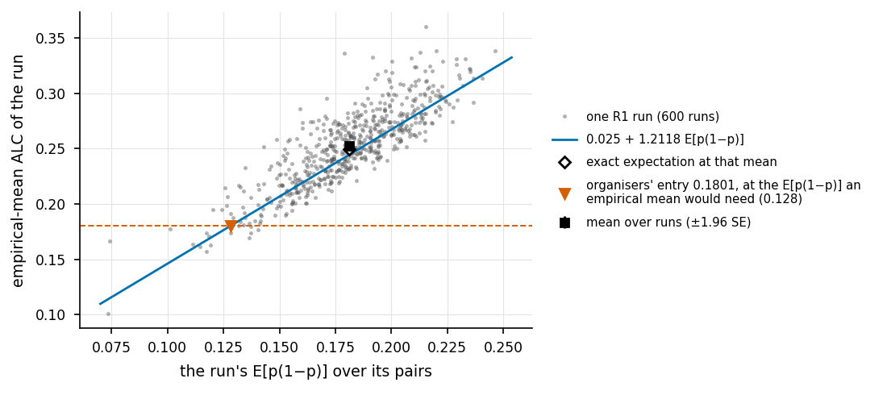

*Figure A1.* The empirical mean's ALC against the run's $\mathbb E[p(1-p)]$ for each of the 600 public R1 runs, with the analytic line $0.025 + 1.2118\,\mathbb E[p(1-p)]$, the mean over runs (0.2526) and the exact expectation at that mean (0.2496). The organisers' leaderboard entry (0.1801) is drawn at the $\mathbb E[p(1-p)]$ an empirical mean would need to score it (0.128). Of the replica's runs, 2.5% lie below it. That position is geometry only: on the hidden runs' own compositions an empirical mean scores 0.1801 or less with chances of 1.9%, 0% and 0.45% (runs 1 to 3), and the figure says nothing about what the entry is (App D.9).

## Appendix B: model, inference and run-time details

### B.1 The priors in full, inference details, fallbacks and floored fits

§5.1 states the model and its priors. In full, the prior of each component is (`paiec/hier.py`):

| term | meaning | prior |
|---|---|---|
| $\mu_b$ | the benchmark's level, shared by every subject's labels on it | $\mu_b \sim \mathcal N(\mu_0, \sigma_\mu^2)$, Gaussian; Student-t optional |
| $\theta_s$ | the subject's standing, keyed on its canonical name | Gaussian, mean $\gamma\,\hat\theta^{\mathrm{attr}}_s$ plus a capped identity term, variance from $\sigma_\theta$ and the attribute ridge ($\sigma_{\mathrm{attr}}$ in the ridge's place without an attribute prior); display below |
| $\delta_{sb}$ | the pair's own deviation | $\delta_{sb} \sim \mathcal N(0, \sigma_\delta^2)$ |
| $g_i$ | item_features group effects, one per key whose visible values are neither all numeric nor constant | $\mathcal N(0, \sigma_g^2)$, divided evenly over a benchmark's keys; group share of item variance $\sigma_g^2 / (\sigma_g^2 + \sigma_d^2)$, capped at 0.25 |
| $e_i$ | the item's own residual | $e_i \sim \mathcal N(0, \sigma_d^2)$, or $\mathcal N(0, \sigma_d^2 + \sigma_g^2)$ on a benchmark without item_features keys, integrated exactly per item; $\sigma_d^2 + \sigma_g^2$ is the median public item variance |
| $c_i$ | guessing floor: the guess weight $\omega$ times the multiple-choice floor $f_i$ read from the item text (`paiec/mcq.py`) | $c_i = \omega f_i$, fixed, $\omega = 0.5$ |

In the standing's prior, $\hat\theta^{\mathrm{attr}}_s$ is an attribute ridge's prediction of the standing (below), $u_s$ is the variance of that prediction from the ridge's coefficients, and $\gamma$ is the attribute scale. Its identity term carries the same name's standings on the public benchmarks into the prior, with a capped weight $w_s$:

$$
\theta_s \sim \mathcal N\big(\gamma\,\hat\theta^{\mathrm{attr}}_s + w_s\,\bar r_s,\ (1 - w_s)^2\,(\sigma_\theta^2 + u_s) + w_s^2\,v_s\big),
\qquad
w_s = \min\Big(\frac{\sigma_\theta^2 + u_s}{\sigma_\theta^2 + u_s + v_s},\ w_{\max}\Big)
$$

Here $\bar r_s$ is the mean attribute residual of the name's standings on the public benchmarks, and $v_s$ is its noise: the name's spread across benchmarks divided by the number of benchmarks behind $\bar r_s$. The cap is $w_{\max}$ (`id_cap`). A name with no public standing has $w_s = 0$. Without an attribute prior, the mean drops its attribute term, $\sigma_{\mathrm{attr}}^2$ takes the place of $u_s$, and $\bar r_s$ averages the raw standings (`paiec/hier.py`, `HierPredictor.theta_prior`).

A component that no label touched (a new benchmark, subject, pair, group or item) stays at its prior, and the predictive distribution integrates over it, so at budget 0 the prediction is the level prior plus the attribute prior, integrated. On the hidden runs that prediction cost LegacyP 0.0205 of its 0.0577 in run 1, as $0.1\,(B_0 - V)$; for hier-ship the $B_0$ term is 0.0057 and 0.0074 of 0.0130 and 0.0208 in runs 2 and 3, and most of its remaining loss is item level (§6.1, Table 1). <!-- src: results/hidden_runs.json decomposition.<run1|run2|run3>.{b0_term, alc_minus_v}; LegacyP's terms 0.0205, 0.0368, 0.0003 (Table D.6b) -->

All components are on the scale of an item-level (Rasch) model [Rasch 1960], on which we measured the public variance components, and hier fits them from `labeled` alone.

The offline prior (`paiec/prior.py`) fits one item-level model per public benchmark, $\operatorname{logit} \Pr(y_{si} = 1) = \mu_b + t_s - g_i - e_i$, on each subject's first recorded response per item, by Laplace-EM. Its standings $t_s$ feed an attribute ridge on provider, release date, model size, reasoning effort and a harness flag (`paiec/subjects.py`), and `fit_hyper` pools its levels, item variances and group shares into empirical-Bayes hyperparameters [Morris 1983], refitted LOPO in every experiment. <!-- src: report v2 §5.3 at v1.1.0, moved here on 2026-10-20 (fix-1); paiec/prior.py (the per-benchmark model, Laplace-EM, fit_hyper); paiec/subjects.py (the attribute columns: provider, log size, effort, harness flag, release date) -->

The shipped bundle, `submission/prior.json`, is fitted on all five public benchmarks with the level prior from `LEVEL` (F§ "Verdict: ship hier with the level moved down"). By their code names, the columns of the table below are `mu0`, `sigma_mu`, `attr_scale`, `sigma_theta`, `sigma_delta`, `sigma_attr`, `sigma_d`, `sigma_g`, `slip` and `guess`. In it, $\sigma_\theta$ is the sd of the identity link: the part of a subject's standing, beyond its attributes, that its benchmarks share.

| $\mu_0$ | $\sigma_\mu$ | $\gamma$ | $\sigma_\theta$ | $\sigma_\delta$ | $\sigma_{\mathrm{attr}}$ | $\sigma_d$ | $\sigma_g$ | $\varepsilon$ | $\omega$ |
|---|---|---|---|---|---|---|---|---|---|
| **-2.5** | **2.5** | **0.5** | 0.1 | 2.382 | 1.018 | 2.671 | 1.542 | 0.01 | 0.5 |

The three bold fields are LEVEL, the level prior we set for the hidden test (§5.3, App C.5); the rest are the empirical-Bayes fit [Morris 1983].

**Inference.** A joint mode over all effects is penalised quasi-likelihood [Breslow and Clayton 1993], biased with binary responses and large random effects [Rodríguez and Goldman 1995; Breslow and Lin 1995]. With the shipped item variance near 9.5 ($\sigma_d^2 + \sigma_g^2 = 2.671^2 + 1.542^2$) and one label per item, the item effects absorb each label: in a regression test at item variance 8.7, a pair with 160 of 200 successes is predicted at 0.70 on a new item under the joint mode and at about 0.8 once the residual is integrated (`tests/test_hier.py`). <!-- src: moved from §5.2 on 2026-10-20; tests/test_hier.py test_item_residual_is_integrated_not_maximised (160 of 200, item variance 8.7, the joint mode's 0.70 and the integrated 0.8, each asserted to within 0.01); the shipped widths: the table above -->

hier integrates each item's likelihood, the one-dimensional integral over its residual $e_i$, by adaptive Gauss-Hermite quadrature with 20 nodes [Liu and Pierce 1994; Pinheiro and Bates 1995], or by a fixed 201-node trapezoid on floored items (items with a multiple-choice floor $c_i$), whose integrand can be bimodal. Newton's method with a line search finds the mode of the joint log posterior of $\mathbf x$, all components except the item residuals.

The Laplace posterior [Tierney and Kadane 1986] of $\mathbf a^\top\mathbf x$, the part of the target's linear predictor that the labels inform, under-reacts to a pair's first labels by 0.013 to 0.02 in probability (`paiec/hier.py` docstring), because the mode of a skewed posterior sits nearer the prior than its mean. hier reads $\mathbf a^\top\mathbf x$ on a grid along the Gaussian conditional mean, with the exact log posterior at each point,

$$
\mathbf x(\zeta) = \hat{\mathbf x} + \boldsymbol\Sigma\mathbf a\,
\frac{\zeta - \mathbf a^{\top}\hat{\mathbf x}}{\mathbf a^{\top}\boldsymbol\Sigma\mathbf a}
$$

where $\hat{\mathbf x}$ is the mode and $\boldsymbol\Sigma$ the Laplace covariance. After this line read, $\mathbb{E}\big[\operatorname{logit}^{-1}(\eta_{si}) \mid \mathcal L\big]$ comes from a 171-node trapezoid, exact to $10^{-9}$. The line read is the Laplace strategy of the integrated nested Laplace approximation with its conditional-mean simplification [Rue, Martino and Chopin 2009, §3.2.2]; unlike that strategy, it leaves out the conditional Gaussian's normalising term. We state the line read as a correction of the under-reaction, not as an ALC gain: at LEVEL, on a fresh seed and at equal weights, removing it costs 0.0004 to 0.0007 in three test-like regimes, nothing in two, and gains 0.0007 and 0.0005 on public runs (App B.3). <!-- src: moved from §5.2 on 2026-10-20; paiec/hier.py module docstring (the under-reaction, 0.013 to 0.02; 20 Gauss-Hermite nodes); results/ablations_at_level.json summary.regimes.<R>.vs_ship.noline.equal.{D, cluster_se} -->

The read gives the exact marginal for one pair whose labelled items share the target item's group effects. Labelled items in other item_features groups, or other subjects on the benchmark, add components off the line, which move along their Gaussian conditional mean (their skew ignored), so in those cases the read is an approximation.

The test that checks the read against the exact posterior predictive for one pair, `test_laplace_error_at_low_budgets`, has no groups, no floor and no slip. The docstring of `paiec/hier.py` documents the remaining approximation error case by case, for other subjects on the benchmark and for benchmarks with floored items: on cases drawn from the model, the error moves Brier by about 0.001 at $B_1$ and by at most $10^{-4}$ from $B_7$ on. We have not measured the case of a single pair whose labelled items lie in other groups separately.

**Convergence.** Without floors the log posterior is concave and its mode is unique. A floored item's success term is not concave, so the negative Hessian that Newton's method inverts is shifted to positive definite when needed. Where Newton's method stops short on a posterior that holds a floored success, trust-region Newton from three starts settles the fit (`Problem._settle`, commit `4d2cc4f`; F§ "Floored fits"). Where Newton's method converges, this settling step changes nothing, bit for bit. We count the fits that are still unconverged after it.

**Fallbacks of the offline prior.** When the included benchmarks cannot identify a hyperparameter, it falls back to a fixed `REFERENCE` value that no fit went into. For example, $\mu_0 = 0$ when fewer than three levels are available.

**The identity link, in full.** The variance that a named model's attribute residuals share across benchmarks, $\tau^2_{\mathrm{res}}$, is estimated at -0.002 on the public data and clipped to [0.01, 0.2]. That puts the identity-link sd $\sigma_\theta$ at its floor of 0.1 and the link weight across benchmarks at 0.0018 (`paiec/hier.py` docstring). The estimator is biased downward, because the ridge that predicts a name's standing on one benchmark was fitted without that benchmark but saw the same name's standings on the others, and that pulls the name's residuals on two benchmarks apart. Until we correct the estimator and measure again, two things are provisional: the conclusion that the identity link adds almost nothing beyond the attributes, and the small link weight that the estimate sets (F§ "The step-2 analyses behind the model").

### B.2 Run-time engineering and the build checks

- `predict` is a pure function of `(input, labeled)`, and its fits are cached under a content fingerprint of `labeled`. Items and subjects are keyed on digests of all their visible fields, because the official input carries no ids and text prefixes collide.
- The predictor never raises an exception. A failed fit falls back to the prediction without labels and then to 0.5, and an unusable `prior.json` falls back to the level prior without a subject prior.
- The archive ships `model.py`, `prior.json` and the run-time modules renamed to `paiec_rt/`, so that no platform-side `paiec` can shadow them. Shipped code imports only the standard library and numpy at module level, and BLAS is held to one thread at run time.
- `tools/build_submission.py` writes the archive only if all of the following hold, and fails otherwise:
  - a fresh interpreter loads `model.py` the way the validator does and predicts real items in the official format at every budget, with a fresh predictor per budget;
  - those predictions match the in-repository predictor bit for bit;
  - no fallback fires and no heavy library loads;
  - the organisers' validator prints OK.

### B.3 Ablations at LEVEL (S4), and of hier-fit before it

S4 scored hier-ship's neighbours at its own level prior, LEVEL ($\mu_0 = -2.5$, $\sigma_\mu = 2.5$, $\gamma = 0.5$), on a regime-sensitivity seed that no earlier study had used. The plan declared S4 no-ship before any of its runs was drawn: a configuration that the RS rule of App C.2 lists as a candidate is reported as one that would pass, and nothing ships (plan section 3). The lock that pins the plan's S4 row, LEVEL and the script's constants was fixed at 2026-10-06T14:12:18Z. The rule was applied once, at 2026-10-06T18:45:45Z, to the complete set of runs (`experiments/ablations_at_level.py`, `results/ablations_at_level.json`). <!-- src: results/ablations_at_level.json lock.fixed_at_utc, lock.checks.{seed_fresh, level_is_shipped, s4_row_sha256}, lock.s4_reading, rule.applied_utc, summary.complete -->

**Runs and configurations.** S4 uses the RS study's seven regimes and run counts: 80 runs in each test-like regime and 60 per public weighting, 520 tasks in all, with split scope 'pair', at seed 20261006. <!-- src: results/ablations_at_level.json plan.{seed, n_runs, split_scope}; lock.checks.regimes_are_p1as; 520 = 5 x 80 + 2 x 60, derived from plan.n_runs --> It scores 16 configurations on identical checkpoints: hier-ship; LegacyP, which the rule's condition 4 (App C.2) and a consistency check need; the nine configurations of the plan's S4 list; and five definitions taken from the pilots that motivated S4. <!-- src: results/ablations_at_level.json plan.{configs, s4_list, references, pilot_family} --> The test-like regimes realise mean pair logits of -1.20 (TUNED), -1.07 (AUDIT), -0.63 (MIXTURE and READING) and -0.27 (FLAT). Each lies within the RS study's realisation tolerance, 0.3 on the mean and on the sd, of what the same knobs realise on the RS study's calibration seed (App C.1). <!-- src: results/ablations_at_level.json summary.regimes.{TUNED, AUDIT, MIXTURE, READING, FLAT}.realised.mean; regimes.checks.<R>.{mean, sd}.{tol, ok}; regimes.tolerance_note --> AUDIT realises a lower level here than at the RS study's seed 11 (-0.93). <!-- src: results/regime_sensitivity.json summary.realised.AUDIT.mean --> On the last planned run of each regime, the script reproduces the RS study's stored seed-11 rows for hier-ship, hier-ship σ3.5, hier-ship σ5, hier-EB on hier-ship and LegacyP with a largest Brier difference of 0, on the RS study's library. <!-- src: results/ablations_at_level.json reproduce.{ok, tasks, configs}, reproduce.checks[*].library_equal, reproduce.checks[*].per_config.*.max_abs_brier -->

**Two readings of the pair-deviation width.** The plan's "$\sigma_\delta \times 0.85$, $\times 0.7$ and $\times 0.5$" can be read in two ways, and S4 scores both. In the repository's convention, the one of the hier-fit table below, a factor multiplies the leave-one-parent-out fit of $\sigma_\delta$, which differs by held-out parent: 1.697 with matharena held out, 2.958 with multi_swebench, 2.415 with real_webagents, 2.564 with researchcodebench and 2.382 with swe_rebench. <!-- src: results/ablations_at_level.json calib.hypers_per_parent.ship.<parent>.sigma_delta --> The pilots instead set $\sigma_\delta$ to the absolute values 2.025, 1.667 and 1.191 for every parent. These are 0.85, 0.7 and 0.5 times 2.382, the fit on all five public benchmarks, the scored parent included. <!-- src: results/ablations_at_level.json plan.{sd_all_public, sd_factors, sd_abs} --> So $\sigma_\delta = 2.025$ is not a uniform narrowing: it widens matharena's value by a factor of 1.19 and narrows the others' by 0.68 to 0.85 (derived). <!-- src: derived, plan.sd_abs[0] / calib.hypers_per_parent.ship.<parent>.sigma_delta (2.025 / 1.697 = 1.19; 2.025 / 2.958 = 0.68; 2.025 / 2.382 = 0.85) --> It is also not fitted leave one parent out (§4.2). We report the absolute rows as the pilots' definitions, scored on a fresh seed. The rule is applied to them as to every row, but their value saw the scored parent.

Two rows also move $\mu_0$ so that the mean $B_0$ prediction stays at hier-ship's: $\mu_0 = -2.4715$ with $\sigma_\delta \times 0.85$, and $\mu_0 = -2.489$ with $\sigma_\delta = 2.025$. <!-- src: results/ablations_at_level.json plan.mu0_mp.{x, abs} --> Both values were set from budget-0 predictions alone on the RS study's seed-11 runs 0 to 11 of TUNED, READING and AUDIT. There, both rows' mean $B_0$ prediction lies within $3.4 \times 10^{-6}$ of hier-ship's 0.4145. <!-- src: results/ablations_at_level.json calib.runs, calib.mean_b0.ship, calib.fixed_configs_mean_b0.{sd_x085_mp, sd085_abs_mp}.minus_ship -->

**Weights.** Equal weights are the RS study's statistics: each pair counts once in its run's mean. <!-- src: results/ablations_at_level.json summary.checks.equal_weights_are_p1as_statistics --> Hidden-$V$ weights reweight the appearances of a regime so that their shares in three bins of $V$, cut at 0.10 and 0.20, match the formative runs' shares: 5, 12 and 9 of the 26 appearances, with $V = B_0 - \mathrm{ECE}_0^2$ read from the organisers' tables (exact for run 1, estimated at $B_0$ for runs 2 and 3, §3.1). <!-- src: results/ablations_at_level.json summary.hidden_v.{bins, counts, definition}; exact for run 1 and estimated for runs 2 and 3: sec3 §3.1, results/hidden_runs.json identity.run1, replica.validation_summary.b0_bias_range --> The test-like regimes hold 28% to 42% of their appearances below $V = 0.10$, against 19% on the hidden runs. <!-- src: results/ablations_at_level.json summary.regimes.<R>.hidden_v.replica_share[0] (0.278 to 0.416 over the five test-like regimes); summary.hidden_v.shares[0] (0.192) --> The weights use only those three counts from the tables and read no id. They are descriptive and choose nothing (App G.6), and the rule reads the equal weights. <!-- src: results/ablations_at_level.json summary.hidden_v.source; rule.table.<config>.conditions.a.<R>.D equals summary.regimes.<R>.vs_ship.<config>.equal.D -->

| configuration minus hier-ship, equal weights, ALC (cluster SE) | TUNED (-1.20) | AUDIT (-1.07) | MIXTURE (-0.63) | READING (-0.63) | FLAT (-0.27) | R1-bf (-0.61) | R1-pu (-0.60) |
|---|---|---|---|---|---|---|---|
| hier-ship, ALC | 0.1698 | 0.1594 | 0.1877 | 0.1856 | 0.1738 | 0.2125 | 0.1992 |
| LegacyP | +0.0395 (0.0035) | +0.0365 (0.0045) | +0.0260 (0.0040) | +0.0252 (0.0037) | +0.0180 (0.0042) | +0.0007 (0.0023) | +0.0012 (0.0017) |
| $\sigma_\delta \times 0.85$ | -0.0002 (0.0001) | +0.0000 (0.0001) | -0.0002 (0.0001) | -0.0002 (0.0001) | +0.0001 (0.0002) | -0.0003 (0.0002) | -0.0003 (0.0001) |
| $\sigma_\delta \times 0.7$ | -0.0002 (0.0002) | +0.0002 (0.0003) | -0.0003 (0.0003) | -0.0002 (0.0002) | +0.0004 (0.0003) | -0.0004 (0.0004) | -0.0005 (0.0003) |
| $\sigma_\delta \times 0.5$ | -0.0001 (0.0003) | +0.0006 (0.0004) | -0.0000 (0.0005) | -0.0001 (0.0004) | +0.0009 (0.0005) | +0.0001 (0.0008) | -0.0002 (0.0005) |
| Laplace fit without the line | +0.0004 (0.0002) | +0.0007 (0.0002) | +0.0000 (0.0002) | +0.0001 (0.0002) | +0.0005 (0.0002) | -0.0007 (0.0002) | -0.0005 (0.0001) |
| $\sigma_\delta \times 0.7$, without the line | +0.0003 (0.0003) | +0.0010 (0.0004) | -0.0001 (0.0004) | -0.0000 (0.0003) | +0.0010 (0.0004) | -0.0008 (0.0006) | -0.0007 (0.0003) |
| $\sigma_\delta \times 0.85$, $\mu_0 = -2.4715$ | -0.0001 (0.0001) | +0.0001 (0.0001) | -0.0002 (0.0001) | -0.0002 (0.0001) | +0.0001 (0.0001) | -0.0004 (0.0002) | -0.0004 (0.0001) |
| hier-ship σ3.5 | +0.0005 (0.0003) | -0.0005 (0.0004) | +0.0006 (0.0005) | +0.0002 (0.0003) | -0.0011 (0.0004) | +0.0018 (0.0005) | +0.0003 (0.0003) |
| hier-ship σ5 | +0.0020 (0.0006) | +0.0002 (0.0008) | +0.0024 (0.0009) | +0.0016 (0.0007) | -0.0011 (0.0009) | +0.0047 (0.0010) | +0.0015 (0.0007) |
| hier-EB on hier-ship | -0.0009 (0.0004) | -0.0005 (0.0004) | +0.0006 (0.0003) | +0.0005 (0.0004) | +0.0000 (0.0004) | +0.0010 (0.0004) | +0.0010 (0.0003) |
| $\sigma_\delta = 2.025$ | -0.0003 (0.0002) | -0.0003 (0.0002) | -0.0006 (0.0002) | -0.0004 (0.0002) | -0.0007 (0.0002) | -0.0009 (0.0002) | -0.0007 (0.0002) |
| $\sigma_\delta = 1.667$ | -0.0003 (0.0003) | -0.0001 (0.0003) | -0.0006 (0.0003) | -0.0004 (0.0002) | -0.0003 (0.0003) | -0.0009 (0.0004) | -0.0009 (0.0003) |
| $\sigma_\delta = 1.191$ | -0.0001 (0.0004) | +0.0005 (0.0004) | -0.0002 (0.0004) | -0.0001 (0.0004) | +0.0005 (0.0005) | -0.0002 (0.0008) | -0.0006 (0.0004) |
| $\sigma_\delta = 1.667$, without the line | +0.0002 (0.0004) | +0.0007 (0.0004) | -0.0004 (0.0004) | -0.0001 (0.0003) | +0.0004 (0.0004) | -0.0013 (0.0005) | -0.0011 (0.0003) |
| $\sigma_\delta = 2.025$, $\mu_0 = -2.489$ | -0.0003 (0.0002) | -0.0003 (0.0002) | -0.0006 (0.0002) | -0.0004 (0.0002) | -0.0007 (0.0002) | -0.0009 (0.0002) | -0.0008 (0.0002) |

Source: `experiments/ablations_at_level.py`, `results/ablations_at_level.json`, `summary.regimes.<R>.vs_ship.<config>.equal.{D, cluster_se}`; hier-ship's ALC from `summary.regimes.<R>.configs.ship.ALC`; realised mean pair logit in brackets from `summary.regimes.<R>.realised.mean`. Rows after hier-ship's are, in the file, `legacy`, `sd_x085`, `sd_x07`, `sd_x05`, `noline`, `sd_x07_noline`, `sd_x085_mp`, `wide35`, `wide50`, `eb_ship`, `sd085_abs`, `sd07_abs`, `sd05_abs`, `sd07_abs_noline` and `sd085_abs_mp`. Positive: hier-ship is better. Seed 20261006; 80 runs per test-like regime and 60 per public weighting; split scope 'pair'. A $\sigma_\delta \times k$ row scales the leave-one-parent-out fit; a $\sigma_\delta = x$ row fixes the value for every parent. <!-- src: results/ablations_at_level.json summary.regimes.<R>.vs_ship.<config>.equal.{D, cluster_se}, summary.regimes.<R>.configs.ship.ALC, summary.regimes.<R>.realised.mean, plan.{seed, n_runs, split_scope} -->

| configuration minus hier-ship, hidden-$V$ weights, ALC (cluster SE) | TUNED (-1.20) | AUDIT (-1.07) | MIXTURE (-0.63) | READING (-0.63) | FLAT (-0.27) | R1-bf (-0.61) | R1-pu (-0.60) |
|---|---|---|---|---|---|---|---|
| LegacyP | +0.0359 (0.0034) | +0.0297 (0.0036) | +0.0270 (0.0042) | +0.0240 (0.0035) | +0.0162 (0.0036) | +0.0022 (0.0027) | +0.0011 (0.0020) |
| $\sigma_\delta \times 0.85$ | -0.0004 (0.0001) | -0.0002 (0.0001) | -0.0002 (0.0001) | -0.0002 (0.0001) | -0.0000 (0.0001) | -0.0003 (0.0003) | -0.0002 (0.0001) |
| $\sigma_\delta \times 0.7$ | -0.0006 (0.0002) | -0.0002 (0.0002) | -0.0003 (0.0003) | -0.0004 (0.0002) | +0.0000 (0.0003) | -0.0002 (0.0005) | -0.0003 (0.0003) |
| $\sigma_\delta \times 0.5$ | -0.0007 (0.0003) | -0.0001 (0.0003) | -0.0001 (0.0005) | -0.0003 (0.0004) | +0.0003 (0.0004) | +0.0005 (0.0009) | +0.0001 (0.0005) |
| Laplace fit without the line | -0.0000 (0.0001) | +0.0001 (0.0001) | -0.0001 (0.0002) | -0.0000 (0.0001) | +0.0001 (0.0001) | -0.0004 (0.0002) | -0.0003 (0.0001) |
| $\sigma_\delta \times 0.7$, without the line | -0.0005 (0.0003) | +0.0000 (0.0003) | -0.0002 (0.0004) | -0.0002 (0.0003) | +0.0003 (0.0003) | -0.0004 (0.0006) | -0.0004 (0.0003) |
| $\sigma_\delta \times 0.85$, $\mu_0 = -2.4715$ | -0.0003 (0.0001) | -0.0001 (0.0001) | -0.0002 (0.0001) | -0.0002 (0.0001) | -0.0001 (0.0001) | -0.0003 (0.0003) | -0.0003 (0.0001) |
| hier-ship σ3.5 | +0.0010 (0.0002) | +0.0004 (0.0003) | +0.0008 (0.0004) | +0.0004 (0.0003) | -0.0004 (0.0004) | +0.0018 (0.0006) | +0.0002 (0.0005) |
| hier-ship σ5 | +0.0032 (0.0005) | +0.0020 (0.0006) | +0.0028 (0.0009) | +0.0019 (0.0006) | +0.0005 (0.0007) | +0.0046 (0.0013) | +0.0012 (0.0009) |
| hier-EB on hier-ship | -0.0002 (0.0004) | +0.0002 (0.0003) | +0.0007 (0.0003) | +0.0008 (0.0004) | +0.0005 (0.0004) | +0.0013 (0.0006) | +0.0008 (0.0003) |
| $\sigma_\delta = 2.025$ | -0.0006 (0.0002) | -0.0005 (0.0001) | -0.0006 (0.0002) | -0.0004 (0.0002) | -0.0006 (0.0002) | -0.0013 (0.0003) | -0.0009 (0.0002) |
| $\sigma_\delta = 1.667$ | -0.0008 (0.0002) | -0.0005 (0.0002) | -0.0006 (0.0003) | -0.0005 (0.0002) | -0.0005 (0.0003) | -0.0011 (0.0005) | -0.0009 (0.0003) |
| $\sigma_\delta = 1.191$ | -0.0008 (0.0003) | -0.0002 (0.0003) | -0.0003 (0.0005) | -0.0003 (0.0004) | +0.0000 (0.0004) | -0.0003 (0.0009) | -0.0005 (0.0004) |
| $\sigma_\delta = 1.667$, without the line | -0.0006 (0.0003) | -0.0003 (0.0003) | -0.0005 (0.0004) | -0.0004 (0.0003) | -0.0002 (0.0003) | -0.0013 (0.0006) | -0.0011 (0.0003) |
| $\sigma_\delta = 2.025$, $\mu_0 = -2.489$ | -0.0005 (0.0002) | -0.0005 (0.0001) | -0.0006 (0.0002) | -0.0004 (0.0002) | -0.0007 (0.0002) | -0.0013 (0.0003) | -0.0009 (0.0002) |

Source: as the table above, `summary.regimes.<R>.vs_ship.<config>.hidden_v.{D, cluster_se}`, with the same bootstrap resamples. Descriptive only: the weights come from the counts 5, 12 and 9 of formative appearances in three bins of $V$ (`summary.hidden_v`), and the rule does not read them. hier-ship's ALC under these weights is not stored. <!-- src: results/ablations_at_level.json summary.regimes.<R>.vs_ship.<config>.hidden_v.{D, cluster_se}; summary.hidden_v.counts -->

**The pair-deviation width sits on a flat optimum in the repository's convention.** Every row of the factor reading, with or without the line and with the mean-preserving $\mu_0$, lies within 0.001 of hier-ship under both weightings. <!-- src: results/ablations_at_level.json summary.regimes.<R>.vs_ship.{sd_x085, sd_x07, sd_x05, sd_x07_noline, sd_x085_mp}.{equal, hidden_v}.D (all within -0.00082 to +0.00098) --> Under equal weights the sign of the three plain narrowings depends on the regime: they are behind hier-ship in AUDIT and FLAT, by up to 0.0009, and ahead or level elsewhere, by up to 0.0005. Under hidden-$V$ weights they are ahead or level in most regimes, by up to 0.0007. <!-- src: results/ablations_at_level.json summary.regimes.<R>.vs_ship.{sd_x085, sd_x07, sd_x05}.equal.D (AUDIT and FLAT +0.00004 to +0.00088; elsewhere -0.00046 to +0.00015); .hidden_v.D (-0.00072 to +0.00048) --> The absolute reading behaves differently. $\sigma_\delta = 2.025$ is ahead of hier-ship in every regime under both weightings, by 0.0003 to 0.0013 (cluster SE 0.0001 to 0.0003), and $\sigma_\delta = 1.667$ is ahead or level in every regime. <!-- src: results/ablations_at_level.json summary.regimes.<R>.vs_ship.sd085_abs.{equal, hidden_v}.{D, cluster_se} (D -0.00126 to -0.00031; SE 0.00014 to 0.00028); summary.regimes.<R>.vs_ship.sd07_abs.{equal, hidden_v}.D (-0.00114 to -0.00005) --> Keeping the mean $B_0$ prediction at hier-ship's moves either reading by at most 0.0001 (derived), so neither gain comes from a shift of the level. <!-- src: derived, max over regimes and weights of |sd_x085_mp - sd_x085| (0.00011) and |sd085_abs_mp - sd085_abs| (0.00005), from summary.regimes.<R>.vs_ship.<config>.{equal, hidden_v}.D --> In READING and AUDIT, where the rule asks for a gain of 0.002, the absolute gain stays well below it, and its value was fitted with the scored parent in view. <!-- src: results/ablations_at_level.json rule.thresholds.gain (0.002); summary.regimes.{READING, AUDIT}.vs_ship.sd085_abs.{equal, hidden_v}.D (-0.00031 to -0.00055) -->

**The line read changes ALC by less than 0.001 in every regime, with a sign that depends on the regime and the weights.** Under equal weights the Laplace fit without the line is behind hier-ship by 0.0004 to 0.0007 in TUNED, AUDIT and FLAT (cluster SE 0.0002), level in MIXTURE and READING, and ahead by 0.0007 and 0.0005 on R1-bf and R1-pu. Under hidden-$V$ weights it is within 0.0002 of hier-ship in every test-like regime and ahead by 0.0004 and 0.0003 on public runs. <!-- src: results/ablations_at_level.json summary.regimes.<R>.vs_ship.noline.{equal, hidden_v}.{D, cluster_se} --> In the table of hier-fit's options below, from before LEVEL, the Laplace fit without the line was ahead of hier-fit on public R1-bf runs by 0.0007 (0.0003), as it is ahead of hier-ship on R1-bf here. <!-- src: results/hier_eval.json r1."benchmark/pair".diffs."hier -line".hier.{diff, cluster_se} --> We therefore state the line read as a correction of the Laplace posterior's under-reaction to a pair's first labels (§5.2, App B.1), not as an ALC gain. Without the line a call takes 0.59 times hier-ship's time. <!-- src: results/ablations_at_level.json summary.latency.all.noline.ratio_to_ship -->

**Wider level priors and the empirical-Bayes level do not do better.** hier-ship σ3.5 stays within 0.0018 of hier-ship and is ahead only in AUDIT and FLAT, by 0.0005 and 0.0011. hier-ship σ5 is behind by 0.0015 to 0.0047 in five of the seven regimes and ahead only in FLAT, by 0.0011 (0.0009). hier-EB on hier-ship is ahead in TUNED and AUDIT, by 0.0009 and 0.0005 (cluster SE 0.0004), and behind by 0.0010 on both public weightings. <!-- src: results/ablations_at_level.json summary.regimes.<R>.vs_ship.{wide35, wide50, eb_ship}.equal.{D, cluster_se} --> The RS study scored these three and LegacyP on seed 11 (App E.2). Between the two seeds their differences from hier-ship move by at most 0.0011, 0.0022, 0.0007 and 0.0052 (derived). The largest move is LegacyP's in AUDIT, which realises -1.07 here and -0.93 at seed 11. <!-- src: derived, max over regimes of |summary.regimes.<R>.vs_ship.<config>.equal.D - summary.regimes.<R>.vs_ship.<config>.seed11.D| for wide35, wide50, eb_ship, legacy (0.00107, 0.00217, 0.00067, 0.00516); summary.regimes.AUDIT.realised.mean; results/regime_sensitivity.json summary.realised.AUDIT.mean -->

**Against LegacyP, the gain shrinks as the realised level rises, as at seed 11.** It is 0.0395 in TUNED, 0.0365 in AUDIT, 0.0260 in MIXTURE, 0.0252 in READING and 0.0180 in FLAT. On public runs LegacyP minus hier-ship is +0.0007 (0.0023) and +0.0012 (0.0017). <!-- src: results/ablations_at_level.json summary.regimes.<R>.vs_ship.legacy.equal.{D, cluster_se} --> TUNED's -0.0395 (0.0035) for hier-ship minus LegacyP is consistent with -0.0415 (0.0034) on TL runs 0 to 299 (App E.2), at $z = 0.40$, inside the check's bound of 3. <!-- src: results/ablations_at_level.json summary.tuned_consistency.{ship_minus_legacy, cluster_se, known, known_se, z, k, ok} -->

**No configuration passes the rule, and nothing ships.** <!-- src: results/ablations_at_level.json rule.{outcome, candidates, would_pass, shipped} --> We number the rule's conditions as App C.2 does. The results file letters those five (a) to (e) and adds (f): every reproduction and realisation check passed and every planned run was scored. <!-- src: experiments/regime_sensitivity.py RULE_TEXT (a) to (f), which experiments/ablations_at_level.py imports; results/ablations_at_level.json rule.table.<config>.conditions.f --> The closest are $\sigma_\delta = 2.025$, its mean-preserving twin and $\sigma_\delta = 1.667$. Each fails only condition 1: it gains 0.0004 in READING and 0.0001 to 0.0003 in AUDIT, against the 0.002 with $U_{95} < 0$ that the rule asks in both. <!-- src: results/ablations_at_level.json rule.table.{sd085_abs, sd085_abs_mp, sd07_abs}.{holds, conditions.a.READING.{D, U95}, conditions.a.AUDIT.{D, U95}}; rule.thresholds.gain --> Every row of the factor reading also fails condition 2 in AUDIT, where its parent-level mean is not negative. <!-- src: results/ablations_at_level.json rule.table.{sd_x085, sd_x07, sd_x05, sd_x085_mp, sd_x07_noline}.conditions.b.AUDIT.{PL, ok} --> Every configuration meets the time condition, condition 5: its mean time per call is 0.55 to 1.22 times hier-ship's 0.97 ms, and the slowest call of any configuration took 1.25 s (LegacyP). <!-- src: results/ablations_at_level.json summary.latency.all.<config>.{ratio_to_ship, mean_ms, max_s}; rule.table.<config>.holds.e -->

**For a pair alone on its benchmark, the two widths act through the sum of their variances.** Without other pairs on $b$ in `labeled`, $\mu_b$ and $\delta_{sb}$ enter that pair's likelihood only through their sum, so only $\mu_b + \delta_{sb}$ is identified. Its prior is

$$
\mu_b + \delta_{sb} \sim \mathcal N\big(\mu_0,\ \sigma_\mu^2 + \sigma_\delta^2\big)
$$

so for such a pair a change of $\sigma_\delta^2$ acts on that pair's prior exactly as an equal change of $\sigma_\mu^2$. At the platform's composition 16 of the 26 formative appearances are alone on their benchmark (App A.2). <!-- src: results/pooling_decomposition.json platform_mix.counts.{alone, two} -->

S4 was declared no-ship before it was scored, and it changed nothing in archive-3 (plan section 3). Amendment 4's evaluation on the expanded pool carried no candidate past selection, so the final archive is archive-3 and S4 describes its configuration (§7, App C.6). <!-- src: results/pool_eval.json selection.outcome -->

**Before LEVEL: hier-fit's options.**

We scored each option alone against hier-fit's default on the same public R1-bf runs, with split scope 'pair' (the primary setting), before the level calibration. The table lists all sixteen comparisons: twelve ablations and four width sensitivities.

| option | runs | minus default (run / cluster / stratified SE) | where it acts |
|---|---|---|---|
| attribute prior off | 150 | +0.0039 ± 0.0003 / 0.0009 / 0.0008 | $B_0$ to $B_3$ |
| feature groups off | 150 | +0.0017 ± 0.0002 / 0.0003 / 0.0003 | $B_7$ to $B_{31}$ |
| level pooling off (a level per pair) | 150 | +0.0012 ± 0.0003 / 0.0004 / 0.0004 | $B_1$, $B_3$ |
| level centre 0 instead of the training mean | 150 | +0.0011 ± 0.0003 / 0.0007 / 0.0006 | ±0.004 per benchmark |
| pair deviation off | 150 | +0.0001 ± 0.0001 / 0.0001 / 0.0001 | |
| identity link off, or relinked at link weight 0.1 / 0.3 (three options) | 100 | 0.0000 to -0.0001 ± 0.0000 / 0.0000 / 0.0000 | |
| hard floor ($\omega = 1$; default $\omega = 0.5$) | 150 | +0.0001 ± 0.0000 / 0.0000 / 0.0000 | |
| text term on | 100 | +0.0002 ± 0.0001 / 0.0001 / 0.0001 | 5.3 ms per call |
| Student-t level ($\nu = 3$) | 100 | -0.0005 ± 0.0001 / 0.0002 / 0.0001 | 18.9 ms per call |
| Laplace fit without the line | 150 | -0.0007 ± 0.0001 / 0.0003 / 0.0001 | $B_1$, $B_3$ |
| $\sigma_\mu \times 0.5$ | 100 | -0.0021 ± 0.0003 / 0.0008 / 0.0004 | $B_1$, $B_3$; swe_rebench -0.0068 |
| $\sigma_\mu \times 2$ | 100 | +0.0049 ± 0.0004 / 0.0015 / 0.0005 | $B_1$, $B_3$ |
| $\sigma_\delta \times 0.5$ | 100 | -0.0004 ± 0.0003 / 0.0007 / 0.0006 | |
| $\sigma_\delta \times 2$ | 100 | +0.0060 ± 0.0004 / 0.0013 / 0.0008 | $B_1$, $B_3$ |

Source: F§ "Ablations and sensitivities", `experiments/hier_eval.py`. The last column names the budgets or benchmarks where an option acts; for the text term and the Student-t level it gives their cost, the time per call.

On public runs the attribute prior, the feature groups and the pooled level each help. A narrower level prior, the Student-t level and the Laplace fit without the line beat the default by more than two cluster SEs. None of the three clears a two-sided Bonferroni bar for sixteen comparisons on the cluster SE, and all three clear it on the stratified SE. Each of them makes the model react less to a run's first labels. The deliberately widened level prior costs about 0.002 on public runs. App C.5 explains why we kept it, and S4 above scores the wider level priors again at LEVEL.

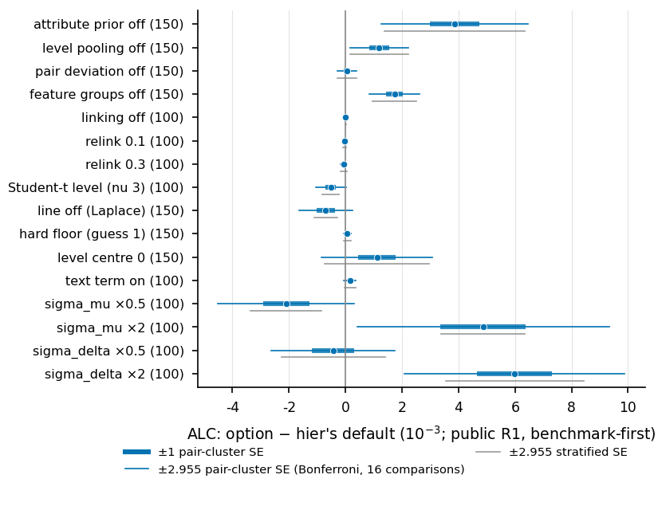

*Figure B1.* Each of hier-fit's sixteen options alone minus hier-fit, on R1-bf runs, with ±1 cluster SE (the legend's "pair-cluster SE"). The figure also marks the two-sided Bonferroni bar for sixteen comparisons (±2.955 SEs), on the cluster SE and on the stratified SE. A narrower level prior, the Student-t level and the Laplace fit without the line beat hier-fit by more than two cluster SEs. None of them clears the Bonferroni bar on the cluster SE, and all three clear it on the stratified one. In the figure, "line off (Laplace)" is the Laplace fit without the line, and "relink" sets the link weight of the identity link. These options were measured on hier-fit, before the level calibration.

### B.4 The corrected multiple-choice floor

The corrected floor reads "(A, B, C, D, or E)" lists and ignores TikZ point labels. It lowers ALC by 0.00026 ± 0.00003 / 0.00008 (run / cluster SE) on test-like runs and by 0.00027 to 0.00045 on public runs, all of it on matharena at $B_0$ and $B_1$ (F§ "The multiple-choice floor, corrected", `experiments/mcq_floor.py`). We measured it on the harness's legacy rows, with hier's solver as it was before the floored-fit fix.

We adopted the corrected floor in the library. On 2026-09-27 we rebuilt the archive with it and with the floored-fit fix (archive-3, sha256 `4a882cc7…`, the final submission). The validator printed OK, the run check was bit-identical, and `prior.json` was byte-identical to the previous build. Formative run 2 used the earlier archive, archive-2, and run 3 used the rebuilt one (App D.1).

### B.5 Cost in full

A formative run makes about 3,000 evaluation calls, which take a few seconds against the 8-hour limit. The pooling study measured hier's worst case, dense multi_swebench and matharena, with about 2,500 labelled entries at $B_{31}$. The table gives the mean time per evaluation call and the slowest single call, by study.

| study | model | runs | processes | mean time per call | slowest single call | LegacyP's slowest call |
|---|---|---|---|---|---|---|
| subject-side study | hier-ship | subject-side runs | two | 0.80 to 1.04 ms | 0.16 to 0.31 s | |
| level calibration | hier-rec | test-like; public | six | 0.75 ms; 0.88 ms | 0.45 s | |
| level calibration | hier-rec | dense real_webagents and researchcodebench | six | 2.0 to 2.4 ms | at most 0.16 s | |
| regime-sensitivity (RS) study | hier-ship, current library | 520 runs | two | 1.34 ms | 0.56 s | 1.86 s |
| RS study | both hier-EB variants | the same tasks | two | 1.18 to 1.19 times hier-ship's | | |
| pooling study | hier-ship | dense multi_swebench; dense matharena | one | 3.1 to 4.6 ms; 7.5 to 9.4 ms | 0.39 s | 1.44 s |

Sources, one per study in the table's order: F§ "Subject side at budgets 0 and 1", Latency; F§ "Calibrating for the hidden test", Latency; F§ "Regime sensitivity at the feedback's reading", Latency; F§ "Pooling under the verified protocol". The subject-side, RS and pooling times were taken on a shared machine. No fallback fired in the RS study.

The floored-fit fix changes the time per call by -0.2% to +0.2% on public runs (F§ "Floored fits", Latency).

The subject-side study's 0.80 to 1.04 ms per call (run-2 library) and the RS study's 1.34 ms (archive-3 library) come from separate measurements; the fix's -0.2% to +0.2% does not account for the gap between them. Two later checks timed archive-3's code again: S4 at a mean of 0.97 ms per call for hier-ship on its own seed (App B.3), and S3 through the organisers' loader at summative scale (App B.8). <!-- src: results/ablations_at_level.json summary.latency.all.ship.mean_ms; results/stress_archive.json gate.pooled -->

In the baseline study the 1PL takes 0.72 to 0.81 ms per call, with a slowest call of 0.13 to 0.18 s, on one process of a shared machine. hier-ship's 1.2 to 1.5 ms per call on the same runs was timed in the RS study's tasks rather than in the 1PL's, so the ratio of about 1.7 to 1.9 compares times across tasks (derived; F§ "Baselines: a plain 1PL, the organisers' empirical mean and BLE", Cost; `results/baselines_p1.json`, `summary.regimes.<R>.configs`).

### B.6 Library defects

Two defects in our code are reported and not fixed, and a third was fixed in archive-3.

`fitting.fit_ab`, LegacyP's fit, diverges when its prior sits far from the labels, which happens on 5 of 1,598 test-like pair appearances. We reported this library bug in F§ "fit_ab diverges when the prior is far from the labels" and have not fixed it.

`testlike.item_oracle`, which we also reported and left unfixed, oscillates on 35 of 2,425 test-like pair appearances, all of them on difficulty strata (689 appearances). On strata the oscillation understated the item oracle: it gained 14.5% of the pair-rate oracle's Brier instead of 32.7%.

The floored Newton fit of hier could stop unconverged. This happened in 11 of 3,030 floored fits on 400 public runs, and one of them collapsed (pair-uniform run 108). Commit `4d2cc4f` fixes it (`Problem._settle`). With the fix no fit is left unconverged, and the mean prediction for run 108's pair at $B_{31}$ goes from 0.217 to 0.770, against an observed success rate of 0.669 (F§ "Floored fits", `results/hier_floor.json`). The fix and the corrected floor went into archive-3, the archive rebuilt on 2026-09-27 (sha256 `4a882cc7…`) and the final submission. The numbers for hier-ship in App E.2's confirmation table and App E.7 come from the earlier archive's code, except the regimes re-measured at `4d2cc4f` (App H.2).

### B.7 S1: hier against the exact posterior predictive at dense budgets 1 and 3

**The question.** On dense real_webagents with per-pair splits, hier pools other subjects' first labels at a cost of +0.015 ± 0.010 of Brier at $B_1$, against hier fed only the pair's own labels (F§ "Pooling under the verified protocol", subsection "Dense runs per benchmark, and hier's cost there"). <!-- src: results/pooling_decomposition.json dense.real_webagents.pair.comparisons."ship - ship_own".budgets[1].{mean, se} --> The plan put this as a question about the second-order term at dense $B_1$ (plan section 3, check S1): does the cost come from hier's approximations, the Laplace fit and the line read (§5.2), or from the model itself? S1 answered it by comparing hier with the exact posterior predictive of its own model.

**Design.** The design is the script's DESIGN block, which the script states was fixed before any number was computed (`experiments/dense_b1_check.py`, `results/dense_b1_check.json`). <!-- src: experiments/dense_b1_check.py docstring ("Design (DESIGN below)") and the comment heading its constants ("the design (fixed before any number was computed)") --> The runs are dense runs of real_webagents, the gate's benchmark, and of matharena and multi_swebench as controls, with split seed 0 and the platform's random acquisition, at $B_1$ and $B_3$ under both split scopes. For each benchmark and scope, 100 evaluation responses are sampled as targets, round robin over every pair (26, 81 and 82 pairs), and the same targets are read at both budgets. On the controls each pair keeps at most 32 evaluated items. <!-- src: results/dense_b1_check.json design.{benches, scopes, budgets, targets, split_seed, eval_cap}; summary.<checkpoint>.{targets, pairs_sampled} --> hier and the exact predictive share one prior: the public benchmarks other than the scored one, with LEVEL written over the level prior. <!-- src: results/dense_b1_check.json design.{prior, level}; checks.level_equals_model --> The exact predictive uses hier's likelihood, multiple-choice floor, priors and hyperparameters, with every item residual integrated out. It integrates over the full joint posterior by importance sampling (IS), with 200,000 draws in 10 batches from a defensive mixture. The mixture is 0.9 times hier's Laplace Gaussian $\mathcal N(\hat{\mathbf x}, \boldsymbol\Sigma)$ plus 0.1 times $\hat{\mathbf x} + L\mathbf t$, where $LL^\top = \boldsymbol\Sigma$ and $\mathbf t$ has independent Student-t coordinates with 4 degrees of freedom. A second estimate comes from a sequential Monte Carlo (SMC) sampler with 4 independent replicates of 2,000 particles. <!-- src: results/dense_b1_check.json design.is.{draws, batches, alpha, df}; design.smc.{particles, replicates}; the mixture's form: experiments/dense_b1_check.py docstring and defensive_is ("(1 - alpha) N(x0, LL') + alpha (x0 + L t), t with independent Student-t(df) coordinates") --> Two diagnostics run on the same targets: the Laplace fit without the line, and hier on the pair's own labels only.

**The gate.** Stage 2 would open only if hier's Brier minus the exact predictive's at $B_1$ on real_webagents were at least 0.003 and its 95% interval excluded 0; otherwise S1 closes. <!-- src: results/dense_b1_check.json gate.rule; design.gate --> Read with per-pair splits, the difference is -0.00035, with a 95% pair-cluster interval of [-0.00152, +0.00079] (target bootstrap [-0.00178, +0.00102]) and a Monte Carlo SE of 0.00012. Neither condition holds, so S1 closes. <!-- src: results/dense_b1_check.json gate.{difference, interval_95_cluster, interval_95_target, mc_se, at_least_0.003, interval_excludes_0, verdict} --> Under per-benchmark splits the same rule gives -0.00198 [-0.00614, +0.00197] and would not open either. <!-- src: results/dense_b1_check.json gate.same_rule_scope_benchmark.{difference, interval_95_cluster, would_open} -->

| checkpoint (benchmark, split scope, budget) | labels in `labeled` | Brier, hier | hier minus exact [95% pair-cluster] | Monte Carlo SE | Laplace without the line minus exact | own labels only minus exact [95% pair-cluster] | IS Pareto $\hat k$ | IS effective sample share | SMC against IS, largest $\lvert z\rvert$ |
|---|---|---|---|---|---|---|---|---|---|
| real_webagents, pair, $B_1$ (the gate) | 26 | 0.2233 | -0.0004 [-0.0015, +0.0008] | 0.00012 | -0.0009 | -0.0207 [-0.0465, +0.0058] | 0.18 | 0.76 | 4.9 |
| real_webagents, pair, $B_3$ | 78 | 0.1809 | +0.0015 [-0.0004, +0.0033] | 0.00009 | +0.0009 | +0.0348 [+0.0136, +0.0548] | 0.26 | 0.53 | 3.0 |
| real_webagents, benchmark, $B_1$ | 26 | 0.1746 | -0.0020 [-0.0061, +0.0020] | 0.00005 | -0.0014 | -0.0024 [-0.0175, +0.0135] | 0.26 | 0.60 | 3.3 |
| real_webagents, benchmark, $B_3$ | 78 | 0.1618 | -0.0007 [-0.0044, +0.0027] | 0.00006 | -0.0007 | +0.0158 [+0.0007, +0.0314] | 0.29 | 0.36 | 3.2 |
| matharena, pair, $B_1$ | 81 | 0.2350 | -0.0007 [-0.0029, +0.0014] | 0.00005 | -0.0013 | +0.0539 [+0.0029, +0.1034] | 0.27 | 0.75 | 3.0 |
| matharena, pair, $B_3$ | 243 | 0.1929 | +0.0004 [-0.0011, +0.0018] | 0.00004 | +0.0001 | +0.0492 [+0.0135, +0.0856] | 0.20 | 0.52 | 2.7 |
| matharena, benchmark, $B_1$ | 81 | 0.2307 | +0.0001 [-0.0016, +0.0017] | 0.00005 | -0.0002 | +0.0415 [-0.0016, +0.0848] | 0.22 | 0.75 | 3.8 |
| matharena, benchmark, $B_3$ | 243 | 0.2151 | -0.0007 [-0.0023, +0.0009] | 0.00006 | -0.0009 | +0.0194 [-0.0152, +0.0558] | 0.30 | 0.45 | 3.9 |
| multi_swebench, pair, $B_1$ | 82 | 0.1879 | +0.0021 [-0.0025, +0.0063] | 0.00014 | +0.0002 | +0.0041 [-0.0093, +0.0154] | 0.44 | 0.15 | 3.7 |
| multi_swebench, pair, $B_3$ | 246 | 0.1665 | +0.0005 [-0.0023, +0.0031] | 0.00021 | -0.0009 | +0.0105 [-0.0013, +0.0218] | 0.54 | 0.032 | 3.0 |
| multi_swebench, benchmark, $B_1$ | 82 | 0.1657 | +0.0023 [-0.0022, +0.0064] | 0.00010 | +0.0000 | +0.0226 [+0.0135, +0.0320] | 0.51 | 0.096 | 2.2 |
| multi_swebench, benchmark, $B_3$ | 246 | 0.1583 | +0.0008 [-0.0017, +0.0034] | 0.00033 | -0.0002 | +0.0097 [+0.0003, +0.0189] | 0.63 | 0.013 | 2.9 |

Source: `experiments/dense_b1_check.py`, `results/dense_b1_check.json`: `checkpoints.<checkpoint>.labels`; `summary.<checkpoint>.brier.hier`, `."hier - exact".{mean, cluster_boot, mc_se}`, `."laplace - exact".mean`, `."own - exact".{mean, cluster_boot}`, `.is.{khat, ess}`, `.smc_vs_is.max_abs_z`. 100 targets per row; split seed 0. Differences are on the targets' Brier; negative: the first-named predictor is better. The effective sample share is the IS effective sample size divided by the 200,000 draws. <!-- src: results/dense_b1_check.json checkpoints.<checkpoint>.labels; summary.<checkpoint>.{brier.hier, "hier - exact".{mean, cluster_boot[0], cluster_boot[1], mc_se}, "laplace - exact".mean, "own - exact".{mean, cluster_boot[0], cluster_boot[1]}, is.{khat, ess}, smc_vs_is.max_abs_z} -->

**hier's approximations cost nothing measurable at these checkpoints.** hier minus exact lies between -0.0020 and +0.0023 at all 12 checkpoints, controls included, and every pair-cluster interval contains 0. <!-- src: results/dense_b1_check.json summary.<checkpoint>."hier - exact".{mean, cluster_boot} --> In Brier the Laplace fit without the line is also within noise of the exact predictive: it differs by -0.0014 to +0.0009, and all its pair-cluster intervals contain 0. Prediction by prediction, though, hier lies closer to the exact predictive at all 12 checkpoints, with a mean absolute difference of 0.0056 to 0.0301 against 0.0082 to 0.0382 for the Laplace fit without the line. <!-- src: results/dense_b1_check.json summary.<checkpoint>."laplace - exact".{mean, cluster_boot}; summary.<checkpoint>.abs_diff.{hier, laplace} (hier 0.005562 to 0.030101, laplace 0.008241 to 0.038217; hier lower at all 12) -->

**The dense $B_1$ cost, if real, is the model's.** At the gate's checkpoint, hier on the pair's own labels is better than the exact predictive by 0.0207 [-0.0465, +0.0058], and better than hier by 0.0203. <!-- src: results/dense_b1_check.json summary."real_webagents.pair.B1".{"own - exact".{mean, cluster_boot}, "hier - own".mean} --> The exact predictive of hier's own model thus pays the cost that hier pays. If the cost is real, it comes from what other subjects' first labels imply under hier's priors on this benchmark, and a more exact fit of this model cannot remove it. The stored cost itself lies 1.5 of its SEs from 0 (derived). <!-- src: derived, 0.015127 / 0.01003 from results/pooling_decomposition.json dense.real_webagents.pair.comparisons."ship - ship_own".budgets[1].{mean, se} --> At $B_3$ and on matharena the same comparison shows pooling gains instead, of up to 0.054 for the exact predictive over own labels. <!-- src: results/dense_b1_check.json summary.<checkpoint>."own - exact".mean (matharena.pair.B1 +0.0539) -->

**Checks.** hier's predictions reproduce the stored per-pair Brier of the pooling study bit for bit at all 12 checkpoints, so they are the predictions behind the +0.015. <!-- src: results/dense_b1_check.json checks.population_repro_bit_identical; checkpoints.<checkpoint>.population.repro.bit_identical --> The script's log posterior, computed independently, differs from hier's by at most $5.6 \times 10^{-4}$, which is consistent with the error of hier's 20-node Gauss-Hermite quadrature (`paiec/hier.py` docstring). It differs from a grid three times finer by at most $1.2 \times 10^{-8}$. Every hier fit converged. <!-- src: results/dense_b1_check.json checks.{lp_vs_hier_max_abs, lp_vs_finer_grid_max_abs, hier_all_converged}; paiec/hier.py module docstring (adaptive Gauss-Hermite, 20 nodes, up to 1e-2 in log L on one item) --> Each checkpoint took 76 to 285 s on one process. <!-- src: results/dense_b1_check.json checkpoints.<checkpoint>.secs (76.3 to 284.5) -->

**Diagnostics: the multi_swebench controls are the weak point of the importance sampler.** On real_webagents and matharena the Pareto $\hat k$ of the IS weights is 0.18 to 0.30. On multi_swebench it is 0.44 to 0.63, and above 0.5 at three of its four checkpoints, where the weights have no finite variance and the estimate converges slowly. Across its four checkpoints the effective sample share is 1.3% to 15% of the draws. <!-- src: results/dense_b1_check.json checks.is_khat; summary.<checkpoint>.is.ess --> The SMC estimate, an independent algorithm, agrees there: its mean difference from IS is +0.00012 to +0.00127 on multi_swebench, and its largest $\lvert z\rvert$ against IS is 2.2 to 3.7. <!-- src: results/dense_b1_check.json summary."multi_swebench.*".smc_vs_is.{mean_diff, max_abs_z} --> Over all 12 checkpoints the largest $\lvert z\rvert$ is 2.2 to 4.9, with at most 4% of targets above 3; the SMC SE rests on 4 replicates. <!-- src: results/dense_b1_check.json checks.smc_vs_is_max_abs_z; summary.<checkpoint>.smc_vs_is.share_abs_z_above_3; design.smc.replicates --> The Monte Carlo SEs of the differences, 0.00004 to 0.00033, are at most 0.13 of the half-widths of their 95% pair-cluster intervals (derived). <!-- src: results/dense_b1_check.json summary.<checkpoint>."hier - exact".{mc_se, cluster_boot}; derived: largest mc_se / ((cluster_boot[1] - cluster_boot[0]) / 2) is 0.131, at multi_swebench.benchmark.B3 --> The weakness concerns the controls only: at the gate's checkpoint $\hat k$ is 0.18, the effective sample share 0.76 and the largest normalised weight 15 times the mean. <!-- src: results/dense_b1_check.json summary."real_webagents.pair.B1".is.{khat, ess, max_weight_x_n} -->

**Scope of the result.** The gate's interval is conditional on one split (seed 0) and one acquisition sequence, and its bootstrap resamples the 26 pairs of one dense run. "Exact" means exact for hier's model as its fit builds it, with a Gaussian level as shipped. S1 closed on 2026-10-06, stage 2 did not open, and S1 changed no code (plan, amendment 1). <!-- src: results/dense_b1_check.json gate.verdict, design.split_seed, summary."real_webagents.pair.B1".pairs_sampled -->

### B.8 S3: archive-3 under stress

S3 tested the robustness and latency of archive-3 (sha256 `4a882cc7…`) through the organisers' own loader, at a scale beyond the formative runs. The organisers' validator printed OK on the archive, and every load extracted it afresh and imported `model.py` through the validator's loading function (`tools/stress_archive.py`, `results/stress_archive.json`). <!-- src: results/stress_archive.json archive.{sha256, is_archive_3}, validator.{returncode, ok, output} --> The gate, fixed in the plan before S3 ran, reads: no exception escapes; every output is finite and in (0, 1); p99 under 2 s and maximum under 30 s per call (plan section 3). <!-- src: results/stress_archive.json gate.text -->

**The four parts.** Each part ran in its own interpreter with BLAS held to one thread. <!-- src: results/stress_archive.json machine.threads -->

1. The fuzz part made 10,000 calls on one loaded archive, in eight families: item content (2,000), unicode in every field (1,000), item_features (1,500), interactors (1,000), release and access dates (1,000), missing or broken fields (1,500), malformed `labeled` lists (1,500) and all of them combined (500). <!-- src: results/stress_archive.json params.fuzz; fuzz.schedule --> 155 calls carried huge `labeled` lists of up to 20,000 entries, shaped like the platform's: at most 31 labels per pair, 700 pairs, 50 benchmarks and 200 subjects per benchmark. <!-- src: results/stress_archive.json fuzz.huge.{huge_calls, huge_max_entries}; fuzz.huge_shape -->
2. The replay part replayed 500 fuzz cases in reverse order in a fresh process, with 0 bit mismatches. <!-- src: results/stress_archive.json replay.{cases, order, fresh_process, bit_mismatches} -->
3. The dense part ran 7 pseudo-benchmarks with 20 subjects each, 140 pairs, at every checkpoint, with `labeled` growing from 0 to 4,340 labels (59.6 MB of JSON at $B_{31}$). The archive was loaded afresh at each checkpoint and answered 10 evaluation inputs per pair, under both split scopes: 16,800 calls, with no fit fallback and no unconverged fit. <!-- src: results/stress_archive.json params.{dense, subjects, targets_per_pair, scopes}; dense.scopes.<scope>.<B>.{pairs, labels, labeled_json_mb, fit_fallbacks, unconverged}; dense.summary.calls --> The first call of a checkpoint, which fits, took at most 0.57 s. <!-- src: results/stress_archive.json dense.scopes.pair.31.first_call_s (0.5658), the largest of dense.scopes.<scope>.<B>.first_call_s -->
4. In the parallel part, 16 fresh worker processes answered the same compositions at once (16,800 calls). They also answered 1,400 calls at $B_{31}$ with every subject's release date rewritten to a non-ISO form, which sends each worker through pandas, for 18,200 calls in all. <!-- src: results/stress_archive.json params.workers; parallel.summary.calls; parallel.odd_dates_summary.calls; gate.parts_alone.parallel.calls --> Every worker answered at every checkpoint, and the parallel predictions equal the serial dense ones bit for bit at all 12 checkpoints of both scopes. <!-- src: results/stress_archive.json parallel.scopes.<scope>.<B>.{workers_answered, calls_lost_with_a_worker}; parallel.bits_equal_to_dense; parallel.composition_equal_to_dense -->

| part | calls | escaped exceptions | invalid outputs | p99 per call, wall (s) | maximum, wall (s) | p99, CPU time of predict (s) | maximum, CPU (s) | passes alone |
|---|---|---|---|---|---|---|---|---|
| all calls pooled (the verdict) | 45,500 | 0 | 0 | 0.516 | 20.21 | 0.108 | 10.82 | yes |
| fuzz | 10,000 | 0 | 0 | 2.146 | 20.21 | 1.448 | 10.82 | no (p99) |
| replay | 500 | 0 | 0 | 1.687 | 8.14 | 0.926 | 4.30 | yes |
| dense | 16,800 | 0 | 0 | 0.120 | 1.21 | 0.048 | 0.35 | yes |
| parallel, odd dates included | 18,200 | 0 | 0 | 0.565 | 3.04 | 0.089 | 1.04 | yes |

Source: `tools/stress_archive.py`, `results/stress_archive.json`, `gate.pooled` and `gate.parts_alone.<part>`: `calls`, `no_exception_escapes`, `finite_and_in_open_unit`, `p99_window_s`, `max_window_s`, `p99_predict_cpu_s`, `max_predict_cpu_s`, `pass`. Wall time is the call window: fresh deep copies of the input and of `labeled`, then `predict`. An invalid output is one the validator rejects, a non-finite value or one outside (0, 1). Seed 0. <!-- src: results/stress_archive.json gate.pooled.{calls, no_exception_escapes, finite_and_in_open_unit, p99_window_s, max_window_s, p99_predict_cpu_s, max_predict_cpu_s, pass}; gate.parts_alone.{fuzz, replay, dense, parallel}.<same keys>; gate.read_on; params.seed; fuzz.summary.{escaped, validator_rejects, nonfinite, outside_open_unit} -->

**Verdict: no failure in the tested envelope.** Of 45,500 calls, none let an exception escape and every output was finite and inside (0, 1). Read on all calls pooled, p99 is 0.516 s and the maximum 20.21 s, so the gate passes. <!-- src: results/stress_archive.json gate.{pooled, verdict, verdict_on} --> S3 fixes only failures, so it changed no code and led to no new archive (plan, amendment 1).

**A deviation, disclosed.** The gate was read on all calls pooled. The harness first also required each part to pass on its own. A smoke run of the harness showed the fuzz part alone above 2 s at p99, and we dropped the per-part requirement before the full run, on the reading that plan section 3 states one criterion for S3 (plan, amendment 1). Read per part, the fuzz part fails on its p99 of 2.146 s wall time; its CPU-time p99 is 1.448 s. <!-- src: results/stress_archive.json gate.parts_alone.fuzz.{p99_window_s, p99_predict_cpu_s, p99_under_2s, pass} --> Its slow tail comes from the huge `labeled` lists, each a fresh fit of up to 20,000 entries: the slowest fuzz call, at 20.21 s, held 20,000 entries. <!-- src: results/stress_archive.json fuzz.slowest[0].{labeled_entries, window_s}; fuzz.families.labeled.window.p99_s; fuzz.families.combined.window.p99_s --> Neither reading would ship a change, because no call failed.

**The machine was heavily loaded.** Other jobs ran throughout: the one-minute load average was 23 to 235 on 8 cores. <!-- src: results/stress_archive.json machine.{cpus, loadavg_start[0]}; dense.scopes.pair.31.loadavg[0] (234.63), the largest load average the file records --> Wall times are therefore inflated, and the table gives the CPU time of `predict` beside them.

**Fallbacks by design.** In the fuzz, 540 of the 1,500 inputs with missing or broken fields answered exactly 0.5: their input is not a pair of dictionaries, and `predict` falls back to 0.5 by design. No other fuzz family triggered a fallback. <!-- src: results/stress_archive.json fuzz.families.missing.{calls, fallback, exactly_half}; fuzz.families.<family>.fallback; fuzz.summary.fallback; by kind, fuzz.kinds."missing/{input_dict, input_empty, input_one, input_str, input_three, item_not_dict, nested_input, subject_not_dict}".fallback (50 + 70 + 68 + 80 + 62 + 64 + 74 + 72 = 540, every other missing/* kind 0); kinds defined in tools/stress_archive.py, family "missing" --> The 500 replayed cases include 28 such inputs. <!-- src: results/stress_archive.json replay.summary.{fallback, exactly_half} --> No input was mutated by `predict`, and two fuzz fits ended unconverged. <!-- src: results/stress_archive.json fuzz.summary.mutated_input; fuzz.unconverged --> Four fuzz calls and two replayed calls printed to stderr, and so did 16 calls of the odd-date part, which ran 16 workers. The results file records the exception type each message ends with: a ValueError for one fuzz call, a TypeError for one replayed call, and no recognised type for the other 20. None of these calls raised. <!-- src: results/stress_archive.json fuzz.summary.stderr_tracebacks ({ValueError: 1, other: 3}), replay.summary.stderr_tracebacks ({TypeError: 1, other: 1}), parallel.odd_dates_summary.stderr_tracebacks ({other: 16}), with .escaped 0 in each; derived: 3 + 1 + 16 = 20; the classification is tools/stress_archive.py _stderr_kind (the type a stderr text ends with, else "other") -->

**Outside the gate.** We also timed single calls on `labeled` shapes the platform cannot send. A list of 20,000 labels, each on its own benchmark_id, took 61.8 s on its first call. The other shapes took 6.3 to 10.5 s on their first call, and every later call took at most 0.79 s. Every output was valid, with no exception and no fallback. <!-- src: results/stress_archive.json envelope_not_gated.probes.<probe>.{labeled_entries, first_call_s, later_calls_s, escaped, fallback, nonfinite, outside_open_unit} -->

**Memory and a full dense run.** The fuzz process peaked at 1,221 MB of resident memory, and the 16 workers together at 3,164 MB (3,527 MB in the odd-date part). <!-- src: results/stress_archive.json memory_peak_mb.{fuzz_process, parallel_concurrent_total_max}; parallel.odd_dates_B31.peak_total_rss_mb --> At the measured serial time per call, a full dense run of these compositions, every distinct evaluation input at every checkpoint, would take 2,132 s on one process or 133 s over 16 workers with per-pair splits (1,664 s and 104 s with per-benchmark splits), against the platform's 28,800 s. <!-- src: results/stress_archive.json projection_full_dense_run.{pair, benchmark}.{serial_s, over_16_workers_s, platform_limit_s} --> The whole check took 1,661 s of wall time. <!-- src: results/stress_archive.json provenance.wall_s -->

Amendment 4's evaluation on the expanded pool carried no candidate, so no archive-4 was built, and S3's verdict covers the final archive, archive-3, as it is (§7, App C.6). <!-- src: results/pool_eval.json selection.outcome -->

## Appendix C: regimes, rules and when they were fixed

Regimes, run sets and predictors carry the names of the glossary in App H.1.

### C.1 Regime catalogue and realised levels

The table lists every regime and run set of the report; App H.1 glosses the names.

| regime | what it is | used for |
|---|---|---|
| R1 (R1-bf, R1-pu) | public formative-like runs (`official.sample_run`), seed 0: 5 to 12 pairs, cut to the 1,000-entry cap. Two weightings: benchmark-first (bf; a run holds 8.6 pairs over 4.4 benchmarks) and pair-uniform (pu; 3.4 benchmarks) | baselines; the public guard |
| R2 | dense runs (`official.dense_run`): every eligible pair of one benchmark, whole | the most cross-subject evidence a run can carry |
| TL | test-like runs (`testlike.Regime()` at its defaults), seed 2; see below | the primary regime for hidden-test choices |
| TL-1.2, TL-2.0, TL-mix, TL-noshift | sensitivities, seed 3: level_mean (the target level mean) -1.2 and -2.0 instead of -1.6; item groups merged at random, with no strata, and whole parent benchmarks; no date shift | robustness of every hidden-test choice |
| LA-0.8, LA-flat | the level audit's two extra regimes, seed 5: target level mean -0.8, and no level tilt | the audit (App C.5, App E.2) |
| RS regimes | the test-like regimes of the regime-sensitivity (RS) study, seed 11, 80 runs each: TUNED (the defaults); READING (level_mean -0.85, level_sd 1.75); AUDIT (-1.8, 2.1); MIXTURE (a two-component level target, `Regime.level_mix`); FLAT (no level tilt). R1 at seed 11, 60 runs per weighting. The RS study set the knobs on seed 10, from run composition alone | hier-ship at the feedback's readings, under a rule fixed in advance (App E.2); the baseline study, E1 and the factorial (App E.4); S4 redraws them at seed 20261006 (App B.3) |
| pool regimes | P-READING and P-AUDIT, their date-shifted twins, P-TUNED, P-MIXTURE and P-FLAT at formative size, and the dense D-READING and D-FLAT, drawn from held-out public benchmarks of the expanded pool; the RS regimes as the guard | the pool evaluation (§7, App C.6) |

Sources: F§ "Under the official protocol", "Hierarchical model", "Calibrating for the hidden test", "What actually shipped, after the audit", "Regime sensitivity at the feedback's reading". Realised levels and the run sets of later studies: below.

A tilted regime draws its pairs toward a target level distribution. Every tilted regime realises a milder level than its target, that is, a mean pair logit closer to zero. The table gives the realised mean pair logit of the scored runs, with its sd in parentheses.

| regime (seed) | knobs | target | realised mean (sd) |
|---|---|---|---|
| TL (300 check runs) | level_mean -1.6, level_sd 1.5, date shift | -1.6 (sd 1.5) | -1.29 (1.70), cluster SE 0.16 |
| TL-1.2 (3) | level_mean -1.2 | -1.2 | -1.10 |
| TL-2.0 (3) | level_mean -2.0 | -2.0 | -1.56 |
| LA-0.8 (5) | level_mean -0.8 | -0.8 | -0.77 |
| LA-flat (5) | no level tilt | none | -0.59 |
| TUNED (11) | the defaults | -1.6 (sd 1.5) | -1.28 (1.62) |
| READING (11) | level_mean -0.85, level_sd 1.75 | -0.72 | -0.63 (1.68) |
| AUDIT (11) | level_mean -1.8, level_sd 2.1 | -1.10 | -0.93 (2.05) |
| MIXTURE (11) | a two-component level target (`Regime.level_mix`) | | -0.64 (2.13) |
| FLAT (11) | no level tilt | none | -0.28 (2.23) |
| public R1 | | | -0.71 (1.42) |

Sources: `results/testlike_check.json`; `results/level_audit.json` (`extra`); `results/regime_sensitivity.json` (`summary.realised`); public R1 on the continuity-corrected scale of App D.4. We set the RS regimes' knobs on seed 10 from run composition alone, with no predictor. READING and AUDIT came out milder than their targets, but within the realisation bounds fixed before scoring, which limit how far a regime's scored runs may drift from the level its knobs realised on that seed.

**How test-like runs are built, in full.** The construction is in `paiec/testlike.py` and in the docstring of `experiments/testlike_check.py`.

*Pseudo-benchmarks.* The five public benchmarks are too few and too central, so we cut them into pseudo-benchmarks. Pseudo-benchmarks are of four kinds: item_features groups sorted by difficulty and merged, difficulty strata, whole parents (a *parent* is the public benchmark that a pseudo-benchmark is cut from), and random chunks for the single-subject benchmark. The chunk kind is built but unused at the defaults, which exclude swe_rebench (`Regime.exclude` in `paiec/testlike.py`), so four parents carry every test-like run. The strata are cross-fitted, so that a subject's own labels never choose its items' stratum. Each pseudo-benchmark gets its own anonymous benchmark_id, and every label is a real recorded response. The construction changes only the grouping of items and, under the date shift below, the release and access dates that the predictor sees.

*Run shape.* A run draws 5 to 12 pairs; the competition site's example run shows 5 pairs. With some probability the next pair joins a pseudo-benchmark already in the run; otherwise it opens a new one. This reproduces the feedback's composition of about one pair per benchmark.

*Date shift.* The visible release and access dates move 1.25 years later. This reproduces the optimism at $B_0$ and $B_1$ that the feedback showed for the legacy prior's linear date term.

The test-like regime was tuned to one feedback run, and that run does not identify the regime's level: level_mean -1.2, -1.6 and -2.0 lie 0.63, 0.37 and 0.46 run sds from the feedback at $B_0$ and $B_1$. The regimes set to the feedback's level readings have level sds of 1.7 to 2.1, and MIXTURE's low mode rests on two pseudo-benchmarks.

**What run 1 checks, and what it does not.** At $B_3$ to $B_{15}$, which no tuning used, run 1's $z$ is +0.09 to +0.50 relative to LegacyP's mean on TL runs, in units of the replica's single-run sd at each budget. Its $B_{31}$ ($z$ +0.30) is partly in sample, because TL's target level mean came from run 1's lower-root reading of $B_{31}$ (App G.6), and its agreement at $B_0$ and $B_1$ is partly in sample: we chose the regime's defaults from a grid of knob settings as the point closest to run 1 at those two budgets. Against LegacyP's mean on public R1, run 1's raw $B_0$ is at $z = +8.5$. ALC alone does not separate the regimes: LegacyP scores 0.2073 on TL runs, 0.2075 on R1 and 0.2113 in run 1 (`results/testlike_check.json`); ALC minus $V$ does (§6.2, App D.8). <!-- src: results/testlike_check.json summary.check.default.ppc.predictor.<3|7|15|31>.z (+0.09, +0.09, +0.50, +0.30); summary.r1."public R1".ppc.predictor.0.z (+8.52); v1.0.1 §4.1 for the ALCs -->

Pseudo-benchmarks carry less item structure than public benchmarks. On TL runs the item oracle (an in-sample Rasch probability per item) has a Brier 46% lower than the pair-rate oracle's, against 55% to 56% lower on public runs (F§ "Item signal from the pair's own labels"). For that reason, item-aware comparisons must also hold on TL-mix, which drops the difficulty strata, and on R1.

Base ALCs, the absolute scores behind a table's differences, differ between tables because the run sets and library versions differ (App H.2 gives hier-ship's on each), so every table names its runs and seed.

**Run sets of the later studies.** The baseline study rescored the RS study's TUNED and public runs (seed 11). The pooling decomposition drew two run sets, each under both split scopes. The first is R1 at seed 11, 100 runs drawn benchmark-first; its runs 0 to 59 are the RS study's public R1-bf runs. The second is R2, the dense runs of the four multi-subject benchmarks.

S4 drew its runs at seed 20261006 with the RS study's knobs and run counts (App B.3). E1 and the factorial read the RS study's seed-11 runs (App E.4). App C.6 describes the pool evaluation's regimes.

### C.2 The decision rules

**The level selection** (App C.5) took the configuration with the best mean ALC on the selection half of the TL runs (runs 0 to 99), among the configurations that lose at most 0.003 ALC against LegacyP on *both* public weightings (the guard). We confirmed configurations on runs 100 to 199 and kept runs 200 to 299, never used to choose the level, as held out. The three blocks redraw one catalogue of pairs, so they measure redrawing; they do not test new parents. <!-- moved from §4.2 on 2026-10-20 -->

**The gate** has the four conditions of §4.3 and App C.4 (F§ "Subject side at budgets 0 and 1").

**The rule** of the RS study, fixed before scoring, asked a replacement to meet five conditions:

1. gain at least 0.002 in READING and in AUDIT, with the upper end of its 95% interval below zero;
2. have a negative parent-level mean there, with no parent losing more than 0.004;
3. lose at most 0.002 in TUNED, MIXTURE and FLAT;
4. lose at most 0.001 on public runs, and at most 0.003 against LegacyP there;
5. take at most twice hier-ship's time per call.

**The reading rule** for runs 1 and 2 is in App D.4.

**With all five public benchmarks in view**, we set `WIDEN`, `G_CAP`, the slip $\varepsilon$, the guess weight $\omega$, `MAX_LEVELS` and the REFERENCE value of $\sigma_\delta$. The value $\sigma_\mu = 2.5$ lay on the edge of the grid we scored. We scored $\sigma_\mu = 3.5$ and 5 later, at hier-ship's $\mu_0$ and $\gamma$, and they do not do better (App E.2, App B.3).

**Statistics in full.** All comparisons are paired on the same runs, checkpoints and acquisitions (§4.2). The full format is "$\Delta$ ± a / b / c (run / cluster / stratified SE)". The *run SE* is the standard error across runs, and it overstates precision, because runs redraw the same pairs. The *cluster SE* comes from a pair-cluster bootstrap (2,000 resamples, ratio estimator), with clusters (benchmark, subject) on public runs and (parent, subject) on test-like runs. The *stratified SE* is the same bootstrap, resampled within each parent. None of these SEs covers variation between benchmarks, so we also report per-parent and leave-one-parent-out ranges, and the parent-level mean ± SE over the four multi-subject parents. Two numbers in square brackets give a 95% interval. Many options compared against one default face a Bonferroni bar: 2.95 SEs, two-sided, for sixteen comparisons (F§ "Ablations and sensitivities").

For every target the experiments fit the subject prior and every empirical-Bayes hyperparameter without the target's parent benchmark (`prior.build(pairs, (parent,))`); on public runs the parent is the benchmark itself. The model factory selects each target's fit by its anonymous benchmark_id, so `predict` never sees a benchmark name. When a study chooses a hyperparameter, such as a covariate's slope or a layer's configuration, it selects it by nested leave-one-parent-out: for each held-out parent it chooses the configuration, or "off", on the appearances of the other parents' pairs, scores that choice on the held-out parent, and redoes the selection inside every bootstrap resample.

### C.3 When each rule was fixed

| study | rule | where it was fixed | evidence | caveat |
|---|---|---|---|---|
| the harness and its gate | the four gate conditions | the harness's plan block; first in commit `f7e7d87` | gate and results committed at once | shows only that gate and results were committed together |
| itemsig | none | `experiments/itemsig_eval.py` never held a gate | results committed a day before the gate | read as a plain null |
| the 14B rubric and attempts | rubric and reading rule | plan block | data produced 13.6 hours after `f7e7d87` | |
| the entropy job | reading rule and primary feature | commit `78e303e` | committed before any output existed; data 83.8 hours after `f7e7d87` | |
| the pooled reading of runs 1 and 2 | the reading rule | written into the results file with a timestamp and a hash | a test checks that the stored rule is the script's and predates the first reading | both runs' tables had been seen; four read runs (below) |
| the RS study | plan, rule and constants block, hashed | the script's lock stage | local file times and copies in its results file | nothing committed before scoring; the precision deviation |
| plan P2's checks S1 to S4 | each check's gate; S4 declared no-ship | plan P2 section 3, commit `6a629cb` | the plan states that it was "written and committed on 2026-10-06, before any of the checks below was run"; S1's and S3's results files record `6a629cb` as their git head, and S4's lock was fixed at 2026-10-06T14:12:18Z | amendment 1 records that S4 scores both readings of its list (App B.3) |
| E1 | report only, no-ship | plan P2 amendment 2, commit `a5ef016` | every kept row was scored after the commit | a dry run of 6 tasks before it was discarded (App E.4) |
| the post-hoc family and the acquisition study | the verdict rule; the references and the bar | `results/posthoc_family.json` (`about.verdict_rule`), `results/acquisition_official.json` (`about`) | written when the probes were ported, after their numbers existed | not fixed in advance (App F.8) |
| the pool evaluation | amendment 4's rule (`RULE_TEXT`), with amendments 4a to 4c | amendment 4 in `3d38232`; the lock in `831ef7d`; both pushed to the public repository when made, as this clone's remote-tracking reflog records | the lock was committed and pushed before any predictor was scored on the pool, and every scoring shard checked it; the reflog is a local record | the design used descriptive statistics of the whole pool (App C.6) |

<!-- src: results/dense_b1_check.json provenance.git_head; results/stress_archive.json provenance.git_head; results/ablations_at_level.json lock.fixed_at_utc; results/e1_baselines_rs.json checks."<R>: every row scored after amendment 2 was committed", about (the dry run); results/pool_eval.json lock_time.{commit, utc}; docs/plans/p2_final_plan.md header, amendments 1, 2 and 4 (decision 8) -->

**What the repository shows.** The record of when the gates in the scripts' plan blocks were fixed is uneven (F§ "The gate, tightened"; `results/gate_and_ci.json`, `evidence`). The harness's gate first appears in commit `f7e7d87` (2026-09-27 04:45 UTC), together with the results of the harness, the known-sign cues and the subject side. For those three studies the commit shows only that gate and results were committed at once. The itemsig results were committed a day earlier, before any commit held the gate. The 14B's rubric and attempt data were produced 13.6 hours after that commit, and its entropy data 83.8 hours after, under a reading rule committed before them (`78e303e`). The other probes were committed after the gate, but the repository does not record when their inputs were produced. We therefore describe the gate as fixed in the plans of the studies committed from `f7e7d87` on, and we do not call it pre-registered. The script `experiments/itemsig_eval.py` has never contained a gate, so itemsig predates the gate and we read it as a plain null (App F.4).

For the one reading of formative feedback made after run 2, we wrote the decision rule into its results file, with a timestamp and a hash, before the reading was computed. A test checks that the stored rule is the script's and predates the first reading. This fixes the rule but not what had been seen: both runs' feedback tables, including run 2's per-pair Brier, were known when the rule was written. We then revised the reading code twice in its descriptive outputs. The earlier versions, rebuilt and re-run, give the same decision (App D.4).

The RS study (App E.2) hashed its plan, its rule and the constants block of its script before any scoring-seed run was drawn, and a lock stage checks those hashes. Nothing was committed before scoring, so the evidence that the lock came first is local file times and copies, recorded in its results file. A dry run of the rule on the first 19 rows printed only "the planned set is not complete", and no code or constant changed after it. One reproduction check departed from the plan, and we accepted the departure on 2026-10-02 (the precision deviation, below).

**The reading was run four times.** The read stage ran at 05:13:48, 05:15:57, 05:19:08 and 05:20:19 under three versions of the script, with digests `5099ef81…`, `321c189e…` and `93cb6a84…`; the last digest is the file in the repository. The stored reading comes from the last of the four runs. The rule's text was byte-identical throughout: the read stage refuses to run when the stored rule and the script's differ. The two edits after the first reading changed descriptive outputs only. The first edit extended the split of run 2's $B_0$ excess to 40 neighbours, kept apart the pair q3 (its $B_{31}$ has no real root) and added explanatory notes. The version before that edit had split the pairs 4 and 4 at 15 neighbours (0.047 below a pair rate of 0.5, 0.060 at or above it) and counted q3 above. The second edit added the neighbours' match distance to the robustness variants. The edit between the hash-locked rule and the first reading touched the record stage only. We rebuilt the version that locked the rule and both earlier reading versions from a log of the edits, and re-ran them. They give the stored decision, $z$ values and bias guard (the rule's check for bias from the reading itself) exactly, and the same value in every one of the 1,502 to 1,559 fields they share with the stored reading (`experiments/script_revisions.py`, `results/script_revisions.json`).

**The precision deviation.** Before scoring began, we compared one reproduction check at its comparator's stored precision instead of the planned $10^{-9}$, and we accepted this on 2026-10-02. The RS outcome (no candidate; LEVEL stays) assumes that deviation. Read literally, with the check held to $10^{-9}$, the rule was not applied; under either reading there is no candidate.

**The pool evaluation's lock.** Amendment 4 of plan P2, with the design `docs/plans/p2_pool_eval.md`, was committed in `3d38232` at 2026-10-11T21:24:54Z, and amendments 4a to 4c followed before the lock, each confirmed by the author. The lock hashes, among other things, the amendments' text, the rule's text (`RULE_TEXT`), the design, the script's constants block and the candidates' bundles. It was written at 2026-10-13T20:31:08Z and committed in `831ef7d` at 2026-10-13T22:48:55Z (`results/pool_eval.json`, `lock_time`). Amendment 4's decision 8 has such commits pushed to the public repository when made. A commit's time is set on the local machine, so the push is what an outside party can check: the hosting service's push event is the outside record, and the record we hold is local, this clone's remote-tracking reflog (`git reflog refs/remotes/origin/official-protocol`), which has `831ef7d` pushed after its commit time and before scoring began. Scoring of the selection half and the RS guard began at 2026-10-13T22:50:43Z, after the lock commit, and every shard passed the lock check at each start. The rule was applied once, at 2026-10-14T00:38:40Z, and the selection was committed in `365664c` (F§ "Amendment 4: hier's priors refitted on the expanded pool; no candidate carried (P2)"). We call this rule committed and pushed in advance, as §7 does, not pre-registered, although the subject line of `3d38232` uses that word; App C.6 gives the design and the outcome. <!-- src: results/pool_eval.json lock.utc (2026-10-13T20:31:08Z), lock_time.{commit, utc}, selection.utc (2026-10-14T00:38:40Z), checks (stage score:S and score:RS, "lock check"); docs/findings.md, "Amendment 4: ...", the record's timeline and "Checks and provenance" (scoring from 2026-10-13T22:50:43Z); docs/plans/p2_final_plan.md amendments 4 (decision 8), 4a, 4b, 4c -->

### C.4 The gate in full

**The harness and its gate.** The harness (`experiments/harness.py`) scores an item covariate $x_i$ against hier-ship, fitted LOPO, as a centred offset on hier-ship's logit (F§ "Acceptance harness"):

$$
q_i = \operatorname{logit}^{-1}\!\Big(\operatorname{logit}\hat p_i + \operatorname{cap}\big(\beta\,(x_i - \bar x_{\mathcal L})\big)\Big),
\qquad \operatorname{cap}(o) = 4\tanh(o/4)
$$

Here $\hat p_i$ is hier-ship's prediction and $\bar x_{\mathcal L}$ the mean of $x$ over the labelled items, so $x$ only orders items and does nothing at $B_0$. The slope $\beta$ is *transferred* (one per budget, fitted on the other parents) or *per-pair* (a MAP estimate from the pair's own labels). A covariate is *transferable* if it is defined on every benchmark and fitted without the target's benchmark. A component ships only if the gate's four conditions hold:

1. Nested selection switches it on in at least 3 of the 4 folds, one per held-out parent.
2. The nested test-like difference satisfies $\Delta \le -0.002$.
3. No held-out parent has $\Delta > +0.002$.
4. Neither public weighting loses more than 0.001 ALC.

§4.3 states the gate in one paragraph, and App C.3 says when its rules were fixed.

The gate's scale comes from degraded oracles, $x_i = r\,\tilde d_i + \sqrt{1 - r^2}\,\xi_i$, where $\tilde d_i$ is an *honest* difficulty, fitted only on subject folds without the target and standardised within its parent, and $\xi_i$ is standard normal noise, so $r$ is the honest $r$. A transferred slope needs an honest $r$ of about 0.3, a within-pair $r$ of 0.25: there $\Delta = -0.00255$ (0.00032), 6 of 8 noise draws pass, and one draw passes the full gate with modelled probability 0.68. A per-pair slope needs about 0.46; the honest oracle's $\Delta$ is -0.0360 (0.0030) (the tables below). Read on TL runs, the thinnest regime, the gate leans toward false negatives: at honest $r = 0.2$ the transferred line gains 0.0008, against 0.0019 to 0.0025 on public runs (Figure C1). <!-- src: moved from §4.3 on 2026-10-20; results/harness_thresholds.json thresholds.honest, acceptance; results/gate_and_ci.json gate (pass probability 0.68); report v1.0.1 §6.1 for the r = 0.2 comparison (harness_thresholds.json) -->

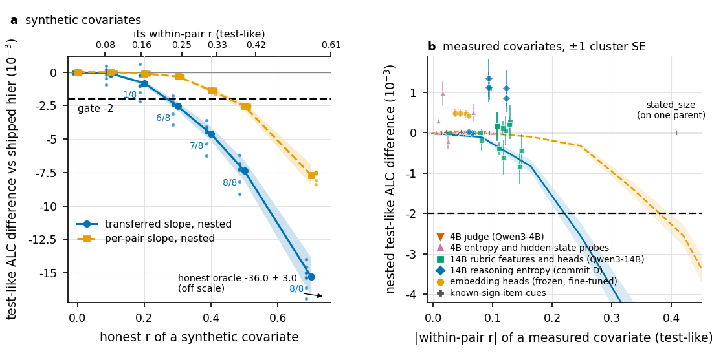

*Figure C1.* (a) Nested TL ALC difference against hier-ship ("shipped hier"), in $10^{-3}$, for a degraded oracle at honest $r$: the transferred and the per-pair slope, each the mean of 8 noise draws (dots) with a ±1 cluster-SE band; labels count the draws passing the gate, -0.002, alone. The honest oracle, -0.0360 (0.0030), is off scale. (b) The 44 measured covariates at their within-pair $\lvert r\rvert$, ±1 cluster SE, with (a)'s lines on that axis; none reaches the gate. <!-- src: panel (a) results/harness_thresholds.json (the degraded-oracle lines, their draws and passes, the honest oracle); panel (b), the 44 covariates: tools/report_figures.py COVARIATES, whose families read the `harness` blocks of results/llm4b_close.json, results/hidden_state_probe.json, results/strong_llm_eval.json, results/finetune_encoder.json and results/itemcov_eval.json; docs/report/figures.md D3 -->

**The gate table.** The harness first reproduces the in-sample oracle that the study of the meta-learned heads scored (App F.5). The targets are -0.0437 on test-like runs and -0.0557 on TL-mix, and the harness reproduces -0.0439 and -0.0558 (targets: `results/heads_eval.json`, `experiments/heads_eval.py`). It then builds the *gate table* from degraded oracles, covariates $x_i$ for each item $i$ built as

$$
x_i = r\,\tilde d_i + \sqrt{1 - r^2}\,\xi_i
$$

Here $\tilde d_i$ is an *honest* difficulty, fitted on other subject folds only and standardised within its parent benchmark, $\xi_i$ is standard normal noise, and $r$ sets the honest correlation (above). For each $r$ the table records what a covariate with that honest correlation would score through the gate, averaged over 8 noise draws, and how many single draws pass. In the table, *nested* means that selection is redone inside each held-out parent.

| honest $r$ (within-pair $r$, test-like) | transferred slope, nested: test-like (cluster SE, draw sd) | TL-mix | R1-bf | R1-pu | draws passing | per-pair slope, nested: test-like | draws passing |
|---|---|---|---|---|---|---|---|
| 0 (0.00) | -0.00002 (0.00001, 0.00006) | +0.00001 | -0.00001 | +0.00000 | 0/8 | -0.00000 | 0/8 |
| 0.1 (0.08) | -0.00010 (0.00005, 0.00043) | -0.00027 | -0.00034 | -0.00044 | 0/8 | -0.00000 | 0/8 |
| 0.2 (0.16) | -0.00083 (0.00015, 0.00086) | -0.00161 | -0.00191 | -0.00245 | 1/8 | -0.00010 | 0/8 |
| 0.3 (0.25) | **-0.00255** (0.00032, 0.00068) | -0.00457 | -0.00517 | -0.00639 | **6/8** | -0.00032 | 0/8 |
| 0.4 (0.33) | -0.00462 (0.00052, 0.00081) | -0.00805 | -0.00906 | -0.01109 | 7/8 | -0.00136 | 0/8 |
| 0.5 (0.42) | -0.00738 (0.00077, 0.00090) | -0.01246 | -0.01399 | -0.01699 | 8/8 | **-0.00255** | **8/8** |
| 0.7 (0.61) | -0.01528 (0.00143, 0.00091) | -0.02392 | -0.02693 | -0.03213 | 8/8 | -0.00768 | 8/8 |
| honest oracle | -0.0360 ± 0.0010 / 0.0030 / 0.0029 | -0.0484 | -0.0539 | -0.0619 | passes | -0.0223 | passes |

Source: `results/harness_thresholds.json` (`thresholds.honest`, `acceptance`), `python experiments/harness.py --stage table`; 300 test-like, 150 TL-mix and 100 + 100 public runs, on rows collected with the current library (corrected multiple-choice floor and floored-fit fix; F§ "Acceptance harness", Provenance). The table built before that re-collection, on the legacy rows, differs from this one by at most 0.0002 in the test-like column and 0.0004 elsewhere; its transferred line at $r = 0.3$ was -0.00238.

The slope $\beta$ is transferred, one coefficient per budget fitted on the other parents, or per-pair, a MAP estimate from the target pair's own labels under a zero-mean prior with sd $\sigma_\beta$ per standard deviation of $x$ (above). We call each configuration that the harness scores a *line*; a *forced* line scores one fixed configuration without selection. A line's $\Delta$ is its ALC minus hier-ship's, so it is negative when the covariate helps.

**What a covariate needs.** One noise draw of a degraded oracle moves its test-like difference by more than its cluster SE (draw sd 0.0007 against 0.0003 at $r = 0.3$). A real covariate is one draw, so we read its chance of passing from the draws rather than from the averaged line (F§ "The gate, tightened"; `experiments/gate_and_ci.py`, `results/gate_and_ci.json`, `gate`):

| honest $r$ (within-pair $r$) | transferred slope: draws passing (Jeffreys 95%) | one draw clears the bar, $\Pr(\Delta \le -0.002)$: normal / Student-t predictive | $\Pr$ of passing the full gate, modelled |
|---|---|---|---|
| 0.2 (0.16) | 1/8 [0.01, 0.45] | 0.09 / 0.12 | 0.09 |
| 0.3 (0.25) | 6/8 [0.41, 0.94] | 0.79 / 0.76 | 0.68 |
| 0.4 (0.33) | 7/8 [0.55, 0.99] | 1.00 / 0.99 | 0.87 |
| 0.5 (0.42) | 8/8 [0.74, 1.00] | 1.00 / 1.00 | 1.00 |

A transferred slope needs an honest $r$ of about 0.3 to 0.35. At $r = 0.3$ a covariate passes about two times in three. The averaged line there is -0.00255, with a draw sd of 0.00068. Of the two failing draws, one misses the bar and one fails the worst-parent condition (inferred: the other four conditions hold, and a draw's worst parent is not stored). A per-draw chance of 0.5, 0.8 or 0.95 of clearing the bar needs an honest $r$ of 0.27, 0.305 or 0.335.

A per-pair slope needs an honest $r$ of about 0.46 (0.455 to 0.475), because it must be learned from at most 31 labels. Forcing a per-pair slope ($\sigma_\beta = 0.5$) on for an uninformative covariate costs +0.0009 ALC on test-like runs when the term acts from $B_1$, and +0.0007 when it acts from $B_7$.

The gate uses the thinnest regime, the one in which a covariate gains least, so it leans toward false negatives. At $r = 0.2$ the transferred line gains 0.0016 on TL-mix and 0.0019 to 0.0025 on public runs, but 0.0008 on test-like runs. Read on TL-mix, with selection kept on test-like runs, the same per-draw chances of clearing the bar need an honest $r$ of 0.215, 0.24 and 0.255 (0.365 to 0.39 for a per-pair slope), and the pass counts are 4/8 at $r = 0.2$ and 8/8 from $r = 0.3$. These counts are upper bounds, because a draw's worst parent on TL-mix is not stored.

We deferred the full gate under TL-mix. It needs a change to `gate()` and `average_lines()` in `experiments/harness.py`, then a re-run of the table stage with selection on TL-mix (about 25 minutes on one process). The re-run would move the degraded oracles' pass counts, but the stored TL-mix nested lines of the 44 measured covariates in Figure C1 (b) are all above -0.002 (the best is -0.0014, the 14B's time_log_minutes), so the full gate under TL-mix could pass a covariate only where selection on TL-mix switched on one that test-like selection did not (App I.1).

### C.5 How hier-ship's level was chosen

§5.3 gives the short version, and §3.4 says where TL's level target came from. This appendix gives the selection in full: the candidates, the plateau, the tie-break between hier-argmax and hier-rec, and the audit that moved the choice to hier-ship. App E.2 holds the confirmation on fresh runs and the RS study, and App B.3 holds the ablations at LEVEL.

**The candidates.** We scored grids over $(\mu_0, \sigma_\mu, \gamma)$ for hier, with Gaussian and Student-t levels. We also scored an empirical-Bayes re-estimate of the level at every checkpoint, and a level fix for LegacyP (F§ "Calibrating for the hidden test"). Selection on the level grid used nothing from the feedback beyond the regime's defaults (App G.6 lists every use of the feedback).

**The selection rule.** The rule considers only configurations that lose at most 0.003 ALC against LegacyP on *both* public weightings, benchmark-first and pair-uniform (the guard). <!-- src: results/level_calibration.json config.guard --> Among them it takes the one with the best mean ALC on the selection half (TL runs 0 to 99), and it confirms that choice on runs 100 to 199.

**The plateau.** With its level moved and no constraint on the public cost, every model-based family reaches the same plateau on the selection half (TL runs 0 to 99, seed 2; F§ "What moving the level buys, unconstrained"). In the table, each family whose level was moved appears with its best configuration, and LegacyP, hier-fit and Smooth appear unmoved.

| family | best configuration | ALC | $\Delta = \mathrm{ALC}(\text{family}) - \mathrm{ALC}(\text{LegacyP})$ (cluster SE) | public cost, R1-bf / R1-pu (SE not shown) |
|---|---|---|---|---|
| LegacyP (first submission) | | 0.2039 | | |
| hier-fit | | 0.1906 | -0.0134 (0.0017) | -0.0019 / -0.0017 |
| Smooth | | 0.1788 | -0.0252 (0.0021) | +0.0070 / +0.0075 |
| hier, Gaussian level | $\mu_0 = -4$, $\sigma_\mu = 2.5$, $\gamma = 0.5$ | 0.1572 | -0.0467 (0.0042) | +0.0036 / +0.0032 |
| hier, Student-t level | $\mu_0 = -4$, scale 1.8, $\gamma = 0.5$ | 0.1570 | -0.0469 (0.0042) | not scored |
| hier-EB | on the Gaussian above | 0.1567 | -0.0473 (0.0042) | +0.0034 / +0.0033 |
| LegacyP+fix | offset -2.5, scale 1, variance 2 | 0.1562 | -0.0477 (0.0045) | +0.0329 / +0.0329 |
| Smooth-cal | mean $m_0 = 0.25$, strength $n_0 = 2$ | 0.1588 | -0.0451 (derived, no SE) | +0.0077 / +0.0096 |

Source: `experiments/level_calibration.py`, `results/level_calibration.json`; run and stratified SEs: F§ "What moving the level buys, unconstrained". The Smooth-cal row was added by the RS study on the same runs (`results/regime_sensitivity.json`, `smcal`); its difference from LegacyP is derived from the two ALCs, and its public cost is measured against LegacyP's stored rows, which predate the corrected multiple-choice floor. Against the current LegacyP the cost is larger (F§ "Regime sensitivity at the feedback's reading"). <!-- src: results/level_calibration.json summary.selection.configs.<config>.{ALC[0], diff.mean, diff.cluster_se} for Predictor, hier, smoothed, "hier G mu0=-4.00 sm=2.50 as=0.50", "hier T mu0=-4.00 sm=1.80 as=0.50", "hierEB-cs@hier G mu0=-4.00 sm=2.50 as=0.50", "P off=-2.5 sc=1.00 va=2.0"; summary.r1.{r1b, r1p}.<config>.diff.mean; results/regime_sensitivity.json smcal.{chosen_selection_ALC, chosen_guard_loss.r1b, chosen_guard_loss.r1p}; derived: 0.1588 - 0.2039 = -0.0451 -->

The plateau lies at about 0.156 to 0.157 and is flat: 14 of the 108 Gaussian configurations lie within 0.001 of the best (derived). <!-- src: results/level_calibration.json summary.selected.order[*].selection_ALC (the table's best configurations lie at 0.15621 to 0.15719; the robust-fit LegacyP+fix variant "Pr off=-2.5 sc=1.00 va=2.0", not in the table, reaches 0.15597); derived, count of summary.grid_surface cells within 0.001 of the minimum 0.157194, over the 108 non-null cells --> Here LegacyP loses to Smooth, the $\mathrm{Beta}(2, 2)$-smoothed mean, and the loss comes from its prior. Smooth-cal, a smoothed mean with a calibrated prior and no model at all, reaches 0.159. <!-- src: results/regime_sensitivity.json smcal.chosen_selection_ALC --> App E.4 reads calibration and modelling as a paired factorial.

The widest level prior always won. At every shift of the level centre, $\sigma_\mu = 2.5$ beat 1.8, 1.3 and 0.9 in every scored cell of both Gaussian grids (Figure C2). <!-- src: results/level_calibration.json summary.grid_surface (in every cell with a value at sm=2.5, it is lower than at sm=0.9, 1.3 and 1.8; checked over all cells) --> App E.2 and App B.3 score the wider priors 3.5 and 5.0 at hier-ship's $\mu_0$ and $\gamma$.

The public guard decides which configuration is chosen. Moving the level costs LegacyP far more on public runs than it costs hier, which gives back most of its $B_0$ and $B_1$ losses from $B_7$ on.

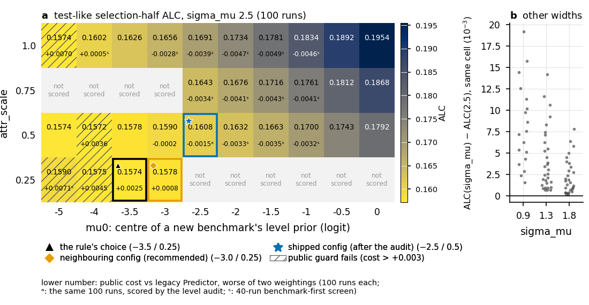

*Figure C2.* (a) Selection-half ALC of hier over $\mu_0$ and $\gamma$ at $\sigma_\mu = 2.5$, with each cell's public guard cost. The cost comes from 100 runs per weighting where scored (hier-ship's cell from the level audit on the same runs), otherwise from the level calibration's 40-run screen; hatched cells fail the guard. Marked, with their coordinates in that order and their ALC: hier-argmax (-3.5, 0.25; 0.1574), hier-rec (-3.0, 0.25; 0.1578; "neighbouring config" in the legend) and hier-ship (-2.5, 0.5; 0.1608). (b) In every scored cell, a level prior sd $\sigma_\mu$ of 0.9, 1.3 or 1.8 loses to 2.5, the edge of the grid; App E.2 and App B.3 score the wider priors.

**Chosen.** The selection rule picked hier-argmax ($\mu_0 = -3.5$, $\gamma = 0.25$). The level calibration broke the tie by the guard's margin and recommended hier-rec ($\mu_0 = -3.0$), which was 0.0004 behind on the selection half (derived) and tied on the confirmation half (F§ "The public guard decides"). <!-- src: results/level_calibration.json summary.selected.order[*].{config, selection_ALC, guard_ok} (hier-argmax 0.157405 and hier-rec 0.157794; derived difference 0.0004); summary.ship.config ("hier G mu0=-3.00 sm=2.50 as=0.25"); summary.ship.vs."hier G mu0=-3.50 sm=2.50 as=0.25"."tl confirmation".{mean, cluster_se} (+0.00004, 0.00043) -->

| configuration; for hier, $(\mu_0, \sigma_\mu, \gamma)$ | selection half, ALC | confirmation half, ALC ± run SE | $\Delta$ LegacyP, confirmation (cluster SE) | R1-bf runs 0 to 99, $\Delta$ LegacyP (SE not shown) | R1-pu runs 0 to 99, $\Delta$ LegacyP (SE not shown) |
|---|---|---|---|---|---|
| hier-ship (-2.5, 2.5, 0.5) | 0.1608 | 0.1677 ± 0.0028 | -0.0396 (0.0037) | -0.0015 | -0.0018 |
| hier-rec (-3.0, 2.5, 0.25; recommended, not shipped) | 0.1578 | 0.1655 ± 0.0031 | -0.0418 (0.0047) | +0.0008 | +0.0007 |
| hier-argmax (-3.5, 2.5, 0.25) | 0.1574 | 0.1655 ± 0.0033 | -0.0418 (0.0051) | +0.0025 | +0.0023 |
| hier-EB (EB-cs, tau 2) on $\mu_0 = -3.0$, $\gamma = 0.5$ | 0.1580 | 0.1658 ± 0.0031 | -0.0416 (0.0043) | +0.0005 | +0.0006 |
| LegacyP+fix (offset -1.5, scale 1, variance 3) | 0.1630 | 0.1696 ± 0.0027 | -0.0377 (0.0032) | +0.0026 | +0.0028 |
| hier-fit | 0.1906 | 0.1949 ± 0.0024 | -0.0124 (0.0019) | -0.0019 | -0.0017 |
| LegacyP | 0.2039 | 0.2073 ± 0.0022 | | ¹ | ¹ |

¹ LegacyP's own ALCs: 0.2068 and 0.2038. In the hier-EB row, EB-cs re-estimates both the centre and the sd of the level prior from the revealed labels at every checkpoint, and tau is the sd of the hyperprior on the centre. Paired, hier-ship minus hier-rec is +0.0030 (0.0009) and +0.0022 (0.0011) on the two TL halves, and -0.0023 (0.0005) and -0.0024 (0.0004) on R1-bf and R1-pu runs 0 to 99 (other SEs: App E.2). Sources: `experiments/level_calibration.py`; hier-ship's row from `results/level_audit.json` (`mild`) and `results/ship_confirm.json`. <!-- src: results/level_audit.json mild."tl 0-99: selection half"."vs PRED"."hier G mu0=-2.50 sm=2.50 as=0.50".ALC[0]; mild."tl 100-199: confirmation half (audit: fresh runs)"."vs PRED"."hier G mu0=-2.50 sm=2.50 as=0.50".{ALC, "minus ref (run / cluster / stratified SE)"[0], [2]}; mild."r1b 0-99: public benchmark-first 0-99 (audit: fresh runs)" and mild."r1p 0-99: public pair-uniform 0-99 (audit: fresh runs)"."vs PRED"."hier G mu0=-2.50 sm=2.50 as=0.50"."minus ref (run / cluster / stratified SE)"[0]; mild.<the same four blocks>."MILD minus AGGR"."minus ref (run / cluster / stratified SE)"[0], [2]; results/level_calibration.json summary.selection.configs.<config>.ALC[0], summary.confirmation.<config>.{ALC, diff.mean, diff.cluster_se}, summary.r1.{r1b, r1p}.<config>.{diff.mean, ALC[0]} for "hier G mu0=-3.00 sm=2.50 as=0.25", "hier G mu0=-3.50 sm=2.50 as=0.25", "hierEB-cs,tm=2.0@hier G mu0=-3.00 sm=2.50 as=0.50", "P off=-1.5 sc=1.00 va=3.0", hier, Predictor -->

**Audited.** The level audit then moved the choice to hier-ship, the milder guarded configuration, for three reasons (F§ "What actually shipped, after the audit"; `results/level_audit.json`):

1. The hidden levels looked spread both ways. When we matched run 1's nine pairs against replica pairs, two of them, both on one benchmark, were more plausibly high-rate, with 70% and 80% of their nearest replica pairs at a rate above 0.5. A third pair was ambiguous. Read that way, the nine pairs average -0.98 (sd 2.05) on the plain logit, instead of the -1.6 of the lower-root reading. Against LegacyP, hier-rec also loses 0.014 on TL pairs at rates 0.5 to 0.7, 0.070 at rates of 0.7 and above, and 0.015 to 0.017 on public matharena. <!-- src: results/level_audit.json feedback."K=40".pairs[5]."nn share p>0.5" (0.7), feedback."K=40".pairs[7]."nn share p>0.5" (0.8); results/formative_feedback.json reading.comparison.run1_readings_recomputed."p6, p8, p9 upper".{mean_plain, sd_plain} (-0.976, 2.046); results/level_audit.json feedback."feedback level readings"."lower roots: mean, sd of logit"[0] (-1.64); analyse."test-like 0-199, AGGR - PRED by group (ratio-weighted, pairs)".{"p 0.5-0.7"[0], "p >=0.7"[0]} (0.0143, 0.0702); analyse."r1b 0-99, AGGR - PRED by benchmark".matharena[0] (0.0172), analyse."r1p 0-99, AGGR - PRED by benchmark".matharena[0] (0.015) --> This was the audit's reasoning at the time, and it rests on a choice of root. The organisers' tables give each pair's $p(1-p)$ (exactly for run 1, estimated at $B_0$ for runs 2 and 3, §3.1), and so the size of its logit, not its sign. Of the 26 formative appearances, 9 have $V \ge 0.20$ (derived), so on these values of $V$ their rate lies between 0.28 and 0.72 whichever root is taken. <!-- src: results/hidden_runs.json decomposition.run1.pairs_v_ge_0.20 (3), decomposition.run2.pairs_v_ge_0.20 (4), decomposition.run3.pairs_v_ge_0.20 (2), decomposition.run{1,2,3}.pairs (9, 8, 9); derived: 3 + 4 + 2 = 9 of 26; p(1 - p) >= 0.20 holds for p from (1 - sqrt(0.2)) / 2 = 0.276 to (1 + sqrt(0.2)) / 2 = 0.724 -->
2. Both configurations sit on a flat plateau (the table's note), and hier-ship's measured worst case is no worse.
3. The confirmation half repeats 82.2% of the selection half's pairs and 99.5% of its clusters, so it measures redrawing and does not test unseen parents. <!-- src: results/level_audit.json analyse."confirmation half against the selection half".{"share whose (pseudo-benchmark, subject) pair is in the selection half", "share whose (parent, subject) cluster is in the selection half"} (0.8216, 0.995) -->

**After run 2: the pooled reading.** We read each pair of runs 1 and 2 against matched replica pairs and pooled the pairs into one reading, under a decision rule. The rule was hash-locked before the reading was computed, but after both runs' tables had been seen (App C.3). It could change only $\mu_0$ and $\sigma_\mu$, at a bar of 2 SEs, with SEs that resample the 7 benchmarks. The 17 pairs' level is -0.65 with 15 nearest neighbours per pair and -0.78 with 40 (SE 0.51). These are 1.24 and 1.00 SEs above the TL regime's realised -1.29, so the rule gives no candidate, and LEVEL stays. <!-- src: results/formative_feedback.json reading.level_distribution."K=15".mean (-0.650), reading.level_distribution."K=40".mean (-0.779), reading.level_distribution."K=15".bootstrap.mean_se (0.514), reading.level_distribution."K=40".bootstrap.mean_se (0.511), reading.decision.z_mean.{"K=15", "K=40"} (1.245, 1.001), reading.decision.comparator.mean (-1.29), reading.decision.outcome --> Like the audit, the reading chose each pair's root by its neighbours, which the tables do not identify (§3.1). It put the hidden level near the public centre (the mean logit of the pair rates on public runs), more central than the TL regime in which the headline gain was measured, at a distance within the noise of 7 benchmarks (App D.4 gives the rule, the table and the checks). No level reading, matching against replica pairs or tuning was done on run 3. After the code was frozen on archive-3 (2026-10-06), run 3's table entered, with those of runs 1 and 2, a root-free analysis of per-pair Brier and ECE ($V$ and ALC minus $V$, §3), which uses the anonymous ids only to find the one subject-benchmark pair that appears in two runs and to group pairs by benchmark in its bootstraps, and chose, tuned and changed nothing (App G.6).

**Then confirmed and tested.** App E.2 gives hier-ship's confirmation on TL runs 200 to 299, which no choice of the level used, and the RS study, which found no replacement at the feedback's later readings under a rule fixed before scoring. App B.3 gives S4, the ablations at LEVEL on a fresh seed, which was declared no-ship and found no candidate either.

The final archive keeps LEVEL on the five-benchmark prior: amendment 4's refit on the expanded pool, with LEVEL kept (C1), with $\mu_0$ matched under the date shift (C1m) or with the pool's level (C2), carried no candidate past selection (§7, App C.6). <!-- src: results/pool_eval.json selection.{outcome, Q, X_star} -->

### C.6 The pool evaluation in full

§7 gives the pool evaluation in one paragraph. This appendix gives the rest: the selection in brief (Table C.6a, below), the data, the candidates, the level arithmetic, the split, the regimes, the statistics, the rule, the checks and the lock, the full selection record, the outcome and its timeline, one disclosed deviation and the limits. The rule is amendment 4 of `docs/plans/p2_final_plan.md`, with amendments 4a, 4b and 4c; the design is `docs/plans/p2_pool_eval.md` (sha256 `5af21af6…`; "the design" below, with its section numbers), and the implementation is `paiec/pool.py` and `experiments/pool_eval.py`. Every number below is in `results/pool_fits.json` or `results/pool_eval.json` unless it is marked *planning*, in which case it comes from the design or its notes under `docs/plans/pool_design/`, measured before any predictor was scored on the pool (F§ "Amendment 4: hier's priors refitted on the expanded pool; no candidate carried (P2)"), or unless it names another source: an amendment of plan P2, a constant of `experiments/pool_eval.py`, a commit message or the repository's history (commit times). $D$ is a candidate's paired difference in ALC against archive-3 on identical runs and checkpoints, so a negative $D$ favours the candidate. <!-- src: results/pool_eval.json lock.{design, design_sha256, amendment.path}; docs/plans/p2_final_plan.md amendment 4 preamble -->

The design (`docs/plans/p2_pool_eval.md`, section 14) planned one paragraph and one table in the main text. To meet the competition's limit of 8 pages of main text, the author moved the table here on 2026-10-20, unchanged.

*Table C.6a: The selection on S, each candidate minus archive-3, $D$ ($\mathrm{SE}_g$) in ALC; negative when the candidate is better.*

| regime (realised level) | condition | C1 | C1m | C2 |
|---|---|---|---|---|
| P-READING (-0.64) | gain | -0.0015 (0.0013) | -0.0030 (0.0017) | -0.0026 (0.0048) |
| P-AUDIT (-1.02) | gain | +0.00003 (0.0009) | -0.0004 (0.0013) | +0.0065 (0.0049) |
| mean of the two gain regimes | $\le -0.001$ to carry | -0.0007 | -0.0017 | +0.0019 |
| P-READING-DS, dates +1.25 years | $D \le 0$ | +0.0005 (0.0010) | -0.0009 (0.0011) | +0.0002 (0.0040) |
| P-AUDIT-DS, dates +1.25 years | $D \le 0$ | +0.0006 (0.0012) | +0.0002 (0.0010) | +0.0076 (0.0042) |
| P-TUNED (-1.22) | $D \le +0.002$ | -0.00003 (0.0008) | -0.0002 (0.0012) | +0.0080 (0.0041) |
| P-MIXTURE (-0.61) | $D \le +0.002$ | -0.0023 (0.0013) | -0.0037 (0.0017) | -0.0024 (0.0046) |
| P-FLAT (-0.02) | $D \le +0.002$ | -0.0024 (0.0016) | -0.0054 (0.0017) | -0.0122 (0.0035) |
| D-READING (-0.72), dense | $D \le +0.001$ | -0.0005 (0.0010) | -0.0016 (0.0012) | -0.0024 (0.0032) |
| D-FLAT (-0.24), dense | $D \le +0.001$ | -0.0010 (0.0009) | -0.0023 (0.0011) | -0.0041 (0.0026) |
| RS guard, mean of seven regimes | $\le +0.0005$ | -0.0001 | -0.0006 | +0.0052 |
| RS regimes over their bound (+0.002; public +0.001) | none | R1-bf, R1-pu | none | six of seven |
| eligible | | no | no | no |

Source: `experiments/pool_eval.py`, `results/pool_eval.json` (`selection`); realised levels on S's calibration seed (`regimes`). $\mathrm{SE}_g$ is the larger of a source-family cluster bootstrap SE and a two-way family-and-subject SE. Runs in S: 80 per formative-size regime and twin, 20 per dense regime; RS: 520 tasks. Rule verbatim in amendment 4, section 4.4, of `docs/plans/p2_final_plan.md`. <!-- src: moved from §7 on 2026-10-20; results/pool_eval.json selection.stats.<C>.<R>.{D, SEg, runs}; selection.candidates.<C>.{M, E1.mean, E1.regimes.<R>.ok, eligible}; selection.rule (the bounds); regimes.regimes.S.<R>.cal.mean; F§ "Amendment 4: hier's priors refitted on the expanded pool; no candidate carried (P2)" ("Checks and provenance": 520 RS tasks). Rounding: 4 decimals, half up, from the stored floats, except C1's P-AUDIT and P-TUNED, given to five decimals because they round to zero at four (selection.stats.C1."P-AUDIT".D +0.000033, selection.stats.C1."P-TUNED".D -0.000027) -->

**Why the code was unfrozen, and how far.** On 2026-10-06 and 2026-10-07 measurement-db grew from six benchmarks to 255 catalogue entries, 252 of them public (revision `54074453`). The competition page says that benchmarks were "randomly assigned to separate training and test pools before curation" [PAIEC organisers 2026], so a public benchmark held out of a fit stands in for a hidden one. Archive-3's priors rest on five benchmarks and 221 pairs; the pool offers 128 benchmarks for the subject prior and 137 for the item variance and the level. The difficulty is the level. The 166 eligible benchmark levels of the planning survey have mean +0.06 and sd 1.54; LEVEL's median, mapped to the same accuracy-logit scale (-1.15), sits at their 15.7th percentile, and the formative readings sit low: READING -0.715 (sd 1.772), AUDIT -1.10 (2.00), TUNED -1.29 (1.696) (*planning*, `docs/plans/pool_design/data.md`, section 5; the targets from `results/regime_sensitivity.json`). A level learned from the pool therefore wins on unselected held-out benchmarks by construction, and such benchmarks cannot decide alone. <!-- src: docs/plans/p2_pool_eval.md §1; docs/plans/pool_design/data.md "Against the shipped LEVEL" (median -1.15, 15.7% of the 166 pool levels); results/regime_sensitivity.json regimes.targets.{READING, AUDIT, TUNED}; results/pool_eval.json reproduce.RP4.pairs (221); results/pool_fits.json selection.{L, U} -->

Amendment 4 lifted amendment 1's code freeze for hier's priors only, with archive-3 as the fallback at every step. An archive-4 could differ from archive-3 in `submission/prior.json`; for C1m and C2 also in the `LEVEL` literal of `submission/model.py`; and in model.py's docstring and the comment above `LEVEL`, which had to be true for what shipped. An AST comparison that ignores docstrings, comments and the `LEVEL` value had to find model.py otherwise identical, and the eight shipped modules stayed byte-identical. The new code is offline: `paiec/pool.py` (never imported by a shipped module), `tools/pool_benchmarks.json`, `tools/pool_families.json`, `experiments/pool_eval.py`, their tests, and a `--pool` path of `tools/build_submission.py` that had to rebuild the carried candidate's locked bundle byte for byte. The default build is still archive-3: `831ef7d` added lines to `tools/build_submission.py` and changed or removed none, and without `--pool` the script takes the path that built archive-3 (App G.3). <!-- src: docs/plans/p2_final_plan.md amendment 4 §4.1 decision 1, §4.2; docs/plans/p2_pool_eval.md §2; git show 831ef7d (message); git diff --stat 4d2cc4f 2af8fcd -- tools/build_submission.py (619 insertions, 0 deletions, all from 831ef7d) -->

**Data.** The pool is revision `54074453da7b9911be0f48e4c560be547bc84d21`, fetched by `tools/fetch_pool.py` with the item tables of every public benchmark but cseo_bench and qatch, which the evaluation does not use. The manifest (`data/pool/manifest.json`, fetched 2026-10-08T04:04:26Z, sha256 `ff548206…`) lists every file's size and sha256, and the loader checks a file against it before it first reads it; all 548 files of the 137 benchmarks used (L, below) matched. Item tables are present ("Mode A"), so an item has the official input's four keys, with `interactors` taken from the item's first 0/1 response row, and hier's multiple-choice floor and group effects act on pool runs, for every arm, as at test time. Item text enters no file: caches and rows hold item ids and sha256 digests, and the evaluation loader reads a drawn pair's items at run time. <!-- src: results/pool_fits.json revision; manifest.{fetched_utc, items_skipped, sha256, verified_L.{benchmarks, files}}; docs/plans/p2_pool_eval.md §3.1, §3.2 -->

A pair is (subject, benchmark); its responses are the 0/1 values in file order, and an item's label is its first 0/1 response. A pair is eligible with at least 80 distinct items. Three sets follow:

* **L**, the level part: public, item-granular benchmarks that are binary, or mixed with a 0/1 share of at least 0.95, with an eligible pair. 137 benchmarks (128 binary, 9 mixed), the five original ones included.
* **U**, the subject part: L less nine direction-flagged benchmarks (lower is better: crow, emoji_attack, harmbench, jailbreakbench, llmail_inject, wmt_mqm; unordered: alignment_faking, safeagentbench, tensortrust), whose standings would enter the ridge with the wrong sign or none. 128 benchmarks, 8,388 eligible pairs.
* **E**, the evaluation set: L less the five original benchmarks. 132 benchmarks and 12,668 eligible pairs, the nine flagged and 12 single-pair benchmarks included. The five original benchmarks enter the evaluation only through the RS guard.

The fits cap each pair at its first 2,000 items in one benchmark-wide hash order and each benchmark at 100 pairs, taken round-robin over canonical subject names, which links 222 names across two or more benchmarks of U, against 176 in subject-id order (*planning*, design section 3.4); evaluation runs are never capped this way. 21 of E's benchmarks are flagged multiple-choice by their catalogue text (4 in S: kmmlu, mmlu, mmlupro, tumlu), and the shipped floor is positive on at least half of the items read for 21 (3 in S: egoschema, kmmlu, kormedmcqa) and on some item for 43. <!-- src: results/pool_fits.json selection.{L, U, E, pairs_U, pairs_E}; K (100); M_P (2000); mixed_scales (9 benchmarks); catalogue_mcq (21); floor_share.<b>.{share, floor_positive}; results/pool_eval.json split.summary.{S, C}.single_pair (4 + 8); docs/plans/p2_pool_eval.md §3.3, §3.4 (222 and 176 names, planning, amend4_order.py), §3.7 -->

**Source families and exclusion.** Two catalogue entries are joined when they share a normalised `source_url` key (host and first two path segments) or a normalised `paper_url` (arXiv id, OpenReview forum id, DOI, else host and path); a family is a connected component. The 255 entries form 230 families, 10 with two or more members, and the split stage reproduced the planning table exactly. Eight families have two or more members in L, 26 benchmarks, all in E; the largest is MedHELM's ten benchmarks (*planning*, design section 3.5). For a pool run with benchmark set $B_{\mathrm{run}}$, every candidate is built without every benchmark of L in the family of a benchmark of $B_{\mathrm{run}}$, so no source of the run informs any target's prior. On an RS task the exclusion is the target's parent alone. The per-benchmark fits do not depend on the exclusion, so a run costs one rebuild of the subject prior. <!-- src: results/pool_fits.json families.{families, multi, equal}; results/pool_eval.json checks[split] "families reproduce the planning table"; docs/plans/p2_pool_eval.md §3.5, §3.6 -->

**The pool build, and the degenerate fits (amendments 4a and 4b).** For every benchmark of L with at least two pairs after the caps, `paiec.prior.benchmark_fit` runs at its defaults on the Mode A items; there are 124 such free fits, kept as returned (15 ended with EM not converged and 10 with Newton not converged). The subject prior is `from_standings` on the standings rows of U without the excluded families. The hyperparameters follow `fit_hyper`'s arithmetic: the item variance $T$ is the median item variance of the multi-pair fits, split into $\sigma_d^2$ and $\sigma_g^2$ by the group share (the median share of the keyed fits, capped at 0.25); $\sigma_\theta^2$ is the shared residual variance clipped to [0.01, 0.2] with archive-3's identity cap of 0.1; $\sigma_\delta$ and $\sigma_{\mathrm{attr}}$ come from the attribute ridge's residual and total variances. The bundle has archive-3's keys and no per-benchmark level. <!-- src: results/pool_fits.json benchmarks.<b>.free (124 non-null); convergence.{free_em_not_converged (15), free_newton_not_converged (10)}; docs/plans/p2_pool_eval.md §4.1 -->

A dry run of the fits stage, with no score computed, found three free fits whose item variance lies far outside the rest: multi_moe 963,196 (Newton not converged), finegrain_t2i 298 and revolve 101. The largest of the others is 35.9. Kept, the three would have pushed every candidate's $\sigma_\delta$ to 7.39 (archive-3 2.38; 2.04 without them; amendment 4a). Amendment 4a, committed before the lock and before any score, fixed the rule from these fit diagnostics alone: a benchmark whose free fit has an item variance above 50 is left out of every pooled hyperparameter (the item variance, $\sigma_\delta$, the group share, C2's level distribution and C1m's matching), while its pairs still serve the standings and the identity table and the benchmark stays in the evaluation sets. On this pool the rule leaves out exactly those three, and the lock records the list. Amendment 4b then read "every pooled hyperparameter" to include the attribute ridge's residual variance $s^2_{\mathrm{res}}$, and with it each subject's attribute variance $u$: with the three included, $s^2_{\mathrm{res}}$ is 28.33 and the mean $u$ 0.260; without them, 2.346 and 0.0216 (archive-3 0.180, amendment 4b). After the rule, $T = 6.462$ (6.637 with the three), the group share's median over 78 keyed fits is 0.308, so the cap of 0.25 binds, and 3,124 of the 3,136 standings rows enter the pooled variances. <!-- src: results/pool_fits.json degenerate_rule.{item_var, largest_other (35.865), threshold (50), T_full_with_them (6.6365)}; T_full (6.4620); pooled.{item_var, share, s2_res (2.3457), u_mean (0.02162), pooled_rows (3124)}; pooled.attribute_cov.{rows (3136), s2_res_all_rows (28.334), u_mean_all_rows (0.2605)}; group_share.{keyed_fits, median (0.3076), used}; results/pool_eval.json lock.degenerate; docs/plans/p2_final_plan.md amendment 4a (sigma_delta 7.39, 2.38, 2.04), amendment 4b (0.180) -->

The resulting widths, with nothing excluded, against archive-3's five-benchmark bundle:

| quantity | archive-3 | C1 | C1m | C2 |
|---|---|---|---|---|
| $\mu_0$ | -2.500 | -2.500 | -2.046 | +0.131 |
| $\sigma_\mu$ | 2.500 | 2.500 | 2.500 | 2.350 |
| $\gamma$ | 0.500 | 0.500 | 0.500 | 0.500 |
| $\sigma_\theta$ | 0.100 | 0.447 | 0.447 | 0.447 |
| identity cap | 0.100 | 0.100 | 0.100 | 0.100 |
| $\sigma_\delta$ | 2.382 | 2.040 | 2.040 | 2.040 |
| $\sigma_{\mathrm{attr}}$ | 1.018 | 0.248 | 0.248 | 0.248 |
| $\sigma_d$ | 2.671 | 2.201 | 2.201 | 2.201 |
| $\sigma_g$ | 1.542 | 1.271 | 1.271 | 1.271 |
| $\varepsilon$ | 0.010 | 0.010 | 0.010 | 0.010 |
| $\omega$ | 0.500 | 0.500 | 0.500 | 0.500 |

Source: `results/pool_fits.json`, `hyper.<arm>`; the pool build's $\sigma_\theta = 0.447$ is its upper clip ($\sqrt{0.2}$) and archive-3's 0.100 its floor. The three candidates share every width; they differ only in the level prior. <!-- src: results/pool_fits.json hyper.{A3, C1, C1m, C2}; results/pool_eval.json lock.bundles.<C>.level -->

The fits took 3,847 CPU seconds (free) and 7,659 (C2's fixed-$T$ pass), and the largest worker held 2,368 MB. The two largest item files the evaluation could read were fitted in fresh processes: mind2web, one pair, fixed-$T$ fit only, peaked at 806 MB (1.74 s CPU to read its items, 0.15 s to fit), and swe_smith's free fit took 7.49 s at 259 MB. <!-- src: results/pool_fits.json cpu_s.{free_fits, fixed_T_fits, max_worker_rss_mb}; n8.fits.mind2web.fixed_T.{maxrss_mb, item_cpu, fit_cpu}; n8.fits.swe_smith.free.{fit_cpu, maxrss_mb} -->

**The candidates.** Each candidate is the pool build with archive-3's identity guards; they differ in the level prior.

* **C1** keeps LEVEL: $\mu_0 = -2.5$, $\sigma_\mu = 2.5$, $\gamma = 0.5$.
* **C1m** keeps $\sigma_\mu$ and $\gamma$ and moves $\mu_0$ to -2.046, the solution, by bisection on [-10, 10] and rounded to 3 decimals, of $c(\mathrm{C1m}, \Sigma_{\mathrm{DS}}) = c(\text{archive-3}, \Sigma_{\mathrm{DS}})$, the $B_0$ centres defined below under the 1.25-year date shift. The equation is solved once, for the build with nothing excluded, on E less the three degenerate benchmarks (129 benchmarks, 12,656 pairs), where archive-3's shifted centre is 0.3307; unrounded, the matched $\mu_0$ is -2.0463. Matched on all of E it would be -2.0499, and matched on dated subjects only -1.901, which the design ruled out as a candidate in advance.
* **C2** takes the pool's empirical-Bayes level and keeps $\gamma = 0.5$. With $T$ fixed at 6.462, every benchmark of L, single-pair ones included, gets one fit; its level is the fitted level plus the mean standing, minus the mean attribute score of its subjects, with the fit's variance of the level. The precision-weighted moment iteration over the 134 levels used (none beyond $\pm 10$, 7 iterations) gives a mean of 0.131 and a variance of 5.483, so $\mu_0 = 0.131$ and $\sigma_\mu = \sqrt{5.483}\,\sqrt{1 + 1/134} = 2.350$. The nine flagged benchmarks are included and no widening is applied (amendment 4, decision 4). The variance of the level omits that of the mean standing, whose mean size over the levels used is 0.148. The archive's literal is (0.131, 2.35, 0.5); pool runs use each run's unrounded values without its families.

Ties were to be broken in the order C1, C1m, C2, by increasing departure from archive-3. A fourth candidate, C3, lifted the identity guards; it was dropped before the lock by a criterion read on S and the five original benchmarks only (design section 4.4). The fits stage repeated that computation on the final fits for the record: with 1,042 rows on 41 benchmarks, the identity slope is 0.613 for cells with one other cell (46 cells, model weight 0.466), 0.640 with two (31 cells, weight 0.636) and 0.744 with three or more (67 cells, mean 5.40 others, weight 0.825), so the weight still exceeds the slope at three or more and the criterion would not keep C3. <!-- src: results/pool_fits.json mu0_m.{locked, raw, matching_set.{benchmarks, pairs, left_out}, target_A3_plus_1.25y_all, if_matched_on_all_of_E, if_matched_on_dated_only}; C2.{m, s2, n, iterations, dropped, sigma_mu, omitted_var_mean_t, literal}; results/pool_eval.json lock.{mu0_m, c2_literal}; fits-extra.r4_slopes.{rows, benchmarks, bins, criterion_would_keep_C3}; docs/plans/p2_pool_eval.md §4.3 to §4.5 -->

**The $B_0$ centre at real and shifted dates.** For an arm $X$ and a set $\Sigma$ of pair appearances, the level functional is the benchmark-averaged prior prediction with no label, without the floor, group keys or text term:

$$
c(X, \Sigma) = \frac{1}{n_\Sigma} \sum_{b} \frac{1}{n_b} \sum_{s} (1 - \varepsilon)\,\mathbb E_z\Big[\operatorname{logit}^{-1}\Big(\mu_0 + \gamma\,\hat\theta^{\mathrm{attr}}_s + \sqrt{\sigma_\mu^2 + \sigma_\theta^2 + u_s + \sigma_\delta^2 + T}\;z\Big)\Big]
$$

The outer sum runs over the $n_\Sigma$ benchmarks of $\Sigma$, each once, the inner one over a benchmark's $n_b$ pairs, $u_s$ is subject $s$'s attribute variance, $T = \sigma_d^2 + \sigma_g^2$, and $z$ is standard normal on 80 Gauss-Hermite points. $\Sigma_{\mathrm{real}}$ is E's eligible pairs at their real dates; $\Sigma_{\mathrm{DS}}$ is the same pairs with release and access dates moved 1.25 years later. Undated subjects do not move. 4,092 of E's 12,668 pairs are dated. The date matters because archive-3's ridge has a date coefficient of 2.414 per 400 days and the pool ridge one of about 0.38 (*planning*, design section 4.2), and LEVEL was calibrated on test-like runs whose subjects, released in 2025 or later, were dated 1.25 years later, so one $\mu_0$ is a different effective level for the two ridges. <!-- src: docs/plans/p2_pool_eval.md §4.2; results/pool_fits.json b0_pairs.{E, dated} -->

| arm | real dates: all | dated | undated | dates +1.25 years: all | dated | undated |
|---|---|---|---|---|---|---|
| archive-3 | 0.275 | 0.255 | 0.297 | 0.330 | 0.347 | 0.297 |
| C1 | 0.285 | 0.284 | 0.286 | 0.295 | 0.301 | 0.286 |
| C1m | 0.320 | 0.319 | 0.321 | 0.331 | 0.336 | 0.321 |
| C2 | 0.505 | 0.503 | 0.506 | 0.517 | 0.523 | 0.506 |
| C1 minus archive-3 | +0.010 (+0.009) | +0.029 (+0.028) | -0.012 (-0.012) | -0.035 (-0.035) | -0.047 (-0.047) | -0.012 (-0.012) |
| C1m minus archive-3 | +0.045 (+0.044) | +0.064 (+0.063) | +0.023 (+0.023) | +0.000 (+0.000) | -0.011 (-0.012) | +0.023 (+0.023) |
| C2 minus archive-3 | +0.230 (+0.229) | +0.248 (+0.248) | +0.208 (+0.208) | +0.186 (+0.186) | +0.176 (+0.175) | +0.208 (+0.208) |

Source: `results/pool_fits.json`, `b0_centre.<arm>` on E's pairs (132 benchmarks; 91 with dated pairs, 72 with undated ones) and `b0_centre_minus_A3`; in parentheses, the same difference on C1m's matching set (`b0_centre_matching_set_minus_A3`, 129 benchmarks). Undated subjects do not move, so the two undated columns are equal. <!-- src: results/pool_fits.json b0_centre.<arm>.{real:all, real:dated, real:undated, plus_1.25y:all, plus_1.25y:dated, plus_1.25y:undated, <...>:benchmarks}; b0_centre_minus_A3.<C>; b0_centre_matching_set_minus_A3.<C> -->

So no one $\mu_0$ holds archive-3's centre under both dates. C1 sits within 0.010 of it at real dates and 0.035 below it under the shift; C1m holds it under the shift and sits 0.045 above it at real dates (0.064 on dated subjects); C2 sits 0.230 above at real dates and 0.186 under the shift. The rule therefore reads every candidate under both dates, and each contrast reads something different:

| contrast | in P-READING and P-AUDIT, real dates: gains required | in their twins, dates +1.25 years: no loss allowed |
|---|---|---|
| C1 minus archive-3 | the pool's rest of the prior at archive-3's level centre (+0.010) | the rest with the centre 0.035 lower (dated 0.047) |
| C1m minus archive-3 | the rest with the centre 0.045 higher (dated 0.064) | the rest at archive-3's level centre (+0.000) |
| C2 minus archive-3 | the rest with the pool's level (centre +0.230) | the same (centre +0.186) |

"The rest" is the standings, the ridge with its date term, the identity table, $T$ and its split, $\sigma_\delta$, $\sigma_{\mathrm{attr}}$ and $\sigma_\theta$. Centres on E's pairs, builds with nothing excluded (`b0_centre_minus_A3`); the rule does not split C1m's gain at real dates into its centre shift and its rest, and only the no-loss half of C1m's reading sits at archive-3's centre (design section 4.3). <!-- src: results/pool_fits.json b0_centre_minus_A3.<C>.{real:all, real:dated, plus_1.25y:all, plus_1.25y:dated}; docs/plans/p2_pool_eval.md §4.3 "What each contrast reads" -->

A run's build without its families, and a regime's own pairs, sit somewhat off these figures (descriptive). On S's planned appearances at real dates C1 sits +0.015 to +0.018 above archive-3, C1m +0.050 to +0.053 and C2 +0.235 to +0.238, across the seven real-date regimes; in both of S's twins they sit at -0.025, +0.010 and +0.196. On C's planned appearances the same figures are +0.006 to +0.009, +0.041 to +0.044 and +0.226 to +0.229, and -0.040 and -0.038, -0.004 and -0.003, +0.182 and +0.184 in P-AUDIT-DS and P-READING-DS. The matched $\mu_0$ that the matching rule would give without a run's families, over 50 P-READING runs of each half, has mean -2.039 (sd 0.026, range -2.073 to -1.973) in S and -2.042 (sd 0.015, range -2.079 to -2.000) in C, 0.007 and 0.004 above the locked -2.046. <!-- src: results/pool_eval.json regimes.centres.{S, C}.<R>.{C1-A3, C1m-A3, C2-A3}; fits-extra.mu0_m_runs.halves.{S, C}.{mean, sd, min, max, minus_locked, runs, regime} -->

**The split into S and C.** A unit is a source family's members in E, so most units are single benchmarks; E has 114 units. A unit's level is the mean over its members of the benchmark level, the mean over eligible pairs of the continuity-corrected pair logit $\log\big((k + 0.5)/(n - k + 0.5)\big)$, with $n$ the pair's distinct items and $k$ those whose first response is 1. The split stage derived $n$, $k$ and the levels through `paiec/pool.py` and matched the planning tables (132 benchmarks, 12,668 pairs; largest difference $8.9 \times 10^{-16}$ in a level, against a tolerance of $10^{-12}$). Flagged units are sorted by level, cut into consecutive blocks of 3, ordered within a block by the sha256 of `("pool-eval-split", unit_id)`, and the first `round(size / 3)` go to S; the other units, within each response kind, go the same way in blocks of 8 with the first `round(3 * size / 8)` to S. Every benchmark follows its unit, so no family straddles the halves, and the result reproduced the planning halves exactly. <!-- src: results/pool_eval.json split.{units (114 keys), rule.{unit, flagged_block, flagged_to_s, block, to_s, salt, kinds}, csv.{benchmarks, pairs, max_abs_diff, tol}}; checks[split] "split reproduces the planning halves" (differ: []); docs/plans/p2_pool_eval.md §5.1 -->

| half | benchmarks | pairs | level mean (sd) | below -1.5 / below -3 | with at least 4 pairs | single-pair | direction-flagged | mixed | multi-member families |
|---|---|---|---|---|---|---|---|---|---|
| S | 44 | 988 | -0.00 (1.29) | 3 / 2 | 34 | 4 | crow, emoji_attack, safeagentbench | 3 | 2 |
| C | 88 | 11,680 | +0.15 (1.45) | 10 / 3 | 73 | 8 | alignment_faking, harmbench, jailbreakbench, llmail_inject, tensortrust, wmt_mqm | 5 | 6 |

Source: `results/pool_eval.json`, `split.summary`; levels on the pair-logit scale above. The multi-member families of S are those of kmmlu (with kormedmcqa) and mmlu (with truthfulqa_mc). S is adaptivestep, alpha_sql, appworld, averimatec, bertaqa, bird_sql, causal_axioms, chatgpt_drift, critic_discernment_game, crow, devbench, disco, editbench, egoschema, emoji_attack, evouna, faithcot, financebench, finegrain_t2i, healthadminbench, kmmlu, kormedmcqa, llm_bp_tag, matharena_platform, mj_bench, mmlu, mmlupro, moe_cap, naep_llm_students, nester, ood_prediction, openbiorq, pku_saferlhf, prox, safeagentbench, software_world_models, sugarcrepe, swepolybench, tau2_bench, truthfulqa_mc, tumlu, visual_riddles, vl_rewardbench and workbench_revisited; C is the rest of E. <!-- src: results/pool_eval.json split.summary.{S, C}; split.halves.S; docs/plans/p2_pool_eval.md §3.5 (the two families) -->

A balance check, fixed in the design and run at the regimes stage, requires the direction-flagged share of each tilted regime's weight to differ by at most 0.10 between the halves. The largest difference is 0.060, in D-READING (S 0.166, C 0.106); among the formative-size regimes it is 0.024 (P-READING). The split was revised once before any predictor was scored, on levels, direction flags and families only. <!-- src: results/pool_eval.json regimes.{balance.<R>.{S, C, abs_diff, ok}, balance_ok}; docs/plans/p2_pool_eval.md §5.1 "Balance check", "Disclosure" -->

**Run shapes and protocol.** A formative-size run draws $n \sim U\lbrace 5, \dots, 12\rbrace$ pairs one at a time from the half's benchmarks. With probability 0.25, and if a benchmark already in the run has a free pair, the next pair joins one of those; otherwise it opens a new benchmark. The benchmark is drawn in proportion to its weight $w_b$ and the pair uniformly among its free pairs, each pair keeps a uniform subset of at most 160 items, and `official.sample_run` then cuts the run to the 1,000-entry cap. A dense run draws 7 benchmarks without replacement in proportion to $w_b$ among the half's benchmarks with at least 4 eligible pairs (34 in S, 73 in C), and up to 8 pairs from each, at most 120 items a pair and no cap. Subjects keep their real dates. The protocol is the replica's (§2): a persistent 50/50 split at seed 0, scope 'pair', the platform's sha256 acquisition, the first recorded response revealed, every 0/1 response of an evaluation item scored, one shared `labeled` per checkpoint, a fresh predictor per checkpoint and arm, budgets 0, 1, 3, 7, 15 and 31, and anonymous ids as `official._slots` assigns them. The harness `evaluate_timed` is a copy of the level calibration's evaluation that also records each call's CPU time (`time.process_time`); it records an invalid output (anything but one finite float in [0, 1]) instead of raising, and the arm that produced it is not scored on that run. <!-- src: docs/plans/p2_pool_eval.md §5.2; results/pool_eval.json regimes.regimes.{S, C}."D-READING".weights.benchmarks (34, 73); regimes.dense_max_items (120) -->

**Regimes, tilt and knobs.** Nine pool regimes, and the RS guard:

* P-READING and P-AUDIT, formative-size, tilted to the READING and AUDIT targets above, at real dates: the gain regimes.
* P-READING-DS and P-AUDIT-DS, the twins: the same compositions with every subject's release and access dates moved 1.25 years later (`testlike.shifted`), as the RS study shifted its test-like pairs. Responses, items and subject ids are untouched; the acquisition hashes the visible input, so the twins also redraw which items are acquired. No loss is allowed, $D \le 0$, for every candidate (amendment 4, decision 7).
* P-TUNED (target -1.290, sd 1.696), P-MIXTURE (share below -3 of 0.118, rest mean -0.226) and P-FLAT (untilted), formative-size, each with a loss bound of +0.002; D-READING (READING's target) and D-FLAT (untilted), dense, each with a loss bound of +0.001.
* The RS guard: the RS study's seven regimes on its scoring seed 11 (80 runs each of RS-TUNED, RS-READING, RS-AUDIT, RS-MIXTURE and RS-FLAT; 60 each of RS-R1B and RS-R1P, the public R1-bf and R1-pu runs; 520 tasks). Archive-3's side is the RS study's stored rows for hier-ship, pinned as one digest over the 520 files.

A benchmark's target density $t_b$ is the target's density at its level over a Gaussian-kernel density (bandwidth 0.7) of the half's levels; $w_b \propto \min(t_b, 20\,\bar t)$, restricted to the benchmarks the regime's sampler can draw, renormalised, and then capped so that no benchmark holds more than 0.10 of the weight. The knobs (the Gaussian target's mean and sd; for P-MIXTURE, the weight on RS's low component at -4.38 and the mean of the high component) were searched on CAL_SEED 4001, 1,000 runs per setting and half, on an all-item proxy of the realised level, over 297 Gaussian settings and 91 mixture settings, with the RS study's objective; each argmin was fixed at the lock. At the argmin the same 1,000 CAL_SEED runs were drawn again and their realised level measured on the evaluated responses: that is a regime's CAL_SEED value. <!-- src: docs/plans/p2_pool_eval.md §5.3; results/pool_eval.json regimes.{cal_seed, cal_draws}; regimes.regimes.<H>.<R>.search.settings (297, 91); results/regime_sensitivity.json regimes.targets.{TUNED, MIXTURE} -->

| regime | S: knobs | S: realised | S: Kish $n$, benchmarks / families; largest share | C: knobs | C: realised | C: Kish $n$; largest share |
|---|---|---|---|---|---|---|
| P-READING | mean -0.875, sd 1.6 | -0.64 (1.70) | 30.7 / 29.2; crow 0.091 | mean -0.875, sd 1.8 | -0.75 (1.83) | 55.6 / 35.1; monkey_power_laws 0.053 |
| P-AUDIT | mean -1.5, sd 1.6 | -1.02 (1.77) | 22.7 / 21.9; crow 0.100 | mean -1.25, sd 2.0 | -1.10 (2.01) | 42.5 / 30.2; monkey_power_laws 0.073 |
| P-TUNED | mean -1.75, sd 1.2 | -1.22 (1.57) | 18.3 / 17.7; crow 0.100 | mean -1.5, sd 1.6 | -1.29 (1.80) | 34.6 / 26.5; monkey_power_laws 0.082 |
| P-MIXTURE | low weight 0.06, high mean -0.5 | share 0.081, rest -0.27 | 30.9 / 29.2; bird_sql 0.100 | low weight 0.06, high mean -0.5 | share 0.038, rest -0.26 | 68.2 / 42.8; lingoly 0.021 |
| P-FLAT | none | -0.02 (1.47) | 44.0 / 40.3; equal 0.023 | none | +0.12 (1.62) | 88.0 / 39.1; equal 0.011 |
| D-READING | mean -0.75, sd 1.6 | -0.72 (1.71) | 25.6 / 24.0; crow 0.098 | mean -0.875, sd 1.6 | -0.68 (1.75) | 46.6 / 28.6; monkey_power_laws 0.056 |
| D-FLAT | none | -0.24 (1.53) | 34.0 / 30.4; equal 0.029 | none | +0.11 (1.67) | 73.0 / 29.4; equal 0.014 |

Source: `results/pool_eval.json`, `regimes.regimes.<half>.<regime>`: `knob`; `cal` (the CAL_SEED value on evaluated responses: mean (sd) over appearances; for P-MIXTURE the share below -3 and the mean of the rest); `weights` (Kish $n = 1/\sum w_b^2$ by benchmark and by family, and the largest share; "equal" for the untilted regimes). The twins have no knobs of their own. <!-- src: results/pool_eval.json regimes.regimes.<H>.<R>.{knob, cal.{mean, sd, share_below, rest_mean}, weights.{kish_benchmarks, kish_families, max_weight}} -->

A regime whose CAL_SEED value misses its target by more than 0.15 on the mean or 0.03 on the share is recorded as short of target and keeps its place in the rule. Only P-MIXTURE is short, in both halves, on its share below -3: 0.081 in S and 0.038 in C, against 0.118. Before scoring, the planned scoring runs' realised level had to lie within the RS study's tolerances of the CAL_SEED value (mean and sd $\pm 0.30$, share $\pm 0.04$, rest mean $\pm 0.25$). It did in every regime of both halves; the largest differences were +0.160 in a mean (S, D-READING), +0.162 in an sd (S, D-FLAT), -0.055 in a rest mean (S, P-MIXTURE) and +0.012 in a share (C, P-MIXTURE). <!-- src: results/pool_eval.json regimes.regimes.<H>.<R>.{short_of_target.{short, off}, checks.<stat>.{diff, tol, ok}}; regimes.realisation_ok; checks[regimes] "realisation <H> <R>" -->

**Seeds and run counts.** The split uses the salt `pool-eval-split`; CAL_SEED 4001 sets the knobs and is never scored; SEL_SEED 4002 draws S and CONF_SEED 4003 would have drawn C; TIMING_SEED 4004 draws the timing and reproduction runs, which run on label-randomised copies; every bootstrap uses seed 0. Each run uses `numpy.random.default_rng([seed, half, regime, i])`, and the twins reuse their parent's stream and composition. S has 80 compositions in each of the five formative-size regimes plus the 160 twin plays and 20 in each dense regime, 600 tasks, each scored for archive-3, C1, C1m and C2; the RS guard has 520 tasks, scored for the three candidates. The C core would have had 120 compositions a formative-size regime (600, plus 240 twin plays) and 40 a dense regime (`N_RUNS`), for archive-3 and the carried candidate only; C-extra would have scored the same formative-size plays for the two other candidates, descriptively, after the gate. The dense counts, 20 and 40, were set before the lock from the calendar, on no outcome. <!-- src: results/pool_eval.json regimes.cal_seed; selection.stats.<C>.<R>.runs; findings "Checks and provenance" (600 S tasks, 520 RS tasks); docs/plans/p2_pool_eval.md §5.4; docs/plans/p2_final_plan.md amendment 4 §4.3 -->

**Statistics.** A pair's ALC is $0.1\,B_0 + 0.2\,(B_1 + B_3 + B_7 + B_{15}) + 0.1\,B_{31}$. Let pair appearance $j$ have the pair-ALC difference $d_j$ (candidate minus archive-3) and lie in a run of $n_j$ pairs. Then

$$
D = \frac{\sum_j d_j / n_j}{\sum_j 1 / n_j}
$$

which is the mean over the regime's runs of the run's pair-mean difference. The run SE is the sd of the run differences over $\sqrt{\text{runs}}$. $\mathrm{SE}_f$ is a cluster bootstrap of this ratio with source families as clusters (2,000 multinomial resamples, seed 0), because siblings share sources and subjects; $\mathrm{SE}_s$ and $\mathrm{SE}_{fs}$ are the same bootstrap with the subject identity key, and with the (family, key) cell, as clusters. Then

$$
\mathrm{SE}_2 = \sqrt{\max\big(0,\ \mathrm{SE}_f^2 + \mathrm{SE}_s^2 - \mathrm{SE}_{fs}^2\big)}, \qquad \mathrm{SE}_g = \max(\mathrm{SE}_f, \mathrm{SE}_2), \qquad U_{95} = D + 1.96\,\mathrm{SE}_g
$$

PB is the mean over families, each once, of the family's $D_f$, its appearances weighted $1/n_j$ as in $D$. JK is the largest $D$ left after removing one family's appearances, so a run whose pairs all lie in that family drops out. The record also holds the bootstrap's 2.5th and 97.5th percentiles, the SE with benchmarks as clusters, the share of families with $D_f < 0$, and $D$ by budget (the paired Brier difference at each checkpoint, weighted as $D$). Latency is CPU time per evaluation call: an arm's CPU time summed over its calls, divided by their number. These functions, the selection and the gate are frozen by an AST digest at the lock (amendment 4a). <!-- src: experiments/pool_eval.py cluster_boot, D_of, pb_jk, diff_stats, latency; docs/plans/p2_pool_eval.md §6; docs/plans/p2_final_plan.md amendment 4a "The decision arithmetic is frozen"; results/pool_eval.json lock.decision_ast -->

**The rule.** Amendment 4's section 4.4 quotes the rule verbatim (`RULE_TEXT`, sha256 `15e8cc67…`, which the selection record repeats). Selection reads S and the RS guard only. A candidate is eligible if

* (E1) its mean $D$ over the seven RS regimes is at most +0.0005, and $D$ is at most +0.002 in each test-like RS regime and at most +0.001 in RS-R1B and RS-R1P;
* (E2) on S, $D \le +0.002$ in P-TUNED, P-MIXTURE and P-FLAT, $D \le 0$ in both twins, and $D \le +0.001$ in D-READING and D-FLAT;
* (E3) on S's pool tasks its mean CPU time per call is at most 2.0 times archive-3's, and no call on S's formative-size runs or on the RS tasks takes more than 2.0 s of CPU;
* (E4) every planned S and RS task is scored for every arm, and every check passed.

$M(X)$ is the mean of $D$ in P-READING and P-AUDIT on S. Q is the set of eligible candidates with $M(X) \le -0.001$. If Q is empty, no candidate is carried and archive-3 stays; otherwise the carried candidate is the earliest of Q, in the order C1, C1m, C2, within 0.0005 of Q's best $M$. The (E1) mean, rather than a literal +0.0005 in each regime, was the author's decision 3, since seven point estimates would fail a literal bound by noise alone; the guard leans towards archive-3, because the same catalogue chose and guarded LEVEL. <!-- src: docs/plans/p2_final_plan.md amendment 4 §4.4 (RULE_TEXT), §4.1 decision 3; docs/plans/p2_pool_eval.md §7; results/pool_eval.json selection.{rule, rule_text_sha256, bounds} -->

The gate, read once on C's full planned set, would have asked of the carried candidate: (a) in P-READING and P-AUDIT, $D \le -0.002$ and $U_{95} < 0$; (b) there, PB $\le 0$ and JK $\le -0.001$; (c) the loss bounds and both twins at $D \le 0$, as in (E2); (d) the dense bounds; (e) (E1) again; (f) latency on C, including a p99 of at most 1.0 s and a maximum of at most 30 s over its dense calls; (g) every check passed and every planned C task scored. A pass would have made archive-4, archive-3's runtime with the candidate's locked bundle, the final only after the build checks, S3 on archive-4, amendment 5 and one regression upload with finite outputs on every pair, each by a hard stop. On a fail, or with no candidate carried, archive-3 stays, recorded as a negative result with every $D$, SE and condition for every candidate scored. Everything else (the decomposition, budgets, cuts, latency tables, the C-extra arms, the placement of the hidden runs) is descriptive (`RULE_TEXT`, Readings 1 to 3). <!-- src: docs/plans/p2_final_plan.md amendment 4 §4.4 (Gate (a) to (g); Reading 1 to 3); results/pool_eval.json selection.rule.{gain, z95, pb, jk, loss, twin, dense, dense_p99_s, dense_max_s, latency_ratio, latency_max_s} -->

**Power.** For each candidate, the selection record gives the chance that condition (a) passes in one gain regime, if $D$ were normal with S's $\mathrm{SE}_f$ and a true gain $g$: $\Pr(D \le t)$ with $t = \min(-0.002, -1.96\,\mathrm{SE}_f)$. C has twice as many benchmarks as S, so these figures use S's noise, not C's. <!-- src: experiments/pool_eval.py power; results/pool_eval.json selection.{power_of_a_at_S_SEf, SEf} -->

| candidate | regime | $\mathrm{SE}_f$ on S | true gain 0.002 | 0.004 | 0.006 |
|---|---|---|---|---|---|
| C1 | P-READING | 0.0011 | 0.47 | 0.96 | 1.00 |
| C1 | P-AUDIT | 0.0008 | 0.50 | 0.99 | 1.00 |
| C1m | P-READING | 0.0015 | 0.27 | 0.77 | 0.98 |
| C1m | P-AUDIT | 0.0013 | 0.34 | 0.88 | 1.00 |
| C2 | P-READING | 0.0047 | 0.06 | 0.13 | 0.24 |
| C2 | P-AUDIT | 0.0049 | 0.06 | 0.13 | 0.23 |

Source: `results/pool_eval.json`, `selection.power_of_a_at_S_SEf` and `selection.SEf`. The design's *planning* figure, for a cluster sd of 0.010 (SE 0.0017 in P-READING on C's Kish $n$ by family), was 0.23, 0.67 and 0.95 at the same gains: a true gain under about 0.004 would often be missed, and the rule errs towards archive-3, which is the fallback anyway. The twins add a cost of their own: with no true effect in a twin, each twin condition holds in about half of the draws, the two of one stage together in about 0.25 to 0.5 of them, and the four twin conditions of selection and gate together in only about 0.06 to 0.25 (design section 7; amendment 4, decision 7). <!-- src: docs/plans/p2_pool_eval.md §7 (power table, twins), docs/plans/p2_final_plan.md amendment 4 §4.1 decision 7 -->

**Checks before scoring, and the lock.** The pre-lock stages ran on 2026-10-13 between 19:33 and 20:30 UTC at HEAD `72cc96b` (amendment 4c), with `PYTHONHASHSEED=0` and one BLAS thread; all 42 of their check-log entries passed.

* `split`: the levels against the planning tables, the halves and the families reproduced, the counts (above).
* `regimes`: the knob searches reproduced on redraws, the realisation and balance checks, the planned compositions written and hashed, and the centres.
* `fits-extra`: the R4 slopes and the 50-run matched $\mu_0$ (above).
* `reproduce`: RP1 re-scored archive-3 on 14 of the RS tasks (runs 0 and 1 of each regime) and matched the stored rows with a largest Brier difference of 0.0, and computed the RS rows' digest; RP2 found archive-3 loaded from the zip and the in-repository predictor bit-identical on two runs (2,880 and 17,868 calls); RP3 found `evaluate_timed` and `official.run_official` identical for archive-3 and C1 on a formative-size run, its twin and a dense run, on label-randomised copies; RP4 rebuilt archive-3's `prior.json` byte for byte from the five original benchmarks' 221 pairs (sha256 `c7ce3b84…`) and each leave-one-out build; RP5 found every candidate bundle valid on ten exclusion sets.
* `timing`: ten label-randomised runs (six formative-size and two dense from S, and two from C that hold the pairs of mind2web and swe_smith), with no Brier or ALC computed. Every call was valid, the largest resident set was 0.80 GB, under the 1.45 GB guard (`RSS_GUARD_GB`), and the projected core cost was 12.0 process-hours (*planning* 18.6), under the 30 at which the dense item cap would have dropped to 80 (`ADJUST`), so it stayed at 120. A hier arm took 1.25 s on a formative-size run and 20.1 s on a dense one, and the bundles of one run 19.0 s.

<!-- src: results/pool_eval.json checks (42 entries of stages split, regimes, fits-extra, reproduce, timing, all ok); <stage>.provenance.{head, utc, env}; reproduce.{RP1.{tasks, max_abs_brier, tol}, RP2.runs, RP3.runs, RP4.{pairs, literal_sha256, literal_equals_archive_3, leave_one_out}, RP5.sets (10)}; timing.{runs[*].maxrss_gb (largest 0.797, run 8), runs[*].arms.<X>.{invalid, failures}, projection.{core_process_hours, unit_s.{arm_formative, arm_dense, bundles_per_run}}, adjustment}; docs/plans/p2_pool_eval.md §12 (18.6) -->

The lock was written at 2026-10-13T20:31:08Z, and its record's digest is `0b35241c…`. The record holds the sha256 of the texts of amendments 4, 4a, 4b and 4c, of `RULE_TEXT` and of the design file; the digests of the constants block (`619200e7…`) and of the decision AST over 47 names (`664e02f6…`); 144 frozen objects; and 59 pinned files. The files are the shipped modules and `submission/model.py`, the harness modules and the rest of the import closure (20 files), the two test files, the official streaming client (`c6f2610f…`, at the clone's commit `82d330dd…`), the five original benchmarks' data files, `dist/archive-3.zip` and archive-3's `prior.json`, the pool manifest, the benchmark and family lists, the levels and the planning tables they were checked against, the fits index, the RS study's and the pool's planned compositions, and the three bundles (C1 `de365b55…`, C1m `ead22f86…`, C2 `d22da461…`). The 520 RS row files are pinned as one digest beside them. It also records the degenerate list, C1m's matched $\mu_0$, C2's literal, the fix scope (harness and I/O code in `experiments/pool_eval.py` and the seven definitions `paiec.pool.EVAL_LOADER` names) and amendment 4c's hard stops. It was committed in `831ef7d` at 2026-10-13T22:48:55Z, with the implementation and its tests (1,082 passed, 2 skipped, 1 deselected, by its commit message), and pushed to the public repository when made, before any predictor was scored on the pool; it was in time both for the original stop, 2026-10-13 23:59 UTC, and for amendment 4c's, 2026-10-15 23:59 UTC. The rule was thus committed and pushed in advance, as §7 says. <!-- src: results/pool_eval.json lock.{utc, digest, constants_sha256, decision_ast, decision (47), frozen_objects (144), files (59), import_closure (20), streaming_client, rs_rows, bundles, degenerate, mu0_m, c2_literal, fix_scope, eval_loader (7), hard_stops, amendment_sha256, amendment_4a_sha256, amendment_4b_sha256, amendment_4c_sha256, rule_sha256, design_sha256, env, versions}; lock_time.{commit, utc, in_time, hard_stop}; git log -1 831ef7d (message: tests); git reflog origin/official-protocol (the push) -->

**Where the freeze stops.** The lock's commit message says where. The AST freeze does not cover the JSON I/O layer (`read_json`, `load_state`, `save_stage`, `_locked_update`, `write_json`), `lock_check` with the fix scope and `record-fix`, the descriptive helpers, `main`'s dispatch, or the locked-test runner; the first three are named in `UNFROZEN_READS`, which a locked test pins. An adversarial check of the lock found that a deliberate edit in these places can pass both the mechanical checks and the locked tests and change the outcome. Such an edit would be caught only by the recorded fix and its public diff, which every post-lock fix must produce. No post-lock fix was made. <!-- src: git log -1 831ef7d (message, "Where the freeze stops"); experiments/pool_eval.py UNFROZEN_READS; results/pool_eval.json checks (no record-fix entry) -->

**Scoring.** The S and RS tasks were scored after the lock, from 2026-10-13T22:50:43Z to 2026-10-14T00:38:12Z, on three shard processes per stage (200 S tasks each; 174, 173 and 173 RS tasks). Every shard passed the lock check at each start (four for S, one a restart; three for RS) and the frozen-object check at its end. One S shard stopped once at the memory guard (exit 75) at 23:18:41Z, passed the frozen-object check at that stop and resumed. The select stage then passed the lock check, re-verified the RS rows' digest and applied the rule once, at 2026-10-14T00:38:40Z, ending with the frozen-object check; its record was committed in `365664c` at 2026-10-14T00:40:34Z and pushed. <!-- src: results/pool_eval.json checks[score:S, score:RS, select]; selection.utc; findings "Checks and provenance"; git log -1 365664c -->

**The selection record: every candidate in every S regime.** Each table is one candidate minus archive-3 on S, in ALC; "(fails)" marks a condition of (E2) that fails.

C1:

| regime | condition | $D$ | run SE | $\mathrm{SE}_f$ | $\mathrm{SE}_s$ | $\mathrm{SE}_{fs}$ | $\mathrm{SE}_2$ | $\mathrm{SE}_g$ | $U_{95}$ | PB | JK |
|---|---|---|---|---|---|---|---|---|---|---|---|
| P-READING | gain | -0.0015 | 0.0004 | 0.0011 | 0.0010 | 0.0007 | 0.0013 | 0.0013 | +0.0010 | -0.0028 | -0.0011 |
| P-AUDIT | gain | +0.00003 | 0.0004 | 0.0008 | 0.0006 | 0.0006 | 0.0009 | 0.0009 | +0.0017 | -0.0026 | +0.0003 |
| P-READING-DS | $D \le 0$ (fails) | +0.0005 | 0.0004 | 0.0010 | 0.0007 | 0.0007 | 0.0010 | 0.0010 | +0.0026 | +0.0016 | +0.0012 |
| P-AUDIT-DS | $D \le 0$ (fails) | +0.0006 | 0.0005 | 0.0012 | 0.0007 | 0.0007 | 0.0012 | 0.0012 | +0.0029 | +0.0020 | +0.0014 |
| P-TUNED | $D \le +0.002$ | -0.00003 | 0.0004 | 0.0008 | 0.0007 | 0.0006 | 0.0008 | 0.0008 | +0.0016 | -0.0028 | +0.0003 |
| P-MIXTURE | $D \le +0.002$ | -0.0023 | 0.0006 | 0.0013 | 0.0009 | 0.0008 | 0.0013 | 0.0013 | +0.0003 | -0.0030 | -0.0017 |
| P-FLAT | $D \le +0.002$ | -0.0024 | 0.0006 | 0.0015 | 0.0011 | 0.0010 | 0.0016 | 0.0016 | +0.0006 | -0.0027 | -0.0016 |
| D-READING | $D \le +0.001$ | -0.0005 | 0.0004 | 0.0009 | 0.0007 | 0.0005 | 0.0010 | 0.0010 | +0.0013 | -0.0010 | +0.0000 |
| D-FLAT | $D \le +0.001$ | -0.0010 | 0.0005 | 0.0008 | 0.0006 | 0.0005 | 0.0009 | 0.0009 | +0.0008 | -0.0014 | -0.0006 |

C1m:

| regime | condition | $D$ | run SE | $\mathrm{SE}_f$ | $\mathrm{SE}_s$ | $\mathrm{SE}_{fs}$ | $\mathrm{SE}_2$ | $\mathrm{SE}_g$ | $U_{95}$ | PB | JK |
|---|---|---|---|---|---|---|---|---|---|---|---|
| P-READING | gain | -0.0030 | 0.0005 | 0.0015 | 0.0012 | 0.0009 | 0.0017 | 0.0017 | +0.0002 | -0.0063 | -0.0026 |
| P-AUDIT | gain | -0.0004 | 0.0004 | 0.0013 | 0.0007 | 0.0007 | 0.0013 | 0.0013 | +0.0021 | -0.0060 | -0.0002 |
| P-READING-DS | $D \le 0$ | -0.0009 | 0.0004 | 0.0011 | 0.0007 | 0.0007 | 0.0011 | 0.0011 | +0.0012 | -0.0018 | -0.0004 |
| P-AUDIT-DS | $D \le 0$ (fails) | +0.0002 | 0.0004 | 0.0010 | 0.0006 | 0.0006 | 0.0010 | 0.0010 | +0.0022 | -0.0013 | +0.0008 |
| P-TUNED | $D \le +0.002$ | -0.0002 | 0.0004 | 0.0012 | 0.0008 | 0.0008 | 0.0012 | 0.0012 | +0.0022 | -0.0062 | +0.0002 |
| P-MIXTURE | $D \le +0.002$ | -0.0037 | 0.0006 | 0.0016 | 0.0011 | 0.0010 | 0.0017 | 0.0017 | -0.0004 | -0.0063 | -0.0030 |
| P-FLAT | $D \le +0.002$ | -0.0054 | 0.0007 | 0.0016 | 0.0012 | 0.0011 | 0.0017 | 0.0017 | -0.0021 | -0.0059 | -0.0045 |
| D-READING | $D \le +0.001$ | -0.0016 | 0.0004 | 0.0011 | 0.0008 | 0.0006 | 0.0012 | 0.0012 | +0.0007 | -0.0024 | -0.0010 |
| D-FLAT | $D \le +0.001$ | -0.0023 | 0.0005 | 0.0010 | 0.0007 | 0.0005 | 0.0011 | 0.0011 | -0.0002 | -0.0029 | -0.0018 |

C2:

| regime | condition | $D$ | run SE | $\mathrm{SE}_f$ | $\mathrm{SE}_s$ | $\mathrm{SE}_{fs}$ | $\mathrm{SE}_2$ | $\mathrm{SE}_g$ | $U_{95}$ | PB | JK |
|---|---|---|---|---|---|---|---|---|---|---|---|
| P-READING | gain | -0.0026 | 0.0014 | 0.0047 | 0.0027 | 0.0025 | 0.0048 | 0.0048 | +0.0068 | -0.0154 | -0.0016 |
| P-AUDIT | gain | +0.0065 | 0.0011 | 0.0049 | 0.0024 | 0.0024 | 0.0049 | 0.0049 | +0.0161 | -0.0144 | +0.0073 |
| P-READING-DS | $D \le 0$ (fails) | +0.0002 | 0.0011 | 0.0040 | 0.0022 | 0.0022 | 0.0040 | 0.0040 | +0.0081 | -0.0101 | +0.0009 |
| P-AUDIT-DS | $D \le 0$ (fails) | +0.0076 | 0.0010 | 0.0042 | 0.0021 | 0.0021 | 0.0042 | 0.0042 | +0.0158 | -0.0093 | +0.0082 |
| P-TUNED | $D \le +0.002$ (fails) | +0.0080 | 0.0012 | 0.0041 | 0.0024 | 0.0024 | 0.0041 | 0.0041 | +0.0160 | -0.0150 | +0.0087 |
| P-MIXTURE | $D \le +0.002$ | -0.0024 | 0.0015 | 0.0046 | 0.0024 | 0.0024 | 0.0046 | 0.0046 | +0.0067 | -0.0141 | -0.0012 |
| P-FLAT | $D \le +0.002$ | -0.0122 | 0.0016 | 0.0035 | 0.0021 | 0.0024 | 0.0034 | 0.0035 | -0.0053 | -0.0134 | -0.0109 |
| D-READING | $D \le +0.001$ | -0.0024 | 0.0011 | 0.0031 | 0.0015 | 0.0013 | 0.0032 | 0.0032 | +0.0039 | -0.0043 | -0.0013 |
| D-FLAT | $D \le +0.001$ | -0.0041 | 0.0013 | 0.0026 | 0.0012 | 0.0012 | 0.0026 | 0.0026 | +0.0010 | -0.0057 | -0.0033 |

Source: `experiments/pool_eval.py`, `results/pool_eval.json`, `selection.stats.<candidate>.<regime>`: `D`, `run_se`, `SEf`, `SEs`, `SEfs`, `SE2`, `SEg`, `U95`, `PB`, `JK`; conditions from `selection.candidates.<candidate>.E2`. The $D$ and $\mathrm{SE}_g$ columns are Table C.6a's. $U_{95}$, PB and JK enter only the gate, on C, so on S they are descriptive. <!-- src: results/pool_eval.json selection.stats.<C>.<R>.{D, run_se, SEf, SEs, SEfs, SE2, SEg, U95, PB, JK}; selection.candidates.<C>.E2.<R>.ok -->

The shape of each regime's run set, and two more statistics of the record:

| regime | runs | number of appearances | families | families with $D_f < 0$: C1 / C1m / C2 | SE over benchmarks: C1 / C1m / C2 |
|---|---|---|---|---|---|
| P-READING | 80 | 695 | 42 | 0.50 / 0.69 / 0.74 | 0.0011 / 0.0015 / 0.0047 |
| P-AUDIT | 80 | 672 | 42 | 0.50 / 0.67 / 0.71 | 0.0008 / 0.0013 / 0.0049 |
| P-READING-DS | 80 | 695 | 42 | 0.38 / 0.52 / 0.64 | 0.0010 / 0.0011 / 0.0040 |
| P-AUDIT-DS | 80 | 672 | 42 | 0.43 / 0.57 / 0.69 | 0.0011 / 0.0010 / 0.0042 |
| P-TUNED | 80 | 695 | 40 | 0.48 / 0.65 / 0.70 | 0.0008 / 0.0012 / 0.0041 |
| P-MIXTURE | 80 | 646 | 42 | 0.48 / 0.67 / 0.69 | 0.0012 / 0.0016 / 0.0046 |
| P-FLAT | 80 | 702 | 42 | 0.50 / 0.67 / 0.79 | 0.0015 / 0.0017 / 0.0036 |
| D-READING | 20 | 932 | 32 | 0.44 / 0.59 / 0.66 | 0.0008 / 0.0010 / 0.0031 |
| D-FLAT | 20 | 945 | 32 | 0.50 / 0.66 / 0.66 | 0.0008 / 0.0010 / 0.0025 |

Source: `results/pool_eval.json`, `selection.stats.<candidate>.<regime>`: `runs`, `appearances`, `families` (equal for the three candidates), `share_families_negative`, `SE_benchmarks`. The bootstrap's 2.5th to 97.5th percentiles of $D$, over families:

| regime | C1 | C1m | C2 |
|---|---|---|---|
| P-READING | -0.0037 to +0.0004 | -0.0064 to -0.0005 | -0.0133 to +0.0053 |
| P-AUDIT | -0.0019 to +0.0015 | -0.0035 to +0.0015 | -0.0053 to +0.0143 |
| P-READING-DS | -0.0016 to +0.0024 | -0.0032 to +0.0010 | -0.0084 to +0.0071 |
| P-AUDIT-DS | -0.0015 to +0.0030 | -0.0020 to +0.0020 | -0.0026 to +0.0143 |
| P-TUNED | -0.0018 to +0.0013 | -0.0029 to +0.0017 | -0.0015 to +0.0146 |
| P-MIXTURE | -0.0050 to -0.0000 | -0.0072 to -0.0008 | -0.0118 to +0.0061 |
| P-FLAT | -0.0054 to +0.0003 | -0.0088 to -0.0025 | -0.0195 to -0.0053 |
| D-READING | -0.0024 to +0.0009 | -0.0040 to +0.0001 | -0.0086 to +0.0033 |
| D-FLAT | -0.0028 to +0.0005 | -0.0043 to -0.0005 | -0.0092 to +0.0009 |

Source: `results/pool_eval.json`, `selection.stats.<candidate>.<regime>.pct`. <!-- src: results/pool_eval.json selection.stats.<C>.<R>.{runs, appearances, families, share_families_negative, SE_benchmarks, pct} -->

$D$ by budget, the paired Brier difference at each checkpoint (candidate minus archive-3; negative favours the candidate):

| candidate, regime | $B_0$ | $B_1$ | $B_3$ | $B_7$ | $B_{15}$ | $B_{31}$ |
|---|---|---|---|---|---|---|
| C1, P-READING | -0.0045 | -0.0032 | -0.0014 | -0.0004 | -0.0001 | +0.0001 |
| C1, P-AUDIT | +0.0003 | +0.0001 | +0.0001 | -0.0001 | -0.0001 | -0.0001 |
| C1, P-READING-DS | +0.0038 | +0.0015 | -0.0005 | -0.0003 | -0.0000 | +0.0001 |
| C1, P-AUDIT-DS | +0.0025 | +0.0014 | +0.0002 | +0.0001 | +0.0000 | +0.0000 |
| C1, P-TUNED | -0.0010 | -0.0000 | +0.0001 | +0.0002 | +0.0001 | +0.0000 |
| C1, P-MIXTURE | -0.0086 | -0.0045 | -0.0019 | -0.0005 | -0.0001 | -0.0000 |
| C1, P-FLAT | -0.0075 | -0.0052 | -0.0021 | -0.0009 | -0.0002 | +0.0000 |
| C1, D-READING | -0.0062 | -0.0004 | +0.0005 | +0.0002 | +0.0001 | +0.0000 |
| C1, D-FLAT | -0.0060 | -0.0017 | -0.0001 | -0.0001 | -0.0000 | -0.0000 |
| C1m, P-READING | -0.0107 | -0.0063 | -0.0026 | -0.0008 | -0.0002 | +0.0000 |
| C1m, P-AUDIT | -0.0019 | -0.0005 | -0.0004 | -0.0002 | -0.0001 | -0.0001 |
| C1m, P-READING-DS | -0.0018 | -0.0014 | -0.0015 | -0.0007 | -0.0002 | +0.0000 |
| C1m, P-AUDIT-DS | +0.0008 | +0.0006 | -0.0001 | -0.0000 | -0.0000 | +0.0000 |
| C1m, P-TUNED | -0.0008 | -0.0005 | -0.0002 | +0.0001 | +0.0001 | +0.0000 |
| C1m, P-MIXTURE | -0.0151 | -0.0071 | -0.0029 | -0.0008 | -0.0002 | -0.0001 |
| C1m, P-FLAT | -0.0214 | -0.0107 | -0.0039 | -0.0014 | -0.0003 | -0.0000 |
| C1m, D-READING | -0.0143 | -0.0016 | +0.0003 | +0.0002 | +0.0001 | +0.0000 |
| C1m, D-FLAT | -0.0164 | -0.0028 | -0.0003 | -0.0001 | -0.0000 | -0.0000 |
| C2, P-READING | -0.0018 | -0.0074 | -0.0035 | -0.0009 | -0.0004 | -0.0001 |
| C2, P-AUDIT | +0.0303 | +0.0132 | +0.0030 | +0.0009 | +0.0002 | +0.0000 |
| C2, P-READING-DS | +0.0107 | -0.0014 | -0.0016 | -0.0010 | -0.0003 | -0.0002 |
| C2, P-AUDIT-DS | +0.0369 | +0.0144 | +0.0038 | +0.0010 | +0.0001 | +0.0001 |
| C2, P-TUNED | +0.0453 | +0.0125 | +0.0035 | +0.0011 | +0.0002 | +0.0000 |
| C2, P-MIXTURE | -0.0077 | -0.0048 | -0.0026 | -0.0005 | -0.0002 | -0.0001 |
| C2, P-FLAT | -0.0546 | -0.0234 | -0.0074 | -0.0024 | -0.0007 | -0.0001 |
| C2, D-READING | -0.0161 | -0.0038 | -0.0000 | +0.0001 | +0.0001 | -0.0000 |
| C2, D-FLAT | -0.0304 | -0.0049 | -0.0004 | -0.0002 | -0.0000 | -0.0000 |

Source: `results/pool_eval.json`, `selection.stats.<candidate>.<regime>.budgets`, in the order $B_0$ to $B_{31}$. <!-- src: results/pool_eval.json selection.stats.<C>.<R>.budgets; paiec/evaluator.py BUDGETS -->

The RS guard, (E1): $D$ on the RS study's stored runs, each candidate built without the target's parent.

| RS regime | runs | bound | C1 | C1m | C2 |
|---|---|---|---|---|---|
| RS-TUNED | 80 | $\le +0.002$ | -0.0045 | -0.0033 | +0.0114 (fails) |
| RS-READING | 80 | $\le +0.002$ | +0.0005 | -0.0003 | +0.0045 (fails) |
| RS-AUDIT | 80 | $\le +0.002$ | -0.0014 | -0.0018 | +0.0058 (fails) |
| RS-MIXTURE | 80 | $\le +0.002$ | +0.0008 | +0.0000 | +0.0052 (fails) |
| RS-FLAT | 80 | $\le +0.002$ | +0.0007 | -0.0007 | +0.0017 |
| RS-R1B (public R1-bf) | 60 | $\le +0.001$ | +0.0019 (fails) | +0.0009 | +0.0027 (fails) |
| RS-R1P (public R1-pu) | 60 | $\le +0.001$ | +0.0014 (fails) | +0.0009 | +0.0050 (fails) |
| mean of the seven | 520 | $\le +0.0005$ | -0.0001 | -0.0006 | +0.0052 (fails) |

Source: `results/pool_eval.json`, `selection.candidates.<candidate>.E1` (`regimes.<R>.{D, bound, ok}`, `mean`, `mean_ok`); runs per regime as the RS study scored them. <!-- src: results/pool_eval.json selection.candidates.<C>.E1.{regimes, mean, mean_ok, ok}; selection.table.<C>.RS -->

Eligibility:

| candidate | $M(X)$ | (E1) | (E2) | (E3): mean CPU per call, ratio to archive-3; slowest call | (E4) | invalid outputs | eligible |
|---|---|---|---|---|---|---|---|
| C1 | -0.00071 | fails: RS-R1B (public R1-bf), RS-R1P (public R1-pu) | fails: P-READING-DS +0.00052, P-AUDIT-DS +0.00059 | holds: 0.978; 0.156 s | holds | 0 | no |
| C1m | -0.00174 | holds | fails: P-AUDIT-DS +0.00017 | holds: 0.965; 0.085 s | holds | 0 | no |
| C2 | +0.00193 | fails: RS-TUNED, RS-READING, RS-AUDIT, RS-MIXTURE, RS-R1B (public R1-bf), RS-R1P (public R1-pu), the mean | fails: P-READING-DS +0.00021, P-AUDIT-DS +0.00756, P-TUNED +0.00799 | holds: 0.968; 0.083 s | holds | 0 | no |

Source: `results/pool_eval.json`, `selection.candidates.<candidate>`: `M`, `holds`, `E1`, `E2`, `E3.{ratio, max_s}`, `E4`, `invalid_outputs`, `eligible`; $M(X)$ and the failing margins at 5 decimals, as the selection commit gives them. <!-- src: results/pool_eval.json selection.candidates.<C>.{M, holds, E1, E2, E3, E4, invalid_outputs, eligible, archive_3_stays_for_it, a3_invalid_outputs}; selection.{Q, X_star, M_min_Q, outcome}; git log -1 365664c -->

**Latency and outputs.** On S's pool tasks archive-3 took 0.748 ms of CPU per call on average, and C1, C1m and C2 0.732, 0.722 and 0.724 ms, 0.965 to 0.978 times archive-3's. The slowest call of a candidate on S's formative-size runs or the RS tasks took 0.156 s (C1), 0.085 s (C1m) and 0.083 s (C2), against the bound of 2.0 s. No arm, archive-3 included, returned an invalid output on any S or RS task. <!-- src: results/pool_eval.json selection.table.<X>.latency.{A3_mean_s, mean_s, ratio, max_s}; selection.table.{A3, C1, C1m, C2}.invalid -->

**Outcome: no candidate carried, so archive-3 stays.** No candidate is eligible, so Q is empty, no candidate is carried, and under amendment 4 the gate on C was not read and nothing was built or submitted. Archive-3 (sha256 `4a882cc7…5090`, formative run 3) remains the final submission. All three candidates met the latency and completeness conditions, (E3) and (E4). <!-- src: results/pool_eval.json selection.{outcome, Q, X_star, M_min_Q} -->

* **C1m came closest.** It gained in P-READING (-0.0030, $\mathrm{SE}_g$ 0.0017), was at or below zero in every no-loss and dense regime but one, and held the RS guard. It failed only the P-AUDIT-DS twin, at +0.00017 against a bound of 0 with an $\mathrm{SE}_f$ of 0.0010, which is within noise of the bound; the rule counts it as a failure, as it was fixed to do in advance for every candidate. Its $M$, -0.00174, would have met the carry threshold.
* **C1 failed in three ways.** Its gain-regime mean, -0.00071, was smaller than the -0.001 the rule requires; it lost by more than 0.001 on both public RS regimes (+0.00187 and +0.00138); and it lost in both twins (+0.00052 and +0.00059).
* **C2's level helps in some regimes and hurts in others.** It gains in the regimes that keep the pool's own composition (P-FLAT -0.0122, $\mathrm{SE}_g$ 0.0035, and both dense regimes) and loses in the regimes tuned to the formative runs: P-TUNED +0.0080, P-AUDIT +0.0065 and six of the seven RS regimes, which put its RS mean at +0.0052. Its P-FLAT gain is what a pool level earns on held-out public benchmarks by construction, and the rule asked for gains where the readings sit. By budget, its losses in P-AUDIT, P-TUNED and P-AUDIT-DS and its gain in P-FLAT come mostly from $B_0$ and $B_1$ (descriptive).
* **What this does not show.** No confirmation-half number exists, because the gate was not read, and the selection half holds 44 benchmarks. The result says that no refit of hier's priors met the conditions fixed in advance. It does not say that a refit cannot help: C1m's gains are of the order of their SEs, and the gain regimes are tilted to readings whose roots the tables do not identify (§3.1).

<!-- src: results/pool_eval.json selection.candidates.<C>.{M, E1.regimes.{R1B, R1P}.D, E2.<R>.D}; selection.stats.C1m."P-READING".{D, SEg}; selection.SEf.C1m."P-AUDIT-DS" (0.00103); selection.stats.C2.<R>.{D, SEg, budgets}; findings "Outcome: no candidate carried, so archive-3 stays" -->

The descriptive outputs that the design assigns to `summarise` on C (each arm's ALC, ECE and $B_0$ calibration, the cuts by dated and undated subjects, subject kind, direction flags, multiple-choice benchmarks and the floor-active share, family members, HELM-hosted benchmarks, response kind and level tercile, and the reweighting check) do not exist, since `summarise` runs on C. The selection record holds the statistics above and nothing else. <!-- src: docs/plans/p2_pool_eval.md §6 "Descriptive outputs"; results/pool_eval.json selection (keys: M_min_Q, Q, SEf, X_star, bounds, candidates, check_problems, outcome, power_of_a_at_S_SEf, rule, rule_text_sha256, stats, table, utc); no summary or gate key -->

**Timeline.**

| time (UTC) | event | record |
|---|---|---|
| 2026-10-06 and 10-07 | measurement-db grows to 252 public benchmarks | revision `54074453` |
| 2026-10-08 04:04:26 | the fetch of the pool and its item tables ends; manifest written | `results/pool_fits.json`, `manifest` |
| 2026-10-11 21:24:54 | amendment 4, the design and its notes committed and pushed | `3d38232` |
| 2026-10-12 04:18:46 | amendment 4a: degenerate fits; the decision arithmetic frozen | `d48f66b` |
| 2026-10-12 10:04:36 | amendment 4b: $s^2_{\mathrm{res}}$ pooled without the degenerate fits; the freeze widened | `fe2a7f4` |
| 2026-10-13 16:08:58 | amendment 4c: every hard stop moved by two days, after two network outages | `72cc96b` |
| 2026-10-13 19:33 to 20:30 | the pre-lock stages, every check passing | `results/pool_eval.json`, `checks` |
| 2026-10-13 20:31:08 | the lock written | `lock.utc` |
| 2026-10-13 22:48:55 | the lock committed and pushed | `831ef7d` |
| 2026-10-13 22:50:43 to 10-14 00:38:12 | S and RS scored | `checks` |
| 2026-10-14 00:38:40 | the rule applied once: no candidate carried | `selection.utc` |
| 2026-10-14 00:40:34 | the selection committed and pushed | `365664c` |
| 2026-10-14 01:06:02 | the negative result and the deviation below recorded in `docs/findings.md` (the author's decision on C-extra and `describe-hidden`: 2026-10-14) | `e9b1010` |

Sources: `git log` (commit times; amendment 4's heading carries the Moscow date, 2026-10-12, amendment 4a), `results/pool_eval.json` (`lock.utc`, `lock_time`, `checks`, `selection.utc`), F§ "Amendment 4: hier's priors refitted on the expanded pool; no candidate carried (P2)". The selection was committed almost four days before its hard stop, 2026-10-17 23:59 UTC. <!-- src: git log -1 --format=%aI 3d38232 d48f66b fe2a7f4 72cc96b 831ef7d 365664c e9b1010; results/pool_eval.json lock.utc, lock_time.utc, lock.hard_stops.gate, checks, selection.utc; results/pool_fits.json manifest.fetched_utc; docs/plans/p2_final_plan.md amendment 4a "Date of commit 1", amendment 4c -->

**Deviation, disclosed: C-extra and `describe-hidden` did not run.** Design section 10 says that when no candidate is carried, the C-extra arms and the post-gate placement of the hidden runs (`describe-hidden`) "still run, descriptively". The locked harness refuses both without a selected candidate: `stage_candidates` stops C and C-extra, and `describe-hidden` requires a committed gate record. On 2026-10-14 the author decided not to change locked code after the outcome was known, so neither stage ran. No row of the confirmation half exists, and the pool evaluation never opened `results/hidden_runs.json`. Both stages are descriptive, so the decision does not depend on them. The candidates were trained on revision `54074453`; archive-3's priors, which ship, rest on the earlier revision of App G.2 (`bc8204d8…`). App G.6 records the formative feedback this evaluation used: the RS study's global level targets, testlike's run shape and its 1.25-year date shift, which, through archive-3's LEVEL, also set C1m's $\mu_0$ by the matching rule; formative run 3 set nothing. <!-- src: docs/plans/p2_pool_eval.md §10 "Fail, or no candidate carried", §11; experiments/pool_eval.py stage_candidates, stage_describe_hidden; findings "Deviation, disclosed: C-extra and describe-hidden did not run"; docs/plans/p2_final_plan.md amendment 4 §4.4 Reading 5, §4.6; docs/plans/p2_pool_eval.md §11 (App G.2 and G.6 text: 54074453 for the pool evaluation, bc8204d8 up to archive-3) -->

**A correction to a commit message.** The message of `365664c` says that none of "2,240 calls per candidate" returned an invalid output. That count was not taken from the record and is wrong. The record counts invalid outputs over every S and RS task, and the count is 0 for each candidate (F§ "Amendment 4: hier's priors refitted on the expanded pool; no candidate carried (P2)", "Checks and provenance"). <!-- src: git log -1 365664c; results/pool_eval.json selection.table.<X>.invalid; findings "Checks and provenance" -->

**What the evaluation cannot settle** (design section 14). The readings' own uncertainty: the tilts bracket the readings' centres only, and they match level, not kind. Whether the summative test draws the same 7 benchmarks as the formative runs; if not, P-FLAT is the relevant regime, and it only bounds losses. The hidden subjects' names and dates: the twins bracket two date assumptions and nothing finer. Shared subjects across S and C (one model appears on 52 benchmarks; *planning*): $\mathrm{SE}_2$ sees them within a half, not across the halves. One split, not resampled. $T$ and C1m's matched $\mu_0$ saw every benchmark, through a median and a mean. C1m's $\mu_0$ was set from E's subject fields, in both halves, and two priors, with no label of E beyond the standings the build already uses. The protocol's unknowns: the split scope (only 'pair' was scored), which response is revealed (here the first), how the platform fills `interactors` (here the item's first response row), repeats and multi-condition cells (wmt_mqm, scored as repeats), and the dense shape. And power: a true gain under about 0.004 would often have been missed. Choices made on the whole pool are disclosed in design section 15: the rules, caps, candidates and Mode A were chosen from descriptive statistics of the whole pool, confirmation benchmarks included, with no predictor's ALC or Brier computed on any pool data. <!-- src: docs/plans/p2_pool_eval.md §14 "What this cannot settle", §15 "Disclosures" -->

## Appendix D: formative runs

### D.1 Scores, archives and the recurring pair

The platform has scored three of our formative runs, each one noisy draw of its own pairs. Nothing was submitted after run 3, since no archive-4 was built (§7, App C.6). Besides Brier by budget, the tables report the expected calibration error (ECE) [Naeini et al. 2015]. The last column weights ECE over budgets as ALC weights Brier, then averages it over pairs.

| run | model; archive (sha256) | pairs (benchmarks, subjects) | $B_0$ | $B_1$ | $B_3$ | $B_7$ | $B_{15}$ | $B_{31}$ | ALC | mean ECE-ALC |
|---|---|---|---|---|---|---|---|---|---|---|
| 1 | LegacyP, commit b68492c; archive-1 `8e28d930…` | 9 (7, 9) | 0.3589 | 0.2539 | 0.2043 | 0.1712 | 0.1693 | 0.1568 | 0.2113 | 0.170 |
| 2 | hier-ship, commit ee5085a (run-2 library: old multiple-choice floor, solver before the floored-fit fix); archive-2 `2c64eaad…` | 8 (7, 8) | 0.2368 | 0.1947 | 0.1963 | 0.1836 | 0.1785 | 0.1833 | 0.1926 | 0.100 |
| 3 | hier-ship, commit 4d2cc4f (current library: corrected floor, floored-fit fix); archive-3 `4a882cc7…`, the final submission | 9 (7, 9) | 0.2351 | 0.1868 | 0.1885 | 0.1664 | 0.1667 | 0.1644 | 0.1817 (recomputed) | 0.118 |

Sources: F§ "Formative feedback, runs 1 and 2", "Formative run 3"; the organisers' tables, byte for byte, in `results/formative/`; per pair: below.

Formative runs on different draws do not measure an improvement, and this holds for all three runs: they measure neither the change from LegacyP to hier nor the library changes between runs 2 and 3. On replica runs the difference between two independent runs' ALCs has an sd of about 0.04 (0.037 to 0.047 for hier-ship). On bootstrap runs of the hidden benchmarks hier-ship's run-level ALC has an sd of 0.014 to 0.020 (App D.9), so a difference of two such runs has an sd of about 0.020 to 0.029 (derived). Adjusted for $V$, run 3 minus run 2 is +0.0079 (SE 0.0053), against -0.0110 raw. The observed raw differences are 0.019 between runs 1 and 2 and 0.011 between runs 2 and 3. Measured offline, the code gap between runs 2 and 3 is at most 0.00046. <!-- src: results/hidden_runs.json run_spread.{alc_hier_strat, alc_hier_iid}.sd (0.0143, 0.0205); derived: sqrt(2) x 0.0143 = 0.020, sqrt(2) x 0.0205 = 0.029; vadjusted.run3_minus_run2.{v_adjusted, se, raw} -->

The platform's run score is the unweighted mean of the per-pair ALCs. Computed that way from the returned budget tables, runs 1 and 2 score 0.2112999889 and 0.1926232375. These round to the reported 0.2113 and 0.192623, so both reported scores reproduce to their precision, while weighting pairs by their item counts does not reproduce them (F§ "Formative feedback, runs 1 and 2"). Run 3's headline score was not pasted, so its 0.1816525778 applies the rule rather than testing it. Each pair's summary ALC matches its budgets to within $5 \times 10^{-7}$.

Run 2's archive holds the modules of commit ee5085a byte for byte. That is the library of App E.7's rows, before the corrected multiple-choice floor and the floored-fit fix. Run 3 used archive-3 (sha256 `4a882cc7…`), which differs from it by those two changes, worth -0.0003 on test-like runs (App B.4, App H.2). We uploaded it as a regression and latency check only, and stated that purpose before it was scored (`results/formative_feedback.json`, `submissions`, first committed in `00bdf04` on 2026-09-28). The platform scored all 9 pairs at every budget and reported no errors. Its table records no timing. The file in `dist/` has the archive's bytes, and every tracked member matches `4d2cc4f`. Unlike the archives of runs 1 and 2, it was not downloaded back from the platform (`results/formative_run3.json`, `archive`). Archive-3 is the final submission (§7, App C.6).

All three runs spread their pairs over the same 7 hidden benchmarks, and in no run did a benchmark hold more than two of the run's pairs: 16 of the 26 appearances were alone on their benchmark, and 10 had one companion (`results/pooling_decomposition.json`, `platform_mix.counts`). Runs 1 and 2 share no subject, and run 3 shares none with run 2. Run 3 shares one (subject, benchmark) pair with run 1 (run 1's p7 and run 3's s6, on the same benchmark with 53 items both times), so the three runs hold 25 distinct subjects over 26 appearances.

We treat that recurring pair as descriptive only. On it, run 3's ALC is 0.066 lower and its $B_0$ is 0.252 lower. But the pair ran under two models, and the other pairs sampled into each run differed, so the pair saw a different shared `labeled` list in each run.

Run 1's loss came at budget 0. It scored 0.3589 there, where a constant 0.5 scores 0.25, with ECE as high as 0.75. Answering 0.5 at $B_0$ and $B_1$ alone would have given an ALC of about 0.1996. LegacyP's attribute prior put strong 2025-26 subjects near a predicted probability of 0.75. Read through the lower root of $p(1-p) = B_{31}$, the smaller of its two solutions $p$, the pairs' rates were 0.006 to 0.45, with a mean on the plain logit of -1.6 (sd 1.5), against -0.74 (sd 1.50) for the public R1 appearances (`experiments/hier_design/levels.json`). That reading motivated the level calibration (§5.3, App C.5), but the tables do not identify the root (§3.1, App D.5). What they give is $V = 0.1536$ for run 1, with a pair sd of $V_{sb}$ of 0.082 (App D.6), and a population with the reading's mean and sd, (-1.64, 1.49), has $V$ of 0.129 to 0.131, below all three runs' 0.1536 to 0.1797 (App D.9). <!-- src: v1.0.1 §5.1 for the B0 numbers and the lower-root reading; results/hidden_runs.json decomposition.run1.{v, pair_v_sd}; requirement."tau=<t> | organisers-run-like v~0.125 (-1.64,1.49)".v (0.1295 to 0.1312); main.v_run{1,2} -->

The per-pair tables below give each pair's Brier at every budget, its ALC and its ECE-ALC, which combines the pair's expected calibration error (ECE) over the budgets with the ALC weights. The tables do not say which hidden benchmark a pair is on (F§ "Formative feedback, runs 1 and 2" and "Formative run 3"; the organisers' tables are `results/formative/run1.txt`, `run2.txt` and `run3.txt`).

Run 1, LegacyP:

| pair | n | $B_0$ | $B_1$ | $B_3$ | $B_7$ | $B_{15}$ | $B_{31}$ | ALC | ECE-ALC |
|---|---|---|---|---|---|---|---|---|---|
| p1 | 76 | 0.4224 | 0.2851 | 0.2698 | 0.2067 | 0.2085 | 0.2057 | 0.2568 | 0.171 |
| p2 | 50 | 0.4970 | 0.2861 | 0.1394 | 0.0764 | 0.0650 | 0.0513 | 0.1682 | 0.288 |
| p3 | 56 | 0.3583 | 0.2419 | 0.2429 | 0.2437 | 0.2751 | 0.1923 | 0.2558 | 0.264 |
| p4 | 58 | 0.5663 | 0.3234 | 0.1379 | 0.0518 | 0.0184 | 0.0063 | 0.1636 | 0.344 |
| p5 | 60 | 0.3032 | 0.2477 | 0.2479 | 0.2431 | 0.2437 | 0.2472 | 0.2515 | 0.073 |
| p6 | 44 | 0.1728 | 0.1670 | 0.1675 | 0.1665 | 0.1719 | 0.1678 | 0.1686 | 0.038 |
| p7 | 53 | 0.4771 | 0.2939 | 0.1738 | 0.1335 | 0.1285 | 0.1286 | 0.2065 | 0.204 |
| p8 | 44 | 0.1806 | 0.1747 | 0.1761 | 0.1827 | 0.1745 | 0.1749 | 0.1771 | 0.042 |
| p9 | 44 | 0.2519 | 0.2653 | 0.2834 | 0.2360 | 0.2386 | 0.2366 | 0.2535 | 0.103 |

Run 2, hier-ship (archive of ee5085a):

| pair | n | $B_0$ | $B_1$ | $B_3$ | $B_7$ | $B_{15}$ | $B_{31}$ | ALC | ECE-ALC |
|---|---|---|---|---|---|---|---|---|---|
| q1 | 58 | 0.2555 | 0.1939 | 0.1840 | 0.1931 | 0.1868 | 0.1857 | 0.1957 | 0.091 |
| q2 | 44 | 0.2706 | 0.1635 | 0.1790 | 0.1500 | 0.1458 | 0.1490 | 0.1696 | 0.136 |
| q3 | 113 | 0.2593 | 0.2469 | 0.2408 | 0.2437 | 0.2418 | 0.2524 | 0.2458 | 0.045 |
| q4 | 44 | 0.2576 | 0.2406 | 0.2559 | 0.2311 | 0.2315 | 0.2161 | 0.2392 | 0.093 |
| q5 | 44 | 0.2256 | 0.2300 | 0.2553 | 0.2329 | 0.2228 | 0.2392 | 0.2347 | 0.104 |
| q6 | 60 | 0.2366 | 0.1973 | 0.1989 | 0.1961 | 0.1950 | 0.1983 | 0.2009 | 0.068 |
| q7 | 75 | 0.2333 | 0.2126 | 0.2282 | 0.2119 | 0.2008 | 0.2240 | 0.2164 | 0.104 |
| q8 | 54 | 0.1562 | 0.0729 | 0.0283 | 0.0098 | 0.0034 | 0.0014 | 0.0386 | 0.160 |

Run 3, hier-ship (archive of 4d2cc4f; `results/formative_run3.json`, `run3.pairs`). s6 is run 1's p7: the same subject on the same benchmark, with 53 items both times.

| pair | n | $B_0$ | $B_1$ | $B_3$ | $B_7$ | $B_{15}$ | $B_{31}$ | ALC | ECE-ALC |
|---|---|---|---|---|---|---|---|---|---|
| s1 | 44 | 0.2768 | 0.1941 | 0.2119 | 0.1891 | 0.1935 | 0.2067 | 0.2061 | 0.109 |
| s2 | 60 | 0.2543 | 0.2962 | 0.3617 | 0.2578 | 0.2635 | 0.2514 | 0.2864 | 0.163 |
| s3 | 58 | 0.2071 | 0.1307 | 0.0989 | 0.0927 | 0.0928 | 0.0947 | 0.1132 | 0.095 |
| s4 | 56 | 0.2024 | 0.1696 | 0.1873 | 0.1755 | 0.1821 | 0.1865 | 0.1818 | 0.120 |
| s5 | 72 | 0.2122 | 0.1377 | 0.1307 | 0.1470 | 0.1303 | 0.1178 | 0.1421 | 0.093 |
| s6 | 53 | 0.2254 | 0.1413 | 0.1304 | 0.1233 | 0.1326 | 0.1215 | 0.1402 | 0.095 |
| s7 | 44 | 0.2621 | 0.1619 | 0.1923 | 0.1453 | 0.1487 | 0.1508 | 0.1709 | 0.125 |
| s8 | 54 | 0.2150 | 0.1365 | 0.1044 | 0.1090 | 0.1023 | 0.1001 | 0.1219 | 0.124 |
| s9 | 44 | 0.2606 | 0.3136 | 0.2790 | 0.2581 | 0.2548 | 0.2500 | 0.2722 | 0.139 |

Mean ECE by budget, per run:

| run | mean ECE by budget, $B_0$ to $B_{31}$ |
|---|---|
| 1 | 0.381 0.253 0.195 0.097 0.090 0.047 |
| 2 | 0.210 0.098 0.118 0.084 0.057 0.076 |
| 3 | 0.254 0.146 0.135 0.077 0.073 0.066 |

Source: the organisers' tables cited above.

### D.2 Placement by budget

With hier-ship's level prior, run 2 lost far less at budget 0 than run 1, though on different pairs: its $B_0$ was 0.237 against run 1's 0.359. That is 0.02 above hier-ship's mean on TL runs (0.2165) and on par with its mean on R1-bf runs (0.2350, App E.7). From $B_1$ on, its curve is flat. On a third draw with the same level prior, run 3 had a $B_0$ of 0.235 and fell to 0.164 at $B_{31}$. Figure D1 draws the regimes' curves with the three runs' means, and Figure D2 each run's pairs.

The table places both runs in hier-ship's single-run distributions of raw ALC and Brier, against the same regime means and sds. TL is the tuned test-like regime, TL-mix and TL-noshift are its sensitivities (item groups merged at random; no date shift), and R1-bf and R1-pu are the public runs, with benchmark-first and pair-uniform weighting.

| regime (runs) | mean ALC | single-run sd | run 2's $z$ | share of runs at or above run 2's 0.1926 | run 2's $z$ by budget, $B_0$ to $B_{31}$ | run 3's $z$ | run 3's $z$ by budget, $B_0$ to $B_{31}$ |
|---|---|---|---|---|---|---|---|
| TL (300) | 0.1658 | 0.0318 | +0.84 | 0.20 | +0.98 +0.15 +0.86 +0.89 +0.98 +1.40 | +0.50 | +0.89 -0.06 +0.65 +0.39 +0.65 +0.81 |
| TL-mix (200) | 0.1711 | 0.0329 | +0.65 | 0.245 | +1.12 +0.05 +0.72 +0.70 +0.72 +1.15 | +0.32 | +1.01 -0.16 +0.52 +0.21 +0.40 +0.58 |
| TL-noshift (100) | 0.1585 | 0.0335 | +1.02 | 0.18 | +1.00 +0.45 +0.89 +1.11 +1.20 +1.67 | +0.69 | +0.95 +0.25 +0.69 +0.57 +0.83 +1.02 |
| R1-bf (150) | 0.2051 | 0.0285 | -0.44 | 0.67 | +0.06 -0.78 -0.49 -0.46 -0.27 +0.23 | -0.82 | +0.00 -1.00 -0.70 -1.08 -0.70 -0.50 |
| R1-pu (100) | 0.2020 | 0.0261 | -0.36 | 0.68 | -0.24 -0.67 -0.37 -0.32 -0.13 +0.50 | -0.78 | -0.30 -0.88 -0.62 -0.95 -0.57 -0.26 |

Sources: `results/ship_confirm.json` (`run2_placement`); run 3 from `results/formative_run3.json` (`placement`). The regimes' rows are the run-2 archive's library. Run 3's archive differs from it by at most 0.00046, and that difference is not added to the rows. The table gives no share of runs at or above run 3, because `results/ship_confirm.json` stores no per-run ALC.

**Raw ALC does not separate the regimes; ALC minus $V$ does.** Raw, both runs lie within 1.02 single-run sds of every regime's mean ALC. Run 2's raw profile is at least as close to the public runs as to TL: at every budget it is within 0.8 sd of the public runs' means, while its $B_{31}$ is 1.4 sd above the TL mean, and from $B_3$ (where the TL mean is 0.1645) to $B_{31}$ (0.1386) its curve sits 0.03 to 0.045 above the TL means. In run 3, $B_0$ is again about 0.9 sd above the TL mean and on par with the public runs. From $B_1$ on, it lies within 0.81 sd of the TL means (0.06 sd below at $B_1$, above after) and 0.3 to 1.1 sd below the public runs' means. That raw offset is mostly $V$: run 2's pairs have $V$ of 0.1797, against 0.1384 on TL runs 0 to 299 (§6.2). Adjusted for $V$, against the RS regimes (seed 11, the archive-3 library), run 2's ALC minus $V$ lies below every regime's mean, at $z$ -1.00 to -2.11, and run 3's at -0.28 to -1.27 (Table D.8d), while run 1 departs from the public runs only once $V$ is taken out (App D.8). Report v1.0.1 concluded from this table that neither run discriminates the regimes; that holds for raw ALC only. <!-- src: results/hidden_runs.json decomposition.run2.v (0.1797); item_level.tl_measured.pair_rate_oracle (0.1384); replica.placement_raw_summary.side_by_side_z_alc."run2 (hier)".<R>.v_adjusted (-1.00 to -2.11), ."run3 (hier)".<R>.v_adjusted (-0.28 to -1.27) -->

The mean Brier of run 3 falls by 0.048 from $B_0$ to $B_1$ and rises by 0.0017 from $B_1$ to $B_3$. Two of its pairs, both near a rate of 0.5 ($B_{31}$ at least 0.25), have $B_1$ or $B_3$ above their $B_0$. Each earlier run has one such pair (App D.1).

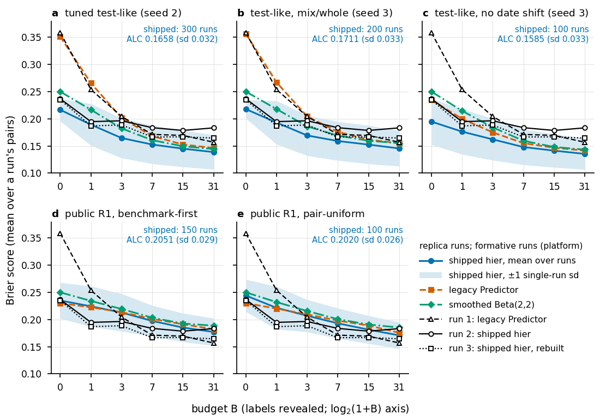

*Figure D1.* Brier by budget for hier-ship ("shipped hier" in the legend; the band is ±1 single-run sd), LegacyP ("legacy Predictor") and Smooth in five replica regimes: (a) TL, (b) TL-mix, (c) TL-noshift, (d) R1-bf, (e) R1-pu. Every panel overlays the pair means of the three formative runs. These are three draws with different subjects, so the gaps between them are not measured effects. The hier-ship curves use the run-2 library. The placement drawn here is raw, so it carries each run's $V$ (run 2's 0.1797 against 0.1384 on TL runs 0 to 299); App D.8 and Figure 2 (b) take $V$ out.

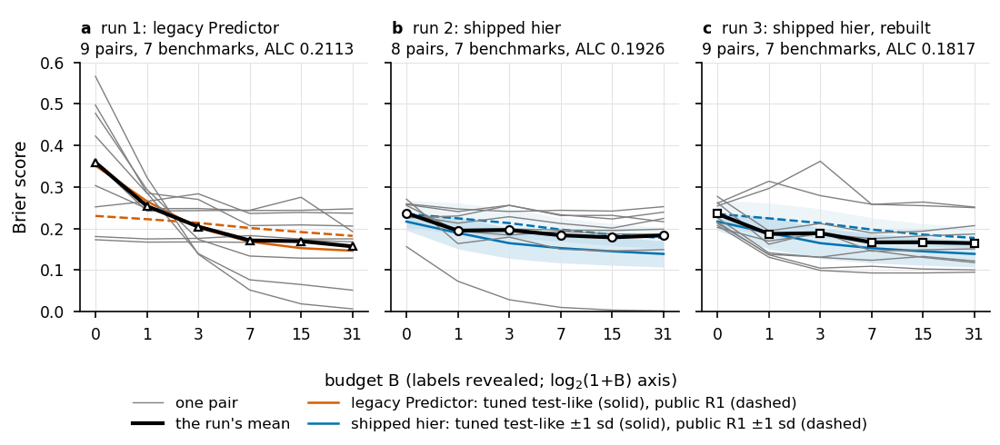

*Figure D2.* Each formative run's pairs (grey) and their mean (black) by budget, against the replica's mean for the run's model on tuned test-like runs (solid) and on public R1 runs (dashed). Over its 9 pairs, run 1's $B_0$ spans 0.17 to 0.57. For runs 2 and 3 it spans 0.16 to 0.27 and 0.20 to 0.28. Benchmarks are not labelled.

### D.3 What hier-ship was expected to score

Before run 2, the level audit's per-pair matched estimate of hier-rec's ALC on run 1 was about 0.178 (0.169 to 0.183). This estimate replaced the average-shift estimate of 0.167 for hier-rec, the level calibration's recommended configuration. By the same estimator, hier-ship's estimate on the audit's pool is 0.1812 with 15 neighbours among the replica pairs and 0.1830 with 40, where hier-rec scores 0.1824 and 0.1839. On hier-ship's own replica rows the estimate is 0.1774 and 0.1779. Across robustness variants on pools that hold test-like runs, it ranges from 0.1766 to 0.1824. Pools of public runs alone give 0.205, on matches about five times further away (F§ "Formative feedback, runs 1 and 2"; `experiments/level_audit.py` agrees, with 0.1765 and 0.1789).

Run 2 is a different draw, so these estimates predict a like-sized run and make no prediction for its particular pairs. Its 0.1926 lies 0.015 above the estimate on hier-ship's own replica rows ($z = +0.48$ in units of the test-like single-run sd). Run 2 did better than predicted at $B_0$ (by 0.008) and worse from $B_3$ on: by 0.017 to 0.022 at $B_3$ to $B_{15}$, and by 0.034 at $B_{31}$. Its pairs sit nearer a rate of 0.5 than run 1's (mean $B_{31}$ 0.183 against 0.157).

### D.4 The pooled reading of runs 1 and 2

The reading found the pooled level 1.0 to 1.2 SEs more central than that of the tuned test-like regime (TL). That is below the rule's bar of 2 SEs, and the reading proposed nothing. LEVEL has not changed since run 2.

After run 2, the level audit asked for the next feedback to be read per pair, pooled with run 1, before the level distribution was refitted once. Its decision rule could change only $\mu_0$ and $\sigma_\mu$. Before any matching of run 2's pairs and before any pooled reading was computed, we wrote into the results file what the reading could change and when, and hash-locked that text (F§ "Formative feedback, runs 1 and 2"). The rule was written at 2026-09-28 05:06:59 UTC (sha256 `0de18448…`), and the first reading ran at 05:13:48.

The hash fixes the rule's text, but the reading is not blind. The feedback tables of runs 1 and 2 had been seen when we wrote the rule, run 2's per-pair Brier included, and so had the audit's scratch outputs for run 1.

The rule may change one global hyperparameter only: the level distribution of a new benchmark ($\mu_0$ and $\sigma_\mu$ of LEVEL). It proposes a candidate only when two conditions hold. First, with both 15 and 40 neighbours per pair, the 17 pairs' mean (or sd) level must differ from TL's realised -1.29 (sd 1.70) by more than 2 SEs, computed by resampling the 7 benchmarks. Second, a guard must find no bias from the reading itself. Even then, a candidate would have to pass the level calibration's gate on fresh test-like runs set to the reading before it could ship.

The reading works on the continuity-corrected logit of each pair's rate. On the plain logit, the lower-root reading of run 1, whose root the tables do not identify (§3.1), averages -1.6 (sd 1.5), and the public R1 appearances average -0.74 (sd 1.50). Both values come from `experiments/hier_design/levels.json` (`r1`; F§ "Against the first real formative feedback"). On the continuity-corrected scale the two are -1.51 and -0.71 (`results/formative_feedback.json`). Read per pair against replica pairs, run 1's levels are spread both ways, a reading that chooses each pair's root by its neighbours (App C.5).

| reading (continuity-corrected pair logit) | mean (SE) | sd (SE) |
|---|---|---|
| runs 1 and 2, 17 pairs, 15 neighbours | -0.65 (0.51) | 1.80 (0.36) |
| runs 1 and 2, 17 pairs, 40 neighbours | -0.78 (0.51) | 1.75 (0.34) |
| tuned test-like regime, realised | -1.29 (0.16) | 1.70 |
| public R1, realised | -0.71 (0.12) | 1.42 |

The pooled mean is 1.24 (15 neighbours) and 1.00 (40 neighbours) SEs above TL's, and the pooled sd is 0.29 and 0.14 SEs above. Both differences are below the bar and the bias guard did not trip, so the rule gives no candidate.

On this scale the shipped LEVEL implies a mean of -1.15, a between-benchmark sd of 1.15 and a within-benchmark sd of 1.10. The 17 pairs are consistent with it: they give a between sd of 1.20 to 1.49 (90% interval from 0 to about 1.7) and a within sd of 1.01 to 1.40. A two-component mixture of levels is not supported (BIC differences of 0.68 and 0.38, against a bar of 2). The only structure in the pairs is two pairs near a zero rate.

Run 2's $B_0$ excess over $B_{31}$ does not sit mainly on low-rate pairs. With 15 neighbours it is 0.047 on the 4 pairs read below a rate of 0.5 and 0.078 on the 3 above, and the eighth pair, which has no real lower root, is kept apart. This split is descriptive, and under the reading rule it changes nothing. It also depends on the root; App D.6 bins hier-ship's excess by $V_{sb}$ instead, which needs no root (Table D.6d).

Run 3 is not added to the reading. The rule covered runs 1 and 2 only, and no level reading, matching or tuning was done on run 3 (`results/formative_run3.json`, `no_reading_or_tuning`). After the code was frozen on archive-3 (2026-10-06), run 3's table entered, with those of runs 1 and 2, the root-free analysis of App D.5 to D.10, which chose, tuned and changed nothing (App G.6).

The reading of runs 1 and 2 supports a modest conclusion: it puts the hidden level near the public centre, with an SE of about 0.5 logit, and more central than the regime in which the headline gain was measured, but within the noise of 7 benchmarks. The level audit's two regimes nearer that reading give hier-ship a margin of 0.022 to 0.029 over LegacyP, rather than 0.042. Regimes set to this reading and to the audit's, scored later under a rule fixed in advance, give it 0.025 to 0.031. No scored alternative beats hier-ship there (App E.2).

### D.5 The identity

Fix a pair $(s, b)$ and a budget $k$. $\mathcal R_{sb}$ lists the pair's $N$ evaluated responses $(i, y)$, every repeated trial counted. Each response carries its item's prediction $\hat p_i = \hat p^{(k)}_{si}$, made once per item, and $\bar y$ is the responses' success rate. The Brier score is $B_k = N^{-1}\sum_{(i, y) \in \mathcal R_{sb}} (\hat p_i - y)^2$. The ECE sorts the responses into ten equal-width bins of $\hat p_i$ and takes $\mathrm{ECE}_k = \sum_h (n_h / N)\,\lvert \bar{\hat p}_h - \bar y_h\rvert$, where bin $h$ holds $n_h$ responses with mean prediction $\bar{\hat p}_h$ and success rate $\bar y_h$ [P§ Scoring] (`paiec/official.py`, `ece`). Write $\operatorname{Var}_h$ and $\operatorname{Cov}_h$ for the variance and covariance over the responses of bin $h$. Expanding the square within each bin, and using $\sum_h (n_h/N)\,\bar y_h(1 - \bar y_h) = \bar y(1 - \bar y) - \sum_h (n_h/N)(\bar y_h - \bar y)^2$ for binary outcomes, gives

$$
B_k = \sum_h \frac{n_h}{N}(\bar{\hat p}_h - \bar y_h)^2 - \sum_h \frac{n_h}{N}(\bar y_h - \bar y)^2 + \bar y(1 - \bar y) + \sum_h \frac{n_h}{N}\big[\operatorname{Var}_h(\hat p) - 2\operatorname{Cov}_h(\hat p, y)\big]
$$

When each bin holds a single prediction value, the last sum vanishes and the display is the partition of the Brier score into reliability, minus resolution, plus uncertainty [Murphy 1973]. With one prediction $\hat p$ for all of the pair's responses, one bin is occupied, $\bar{\hat p}_h = \hat p$ and $\bar y_h = \bar y$, and the variance and covariance vanish:

$$
B_k = (\hat p - \bar y)^2 + \bar y(1 - \bar y), \qquad \mathrm{ECE}_k = \lvert \hat p - \bar y\rvert, \qquad B_k - \mathrm{ECE}_k^2 = \bar y(1 - \bar y) = V_{sb}
$$

This is the one-bin case: the reliability is $\mathrm{ECE}_k^2$, the resolution is zero and the uncertainty is $V_{sb}$, the Brier score of the pair-rate oracle.

For any predictions, the within-pair resolution $R_k = V_{sb} - (B_k - \mathrm{ECE}_k^2)$ makes $B_k - V_{sb} = \mathrm{ECE}_k^2 - R_k$ hold exactly. From the first display,

$$
R_k = \sum_h \frac{n_h}{N}(\bar y_h - \bar y)^2 + \sum_h \frac{n_h}{N}\big[2\operatorname{Cov}_h(\hat p, y) - \operatorname{Var}_h(\hat p)\big] - \Big[\sum_h \frac{n_h}{N}(\bar{\hat p}_h - \bar y_h)^2 - \mathrm{ECE}_k^2\Big]
$$

The last bracket is non-negative, because $\mathrm{ECE}_k$ is a weighted mean of $\lvert \bar{\hat p}_h - \bar y_h\rvert$. If all of a pair's predictions fall into one bin, $R_k = 2\operatorname{Cov}(\hat p, y) - \operatorname{Var}(\hat p)$ over its responses, positive when the predictions follow the outcomes more than they spread. $R_k$ is zero when a pair gets one value, as LegacyP's pairs did in run 1. hier's multiple-choice floors and group effects give a pair's items different predictions, so its $R_k$ need not be zero. The results file calls $R_{31}$ `within_pair_resolution_b31`.

The identity needs two conditions: one prediction for all of the pair's evaluated responses at the budget, and an ECE taken on responses with the Brier score's success rate. If the ECE's rate were $\bar y'$ instead of $\bar y$, then $B_k - \mathrm{ECE}_k^2 = \bar y(1 - \bar y) + (\hat p - \bar y)^2 - (\hat p - \bar y')^2$, which moves linearly with $\hat p$ unless $\bar y' = \bar y$. By design LegacyP's predictions within a pair differ only through the multiple-choice floor and, once a benchmark has 64 distinct labelled items, through item difficulty, which is zero below that (`paiec/predict.py`, `BenchmarkFit.WARMUP`). One value per pair is therefore expected of it but not guaranteed. Its predictions moved between budgets: its mean ECE falls from 0.381 at $B_0$ to 0.047 at $B_{31}$. <!-- src: results/hidden_runs.json identity.run1.mean_ece_by_budget --> So the constancy of run 1 (Table D.5a) checks both conditions together on the organisers' own tables.

A table value is rounded to six decimals. One estimate $B_k - \mathrm{ECE}_k^2$ is then off by at most $5 \times 10^{-7} + 10^{-6}\,\mathrm{ECE}_k$ (plus a term below $10^{-12}$), and a pair's range over the six budgets by at most the sum of its two largest such errors. In run 1 the largest per-pair range is 0.89 of its pair's bound. <!-- src: results/hidden_runs.json identity.run1.per_pair_range_over_bound_max -->

*Table D.5a: $B_k - \mathrm{ECE}_k^2$ by budget on the hidden runs.*

| run | predictor | pairs | run mean of $B_k - \mathrm{ECE}_k^2$, $B_0$ to $B_{31}$ | range of the run mean | largest per-pair range | pairs within the rounding bound |
|---|---|---|---|---|---|---|
| 1 | LegacyP | 9 | 0.1536 0.1536 0.1536 0.1536 0.1536 0.1536 | $1.5 \times 10^{-7}$ | $1.13 \times 10^{-6}$ | 9 of 9 |
| 2 | hier-ship | 8 | 0.1797 0.1795 0.1777 0.1753 0.1746 0.1759 | 0.0050 | 0.0236 | 2 of 8 |
| 3 | hier-ship | 9 | 0.1608 0.1611 0.1609 0.1589 0.1602 0.1584 | 0.0027 | 0.0137 | 4 of 9 |

Source: `experiments/hidden_runs.py`, `results/hidden_runs.json` (`identity`), from the organisers' tables `results/formative/run1.txt` to `run3.txt`. <!-- src: results/hidden_runs.json identity.run1.{mean_B_minus_ece2_by_budget, range_of_run_mean_over_budgets, per_pair_range_max, pairs_within_rounding_bound, pairs}; identity.run2.{same}; identity.run3.{same} -->

For hier-ship we estimate $V_{sb}$ at $B_0$. On replica rows the evaluated rate $p$ of every appearance is known, so the estimator can be checked against $V_{sb} = p(1-p)$. Table D.5b gives the error of $B_k - \mathrm{ECE}_k^2$ on hier-ship's rows of the RS study, in its five regimes and on both public weightings (seed 11, the archive-3 library).

*Table D.5b: Error of $B_k - \mathrm{ECE}_k^2$ as an estimate of $p(1-p)$, hier-ship's replica rows, mean (sd over appearances).*

| regime (realised level) | number of appearances | $B_0$ | $B_1$ | $B_3$ | $B_{31}$ |
|---|---|---|---|---|---|
| tuned (-1.28) | 671 | -0.00011 (0.0010) | -0.00044 (0.0023) | -0.0019 (0.0074) | -0.0098 (0.0188) |
| reading (-0.63) | 671 | -0.00013 (0.0012) | -0.00075 (0.0034) | -0.0021 (0.0073) | -0.0120 (0.0219) |
| audit (-0.93) | 654 | -0.00011 (0.0012) | -0.00060 (0.0058) | -0.0018 (0.0064) | -0.0090 (0.0173) |
| mixture (-0.64) | 627 | -0.00020 (0.0016) | -0.00059 (0.0027) | -0.0023 (0.0065) | -0.0114 (0.0191) |
| flat (-0.28) | 650 | -0.00013 (0.0011) | -0.00059 (0.0028) | -0.0015 (0.0058) | -0.0092 (0.0170) |
| R1-bf (-0.56) | 528 | -0.00011 (0.0012) | -0.00163 (0.0053) | -0.0038 (0.0099) | -0.0201 (0.0295) |
| R1-pu (-0.77) | 528 | -0.00005 (0.0010) | -0.00187 (0.0074) | -0.0055 (0.0151) | -0.0183 (0.0301) |

Source: `results/hidden_runs.json` (`replica.validation`), read from the RS study's rows (`experiments/regime_sensitivity.py`, seed 11; `data/regime_sensitivity_rows/`, gitignored); realised levels from `results/regime_sensitivity.json` (`summary.realised`). <!-- src: results/hidden_runs.json replica.validation.<R>.{appearances, bias_by_budget, sd_by_budget} for R in TUNED, READING, AUDIT, MIXTURE, FLAT, R1B, R1P; realised levels results/regime_sensitivity.json summary.realised.<R>.mean -->

At $B_0$ the bias is at most 0.0002 in size, against an sd of 0.0010 to 0.0016 per appearance. By $B_{31}$ the bias has grown to -0.009 to -0.020, as hier-ship's predictions within a pair spread. <!-- src: results/hidden_runs.json replica.validation_summary.{b0_bias_range, b0_sd_range, b31_bias_range} --> The hidden runs show the same drift (Table D.5a: from $B_7$ on, $B_k - \mathrm{ECE}_k^2$ lies below its $B_0$ value on runs 2 and 3), so $B_0$ is the estimator. The lower-root reading of report v1.0.1 took $p(1-p) = B_{31}$ itself. App D.10 gives how far $B_{31}$ exceeds $V$ on the hidden runs.

hier-ship's $V$ is an estimate, whose error ALC minus $V$ carries with the opposite sign, and it could err more than on the replica if hidden items spread its $B_0$ predictions more (§8). The ideal learner (App D.7) is a simulation, and the item-level share (§3.3) assumes public-like heterogeneity within pairs. <!-- moved from §3.4 on 2026-10-20 -->

Each $V_{sb} \le 0.25$ has two roots, $p = \tfrac12 \pm \sqrt{\tfrac14 - V_{sb}}$, and the tables do not say which one holds. No level is read from $V$ (§3.1).

### D.6 The decomposition in full

Every value here takes $V$ from $B_0$ (§3.2; `v` in the results file). The pair SEs treat the pairs as independent. The benchmark ids group pairs only in the bootstraps of App D.9 (`about.id_use` in the results file), so no benchmark-cluster SE is given, and these SEs may be optimistic if pairs on one benchmark move together. They hold no run-level noise; App D.8 has that.

*Table D.6a: $B_k - V$ by budget on the hidden runs, mean (pair SE).*

| run | predictor | pairs | $B_0$ | $B_1$ | $B_3$ | $B_7$ | $B_{15}$ | $B_{31}$ | ALC $-\,V$ |
|---|---|---|---|---|---|---|---|---|---|
| 1 | LegacyP | 9 | 0.2052 (0.0694) | 0.1003 (0.0389) | 0.0507 (0.0151) | 0.0175 (0.0081) | 0.0157 (0.0101) | 0.0031 (0.0013) | 0.0577 (0.0190) |
| 2 | hier-ship | 8 | 0.0572 (0.0201) | 0.0150 (0.0085) | 0.0166 (0.0053) | 0.0039 (0.0021) | -0.0012 (0.0018) | 0.0036 (0.0037) | 0.0130 (0.0046) |
| 3 | hier-ship | 9 | 0.0743 (0.0148) | 0.0260 (0.0073) | 0.0277 (0.0117) | 0.0056 (0.0025) | 0.0059 (0.0019) | 0.0036 (0.0034) | 0.0208 (0.0026) |
| 2 and 3 | hier-ship | 17 | 0.0662 (0.0121) | 0.0208 (0.0056) | 0.0225 (0.0066) | 0.0048 (0.0016) | 0.0026 (0.0016) | 0.0036 (0.0024) | 0.0171 (0.0027) |

Source: `results/hidden_runs.json` (`decomposition`, `decomposition.*.pair_se`). <!-- src: results/hidden_runs.json decomposition.<run1|run2|run3|hier_pooled>.{pairs, excess_by_budget, alc_minus_v}; decomposition.<same>.pair_se.{excess_by_budget_pair_se, alc_minus_v_pair_se} -->

*Table D.6b: The three weighted terms of ALC minus $V$, with pair SEs, and the share of ALC minus $V$ paid at $B_0$, $B_1$ and $B_3$.*

| run | $0.1\,(B_0 - V)$ | $0.2\,(B_1 + B_3 + B_7 + B_{15} - 4V)$ | $0.1\,(B_{31} - V)$ | share at $B_0$, $B_1$, $B_3$ |
|---|---|---|---|---|
| 1 | 0.0205 (0.0069) | 0.0368 (0.0122) | 0.0003 (0.0001) | 0.88 |
| 2 | 0.0057 (0.0020) | 0.0069 (0.0028) | 0.0004 (0.0004) | 0.93 |
| 3 | 0.0074 (0.0015) | 0.0130 (0.0035) | 0.0004 (0.0003) | 0.87 |

Source: `results/hidden_runs.json` (`decomposition`, `decomposition.*.pair_se.terms_pair_se`). <!-- src: results/hidden_runs.json decomposition.<run1|run2|run3>.{b0_term, b1_b15_terms, b31_term, share_b0_b1_b3}; decomposition.<same>.pair_se.terms_pair_se.{b0_term, b1_b15_terms, b31_term} -->

The other convention subtracts $\mathrm{ECE}_k^2$ budget by budget, so it measures $\sum_k w_k \mathrm{ECE}_k^2$. The two differ by $\sum_k w_k R_k$, the weighted within-pair resolution ($R_0 = 0$ when $V$ comes from $B_0$). For LegacyP they agree. For hier-ship the per-budget convention is higher, 0.0157 against 0.0130 on run 2 and 0.0215 against 0.0208 on run 3. hier-ship's $R_{31}$ is 0.0038 on run 2 and 0.0024 on run 3 (0.0031 over the 17 pairs), with 2 and 1 pairs at 0.011 or more (3 of the 17). <!-- src: results/hidden_runs.json decomposition.run2.alc_minus_v_ece2_convention; decomposition.run3.alc_minus_v_ece2_convention; decomposition.<run2|run3|hier_pooled>.within_pair_resolution_b31.{mean, "pairs_ge_0.011"} -->

*Table D.6c: The per-budget convention.*

| run | mean $\mathrm{ECE}_k^2$, $B_0$ to $B_{31}$ | $\sum_k w_k \mathrm{ECE}_k^2$ | ALC $-\,V$ | $R_{31}$ |
|---|---|---|---|---|
| 1 | 0.2052 0.1003 0.0507 0.0175 0.0157 0.0031 | 0.0577 | 0.0577 | 0.0000 |
| 2 | 0.0572 0.0152 0.0186 0.0083 0.0038 0.0074 | 0.0157 | 0.0130 | 0.0038 |
| 3 | 0.0743 0.0258 0.0276 0.0075 0.0065 0.0060 | 0.0215 | 0.0208 | 0.0024 |

Source: `results/hidden_runs.json` (`identity`, `decomposition`). <!-- src: results/hidden_runs.json identity.<run1|run2|run3>.mean_ece2_by_budget; decomposition.<run1|run2|run3>.{alc_minus_v_ece2_convention, alc_minus_v, within_pair_resolution_b31.mean} -->

hier-ship's cost per pair falls as the pair's rate nears 0.5. Over the 17 pairs of runs 2 and 3, binned on $V_{sb}$, it is 0.0274 on the 3 pairs below 0.10 and 0.0134 on the 6 pairs at 0.20 or above; the 8 pairs between hold 0.44 of the cost. <!-- src: results/hidden_runs.json decomposition.hier_pooled.bins.<bin>.{pairs, alc_minus_v, share_of_pooled_alc_minus_v} --> Runs 1 to 3 have 3, 4 and 2 pairs with $V_{sb} \ge 0.20$ and 2, 1 and 2 pairs below 0.10; the pair sd of $V_{sb}$ is 0.082, 0.079 and 0.058. <!-- src: results/hidden_runs.json decomposition.<run1|run2|run3>.{"pairs_v_ge_0.20", "pairs_v_lt_0.10", pair_v_sd} -->

*Table D.6d: Hier-ship's $B_k - V$ in bins of $V_{sb}$, runs 2 and 3.*

| $V_{sb}$ | pairs | $B_0$ | $B_1$ | $B_3$ | $B_7$ | $B_{15}$ | $B_{31}$ | ALC $-\,V$ | share of the pooled ALC $-\,V$ |
|---|---|---|---|---|---|---|---|---|---|
| below 0.10 | 3 | 0.1289 | 0.0494 | 0.0133 | 0.0066 | 0.0023 | 0.0015 | 0.0274 | 0.28 |
| 0.10 to 0.20 | 8 | 0.0828 | 0.0100 | 0.0169 | 0.0050 | 0.0045 | 0.0047 | 0.0160 | 0.44 |
| 0.20 or above | 6 | 0.0128 | 0.0210 | 0.0345 | 0.0036 | 0.0002 | 0.0032 | 0.0134 | 0.28 |

Source: `results/hidden_runs.json` (`decomposition.hier_pooled.bins`). The middle bin includes 0.10 and excludes 0.20. <!-- src: results/hidden_runs.json decomposition.hier_pooled.bins."v < 0.10"; bins."0.10 <= v < 0.20"; bins."v >= 0.20" (pairs, excess_by_budget, alc_minus_v, share_of_pooled_alc_minus_v) -->

### D.7 The ideal pair-rate learner

*Information set.* The learner knows a population prior over the pair's rate, $\operatorname{logit} p \sim \mathcal N(m, \sigma_{\mathrm{pop}}^2)$, and sees the pair's own labels. It has no subject attributes, no other pair's labels, no item features and no item identity. It therefore gives one prediction for all of a pair's items, and its $R_k$ is zero.

*Prediction.* After $j$ successes in $k$ labels it predicts the posterior mean of $p$ on a grid of 721 logits $\ell_g$ from -9 to 9: <!-- src: experiments/hidden_runs.py GRID = np.linspace(-9, 9, 721), qtable (design constants, not results) -->

$$
\hat p_k(j) = \frac{\sum_g \phi_g\,\pi_g^{\,j+1}(1 - \pi_g)^{k - j}}{\sum_g \phi_g\,\pi_g^{\,j}(1 - \pi_g)^{k - j}}, \qquad \pi_g = \operatorname{logit}^{-1}\ell_g, \qquad \phi_g \propto \exp\!\Big(-\frac{(\ell_g - m)^2}{2\sigma_{\mathrm{pop}}^2}\Big)
$$

Its Brier score at budget $k$ is $V_{sb} + \big(\hat p_k(j) - \bar y_{sb}\big)^2$. At $B_0$ it predicts the prior mean $\hat p_0(0)$.

*Labels.* For a pair with $n$ evaluated items and evaluated rate $\bar y_{sb}$, the acquisition pool also has $n$ items. Its number of successes is $\mathrm{Binomial}(n, \theta)$ with $\theta \sim \mathrm{Beta}\big(n\bar y_{sb} + 1,\ n(1 - \bar y_{sb}) + 1\big)$, the split noise between the halves of a pair whose items are alike. The labels are the first $k$ items of a random order of the pool, so they are drawn without replacement. Each pair and root gets 600 simulated orders (seed 11), and the excess is averaged over the pairs. <!-- src: experiments/hidden_runs.py ideal (sim_pair sims=600; design constant); results/hidden_runs.json provenance.seeds.ideal --> Items within a pair are exchangeable in the simulation.

*Roots.* $V_{sb}$ gives $p_\pm = \tfrac12 \pm \sqrt{\tfrac14 - V_{sb}}$, with $V_{sb}$ clipped to $[10^{-4}, 0.25]$. <!-- src: experiments/hidden_runs.py ideal (clip; design constant) --> We report the lower root, the upper root, and their mixture, with the lower root's weight $\phi(\operatorname{logit} p_-) / \big(\phi(\operatorname{logit} p_-) + \phi(\operatorname{logit} p_+)\big)$ under the prior density $\phi$.

*Priors.* We use three, given as $(m, \sigma_{\mathrm{pop}})$: the lower-root reading of run 1, (-1.6, 1.5) (`team inference` in the results file); about the pooled reading of runs 1 and 2 (App D.4), (-0.70, 1.75) (`pooled reading`); and about public R1's realised level, (-0.70, 1.42) (`R1-like`). <!-- src: results/hidden_runs.json ideal key names "team inference (-1.6, 1.5) | runs (2, 3)", "pooled reading (-0.70, 1.75) | runs (2, 3)", "R1-like (-0.70, 1.42) | runs (2, 3)" -->

The learner is a reference for the cost of learning a pair's rate from its own labels. It is not a bound on hier-ship, which also sees subject attributes, the other pairs' labels in the shared `labeled` list, and item structure.

*Table D.7a: $B_k - V$ by budget, the ideal learner against hier-ship on the 17 pairs of runs 2 and 3.*

| learner | prior | root | $B_0$ | $B_1$ | $B_3$ | $B_7$ | $B_{15}$ | $B_{31}$ | ALC $-\,V$ |
|---|---|---|---|---|---|---|---|---|---|
| hier-ship, observed | | | 0.0662 | 0.0208 | 0.0225 | 0.0048 | 0.0026 | 0.0036 | 0.0171 |
| ideal | (-1.6, 1.5) | lower | 0.0170 | 0.0216 | 0.0202 | 0.0155 | 0.0110 | 0.0076 | 0.0161 |
| ideal | (-1.6, 1.5) | prior-weighted | 0.0485 | 0.0388 | 0.0279 | 0.0184 | 0.0118 | 0.0078 | 0.0250 |
| ideal | (-1.6, 1.5) | upper | 0.2783 | 0.1663 | 0.0834 | 0.0378 | 0.0181 | 0.0095 | 0.0899 |
| ideal | (-0.70, 1.75) | lower | 0.0362 | 0.0372 | 0.0283 | 0.0192 | 0.0122 | 0.0080 | 0.0238 |
| ideal | (-0.70, 1.75) | prior-weighted | 0.0710 | 0.0526 | 0.0348 | 0.0212 | 0.0129 | 0.0081 | 0.0322 |
| ideal | (-0.70, 1.75) | upper | 0.1498 | 0.0876 | 0.0488 | 0.0257 | 0.0142 | 0.0085 | 0.0511 |
| ideal | (-0.70, 1.42) | lower | 0.0331 | 0.0308 | 0.0242 | 0.0173 | 0.0117 | 0.0079 | 0.0209 |
| ideal | (-0.70, 1.42) | prior-weighted | 0.0637 | 0.0476 | 0.0318 | 0.0201 | 0.0125 | 0.0081 | 0.0296 |
| ideal | (-0.70, 1.42) | upper | 0.1586 | 0.0993 | 0.0542 | 0.0283 | 0.0149 | 0.0087 | 0.0561 |

Source: `results/hidden_runs.json` (`ideal`; seed in `provenance.seeds.ideal`). <!-- src: results/hidden_runs.json ideal."<prior> | runs (2, 3)".{lower, mix, upper, observed, alc_minus_v.lower, alc_minus_v.mix, alc_minus_v.upper, alc_minus_v.observed} for prior in "team inference (-1.6, 1.5)", "pooled reading (-0.70, 1.75)", "R1-like (-0.70, 1.42)" -->

*Table D.7b: ALC minus $V$ of the ideal learner, runs 2 and 3 (hier-ship observed: 0.0171) and run 1 (LegacyP observed: 0.0577).*

| prior | runs 2 and 3: lower | prior-weighted | upper | run 1: lower | prior-weighted | upper |
|---|---|---|---|---|---|---|
| (-1.6, 1.5) | 0.0161 | 0.0250 | 0.0899 | 0.0155 | 0.0246 | 0.0981 |
| (-0.70, 1.75) | 0.0238 | 0.0322 | 0.0511 | 0.0248 | 0.0330 | 0.0550 |
| (-0.70, 1.42) | 0.0209 | 0.0296 | 0.0561 | 0.0228 | 0.0314 | 0.0624 |

Source: `results/hidden_runs.json` (`ideal`, `decomposition`; seed in `provenance.seeds.ideal`). <!-- src: results/hidden_runs.json ideal."<prior> | runs (2, 3)".alc_minus_v.{lower, mix, upper}; ideal."<prior> | runs (1,)".alc_minus_v.{lower, mix, upper}; observed decomposition.hier_pooled.alc_minus_v; decomposition.run1.alc_minus_v -->

hier-ship's 0.0171 lies between the lower-root learner under the first prior (0.0161) and the prior-weighted learners (0.0250 to 0.0322). In that sense it learns pair rates at the level of an ideal learner with a population prior. <!-- src: results/hidden_runs.json ideal.summary_hier.{observed_hier, lower_roots_team_prior, prior_weighted_range} --> At $B_0$ hier-ship pays 0.0662, about what the prior-weighted learners pay (0.049 to 0.071). From $B_1$ on it pays less than each of them, starting with 0.0208 against their 0.039 to 0.053 at $B_1$. <!-- src: results/hidden_runs.json ideal."<prior> | runs (2, 3)".mix; decomposition.hier_pooled.excess_by_budget -->

Its $B_3$ then exceeds its $B_1$ by more than 0.01 in 8 of the 17 pairs. <!-- src: results/hidden_runs.json curve.shape."pairs_B3_gt_B1_plus_0.01" --> App D.10 compares that count with an ideal learner whose prior is the truth: it is weak evidence that hier-ship's curve rises more often than label noise alone would make it. hier-ship's advantage at $B_1$ is therefore consistent with favourable first labels as much as with structure.

From $B_7$ on hier-ship pays 0.0048, 0.0026 and 0.0036, less than every variant of the learner (at least 0.0155, 0.0110 and 0.0076 at $B_7$, $B_{15}$ and $B_{31}$). At $B_7$ and $B_{15}$ the gap to the closest variant is about 6.8 and 5.4 of hier-ship's pair SEs, more than the noise of 17 pairs would give. It points to information the learner lacks: subject attributes, the other pairs' labels and item structure. At $B_{31}$ the gap is about 1.6 pair SEs, which noise alone could give. These SEs treat the pairs as independent (App D.6). <!-- src: [derived] (min over the nine variants of ideal."<prior> | runs (2, 3)".<lower|mix|upper>[k] minus decomposition.hier_pooled.excess_by_budget[k]) / decomposition.hier_pooled.pair_se.excess_by_budget_pair_se[k] for k = B7, B15, B31: 6.77, 5.38, 1.64 --> LegacyP in run 1 pays 0.0577 against 0.0155 to 0.0248 at the lower roots and 0.0246 to 0.0330 weighted by the prior. At $B_0$ alone it pays 0.2052 against the prior-weighted learners' 0.049 to 0.080. <!-- src: results/hidden_runs.json decomposition.run1.{alc_minus_v, excess_by_budget}; ideal."<prior> | runs (1,)".{alc_minus_v.lower, alc_minus_v.mix, mix} -->

### D.8 Placement and noise adjusted for the pair-rate oracle, and the raw placement

The replica side is the RS study's rows (seed 11; 80 runs per test-like regime and 60 per public weighting; the archive-3 library; `data/regime_sensitivity_rows/`, gitignored). Each hidden run meets the rows of its own predictor: LegacyP for run 1, hier-ship for runs 2 and 3. Run 2's archive (`ee5085a`) predates the corrected multiple-choice floor. Measured offline, the code gap between runs 2 and 3 is at most 0.00046 (App D.1), and it is not added to the rows. On the replica, ALC minus $V$ uses each appearance's known $p(1-p)$; on the hidden runs $V$ comes from $B_0$ (§3.1). <!-- src: results/hidden_runs.json replica.noise.<R>.<ship|legacy>.runs; experiments/hidden_runs.py replica (known v = p(1-p) per appearance) -->

*Table D.8a: The single-run spread of ALC and of ALC minus $V$ on the replica, mean (single-run sd); the ratio is the sd of ALC over the sd of ALC minus $V$.*

| regime (realised level) | runs | $V$ | hier-ship ALC | hier-ship ALC $-\,V$ | ratio | LegacyP ALC | LegacyP ALC $-\,V$ | ratio |
|---|---|---|---|---|---|---|---|---|
| tuned (-1.28) | 80 | 0.1411 | 0.1690 (0.0269) | 0.0279 (0.0097) | 2.77 | 0.2124 (0.0214) | 0.0713 (0.0187) | 1.14 |
| reading (-0.63) | 80 | 0.1607 | 0.1881 (0.0260) | 0.0275 (0.0095) | 2.72 | 0.2130 (0.0232) | 0.0523 (0.0137) | 1.69 |
| audit (-0.93) | 80 | 0.1343 | 0.1650 (0.0298) | 0.0307 (0.0086) | 3.45 | 0.1963 (0.0254) | 0.0621 (0.0168) | 1.51 |
| mixture (-0.64) | 80 | 0.1540 | 0.1830 (0.0276) | 0.0290 (0.0091) | 3.02 | 0.2093 (0.0269) | 0.0553 (0.0143) | 1.88 |
| flat (-0.28) | 80 | 0.1412 | 0.1739 (0.0265) | 0.0328 (0.0094) | 2.83 | 0.1940 (0.0253) | 0.0528 (0.0174) | 1.45 |
| R1-bf (-0.56) | 60 | 0.1864 | 0.2114 (0.0229) | 0.0250 (0.0092) | 2.48 | 0.2116 (0.0203) | 0.0252 (0.0086) | 2.36 |
| R1-pu (-0.77) | 60 | 0.1709 | 0.1948 (0.0256) | 0.0239 (0.0109) | 2.34 | 0.1988 (0.0213) | 0.0279 (0.0102) | 2.09 |

Source: `results/hidden_runs.json` (`replica.noise`). <!-- src: results/hidden_runs.json replica.noise.<R>.ship.{runs, v, alc, alc_sd, alc_minus_v, alc_minus_v_sd, sd_ratio_raw_over_vadjusted}; replica.noise.<R>.legacy.{same}; realised levels results/regime_sensitivity.json summary.realised.<R>.mean -->

For hier-ship, adjusting for $V$ cuts the single-run sd by a factor of 2.3 to 3.4 in every regime. <!-- src: results/hidden_runs.json replica.noise_summary.ship_sd_ratio_range --> For LegacyP the factor is 1.14 to 2.36, lowest in the tuned regime, where its ALC minus $V$ has a single-run sd of 0.0187. Run 1's ALC minus $V$, 0.0577, lies between the reading regime's 0.0523 and the tuned regime's 0.0713, and far above public runs' 0.0252 and 0.0279. <!-- src: results/hidden_runs.json decomposition.run1.alc_minus_v; replica.noise.<READING|TUNED|R1B|R1P>.legacy.alc_minus_v -->

A hidden run's placement in a regime is

$$
z_k = \frac{\overline{(B_k - V)}_{\mathrm{hidden}} - m_k}{s_k}
$$

where $m_k$ and $s_k$ are the mean and the single-run sd of the regime's run means of $B_k - V$; the same holds for ALC minus $V$. The regime's runs have formative size, so the pooled 17 pairs of runs 2 and 3, set against the same sd, have a $z$ that understates their precision.

*Table D.8b: Run 1 against LegacyP's replica runs, $z$ adjusted for $V$.*

| regime (realised level) | $B_0$ | $B_1$ | $B_3$ | $B_7$ | $B_{15}$ | $B_{31}$ | ALC $-\,V$ |
|---|---|---|---|---|---|---|---|
| tuned (-1.28) | -0.12 | -0.79 | -0.64 | -1.25 | +0.10 | -0.57 | -0.73 |
| reading (-0.63) | +1.01 | +0.20 | +0.17 | -0.86 | +0.26 | -0.54 | +0.39 |
| audit (-0.93) | +0.26 | -0.37 | -0.36 | -0.85 | +0.33 | -0.56 | -0.26 |
| mixture (-0.64) | +0.97 | +0.08 | -0.11 | -0.94 | +0.10 | -0.72 | +0.17 |
| flat (-0.28) | +1.01 | +0.13 | -0.09 | -0.66 | +0.62 | -0.71 | +0.28 |
| R1-bf (-0.56) | +8.87 | +4.24 | +1.46 | -0.37 | +0.41 | +0.25 | +3.78 |
| R1-pu (-0.77) | +7.21 | +2.78 | +1.20 | -0.30 | +0.42 | +0.34 | +2.93 |

Source: `results/hidden_runs.json` (`replica.placement_z`). Against the test-like rows, run 1 is out of sample only at $B_3$ to $B_{15}$; at $B_0$, $B_1$ and $B_{31}$ it is partly in sample (§3.4). <!-- src: results/hidden_runs.json replica.placement_z.<R>."run1 (LegacyP)".{z_by_budget, z_alc_minus_v} -->

*Table D.8c: Runs 2 and 3 pooled (17 pairs) against hier-ship's replica runs, $z$ adjusted for $V$.*

| regime (realised level) | $B_0$ | $B_1$ | $B_3$ | $B_7$ | $B_{15}$ | $B_{31}$ | ALC $-\,V$ |
|---|---|---|---|---|---|---|---|
| tuned (-1.28) | -0.37 | -1.17 | -0.41 | -1.15 | -0.59 | +0.58 | -1.11 |
| reading (-0.63) | -0.30 | -1.33 | -0.33 | -1.16 | -0.59 | +0.64 | -1.08 |
| audit (-0.93) | -1.01 | -1.67 | -0.49 | -1.08 | -0.70 | +0.42 | -1.57 |
| mixture (-0.64) | -0.38 | -1.35 | -0.50 | -1.60 | -0.67 | +0.51 | -1.30 |
| flat (-0.28) | -1.09 | -1.73 | -0.58 | -1.43 | -0.61 | +0.52 | -1.67 |
| R1-bf (-0.56) | +0.41 | -1.12 | -0.50 | -1.05 | -0.35 | +0.67 | -0.85 |
| R1-pu (-0.77) | +0.30 | -0.90 | -0.30 | -0.87 | -0.15 | +0.78 | -0.62 |

Source: `results/hidden_runs.json` (`replica.placement_z`). <!-- src: results/hidden_runs.json replica.placement_z.<R>."runs 2+3 (hier)".{z_by_budget, z_alc_minus_v} -->

*Table D.8d: $z$ of raw ALC beside $z$ of ALC minus $V$, same rows.*

| regime (realised level) | run 1: raw | adjusted | runs 2 and 3: raw | adjusted | run 2: raw | adjusted | run 3: raw | adjusted |
|---|---|---|---|---|---|---|---|---|
| tuned (-1.28) | -0.05 | -0.73 | +0.66 | -1.11 | +0.88 | -1.54 | +0.47 | -0.73 |
| reading (-0.63) | -0.07 | +0.39 | -0.05 | -1.08 | +0.17 | -1.52 | -0.25 | -0.70 |
| audit (-0.93) | +0.59 | -0.26 | +0.73 | -1.57 | +0.93 | -2.06 | +0.56 | -1.15 |
| mixture (-0.64) | +0.07 | +0.17 | +0.14 | -1.30 | +0.35 | -1.76 | -0.05 | -0.90 |
| flat (-0.28) | +0.69 | +0.28 | +0.49 | -1.67 | +0.71 | -2.11 | +0.29 | -1.27 |
| R1-bf (-0.56) | -0.02 | +3.78 | -1.07 | -0.85 | -0.82 | -1.30 | -1.30 | -0.45 |
| R1-pu (-0.77) | +0.59 | +2.93 | -0.31 | -0.62 | -0.09 | -1.00 | -0.51 | -0.28 |

Source: `results/hidden_runs.json` (`replica.placement_raw`, `replica.placement_raw_summary`). <!-- src: results/hidden_runs.json replica.placement_raw_summary.side_by_side_z_alc.<"run1 (LegacyP)"|"runs 2+3 (hier)"|"run2 (hier)"|"run3 (hier)">.<R>.{raw, v_adjusted} -->

Raw ALC does not separate the regimes for run 1: its raw $z$ is -0.07 to +0.69 in the test-like regimes and -0.02 and +0.59 on public runs. <!-- src: results/hidden_runs.json replica.placement_raw_summary.z_alc_range_test_like."run1 (LegacyP)"; replica.placement_raw_summary.side_by_side_z_alc."run1 (LegacyP)".<R1B|R1P>.raw --> Adjusted for $V$, run 1 rejects public runs as a description of LegacyP on the hidden test: $z$ is +8.87 and +7.21 at $B_0$, +4.24 and +2.78 at $B_1$, and +3.78 and +2.93 on ALC minus $V$, against R1-bf and R1-pu. <!-- src: results/hidden_runs.json replica.placement_summary.run1_vs_R1B_B0_B1; replica.placement_summary.run1_vs_R1P_B0_B1; replica.placement_z.<R1B|R1P>."run1 (LegacyP)".z_alc_minus_v --> This premise of the level calibration now holds without a root (§6.2). Against the test-like regimes, run 1's adjusted $z$ is -1.25 to +1.01 at every budget. At $B_0$, $B_1$ and $B_{31}$ that agreement is partly in sample, and at $B_3$ to $B_{15}$ it was never a tuning target (§3.4). <!-- src: results/hidden_runs.json replica.placement_summary.run1_vs_test_like_range -->

For hier-ship the raw $z$ is positive against four of the five test-like regimes, whose $V$ (0.1343 to 0.1607) lies below the hidden pairs' 0.1697. <!-- src: results/hidden_runs.json replica.placement_raw_summary.side_by_side_z_alc."runs 2+3 (hier)"; replica.noise.<R>.ship.v; decomposition.hier_pooled.v --> Adjusted for $V$, runs 2 and 3 sit at $z$ -1.08 to -1.67 on ALC minus $V$ in the test-like regimes and -0.85 and -0.62 on public runs; per run and budget the $z$ spans -1.97 to +0.78. <!-- src: results/hidden_runs.json replica.placement_z.<R>."runs 2+3 (hier)".z_alc_minus_v; replica.placement_summary.hier_per_run_range --> It is highest at $B_{31}$ (+0.42 to +0.78 pooled), the late-budget gap of App D.10.

### D.9 What a run's composition allows, and the organisers' entry

A bootstrap run has 9 pairs. Drawn iid, they come from the 26 appearances of runs 1 to 3 (for $V$) or from the 17 hier-ship pairs of runs 2 and 3 (for hier-ship's ALC). Stratified, each of the 7 benchmarks enters once and two benchmarks drawn at random enter twice, with values resampled within benchmark. The anonymous benchmark ids group the pairs and are written nowhere. There are 20,000 runs per version (seed 7). <!-- src: results/hidden_runs.json run_spread.{boots, benchmarks, pairs}; provenance.seeds.stream7 -->

*Table D.9a: Run-level $V$ and hier-ship's run-level ALC on bootstrap runs of 9 pairs.*

| quantity | draw | mean | sd | 5th percentile | 1st percentile | $\Pr(\le 0.128)$ | $\Pr(\le 0.117)$ | $\Pr(\le 0.10)$ |
|---|---|---|---|---|---|---|---|---|
| $V$ | iid | 0.1644 | 0.0235 | 0.1239 | 0.1046 | 0.068 | 0.030 | 0.0061 |
| $V$ | stratified | 0.1599 | 0.0169 | 0.1314 | 0.1200 | 0.034 | 0.0066 | 0.0003 |
| hier-ship ALC | iid | 0.1869 | 0.0205 | 0.1523 | 0.1366 | 0.003 | 0.0006 | 0 |
| hier-ship ALC | stratified | 0.1868 | 0.0143 | 0.1628 | 0.1533 | 0 | 0 | 0 |

Source: `results/hidden_runs.json` (`run_spread`). <!-- src: results/hidden_runs.json run_spread.<v_iid|v_strat|alc_hier_iid|alc_hier_strat>.{mean, sd, p5, p1, "P_le_0.128", "P_le_0.117", "P_le_0.10"}; run_spread.boots; provenance.seeds.stream7 -->

On runs of these benchmarks hier-ship's run-level ALC has a single-run sd of 0.014 (stratified) to 0.020 (iid). Scored on $M$ independent runs of this kind, its best run would reach 0.117 with probability 0.0060, 0.030, 0.11 and 0.45 for $M$ of 10, 50, 200 and 1,000 with pairs drawn iid, and 0 at every $M$ when stratified, taking $1 - (1 - P)^M$ with the bootstrap's $P$. This describes how the best of many runs of one predictor moves, and says nothing about any entry. <!-- src: results/hidden_runs.json run_spread.alc_hier_strat.sd; run_spread.alc_hier_iid.sd; run_spread.best_of_n_hier.<10|50|200|1000>.{"P_min_le_0.117_iid", "P_min_le_0.117_strat"} --> The value 0.117 is the leaderboard's best formative score, 0.1172, read once on 2026-09-24. We do not know whether the leaderboard shows best or latest scores, or on which run an entry was scored. <!-- src: results/hidden_runs.json entry.leaderboard.{best_entry, read}; moved from §3.3 on 2026-10-20 -->

*Distinct pairs.* The 26 appearances hold 25 distinct pairs. One subject-benchmark pair appears in runs 1 and 3, with the same number of items both times and $V_{sb}$ equal within $2.9 \times 10^{-7}$, the tables' rounding. <!-- src: results/hidden_runs.json run_spread.distinct_pairs.{appearances, distinct_pairs, pairs_in_two_runs, repeat_runs, repeat_same_n, repeat_max_abs_v_difference} --> The primary bootstrap above counts it twice. As a sensitivity analysis we redraw both versions on common random numbers (200,000 runs, seed 8), the distinct version giving that pair one entry.

*Table D.9b: The bootstrap of run-level $V$ over appearances and over distinct pairs.*

| draw | per appearance: mean (sd) | distinct pairs: mean (sd) | $\Pr(V \le 0.117)$, per appearance | $\Pr(V \le 0.117)$, distinct | distinct minus per appearance (Monte Carlo SE) |
|---|---|---|---|---|---|
| iid | 0.1642 (0.0234) | 0.1655 (0.0238) | 0.0289 | 0.0278 | -0.0011 (0.0005) |
| stratified | 0.1601 (0.0170) | 0.1613 (0.0170) | 0.0060 | 0.0053 | -0.0007 (0.0001) |

Source: `results/hidden_runs.json` (`run_spread.distinct_pairs`). <!-- src: results/hidden_runs.json run_spread.distinct_pairs.<v_iid|v_strat>.<per_appearance|distinct>.{mean, sd, "P_le_0.117"}; run_spread.distinct_pairs.<v_iid|v_strat>.distinct_minus_per_appearance.{"P_le_0.117", "P_le_0.117_mc_se"}; run_spread.distinct_pairs.{boots, seed} -->

Counting the pair once raises the mean $V$ by 0.0012 to 0.0014 and lowers $\Pr(V \le 0.117)$ slightly; neither change alters the bound of §3.3. <!-- src: results/hidden_runs.json run_spread.distinct_pairs.<v_iid|v_strat>.distinct_minus_per_appearance.mean_difference --> The seed-8 per-appearance figures differ from the seed-7 ones of Table D.9a by Monte Carlo noise only. hier-ship's ALC bootstrap is unaffected, since runs 2 and 3 hold the pair once, and so are every per-run block, the ideal learner and the placement. The comparison of LegacyP in run 1 with hier-ship in runs 2 and 3 has the pair on both sides, and its SE treats the sides as independent.

*What reaching 0.117 needs.* We draw synthetic pairs (2,500 per setting, seed 3), each with 55 items in each half and one response per item: <!-- src: experiments/hidden_runs.py simulate (n = 55), requirement (pairs = 2500; design constants); results/hidden_runs.json provenance.seeds.requirement -->

$$
\operatorname{logit}\Pr(y_{si} = 1) = \kappa(\tau)\,\ell_{sb} + e_i, \qquad e_i \sim \mathcal N(0, \tau^2),
$$

$$
\kappa(\tau) = \sqrt{1 + \pi\tau^2/8}, \qquad x_i = r\,e_i/\tau + \sqrt{1 - r^2}\,\xi_i
$$

Here $\ell_{sb} \sim \mathcal N(m, \sigma_{\mathrm{pop}}^2)$ is the pair's rate logit, $\tau$ is the item spread (the sd of the item logits within a pair), $\kappa(\tau)$ keeps $\operatorname{logit}^{-1}\ell_{sb}$ near the pair's mean rate, $\xi_i$ is standard normal noise, and $r$ is the covariate's within-pair correlation with the items' true logits. The known-rate learner knows $\ell_{sb}$ and predicts $\operatorname{logit}^{-1}\big((\kappa(\tau)\,\ell_{sb} + r\tau x_i)/\kappa_r\big)$ with $\kappa_r = \sqrt{1 + \pi\tau^2(1 - r^2)/8}$. The calibrated learner replaces $\ell_{sb}$ by its exact posterior under the population prior, given the labels and their covariates at each budget. The $r$ needed for an ALC of 0.117 is interpolated linearly on the grid $r$ = 0, 0.3, 0.5, 0.7, 0.8, 0.9, 0.95 and 1. Two populations are used: a hidden-like one, $(m, \sigma_{\mathrm{pop}}) = (-0.70, 1.42)$, and one at about the lower-root reading of run 1, $(m, \sigma_{\mathrm{pop}}) = (-1.64, 1.49)$. <!-- src: results/hidden_runs.json requirement key names; requirement."tau=2.0 | hidden-like v~0.165 (-0.70,1.42)".cal keys "0.0" to "1.0" (the r grid) -->

*Table D.9c: What an ALC of 0.117 needs, by item spread $\tau$.*

| $\tau$ | population | $V$ | item oracle | known rate: ALC at $r = 0$ | at $r = 1$ | $r$ needed | calibrated: ALC at $r = 0$ | at $r = 1$ | $r$ needed |
|---|---|---|---|---|---|---|---|---|---|
| 2.0 | hidden-like | 0.1694 | 0.1096 | 0.1725 | 0.1096 | 0.95 | 0.2001 | 0.1403 | out of reach |
| 2.0 | lower-root | 0.1312 | 0.0870 | 0.1335 | 0.0870 | 0.63 | 0.1547 | 0.1127 | 0.95 |
| 2.6 | hidden-like | 0.1685 | 0.0919 | 0.1715 | 0.0919 | 0.86 | 0.1993 | 0.1244 | out of reach |
| 2.6 | lower-root | 0.1302 | 0.0730 | 0.1325 | 0.0730 | 0.55 | 0.1537 | 0.1005 | 0.86 |
| 3.2 | hidden-like | 0.1679 | 0.0784 | 0.1708 | 0.0784 | 0.81 | 0.1987 | 0.1126 | 0.98 |
| 3.2 | lower-root | 0.1295 | 0.0626 | 0.1317 | 0.0626 | 0.52 | 0.1529 | 0.0915 | 0.81 |

Source: `results/hidden_runs.json` (`requirement`; the results file labels the second population `organisers-run-like`). <!-- src: results/hidden_runs.json requirement."tau=<t> | hidden-like v~0.165 (-0.70,1.42)" and requirement."tau=<t> | organisers-run-like v~0.125 (-1.64,1.49)" for t in 2.0, 2.6, 3.2: {v, item, known_rate."0.0", known_rate."1.0", req_r_known, cal."0.0", cal."1.0", req_r_cal}; provenance.seeds.requirement -->

At $r = 1$ the known-rate learner is the item oracle. On the hidden-like population a learner without item information ($r = 0$) scores 0.171 to 0.173 with the rate known and about 0.20 with a calibrated prior. The lower-root population has $V$ of 0.129 to 0.131, below all three hidden runs' 0.1536 to 0.1797 (§3.1). <!-- src: results/hidden_runs.json requirement."tau=<t> | hidden-like v~0.165 (-0.70,1.42)".{known_rate."0.0", cal."0.0"}; requirement."tau=<t> | organisers-run-like v~0.125 (-1.64,1.49)".v; main.v_run1; main.v_run2 -->

*The organisers' entry.* When we read the leaderboard on 2026-09-24, the organisers' entry scored 0.1801; which baseline it is, is not stated (F§ "Against the live leaderboard"). <!-- src: results/hidden_runs.json entry.leaderboard.{organisers_entry, read} --> Report v1.0.1 drew it at the $\mathbb E[p(1-p)]$ that the organisers' empirical-mean baseline would need, 0.128 on the line $\mathrm{ALC} \approx 0.025 + 1.2118\,\mathbb E[p(1-p)]$ (Figure A1). <!-- src: results/hidden_runs.json entry.level_reading_of_entry; entry.line.{a, b} --> On the hidden runs' own compositions that baseline, which predicts 0.5 at $B_0$ and then the mean of the pair's labels, is expected at 0.215, 0.247 and 0.224, and reaches 0.1801 or less with chances of 1.9%, 0% and 0.45%. <!-- src: results/hidden_runs.json entry.<run1|run2|run3>.{mc_mean, P_mc_le_entry} --> An empirical mean would need runs with $V$ of about 0.123 to score 0.1801 (simulated at 54 items per pair). <!-- src: results/hidden_runs.json entry.v_an_empirical_mean_needs_for_entry; empirical_mean.v_at_organisers_entry --> We withdraw report v1.0.1's reading of the organisers' entry as the empirical mean, and say nothing about what the entry is.

*Table D.9d: The organisers' empirical-mean baseline on the hidden runs' compositions.*

| run | $V$ | expected ALC, Monte Carlo (sd) | $\Pr(\mathrm{ALC} \le 0.1801)$ | expected ALC, $V$ from $B_0$ |
|---|---|---|---|---|
| 1 | 0.1536 | 0.2146 (0.0186) | 0.0185 | 0.2154 |
| 2 | 0.1797 | 0.2468 (0.0183) | 0 | 0.2459 |
| 3 | 0.1608 | 0.2238 (0.0197) | 0.0045 | 0.2235 |

Source: `results/hidden_runs.json` (`entry`, `empirical_mean`). <!-- src: results/hidden_runs.json entry.<run1|run2|run3>.{v, mc_mean, mc_sd, P_mc_le_entry, root_agnostic_expected}; provenance.seeds.entry --> The Monte Carlo draws 4,000 runs per hidden composition (seed 0), with each pair's rate from $p(1-p) = \min(B_{31}, 0.25)$ at a random root. <!-- src: experiments/hidden_runs.py entry (4000 draws; design constant); results/hidden_runs.json provenance.seeds.entry --> The last column takes $V$ from $B_0$; it depends on $V$ only, not on the root.

### D.10 Late budgets

hier-ship's hidden curve is flat after $B_7$, and the replica's curves are not. By $B_7$ runs 1 to 3 have made 0.93, 0.99 and 0.97 of their drop in Brier from $B_0$ to $B_{31}$. <!-- src: results/hidden_runs.json curve.shape.per_run.<run1|run2|run3>.share_of_drop_by_B7 -->

*Table D.10a: Steps of the mean Brier, hier-ship's hidden pairs (runs 2 and 3, pair SE) against hier-ship's replica run means.*

| curve | $B_0 \to B_1$ | $B_1 \to B_3$ | $B_3 \to B_7$ | $B_7 \to B_{31}$ |
|---|---|---|---|---|
| hidden, 17 pairs | -0.0454 (0.0116) | +0.0016 (0.0068) | -0.0177 (0.0066) | -0.0012 (0.0028) |
| TL | -0.0273 | -0.0247 | -0.0120 | -0.0139 |
| TL-mix | -0.0247 | -0.0239 | -0.0103 | -0.0136 |
| TL-noshift | -0.0185 | -0.0143 | -0.0141 | -0.0126 |
| R1-bf | -0.0107 | -0.0114 | -0.0156 | -0.0202 |
| R1-pu | -0.0226 | -0.0146 | -0.0140 | -0.0222 |

Source: `results/hidden_runs.json` (`curve.shape`). <!-- src: results/hidden_runs.json curve.shape.platform_steps_mean_se.<"B0->B1"|"B1->B3"|"B3->B7"|"B7->B31">; curve.shape.replica_mean_steps.<tl|"tl mix/whole"|"tl no shift"|r1b|r1p> --> The replica rows are hier-ship's means in App E.7 (`results/ship_confirm.json`, `run2_placement`), on the run-2 library: TL runs 0 to 299 (seed 2), TL-mix runs 0 to 199 and TL-noshift runs 0 to 99 (seed 3), R1-bf runs 0 to 149 and R1-pu runs 0 to 99 (seed 0). Between $B_7$ and $B_{31}$ the hidden step splits into -0.0022 (0.0017) to $B_{15}$ and +0.0010 (0.0026) after. <!-- src: results/hidden_runs.json curve.shape.platform_steps_mean_se.<"B7->B15"|"B15->B31"> -->

A resampling test asks how often replica pairs with the hidden composition move as little. From hier-ship's stored rows of the subject-side study (`experiments/subject_side.py`, the run-2 library; TL runs 0 to 299 at seed 2, R1-bf runs 0 to 149 and R1-pu runs 0 to 99 at seed 0), with 2,425, 1,307 and 874 pairs, <!-- src: results/hidden_runs.json curve.test.replica.<tl|r1b|r1p>.pairs; run sets from experiments/subject_side.py PLAN and experiments/level_calibration.py REGIMES --> we draw 17 pairs with the hidden runs' mix over three bins of $\min(B_{31}, 0.25)$ (edges 0.12 and 0.20; 4, 6 and 7 pairs), 20,000 times (seed 0). The hidden 17 pairs move by -0.0012 from $B_7$ to $B_{31}$ with a pair sd of 0.0114, by +0.0016 from $B_1$ to $B_3$ and by -0.0160 from $B_1$ to $B_7$. <!-- src: results/hidden_runs.json curve.test.platform.{composition_by_bin, "B7->B31_mean", "B7->B31_sd", "B1->B3_mean", "B1->B7_mean"}; curve.test.{edges, draws}; provenance.seeds.curve -->

*Table D.10b: The resampling test, 17 replica pairs with the hidden composition.*

| regime | pairs | $B_7 \to B_{31}$, mean of 17 (sd over draws) | $\Pr$(as flat as hidden) | $\Pr$(pair sd as low as hidden) | $\Pr$($B_1 \to B_3$ as high as hidden) | $\Pr$($B_1 \to B_7$ as high as hidden) |
|---|---|---|---|---|---|---|
| TL | 2,425 | -0.0145 (0.0065) | 0.011 | 0.010 | 0.038 | 0.15 |
| R1-bf | 1,307 | -0.0215 (0.0076) | 0.00065 | 0.0012 | 0.14 | 0.19 |
| R1-pu | 874 | -0.0229 (0.0084) | 0.0021 | 0.0008 | 0.11 | 0.22 |

Source: `results/hidden_runs.json` (`curve.test`), from `data/subject_side_rows/` (gitignored). <!-- src: results/hidden_runs.json curve.test.replica.<tl|r1b|r1p>.{pairs, "B7->B31_mean_of17", "P(mean >= platform)", "P(sd <= platform)", "P(B1->B3 >= platform)", "P(B1->B7 >= platform)"} -->

The test treats the 17 hidden pairs as independent, although they come from two runs and share 7 benchmarks, so its probabilities overstate the evidence. With that caveat, a curve as flat after $B_7$ as the hidden one has probability 1.1% on TL and 0.065% and 0.21% on public runs. A rise from $B_1$ to $B_3$ as large as the hidden one has probability 3.8% on TL and 14% and 11% on public runs, and a drop from $B_1$ to $B_7$ as small as the hidden one 15% to 22%. <!-- src: results/hidden_runs.json curve.test.replica.<tl|r1b|r1p>.{"P(mean >= platform)", "P(B1->B3 >= platform)", "P(B1->B7 >= platform)"} -->

At $B_{31}$, $B_{31} - V = \mathrm{ECE}_{31}^2 - R_{31}$ pair by pair (App D.5). A learner that predicts the plain mean of its 31 labels pays, in expectation, the split noise between two halves of $n$ items plus the error of the mean of 31 labels drawn without replacement:

$$
F_{sb} = \frac{2V_{sb}}{n} + \frac{V_{sb}}{31}\cdot\frac{n - 31}{n - 1}
$$

*Table D.10c: $B_{31} - V$ split into $\mathrm{ECE}_{31}^2$ and $R_{31}$, with the label-mean learner's expected $\mathrm{ECE}_{31}^2$, $F_{sb}$, averaged over pairs.*

| run | predictor | pairs | $B_{31} - V$ (pair SE) | $\mathrm{ECE}_{31}^2$ | $R_{31}$ | $F_{sb}$, $V$ from $B_0$ | largest pair | pairs below zero |
|---|---|---|---|---|---|---|---|---|
| 1 | LegacyP | 9 | 0.0031 (0.0013) | 0.0031 | 0.0000 | 0.0079 | 0.0117 | 0 |
| 2 | hier-ship | 8 | 0.0036 (0.0037) | 0.0074 | 0.0038 | 0.0090 | 0.0155 | 1 |
| 3 | hier-ship | 9 | 0.0036 (0.0034) | 0.0060 | 0.0024 | 0.0083 | 0.0207 | 2 |
| 2 and 3 | hier-ship | 17 | 0.0036 (0.0024) | 0.0067 | 0.0031 | 0.0086 | 0.0207 | 3 |

Source: `results/hidden_runs.json` (`late_gap`; the results file calls $F_{sb}$ `floor_pure_rate_learner_B31_b0_convention`). <!-- src: results/hidden_runs.json late_gap.<run1|run2|run3|hier_pooled>.{pairs, b31_minus_v, b31_minus_v_pair_se, ece31_sq, r31, floor_pure_rate_learner_B31_b0_convention, per_pair_max, pairs_negative} --> With $V$ read at $B_{31}$ instead ($B_{31} - \mathrm{ECE}_{31}^2$), $F_{sb}$ averages 0.0088 and 0.0082 on runs 2 and 3 (`split_floor`). <!-- src: results/hidden_runs.json split_floor.run2.floor_pure_rate_learner_B31; split_floor.run3.floor_pure_rate_learner_B31 -->

hier-ship's $\mathrm{ECE}_{31}^2$ (0.0074 and 0.0060) is below the label-mean learner's expected 0.0090 and 0.0083. $F_{sb}$ is not a floor: a prior can lower it, and the ideal learners of App D.7 pay 0.0076 to 0.0095 at $B_{31}$ on the 17 pairs (Table D.7a). <!-- src: results/hidden_runs.json ideal."<prior> | runs (2, 3)".<lower|mix|upper>[5] --> hier-ship's within-pair resolution adds only 0.0038 and 0.0024, so the hidden items' features give it little at $B_{31}$. $B_{31}$ exceeds $V$ by 0.0036 on both runs and by 0.0031 for LegacyP. Reading $p(1-p) = B_{31}$, as the lower-root reading of run 1 in report v1.0.1 did, overstates $V$ by these amounts. <!-- src: results/hidden_runs.json late_gap.<run1|run2|run3>.{ece31_sq, r31, floor_pure_rate_learner_B31_b0_convention, b31_minus_v} -->

*Table D.10d: $B_{31} - V$ on the hidden runs minus that on the replica, both with $V$ from $B_0$; the SE combines the hidden pair SE with the replica's run-cluster SE.*

| regime (realised level) | hier-ship: replica $B_{31} - V$ | hidden minus replica (SE) | LegacyP: replica $B_{31} - V$ | hidden minus replica (SE) |
|---|---|---|---|---|
| tuned (-1.28) | +0.0001 | +0.0035 (0.0025) | +0.0092 | -0.0060 (0.0017) |
| reading (-0.63) | -0.0007 | +0.0043 (0.0026) | +0.0073 | -0.0041 (0.0015) |
| audit (-0.93) | +0.0008 | +0.0028 (0.0025) | +0.0081 | -0.0050 (0.0016) |
| mixture (-0.64) | +0.0003 | +0.0033 (0.0026) | +0.0097 | -0.0066 (0.0017) |
| flat (-0.28) | +0.0006 | +0.0030 (0.0025) | +0.0069 | -0.0038 (0.0014) |
| R1-bf (-0.56) | -0.0034 | +0.0070 (0.0027) | +0.0001 | +0.0031 (0.0017) |
| R1-pu (-0.77) | -0.0036 | +0.0072 (0.0027) | -0.0002 | +0.0033 (0.0017) |

Source: `results/hidden_runs.json` (`late_gap.vs_replica`), the replica side from the RS study's rows (`replica.late`; seed 11, the archive-3 library, which run 2's archive differs from as App D.8 states). <!-- src: results/hidden_runs.json late_gap.vs_replica.<R>.<hier_pooled|run1>.{replica_b31_minus_v_b0_convention, hidden_minus_replica, se}; late_gap.vs_replica_summary -->

At $B_{31}$ hier-ship's hidden pairs sit 0.0028 to 0.0043 further above $V$ than its pairs in the test-like regimes (SE 0.0025 to 0.0026), and 0.0070 and 0.0072 further than on public runs (SE 0.0027). For LegacyP the sign reverses in the test-like regimes (-0.0066 to -0.0038, SE 0.0014 to 0.0017), and it is +0.0031 and +0.0033 on public runs. <!-- src: results/hidden_runs.json late_gap.vs_replica_summary.<hier_pooled|run1>.{hidden_minus_replica_range_test_like, hidden_minus_replica_range_all} --> The finding that the replica overstates late-budget gains therefore concerns hier-ship. We read hier-ship's replica gains at $B_7$ and later, item-side gains included, as upper bounds for these benchmarks, with the size of the gap in the test-like regimes uncertain at an SE of about 0.0025.

In 8 of the 17 pairs $B_3$ exceeds $B_1$ by more than 0.01, and in 2 pairs $B_1$ exceeds $B_0$ by more than 0.01. <!-- src: results/hidden_runs.json curve.shape."pairs_B3_gt_B1_plus_0.01"; curve.shape."pairs_B1_gt_B0_plus_0.01" --> We simulate an ideal learner (App D.7) whose prior is the truth, for two populations: logit $\mathcal N(-0.70, 1.42^2)$, the R1-like prior of App D.7, and logit $\mathcal N(-1.29, 1.70^2)$, TL's realised pair logits (`results/testlike_check.json`, `summary.check.default.regime.pair_logit`). Each simulated pair has 55 items per half, with 4,000 pairs per population (seed 7). <!-- src: experiments/hidden_runs.py stream7, nonmonotone block (n = 55, N = 4000; design constants); results/hidden_runs.json provenance.seeds.stream7; results/testlike_check.json summary.check.default.regime.pair_logit.{mean, sd} --> A single pair shows the first rise with probability 0.215 to 0.237 and the second with probability 0.26 to 0.30. Eight or more of 17 pairs then have probability 0.011, 0.040 and 0.105 at per-pair rates of 0.20, 0.25 and 0.30. <!-- src: results/hidden_runs.json nonmonotone."prior=truth logit N(-0.7,1.42)"; nonmonotone."prior=truth logit N(-1.29,1.7)"; nonmonotone."P(>=8 of 17 with B3>B1+0.01)" --> That is weak evidence that hier-ship's curve rises from $B_1$ to $B_3$ more often than label noise alone would make it.

## Appendix E: calibration details

Names of models and run sets, and terms such as parent, LOPO, the guard and the rule, follow the glossary of App H.1, which also explains the internal labels, such as seeds, archives and libraries.

### E.1 Public baselines, and hier-fit against LegacyP

We scored the baselines on 600 public formative-like runs with benchmark-first weighting (R1-bf; seed 0, split scope 'pair'; F§ "Under the official protocol", `experiments/official_baselines.py`).

| predictor | $B_0$ | $B_1$ | $B_3$ | $B_7$ | $B_{15}$ | $B_{31}$ | ALC ± run SE |
|---|---|---|---|---|---|---|---|
| constant 0.5 | 0.2500 | 0.2500 | 0.2500 | 0.2500 | 0.2500 | 0.2500 | 0.2500 |
| EmpMean | 0.2500 | 0.3746 | 0.2572 | 0.2131 | 0.1974 | 0.1913 | 0.2526 ± 0.0014 |
| Smooth | 0.2500 | 0.2349 | 0.2220 | 0.2059 | 0.1957 | 0.1908 | 0.2158 ± 0.0008 |
| LegacyP, LOPO prior | 0.2313 | 0.2238 | 0.2162 | 0.2034 | 0.1944 | 0.1832 | 0.2090 ± 0.0009 |
| base-rate oracle, $\mathbb E[p(1-p)]$ | 0.1809 | 0.1809 | 0.1809 | 0.1809 | 0.1809 | 0.1809 | 0.1809 ± 0.0010 |

EmpMean is no better than answering 0.5, because one label sends it to 0 or 1 (0.3746 at $B_1$). LegacyP beats Smooth by only 0.0026 ± 0.0009 with a strict run-LOBO prior, or by 0.0069 ± 0.0016 with a LOPO prior.

Before the level calibration, we compared hier-fit with LegacyP on 300 runs per setting (F§ "Hierarchical model", `experiments/hier_eval.py`, `results/hier_eval.json`):

| weighting, split scope | hier-fit minus LegacyP (run / cluster / stratified SE) | 95%, pair-cluster | 95%, stratified |
|---|---|---|---|
| benchmark-first, pair (primary) | -0.0024 ± 0.0004 / 0.0013 / 0.0008 | [-0.0047, +0.0002] | [-0.0040, -0.0008] |
| benchmark-first, benchmark | -0.0010 ± 0.0003 / 0.0014 / 0.0009 | [-0.0035, +0.0017] | [-0.0027, +0.0007] |
| pair-uniform, pair | -0.0017 ± 0.0004 / 0.0008 / 0.0007 | [-0.0033, -0.0002] | [-0.0031, -0.0003] |
| pair-uniform, benchmark | -0.0015 ± 0.0003 / 0.0008 / 0.0007 | [-0.0030, +0.0000] | [-0.0029, +0.0000] |

The gain comes from pooling a benchmark's level across the subjects a run holds on it. On multi-subject benchmarks, a target that shares its benchmark with one other pair gains 0.0015 to 0.0033, a target that shares it with two or more gains 0.0019 to 0.0044, and a target alone on its benchmark gains nothing measurable (at most 0.0016 ± 0.0014). On the single-subject swe_rebench pair, hier-fit is worse than LegacyP by 0.006 to 0.009, mostly through the widened level prior. In hier-fit, the attribute prior, the feature groups and the pooled level each contribute (App B.3).

Weighted like our first formative run (5 targets alone on their benchmark, 4 sharing it with one other pair), hier's expected gain on public data would be 0.0006 to 0.0024. On that evidence our first verdict was to keep LegacyP (F§ "Verdict: keep the Predictor"), and the test-like runs of App C.5 reversed it.

**By company on the benchmark.** The columns count the pairs of the target's benchmark in its run. Each cell gives hier-fit minus LegacyP on the multi-subject benchmarks, with its pair-cluster SE (F§ "Hierarchical model").

| weighting, split scope | alone | 2 pairs | 3 or more |
|---|---|---|---|
| benchmark-first, pair | -0.0016 ± 0.0014 | -0.0033 ± 0.0011 | -0.0044 ± 0.0010 |
| benchmark-first, benchmark | -0.0009 ± 0.0014 | -0.0020 ± 0.0011 | -0.0029 ± 0.0011 |
| pair-uniform, pair | +0.0003 ± 0.0014 | -0.0017 ± 0.0011 | -0.0024 ± 0.0008 |
| pair-uniform, benchmark | -0.0001 ± 0.0012 | -0.0015 ± 0.0011 | -0.0019 ± 0.0008 |

**Strict run-LOBO.** Here we fit everything without any of the run's benchmarks. Over runs 0 to 149, LegacyP scores 0.2111 ± 0.0019 and hier-fit 0.2089 ± 0.0020. Their difference, hier-fit minus LegacyP, is -0.0022 ± 0.0004 / 0.0010 / 0.0006 (run / cluster / stratified SE), with 95% intervals of [-0.0039, -0.0001] (pair-cluster) and [-0.0033, -0.0010] (stratified). Both models score about 0.004 worse than with LOPO fits, which leave out only the target's parent (F§ "Strict run-LOBO").

### E.2 hier-ship confirmed, sensitivity to the regime, and the RS study in full

**Confirmed.** After the level audit (App C.5) we scored hier-ship against LegacyP and Smooth on identical runs, including TL runs 200 to 299, which no choice of the level used. We report each difference with the full SE triple, the parent-level mean ± SE over the four multi-subject parents, and the range over parents (F§ "Shipped configuration, confirmed"; `experiments/ship_confirm.py`, `results/ship_confirm.json`).

| regime, runs | hier-ship ALC | $\Delta$ LegacyP (run / cluster / stratified SE) | parent-level | parents (range) | $\Delta$ Smooth (run / cluster / stratified SE) |
|---|---|---|---|---|---|
| TL, 0 to 99 (selection half) | 0.1608 | -0.0431 ± 0.0019 / 0.0032 / 0.0028 | -0.038 ± 0.009 | -0.059 to -0.014 | -0.0180 ± 0.0010 / 0.0021 / 0.0020 |
| TL, 100 to 199 (confirmation half) | 0.1677 | -0.0396 ± 0.0019 / 0.0037 / 0.0034 | -0.035 ± 0.011 | -0.058 to -0.007 | -0.0159 ± 0.0009 / 0.0021 / 0.0020 |
| TL, 200 to 299 (never used to choose the level) | 0.1687 | -0.0419 ± 0.0017 / 0.0037 / 0.0034 | -0.038 ± 0.008 | -0.057 to -0.021 | not stored |
| TL, 0 to 299 | 0.1658 | -0.0415 ± 0.0011 / 0.0034 / 0.0031 | -0.037 ± 0.009 | -0.058 to -0.014 | -0.0169 ± 0.0007 / 0.0020 / 0.0019 (0 to 199) |
| TL-mix, 0 to 99 | 0.1694 | -0.0436 ± 0.0014 / 0.0039 / 0.0031 | -0.029 ± 0.012 | -0.065 to -0.010 | -0.0176 ± 0.0008 / 0.0022 / 0.0019 |
| TL-noshift, 0 to 99 | 0.1585 | -0.0144 ± 0.0012 / 0.0024 / 0.0022 | -0.012 ± 0.005 | -0.024 to -0.000 | -0.0220 ± 0.0014 / 0.0030 / 0.0028 |
| R1-bf, 0 to 149 | 0.2051 | -0.0017 ± 0.0008 / 0.0021 / 0.0018 | -0.003 ± 0.005 | -0.013 to +0.010 | -0.0086 ± 0.0010 / 0.0030 / 0.0021 |
| R1-pu, 0 to 99 | 0.2020 | -0.0018 ± 0.0010 / 0.0017 / 0.0016 | -0.002 ± 0.005 | -0.015 to +0.009 | -0.0093 ± 0.0011 / 0.0021 / 0.0019 |

Seeds: TL 2, TL-mix and TL-noshift 3, R1 0; run-2 library (App H.2).

On the confirmation half and the held-out runs, the gain over LegacyP is 0.040 to 0.042. Across all 300 TL runs the gain is 0.042, and the first two budgets, $B_0$ and $B_1$, carry 0.029 of it, with Brier gains of 0.135 and 0.076 there (Figure E3). Of the 300 runs, hier-ship beats LegacyP in 296, and leaving out one parent at a time over them gives differences of -0.047 to -0.032.

The gain is less certain between benchmarks. Over runs 0 to 299 the parent-level SE (0.009) is about 2.7 times the cluster SE; on the held-out runs 200 to 299 it is 0.0075, twice the cluster SE of 0.0037 (§8). <!-- src: results/ship_confirm.json table (regime tl, comparator legacy, runs 0-299: parent_se 0.00913, cluster_se 0.00341; runs 200-299: parent_se 0.00751, cluster_se 0.00374) --> Among the parents, matharena gains least (-0.014 ± 0.009) and multi_swebench most (-0.058 ± 0.004), with per-parent cluster SEs.

Against LegacyP on public runs, hier-ship is within noise: 0.0015 to 0.0018 better, or 0.81 and 1.02 cluster SEs. It loses at $B_0$ and on public matharena (+0.010 and +0.009 on the two weightings) and gains from $B_7$ on. Against Smooth, which has no level to tune, hier-ship gains 0.016 to 0.018 on TL runs and 0.009 on public runs. Without the date shift, which moves the test-like runs' visible release and access dates later, its gain over Smooth is 0.022 (TL-noshift).

**Against hier-rec.** The configuration hier-rec ($\mu_0 = -3.0$, $\gamma = 0.25$; F§ "The public guard decides", F§ "What actually shipped, after the audit") was confirmed on runs 100 to 199 at -0.0418 ± 0.0024 / 0.0047 / 0.0042 (run / cluster / stratified SE) against LegacyP, and it cost +0.0008 and +0.0007 on the two public weightings. Against hier-rec, hier-ship gives up 0.0030 ± 0.0005 / 0.0009 / 0.0007 on the selection half and 0.0022 ± 0.0005 / 0.0011 / 0.0009 on the confirmation half. On public runs 0 to 99 (`results/level_audit.json`, `mild`) it gains 0.0023 ± 0.0002 / 0.0005 / 0.0004 (benchmark-first) and 0.0024 ± 0.0002 / 0.0004 / 0.0004 (pair-uniform).

**Sensitivity to the regime.** Each cell is the configuration minus LegacyP, ± run / cluster / stratified SE. Of the two hier configurations, only hier-rec was scored on TL-1.2 and TL-2.0.

| configuration | TL-1.2 (100 runs) | TL-2.0 (100) | TL-mix (100) | TL-noshift (100) | LA-0.8 (40; realised -0.77) | LA-flat (40; realised -0.59) |
|---|---|---|---|---|---|---|
| hier-ship | not scored | not scored | -0.0436 ± 0.0014 / 0.0039 / 0.0031 | -0.0144 ± 0.0012 / 0.0024 / 0.0022 | -0.0286 ± 0.0026 / 0.0039 / 0.0035 | -0.0222 ± 0.0025 / 0.0049 / 0.0043 |
| hier-rec | -0.0388 ± 0.0021 / 0.0044 / 0.0039 | -0.0524 ± 0.0022 / 0.0044 / 0.0039 | -0.0467 ± 0.0017 / 0.0049 / 0.0038 | -0.0139 ± 0.0014 / 0.0028 / 0.0026 | -0.0283 ± 0.0033 / 0.0049 / 0.0044 | -0.0196 ± 0.0033 / 0.0063 / 0.0055 |
| Smooth | -0.0228 | -0.0281 | -0.0260 | +0.0077 | -0.0183 | -0.0119 |
| LegacyP+fix, offset -1.5 | -0.0353 | -0.0446 | -0.0398 | -0.0137 | -0.0275 | -0.0232 |

Sources: hier-ship's TL-mix and TL-noshift cells from `results/ship_confirm.json`; the first four columns of the other rows from F§ "Sensitivity to the regime" (`results/level_calibration.json`); the last two columns from `results/level_audit.json` (`extra`: seed 5, the date shift kept, the library at `4d2cc4f`). The TL-mix and TL-noshift runs are the same 100 runs for every row.

The gain of hier-ship over LegacyP shrinks as the hidden level rises toward the public centre: 0.042 at the tuned regime's realised level of -1.29, 0.029 at -0.77 and 0.022 at -0.59. The RS regimes below show the same pattern on fresh seeds and the current library: 0.043 at -1.28, 0.031 at -0.93, 0.025 and 0.026 at -0.63 and -0.64, and 0.020 at -0.28. The synthetic date shift is what inflates the attribute prior in this regime. Without it, the gain against LegacyP shrinks to 0.014, while the gain against Smooth does not shrink.

**The RS study in full, at the feedback's reading.** The level audit moved the level because the hidden levels "look spread both ways", and the pooled reading of runs 1 and 2 put them near the public centre (both in App C.5). No regime at that reading had been scored. The RS study scores ten alternatives against hier-ship on identical runs of seven regimes (F§ "Regime sensitivity at the feedback's reading"; `experiments/regime_sensitivity.py`, `results/regime_sensitivity.json`).

The test-like regimes share the catalogue and the date shift of §4.1 and differ only in their level target (§4.1, RS regimes). Every prior is fitted with the target's parent left out, and every hier row runs on the library of the current archive (`4d2cc4f`). Scoring seed 11 had not been used before, but its runs redraw the same catalogue and the same public pairs that chose the level, so TUNED and the public guard are not an independent replication. The table below gives each alternative minus hier-ship, with cluster SEs.

To replace hier-ship, an alternative had to gain at least 0.002 in READING and AUDIT, with the upper end of its 95% interval, $U_{95}$, below zero. It also had to lose at most 0.002 in the other test-like regimes and at most 0.001 on public runs. App C.2 gives all five conditions, including the parent-level and time-per-call ones.

| alternative minus hier-ship, ALC (cluster SE) | TUNED (-1.28) | READING (-0.63) | AUDIT (-0.93) | MIXTURE (-0.64) | FLAT (-0.28) | R1-bf | R1-pu |
|---|---|---|---|---|---|---|---|
| hier-ship, ALC | 0.1690 | 0.1881 | 0.1650 | 0.1830 | 0.1739 | 0.2114 | 0.1948 |
| hier-rec | -0.0034 (0.0010) | +0.0015 (0.0011) | +0.0005 (0.0014) | +0.0017 (0.0012) | +0.0033 (0.0014) | +0.0025 (0.0004) | +0.0020 (0.0005) |
| hier-ship σ3.5 | +0.0009 (0.0003) | +0.0006 (0.0003) | -0.0003 (0.0004) | +0.0005 (0.0004) | -0.0010 (0.0005) | +0.0007 (0.0003) | +0.0008 (0.0003) |
| hier-ship σ5 | +0.0031 (0.0007) | +0.0023 (0.0007) | +0.0006 (0.0008) | +0.0022 (0.0008) | -0.0007 (0.0009) | +0.0026 (0.0007) | +0.0025 (0.0007) |
| hier-EB on hier-ship | -0.0014 (0.0004) | +0.0003 (0.0003) | -0.0002 (0.0004) | -0.0001 (0.0003) | -0.0001 (0.0004) | +0.0006 (0.0003) | +0.0014 (0.0003) |
| hier-EB on $\mu_0 = -3.0$, $\gamma = 0.5$ | -0.0027 (0.0006) | +0.0003 (0.0004) | -0.0005 (0.0007) | -0.0001 (0.0004) | +0.0003 (0.0004) | +0.0017 (0.0002) | +0.0020 (0.0002) |
| hier-fit | +0.0309 (0.0035) | +0.0173 (0.0032) | +0.0233 (0.0042) | +0.0164 (0.0028) | +0.0140 (0.0038) | -0.0010 (0.0010) | +0.0009 (0.0011) |
| hier-nosubj | -0.0030 (0.0012) | +0.0026 (0.0014) | +0.0016 (0.0017) | +0.0031 (0.0014) | +0.0049 (0.0017) | +0.0025 (0.0005) | +0.0027 (0.0004) |
| Smooth-cal | -0.0015 (0.0019) | +0.0078 (0.0021) | +0.0043 (0.0024) | +0.0071 (0.0021) | +0.0103 (0.0024) | +0.0108 (0.0014) | +0.0100 (0.0018) |
| Smooth | +0.0170 (0.0022) | +0.0096 (0.0018) | +0.0142 (0.0024) | +0.0110 (0.0020) | +0.0103 (0.0018) | +0.0075 (0.0029) | +0.0127 (0.0021) |
| LegacyP | +0.0434 (0.0037) | +0.0248 (0.0037) | +0.0313 (0.0049) | +0.0263 (0.0037) | +0.0200 (0.0044) | +0.0002 (0.0020) | +0.0039 (0.0019) |

Source: `experiments/regime_sensitivity.py`. Realised mean pair logit in brackets; 80 runs per test-like regime and 60 per public weighting, seed 11, library of `4d2cc4f`. Positive: hier-ship is better. Run and stratified SEs, $U_{95}$, per-parent and per-budget differences: F§ "Regime sensitivity at the feedback's reading".

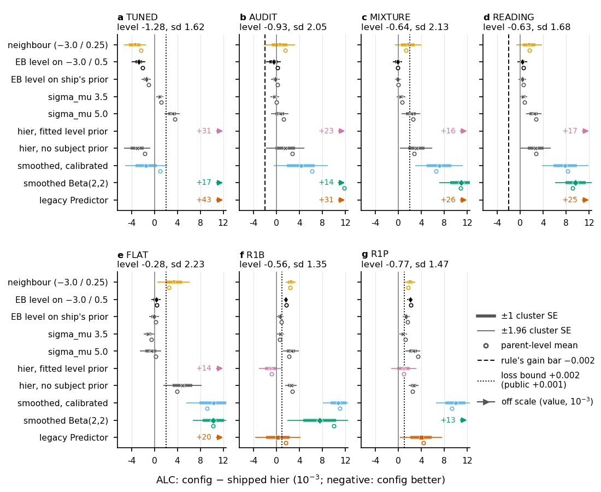

*Figure E1.* Each alternative minus hier-ship ("shipped hier") in the seven RS regimes, with the test-like ones ordered by realised level. Bars show ±1 and ±1.96 cluster SEs, and the right end of the thin bar is the rule's $U_{95}$; a hollow marker shows the parent-level mean. The dashed line marks the gain the rule required in READING and AUDIT (-0.002), the dotted lines its loss bounds. The legend's "hier, no subject prior" is hier-nosubj; it is not a plain 1PL (1PL-ship or 1PL-fit). Panels f and g, R1B and R1P, are R1-bf and R1-pu. No alternative crosses -0.002 in READING or AUDIT.

No configuration passes the rule, so LEVEL stays (Figure E1). We compared one reproduction check at its comparator's stored precision rather than at the planned precision, and we accepted this deviation (App C.3). With or without it, no alternative is a candidate.

**Closest alternatives.** None of the configurations we scored is a better bet than hier-ship at the feedback's reading. Three sit within 0.0006 of it in READING and AUDIT: hier-ship σ3.5 and both hier-EB configurations, with cluster SEs of 0.0003 to 0.0007. In READING, AUDIT and MIXTURE and on both public weightings, hier-ship is first or tied with the first (within 1.96 cluster SEs). Configurations ahead of it by more than that margin appear only in TUNED (hier-rec, hier-nosubj and both hier-EB configurations) and in FLAT (hier-ship σ3.5, by 0.0010 ± 0.0005).

**Where hier-rec wins.** It beats hier-ship only in TUNED, the regime and catalogue it was selected on, by 0.0034 (cluster SE 0.0010). In every other regime it loses, by +0.0005 to +0.0033, and the higher the level, the more it loses. Its losses sit on matharena, the highest-level parent. That pattern is the level audit's argument (App C.5).

**Wider level priors.** Neither wider prior does better than hier-ship: hier-ship σ3.5 stays within 0.001 of hier-ship everywhere (-0.0010 to +0.0009), and hier-ship σ5 is worse by 0.0022 to 0.0031 in five of the seven regimes.

**The empirical-Bayes level.** Contrary to the expectation of our internal review, the adaptive empirical-Bayes level does not beat the fixed one where levels spread both ways. On hier-ship, hier-EB gains only in TUNED (-0.0014). It ties hier-ship in the four other test-like regimes and costs +0.0006 and +0.0014 on public runs, which fails the public guard.

**Against LegacyP.** The gain of hier-ship over LegacyP is 0.043 in TUNED, 0.031 in AUDIT, 0.026 in MIXTURE, 0.025 in READING and 0.020 in FLAT, with parent-level SEs of 0.008 to 0.015. On public runs hier-ship is tied with LegacyP or slightly ahead (-0.0002 and -0.0039).

Four parents carry these numbers. Every alternative with a lower centre than hier-ship trades the same two parents: it gains on multi_swebench, the lowest-level parent, and loses on matharena, the highest-level one. The parent-level SE is two to four times the cluster SE. The RS study's decision rule detects gains of about 0.003 or more, and at 0.002 it detects a gain about half the time.

S4 rescored hier-ship σ3.5, hier-ship σ5, hier-EB on hier-ship and LegacyP on a fresh seed, 20261006. Between the two seeds their differences from hier-ship move by at most 0.0011, 0.0022, 0.0007 and 0.0052, the largest LegacyP's in AUDIT, which realises -1.07 there and -0.93 at seed 11 (App B.3). <!-- src: as App B.3 (derived from results/ablations_at_level.json summary.regimes.<R>.vs_ship.<config>.{equal, seed11}.D) -->

### E.3 The empirical-Bayes level

The empirical-Bayes level adapts in the right direction. At budget 1 it moves most of the way from the public centre toward each regime's level. Among the date-shifted test-like regimes it orders the regimes by their levels, and the date shift itself moves it further down (F§ "The empirical-Bayes level adapts the right way"). It ties the fixed configuration because the level fixed at $B_0$ decides most of the gain. Figure E2 draws the centre by budget.

We did not ship it, because it is about 70 lines of experiment code outside the library and its worst-case call is slower. In the RS study (App E.2), at the feedback's reading, it also gains nothing over the fixed level, so the decision rests on measurement as well.

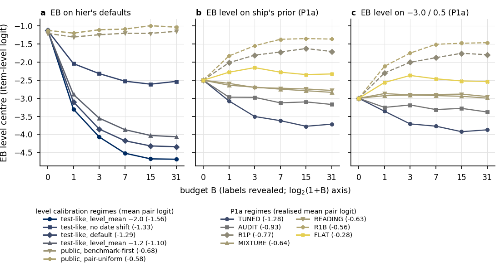

*Figure E2.* The empirical-Bayes (EB) estimate of a new benchmark's level centre by budget, coloured by each regime's mean pair logit. Dashed lines are public regimes. (a) EB on hier-fit's level prior in the level calibration's regimes. (b, c) hier-EB on hier-ship and on $\mu_0 = -3.0$, $\gamma = 0.5$ in the RS regimes (fresh seeds, library of `4d2cc4f`); the legend's "P1a" is the RS study, and R1B and R1P are R1-bf and R1-pu. The centre is on the item-level scale, and the regimes' levels are on the pair-accuracy scale. The two are ordered alike within regimes that share the date shift. The date shift moves the centre further down because the centre has to offset the inflated attribute standings (F§ "The empirical-Bayes level adapts the right way"), so a date-shifted regime ends below an unshifted one of the same or a lower level.

### E.4 The baseline study, E1 and the calibration-by-model factorial

The baseline study rescored the RS study's TUNED and public runs with EmpMean and a plain 1PL, scored as 1PL-ship at hier-ship's level and as 1PL-fit at its own leave-one-parent-out public level (`experiments/baselines_p1.py`, `results/baselines_p1.json`). E1 scored EmpMean and 1PL-ship in the four other test-like regimes of the RS study. The factorial reads the level calibration by model as a paired 2 by 2 on the RS study's stored rows. E1 and the factorial are report only: neither ships or selects anything. <!-- src: results/e1_baselines_rs.json plan.no_ship, about; results/factorial_rs.json about.selects -->

**E1, declared before it ran.** Amendment 2 of the plan declared E1 in commit `a5ef016` (2026-10-06T18:33:43Z), before any of its kept rows was scored (`experiments/e1_baselines_rs.py`, `results/e1_baselines_rs.json`). <!-- src: results/e1_baselines_rs.json plan.{amendment_commit, amendment_commit_utc}; checks."<R>: every row scored after amendment 2 was committed" --> It scores EmpMean and 1PL-ship on the RS study's READING, AUDIT, MIXTURE and FLAT runs (seed 11, runs 0 to 79, split scope 'pair'), paired with hier-ship on the RS study's stored rows, with the RS study's statistics. It re-scores TUNED runs 0 to 79 as a control, whose rows and statistics equal the baseline study's exactly. <!-- src: results/e1_baselines_rs.json plan.regimes.<R>.{seed, runs, role}, plan.split_scope; checks."TUNED: rows equal baselines_p1's bit for bit on every run", checks."TUNED: statistics equal baselines_p1's stored numbers exactly" --> The RS study's Smooth and Smooth-cal rows are reproduced on every run, and its hier-ship, hier-nosubj and LegacyP rows on runs 0 and 79, with a largest Brier difference of 0. <!-- src: results/e1_baselines_rs.json plan.reproduction.{every_run, configs, runs}; summary.regimes.<R>.reproduction_max_abs_brier; all_checks_hold -->

The run history is disclosed in the results file. A dry run on 6 tasks preceded the scored run, and its rows were discarded. The scored run wrote its rows on 2026-10-06 between 18:55 and 18:59 UTC into a session scratch directory, which a restart of the machine cleared. On 2026-10-07 the same scoring code scored the 400 tasks again into the repository's rows directory. Every regime's digest of the scored values and every run's digest equal the first run's, so every statistic below is the first run's bit for bit; only the timings come from the second scoring. <!-- src: results/e1_baselines_rs.json about; rows.note; rows.regimes.<R>.{scored_values_sha256, per_run_sha16}; summary.scored (80 per regime, 5 regimes = 400 tasks, derived) -->

| regime (realised level) | EmpMean minus hier-ship (run / cluster / stratified SE) | parent-level | 1PL-ship minus hier-ship (run / cluster / stratified SE) | parent-level | EmpMean minus LegacyP (cluster SE) | ALC: EmpMean, 1PL-ship, hier-ship |
|---|---|---|---|---|---|---|
| TUNED (-1.28), control | +0.0339 ± 0.0016 / 0.0030 / 0.0028 | +0.036 ± 0.005 | -0.0017 ± 0.0007 / 0.0013 / 0.0010 | -0.000 ± 0.004 | -0.0095 (0.0049) | 0.2029, 0.1673, 0.1690 |
| AUDIT (-0.93) | +0.0252 ± 0.0016 / 0.0028 / 0.0026 | +0.028 ± 0.006 | +0.0027 ± 0.0007 / 0.0018 / 0.0015 | +0.004 ± 0.006 | -0.0061 (0.0060) | 0.1902, 0.1677, 0.1650 |
| MIXTURE (-0.64) | +0.0319 ± 0.0018 / 0.0032 / 0.0027 | +0.033 ± 0.007 | +0.0048 ± 0.0007 / 0.0016 / 0.0014 | +0.004 ± 0.005 | +0.0057 (0.0050) | 0.2150, 0.1879, 0.1830 |
| READING (-0.63) | +0.0337 ± 0.0016 / 0.0028 / 0.0026 | +0.035 ± 0.005 | +0.0042 ± 0.0007 / 0.0015 / 0.0012 | +0.004 ± 0.005 | +0.0089 (0.0049) | 0.2219, 0.1923, 0.1881 |
| FLAT (-0.28) | +0.0256 ± 0.0018 / 0.0031 / 0.0027 | +0.028 ± 0.008 | +0.0064 ± 0.0007 / 0.0018 / 0.0014 | +0.005 ± 0.006 | +0.0055 (0.0045) | 0.1995, 0.1803, 0.1739 |
| R1-bf | +0.0464 ± 0.0019 / 0.0027 / 0.0026 | +0.046 ± 0.006 | +0.0048 ± 0.0005 / 0.0007 / 0.0006 | +0.005 ± 0.002 | +0.0461 (0.0032) | 0.2578, 0.2162, 0.2114 |
| R1-pu | +0.0449 ± 0.0020 / 0.0030 / 0.0029 | +0.048 ± 0.005 | +0.0050 ± 0.0004 / 0.0007 / 0.0006 | +0.005 ± 0.002 | +0.0410 (0.0033) | 0.2397, 0.1998, 0.1948 |

Sources: `experiments/e1_baselines_rs.py`, `results/e1_baselines_rs.json` for the test-like rows, `summary.regimes.<R>.vs_ship.{empmean, rasch}.{D, run_se, cluster_se, strat_se, parent_level.{mean, se}}`, `summary.regimes.<R>.vs_legacy.empmean.{D, cluster_se}`, `summary.regimes.<R>.configs.{empmean, rasch, ship}.ALC` and `summary.regimes.<R>.realised.mean`; `results/baselines_p1.json` for the public rows, the same keys under `summary.regimes.{R1B, R1P}`. RS runs: seed 11, 80 runs per test-like regime and 60 per public weighting. Positive: the second-named predictor is better. The parent-level columns give the mean ± SE over the four multi-subject parents. <!-- src: results/e1_baselines_rs.json summary.regimes.<R>.{vs_ship.{empmean, rasch}.{D, run_se, cluster_se, strat_se, parent_level.mean, parent_level.se}, vs_legacy.empmean.{D, cluster_se}, configs.{empmean, rasch, ship}.ALC, realised.mean}; results/baselines_p1.json summary.regimes.{R1B, R1P}.<the same keys>; summary.t3.{empmean, rasch}.columns.<R>.{D, cluster_se} -->

**EmpMean trails hier-ship in every regime,** by 0.0252 to 0.0339 in the test-like regimes and by 0.0449 and 0.0464 on public runs. <!-- src: results/e1_baselines_rs.json summary.t3.empmean.columns.<R>.D --> Against LegacyP it is ahead only in TUNED and AUDIT, the two regimes with the lowest realised levels, by 0.0095 (0.0049) and 0.0061 (0.0060). It is behind LegacyP by 0.0055 to 0.0089 in MIXTURE, READING and FLAT, and by 0.0410 and 0.0461 on public runs. <!-- src: results/e1_baselines_rs.json summary.regimes.<R>.vs_legacy.empmean.{D, cluster_se}; results/baselines_p1.json summary.regimes.{R1B, R1P}.vs_legacy.empmean.D --> Neither of the two leads over LegacyP reaches 2 cluster SEs (derived). <!-- src: derived, 0.0095 / 0.0049 = 1.94 and 0.0061 / 0.0060 = 1.02, from results/e1_baselines_rs.json summary.regimes.{TUNED, AUDIT}.vs_legacy.empmean.{D, cluster_se} -->

**1PL-ship ties hier-ship only in TUNED.** There it is ahead by 0.0017 (0.0013). It trails hier-ship by 0.0027 to 0.0064 (cluster SE 0.0015 to 0.0018) in the four other test-like regimes, and by 0.0048 and 0.0050 (0.0007) on public runs. <!-- src: results/e1_baselines_rs.json summary.t3.rasch.columns.<R>.{D, cluster_se} --> In the four other test-like regimes its parent-level gap is +0.004 to +0.005 with SEs of 0.005 to 0.006, so those four gaps rest on the cluster SE, and at the parent level none is distinguishable from zero. <!-- src: results/e1_baselines_rs.json summary.regimes.{AUDIT, MIXTURE, READING, FLAT}.vs_ship.rasch.parent_level.{mean, se} --> Among the eight predictors that E1 ranks (hier-ship, hier-nosubj, 1PL-ship, Smooth-cal, Smooth, hier-fit, LegacyP and EmpMean), hier-ship has the lowest ALC in READING, AUDIT, MIXTURE and FLAT. In TUNED it is fourth, behind hier-nosubj, 1PL-ship and Smooth-cal. <!-- src: results/e1_baselines_rs.json summary.regimes.<R>.rank -->

**The factorial.** The factorial crosses the model (the smoothed mean or hier) with the level (default or calibrated). Its four cells are Smooth, Smooth-cal, hier-fit and hier-ship, all scored on identical RS runs and checkpoints, so every contrast is paired (`experiments/factorial_rs.py`, `results/factorial_rs.json`). <!-- src: results/factorial_rs.json design.{factorial, smooth, smcal, ship_level, eb_fit, scoring_seed} --> Both calibrated levels start from LEVEL's selection rule on the TL selection half (seed 2, runs 0 to 99), and they took different paths from it. For Smooth-cal no grid point passed the public guard, so its prior, mean $m_0 = 0.25$ and strength $n_0 = 2$, is the rule's best point regardless of the guard. For hier the rule picked hier-argmax, the level calibration's tie-break by the guard's margin recommended hier-rec, and the level audit, which drew on both TL halves, public runs and a per-pair reading of run 1, moved the choice to hier-ship (App C.5). So only Smooth-cal's level is the rule's output; hier-ship's passed two further steps. <!-- src: results/factorial_rs.json design.smcal.{m0, n0}; checks[name = rows_smcal_is_rs_choice].chosen; results/regime_sensitivity.json smcal.{selection (test-like seed 2, runs 0-99), chosen, guard_failed, passing}, smcal.grid[*].passes_guard; hier: results/level_calibration.json summary.selected.order (the rule's pick, hier-argmax "hier G mu0=-3.50 sm=2.50 as=0.25"), summary.ship.config (the tie-break's recommendation, hier-rec "hier G mu0=-3.00 sm=2.50 as=0.25"); results/level_audit.json mild (blocks "tl 0-99: selection half", "tl 100-199: confirmation half (audit: fresh runs)", "r1b 0-99", "r1p 0-99") and feedback."K=40" (the per-pair reading of run 1); App C.5 "Chosen" and "Audited". Fixed 2026-10-14: the earlier text skipped hier-rec and said both levels were set on the selection half. --> The interaction is

$$
\Delta_{\mathrm{int}} = \big[\mathrm{ALC}(\text{hier-ship}) - \mathrm{ALC}(\text{hier-fit})\big] - \big[\mathrm{ALC}(\text{Smooth-cal}) - \mathrm{ALC}(\text{Smooth})\big]
$$

which also equals the model's effect at the calibrated level minus its effect at the default level. A negative value means that calibration helps hier more than it helps the smoothed mean. <!-- src: results/factorial_rs.json design.contrasts.interaction; summary.interaction.definition -->

| ALC, seed 11 (the RS runs) | TUNED (-1.28) | AUDIT (-0.93) | MIXTURE (-0.64) | READING (-0.63) | FLAT (-0.28) | R1-bf | R1-pu |
|---|---|---|---|---|---|---|---|
| Smooth | 0.1860 | 0.1793 | 0.1940 | 0.1978 | 0.1842 | 0.2189 | 0.2075 |
| Smooth-cal | 0.1675 | 0.1693 | 0.1901 | 0.1959 | 0.1842 | 0.2222 | 0.2048 |
| hier-fit | 0.1999 | 0.1883 | 0.1994 | 0.2054 | 0.1879 | 0.2104 | 0.1957 |
| hier-ship | 0.1690 | 0.1650 | 0.1830 | 0.1881 | 0.1739 | 0.2114 | 0.1948 |
| LegacyP | 0.2124 | 0.1963 | 0.2093 | 0.2130 | 0.1940 | 0.2116 | 0.1988 |

Source: `experiments/factorial_rs.py`, `results/factorial_rs.json`, `cells.<R>.<cell>.ALC`, equal to the RS study's configurations; realised mean pair logit in brackets from `results/regime_sensitivity.json`, `summary.realised`. RS runs: seed 11, 80 runs per test-like regime and 60 per public weighting. <!-- src: results/factorial_rs.json cells.<R>.{smooth, smcal, eb_fit, ship, legacy}.ALC; checks[name = cells_equal_rs_configs].ok; design.regimes.<R>.runs; results/regime_sensitivity.json summary.realised.<R>.mean (test-like regimes) -->

| contrast, ALC (cluster SE) | TUNED | AUDIT | MIXTURE | READING | FLAT | R1-bf | R1-pu |
|---|---|---|---|---|---|---|---|
| calibration within hier: hier-ship minus hier-fit | -0.0309 (0.0035) | -0.0233 (0.0042) | -0.0164 (0.0028) | -0.0173 (0.0032) | -0.0140 (0.0038) | +0.0010 (0.0010) | -0.0009 (0.0011) |
| calibration within the smoothed mean: Smooth-cal minus Smooth | -0.0185 (0.0036) | -0.0100 (0.0046) | -0.0039 (0.0037) | -0.0018 (0.0036) | +0.0000 (0.0040) | +0.0033 (0.0033) | -0.0028 (0.0031) |
| the model at the default level: hier-fit minus Smooth | +0.0139 (0.0027) | +0.0091 (0.0025) | +0.0054 (0.0020) | +0.0077 (0.0021) | +0.0037 (0.0026) | -0.0085 (0.0023) | -0.0118 (0.0015) |
| the model at the calibrated level: hier-ship minus Smooth-cal | +0.0015 (0.0019) | -0.0043 (0.0024) | -0.0071 (0.0021) | -0.0078 (0.0021) | -0.0103 (0.0024) | -0.0108 (0.0014) | -0.0100 (0.0018) |
| interaction, $\Delta_{\mathrm{int}}$ | -0.0125 (0.0021) | -0.0133 (0.0017) | -0.0125 (0.0019) | -0.0155 (0.0015) | -0.0140 (0.0015) | -0.0023 (0.0026) | +0.0019 (0.0023) |
| calibration, main effect | -0.0247 (0.0034) | -0.0166 (0.0043) | -0.0101 (0.0032) | -0.0096 (0.0034) | -0.0070 (0.0038) | +0.0022 (0.0021) | -0.0018 (0.0021) |
| the model, main effect | +0.0077 (0.0021) | +0.0024 (0.0023) | -0.0009 (0.0018) | -0.0001 (0.0019) | -0.0033 (0.0024) | -0.0097 (0.0014) | -0.0109 (0.0012) |
| interaction, run SE | 0.0008 | 0.0009 | 0.0009 | 0.0008 | 0.0009 | 0.0012 | 0.0013 |

Sources: `experiments/factorial_rs.py`, `results/factorial_rs.json`, `cells.<R>.<cell>.ALC` and `summary.<contrast>.by_regime.<R>.{D, cluster_se, run_se}`; the cells equal the RS study's configurations exactly, and every two-cell contrast equals the RS study's stored difference. Realised mean pair logit in brackets (`results/regime_sensitivity.json`, `summary.realised`). RS runs: seed 11, 80 runs per test-like regime and 60 per public weighting. The sign is first-named minus second-named, negative when the first-named side is better; a main effect is the mean of its two simple effects. FLAT's Smooth-cal minus Smooth is +0.0000093. <!-- src: results/factorial_rs.json cells.<R>.{smooth, smcal, eb_fit, ship, legacy}.ALC; summary.{calibration_in_hier, calibration_in_smooth, model_at_default, model_at_calibrated, interaction, calibration_main, model_main}.by_regime.<R>.{D, cluster_se, run_se}; checks[name = cells_equal_rs_configs, pairs_equal_rs_exact, interaction_equals_rs_stored_differences].ok; results/regime_sensitivity.json summary.realised.<R>.mean -->

**Calibration helps hier in every test-like regime, and the smoothed mean less.** Calibrating the level gains 0.0140 to 0.0309 for hier, and every 95% cluster interval lies below zero. For the smoothed mean it gains 0.0000 to 0.0185, beyond two cluster SEs only in TUNED and AUDIT. <!-- src: results/factorial_rs.json summary.calibration_in_hier.testlike.{D_range, all_ci95_below_zero}; summary.calibration_in_smooth.by_regime.<R>.{D, z_cluster} (TUNED -5.15, AUDIT -2.17; elsewhere -1.04 to +0.00) --> At the default level hier is worse than the smoothed mean in every test-like regime, by 0.0037 to 0.0139, although FLAT's +0.0037 (0.0026) is within 1.5 cluster SEs. On public runs hier-fit is better than Smooth by 0.0085 and 0.0118. <!-- src: results/factorial_rs.json summary.model_at_default.by_regime.<R>.{D, cluster_se, z_cluster} (FLAT z 1.43) --> At the default level hier-fit's mean $B_0$ prediction in TUNED is 0.638, near LegacyP's 0.683 and against 0.415 for hier-ship. The paragraph "LegacyP's deficit" below traces LegacyP's value to its attribute prior, which turns the synthetic date shift into optimism. <!-- src: results/factorial_rs.json cells.TUNED.{legacy, eb_fit, ship}.q0; results/regime_sensitivity.json summary.configs.TUNED.<cfg>.q0; LegacyP's cause: v1 E.4 "LegacyP's deficit" --> At the calibrated level hier-ship ties Smooth-cal in TUNED, +0.0015 (0.0019), and beats it by 0.0043 to 0.0103 in the other test-like regimes and by 0.0108 and 0.0100 on public runs. <!-- src: results/factorial_rs.json summary.model_at_calibrated.by_regime.<R>.{D, cluster_se} -->

**The interaction is negative in every test-like regime and absent on public runs.** It is -0.0125 to -0.0155 (cluster SE 0.0015 to 0.0021) in the five test-like regimes, and every 95% cluster interval lies below zero. <!-- src: results/factorial_rs.json summary.interaction.testlike.{D_range, cluster_se_range, all_ci95_below_zero}; outline_check.matches --> It does not rest on one parent. Its parent-level mean is -0.0099 to -0.0148 (parent-level SE 0.0022 to 0.0042), each of the four parents is negative in every test-like regime (-0.0040 to -0.0219), and every leave-one-parent-out value is negative (-0.0168 to -0.0058). It is negative in 94% to 100% of the runs. <!-- src: results/factorial_rs.json contrasts.<R>.interaction.{parent_level.{mean, se, leave_one_out_range}, per_parent.<parent>.mean, share_runs_negative} for the five test-like regimes --> It sits at the first budgets: $B_0$ contributes -0.0071 to -0.0083 of ALC, $B_1$ -0.0049 to -0.0061 and $B_3$ -0.0005 to -0.0014, and each later budget -0.0002 to +0.0003. <!-- src: results/factorial_rs.json contrasts.<R>.interaction.budgets[*].alc_part for the five test-like regimes --> On public runs it is -0.0023 (0.0026) and +0.0019 (0.0023), both intervals containing zero. <!-- src: results/factorial_rs.json summary.interaction.by_regime.{R1B, R1P}.{D, cluster_se}; contrasts.{R1B, R1P}.interaction.ci95_cluster --> Read together: in the test-like regimes hier's structure pays only once its level is calibrated, and then as robustness to where the hidden level sits. On public runs hier beats the smoothed mean at either level, and calibration does nothing measurable for either model.

**Caveats.** The RS runs redraw the catalogue of test-like pairs and the public pairs that chose LEVEL and Smooth-cal, so the calibrated cells carry selection optimism in TUNED and on the public guard, and the factorial is not an independent replication (F§ "The level calibration by model, as a paired 2 x 2 factorial"; F§ "Regime sensitivity at the feedback's reading"). The regimes share clusters, so their SEs are not independent and we give no interaction pooled over regimes. <!-- src: docs/findings.md, "The level calibration by model, as a paired 2 x 2 factorial (P2, W3)", Caveat bullet; docs/findings.md, "Regime sensitivity at the feedback's reading" and v1 §5.4(e) (TUNED and the public guard are not an independent replication); results/factorial_rs.json about.se (shared clusters, per regime only) -->

**The order-dependent split, withdrawn.** An earlier version of our findings split hier-ship's TUNED gain over LegacyP, -0.0434 (0.0037), into the level calibration's share and the model's share for three orders of the steps, with 95% bootstrap intervals. <!-- src: results/baselines_p1.json summary.regimes.TUNED.headline.ship_minus_legacy.{D, cluster_se} -->

| order of the steps | the level calibration's share | the model's share |
|---|---|---|
| calibrate first: LegacyP $\to$ Smooth-cal $\to$ hier-ship | 1.03 [0.94, 1.10] | -0.03 [-0.10, 0.06] |
| model first: LegacyP $\to$ hier-fit $\to$ hier-ship | 0.71 [0.61, 0.81] | 0.29 [0.19, 0.39] |
| through the 1PL: LegacyP $\to$ 1PL-fit $\to$ 1PL-ship $\to$ hier-ship | 0.16 [0.12, 0.20] | 0.88 [0.84, 0.91] for 1PL-fit; -0.04 [-0.08, 0.02] for hier's extras |

Source: `experiments/baselines_p1.py`, `results/baselines_p1.json`, `summary.regimes.TUNED.headline.{calibration_first, model_first, rasch_path}[*].share_of_total.{point, pct95}`; TUNED, seed 11. <!-- src: results/baselines_p1.json summary.regimes.TUNED.headline.calibration_first[0..1].share_of_total.{point, pct95}, model_first[0..1].share_of_total.{point, pct95}, rasch_path[0..2].share_of_total.{point, pct95} -->

The earlier version claimed that calibration is worth far more than the modelling. The split depends on the order of the steps, so it does not support that claim, and we withdraw it. Calibrating first gives the calibration the whole gain, and modelling first gives it 0.71. On the path through the 1PL, 1PL-fit takes 0.88 before any calibration. <!-- src: results/baselines_p1.json summary.regimes.TUNED.headline.{calibration_first[0], model_first[1], rasch_path[0]}.share_of_total.point --> The factorial above replaces the split: it states the calibration's effect within each model and the model's effect at each level, every one paired, together with their interaction.

**Smooth-cal in App C.5.** The RS study added Smooth-cal's row to the plateau table of App C.5, whose note gives its provenance.

**Row provenance.** The baseline study scored a plain 1PL and EmpMean on the RS study's TUNED and public runs (F§ "Baselines: a plain 1PL, the organisers' empirical mean and BLE"; `experiments/baselines_p1.py`, `results/baselines_p1.json`). E1 extends EmpMean and 1PL-ship to the four other test-like regimes (above). The 1PL is hier with the attributes, the identity link, the groups, the multiple-choice floor and slip switched off. It has one pooled level per benchmark, one ability per (subject, benchmark) pair and one difficulty per item, refitted from `labeled` at every checkpoint. We scored it at the shipped level and at its own leave-one-parent-out public level.

Their ALCs on the RS study's TUNED and public runs (seed 11):

| ALC; TUNED and R1, seed 11 (the RS runs) | TUNED | R1-bf | R1-pu |
|---|---|---|---|
| hier-ship | 0.1690 | 0.2114 | 0.1948 |
| 1PL-ship | 0.1673 | 0.2162 | 0.1998 |
| Smooth-cal | 0.1675 | 0.2222 | 0.2048 |
| 1PL-fit | 0.1743 | 0.2173 | 0.2027 |
| hier-fit | 0.1999 | 0.2104 | 0.1957 |
| EmpMean | 0.2029 | 0.2578 | 0.2397 |
| LegacyP | 0.2124 | 0.2116 | 0.1988 |

Source: `experiments/baselines_p1.py`, `results/baselines_p1.json` (`summary.regimes.<R>.configs`).

Every other row is the RS study's. We re-scored Smooth and Smooth-cal on every run, and hier-ship, hier-nosubj and LegacyP on the first and last run of each regime. The re-scored values match the RS study's bit for bit. For hier-fit we read the RS study's rows as stored.

**Smooth-cal against hier-ship.** A calibrated level alone recovers the tuned-regime gain. Smooth-cal takes the prior that LEVEL's own selection rule picks on the TL selection half, mean $m_0 = 0.25$ and strength $n_0 = 2$. No grid point passed the public guard, so this is the best point regardless of the guard. In TUNED, Smooth-cal is within noise of hier-ship (+0.0015 ± 0.0019 cluster SE, in Smooth-cal's favour), and it beats LegacyP there by 0.045 with no item model and no subject prior.

Elsewhere Smooth-cal trails hier-ship: by 0.004 to 0.010 in the four other test-like regimes (hier-ship minus Smooth-cal is -0.0043 to -0.0103), and by 0.010 to 0.011 on public runs, where it also fails the guard. The tuned-regime headline therefore measures a moved level. What hier adds over a calibrated level is the gain it keeps when the hidden level is not the one it was tuned for, and its parity with LegacyP on public runs.

**The subject prior.** Without its attribute prior, hier-ship becomes hier-nosubj, which keeps the pooled level, item difficulty, groups and floor. In TUNED it is ahead of hier-ship by 0.0030, and elsewhere it is behind by 0.0016 to 0.0049. Turning the prior off also lowers the $B_0$ centre: the mean $B_0$ prediction is 0.31, against 0.42 for hier-ship. This comparison therefore measures the prior and hier-ship's centre together. The plain 1PL is a different model, 1PL-ship (above).

**LegacyP's deficit.** Most of LegacyP's tuned-regime deficit is its own prior. In TUNED, 1PL-fit, with no calibration at all, beats LegacyP by 0.038 (cluster SE 0.004), and hier-fit beats it by 0.012. LegacyP's mean $B_0$ prediction in TUNED is 0.68, against 0.42 for hier-ship: its attribute prior turns the synthetic date shift into optimism. Even EmpMean is ahead of LegacyP in that regime, by 0.0095 (-0.0095 ± 0.0025 / 0.0049 / 0.0043, 1.9 cluster SEs; parent-level -0.003 ± 0.012). The tuned regime's headline is therefore set largely by the date shift (§8). E1 shows that LegacyP trails EmpMean only in TUNED and AUDIT; in MIXTURE, READING and FLAT EmpMean is behind LegacyP by 0.0055 to 0.0089 (above).

**Public runs.** On public runs the calibration costs ALC, and the model makes up for it. There hier-ship minus LegacyP is within noise (-0.0002 and -0.0039), so we do not split it into the calibration's share and the model's share. At the same level, hier adds 0.010 over Smooth-cal. It adds 0.005 over 1PL-ship, with differences of -0.0048 ± 0.0005 / 0.0007 / 0.0006 on benchmark-first runs and -0.0050 ± 0.0004 / 0.0007 / 0.0006 on pair-uniform runs (run / cluster / stratified SE). About half of that gain is the subject prior (hier-ship minus hier-nosubj), and half is the groups, the floor, slip and the standing keyed on the model's name (hier-nosubj minus 1PL-ship).

**The attribute prior at $B_0$.** Where the mean $B_0$ predictions match, the attribute prior pays: hier-ship beats 1PL-ship by 0.010 to 0.015 of Brier at $B_0$ and by 0.004 to 0.009 at $B_1$ (cluster SEs 0.0009 to 0.0026). Of the $B_0$ gap, about 0.0015 separates hier-nosubj from 1PL-ship, and the rest is mostly the attribute prior.

TUNED redraws the catalogue that chose LEVEL and Smooth-cal, so TUNED favours hier-ship and Smooth-cal. It also favours 1PL-ship, which borrows hier's calibrated $\mu_0$, chosen with the attribute prior on.

### E.5 BLE

We could not run BLE, and we defer it together with the empirical mean with BLE acquisition. Each BLE prediction is a language-model agent run against a paid API, by default openai/gpt-5.6-luna, with up to 10 turns and 240 s per prediction. Running BLE needs network access, an `OPENAI_API_KEY` for the paid model, and a payload prepared over the network and filtered per held-out parent. On the baseline study's evaluation runs alone it would take about 570,000 agent runs (569,838 exactly). BLE's only offline mode replaces the model with scripted replies.

The empirical mean with BLE acquisition chooses its labels from BLE's predictions, so it cannot run either. Under random acquisition it is EmpMean, scored above. Report v1.0.1 left the best leaderboard entry (0.1172) unexplained; §3.3 and App D.9 now bound what a predictor of pair rates can reach on runs of these benchmarks, a property of runs and predictors that says nothing about any entry.

We did not run amortized calibration [Truong et al. 2025] either. Its core is a difficulty map from embedded item content, trained across datasets. App F.2 measures such a map leave one benchmark out, and the map does not transfer here.

### E.6 The single-subject benchmark

The benchmark swe_rebench has one subject. Its numbers carry an SE over its appearances, and each appearance sees a different subset of its 6,306 items through the run's item cap (mean pairwise overlap 0.026). That SE is not a cluster SE, and nothing measures variation between subjects or between single-subject benchmarks (F§ "A single-subject benchmark"; `experiments/gate_and_ci.py --stage single`, `results/gate_and_ci.json`, `single`).

On swe_rebench hier-ship loses to both LegacyP and Smooth. Against LegacyP it loses +0.0101 ± 0.0012 over 130 R1-bf appearances (run-2 library, seed 0) and +0.0094 ± 0.0016 over 51 (current library, the RS study's seed 11). Against Smooth the two losses are +0.0130 ± 0.0014 and +0.0117 ± 0.0018. Pair-uniform runs hold 7 and 9 appearances, with losses of +0.0121 ± 0.0065 and +0.0024 ± 0.0042 against LegacyP.

The loss sits at $B_0$ to $B_3$ (+0.024, +0.018 and +0.013 against LegacyP) and stays under 0.006 from $B_7$ on. Of hier-ship's -0.0017 against LegacyP on R1-bf, swe_rebench carries +0.0010.

Among the RS study's alternatives, hier-ship is near the best on swe_rebench. It does better than both wider level priors, hier-rec, Smooth-cal, hier-EB on $\mu_0 = -3.0$ and hier-nosubj, by 0.0009 to 0.0073. The wider priors gain at $B_0$ and lose from $B_1$ on. Besides LegacyP and Smooth, only hier-fit does better (by 0.0022 ± 0.0010).

Test-like runs exclude single-subject benchmarks, so the tuned-regime gains say nothing about them, and swe_rebench's success rate (about 0.49) sits near the public centre.

**The platform's composition.** Public runs reweighted to the platform's composition, in which most pairs are alone on their benchmark, put hier-ship within noise of LegacyP under per-pair splits (+0.0024 ± 0.0023). Under per-benchmark splits they put it behind (+0.0045 ± 0.0024). The cost is mostly the single-subject benchmark's. Of the replica's 193 pairs that are alone on their benchmark, 87 are swe_rebench. Without it the two differences become +0.0004 ± 0.0026 and +0.0017 ± 0.0022 (F§ "Pooling under the verified protocol"; App A.2).

### E.7 hier-ship across regimes by budget

| regime | runs (seed) | $B_0$ | $B_1$ | $B_3$ | $B_7$ | $B_{15}$ | $B_{31}$ | ALC ± run SE | single-run sd of ALC |
|---|---|---|---|---|---|---|---|---|---|
| TL | 300 (2) | 0.2165 | 0.1892 | 0.1645 | 0.1525 | 0.1450 | 0.1386 | 0.1658 ± 0.0018 | 0.0318 |
| TL-mix | 200 (3) | 0.2178 | 0.1931 | 0.1692 | 0.1590 | 0.1524 | 0.1454 | 0.1711 ± 0.0023 | 0.0329 |
| TL-noshift | 100 (3) | 0.1948 | 0.1763 | 0.1620 | 0.1479 | 0.1413 | 0.1353 | 0.1585 ± 0.0033 | 0.0335 |
| R1-bf | 150 (0) | 0.2350 | 0.2243 | 0.2128 | 0.1973 | 0.1852 | 0.1771 | 0.2051 ± 0.0023 | 0.0285 |
| R1-pu | 100 (0) | 0.2442 | 0.2215 | 0.2069 | 0.1929 | 0.1813 | 0.1708 | 0.2020 ± 0.0026 | 0.0261 |
| platform, formative run 2 | 1 | 0.2368 | 0.1947 | 0.1963 | 0.1836 | 0.1785 | 0.1833 | 0.1926 | |
| platform, formative run 3 (archive `4a882cc7…`) | 1 | 0.2351 | 0.1868 | 0.1885 | 0.1664 | 0.1667 | 0.1644 | 0.1817 (recomputed) | |

Source: `results/subject_side.json` (`summary.regimes.*.ship`), `experiments/subject_side.py`; single-run sds from `results/ship_confirm.json` (`single_run_sd`); run 2 from `results/formative_feedback.json`, run 3 from `results/formative_run3.json`. The 'ship' arm reproduces `experiments/itemsig_eval.py`'s base exactly.

The comparisons with LegacyP and Smooth below come from `results/ship_confirm.json`.

Most of the gain over LegacyP is at $B_0$ and $B_1$. On TL runs 0 to 299, hier-ship gains 0.135 of Brier (cluster SE 0.011) at $B_0$, 0.076 at $B_1$, 0.037 at $B_3$, 0.016 at $B_7$ and 0.008 at $B_{15}$ and $B_{31}$. Weighted into ALC, the gains at $B_0$ and $B_1$ carry 0.029 of the 0.042 ALC gain (Figure E3).

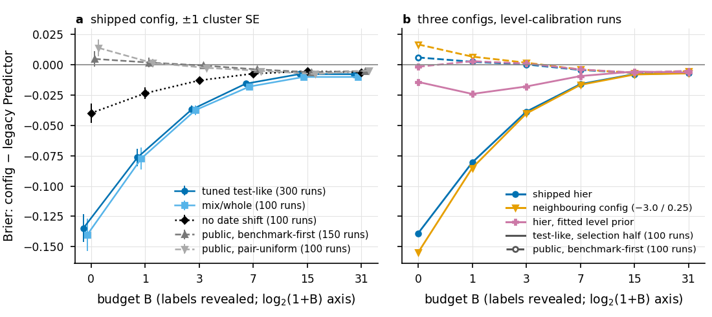

*Figure E3.* Paired Brier difference against LegacyP ("legacy Predictor") by budget. (a) hier-ship ("shipped hier") in five regimes, with ±1 cluster SE. On TL runs it gains 0.135 at $B_0$ and 0.076 at $B_1$ (0.040 and 0.023 on TL-noshift). On public runs it costs 0.005 and 0.014 at $B_0$ (cluster SEs about 0.007), is on par at $B_1$ and $B_3$, and gains 0.004 to 0.008 per budget from $B_7$ on. (b) hier-ship, hier-rec ("neighbouring config") and hier-fit on the level calibration's runs, without SEs (none is stored per budget for hier-rec and hier-fit).

Over Smooth, which has no level to tune, hier-ship gains 0.016 to 0.018 in the tuned regime and 0.009 on public runs. The gain is larger without the date shift (0.022) and positive on every test-like parent.

On public runs hier-ship is within noise of LegacyP. Its point estimates are 0.0015 to 0.0018 better, within about one cluster SE (0.81 cluster SEs on R1-bf and 1.02 on R1-pu). It loses at $B_0$ (+0.0049 ± 0.0065 on R1-bf and +0.0140 ± 0.0072 on R1-pu, cluster SEs) and gains from $B_7$ on (0.004 to 0.008 of Brier per budget). It also loses on public matharena (+0.010 and +0.009 on the two weightings) and on the single-subject swe_rebench pair (+0.010; App E.6).

## Appendix F: the studies of §6.4

### F.1 Summary table and the within-pair scale

Each row of the idea table below is a negative result, with the script that produced it; Table F.1a rolls the rows up by family, and §6.4 summarises it. All these ideas fail for the same reason: the hidden test's headroom lies at budgets 0 and 1 and in the per-item structure of benchmarks nobody has seen, and none of these signals reaches either.

*Table F.1a: Negative results, one row per family.*

| family | ideas | footing | best within-pair $r$, transferable [95%] | best one-benchmark $r$ | best nested $\Delta$ (cluster SE) | verdict |
|---|---|---|---|---|---|---|
| text maps | TF-IDF; Qwen3-Embedding-0.6B ridge and kNN | data-level, LOBO | -0.11 [-0.13, -0.08] (embedding ridge, sign reversed); 0.07 [0.03, 0.10] (TF-IDF) | | not scored | does not transfer |
| language-model judges and probes | 4B judge; 14B rubric; 14B reasoning entropy; attempts, ICL, pairwise, hidden-state heads, fine-tuned encoder | harness, nested; correlation rules | 0.15 [0.12, 0.17] (two 14B rubric scales); 0.12 [0.09, 0.15] (entropy) | 0.32 (attempts, matharena) | -0.00084 (0.00043) (14B rubric) | null for ALC |
| label-conditional layers | itemsig; meta-learned heads | harness, nested | | | -0.00002 (0.00008) | no gain |
| known-sign cues | length, format, stated size and others | harness, nested | | +0.41 (stated size, researchcodebench only) | 0 to +0.00003 | none passes |
| subject side | ordered effort, harness identity, date forms, Student-t level | harness, nested | | | -0.00097 (0.00033) | none passes |
| post-hoc maps and update speed | temperature, affine, isotonic; blends; run-level shift; damping; $B_0$ stretch; budget switching | post hoc on harness rows, LOPO | | | -0.00034 (0.00018) (run-level shift) | 13 negative, 3 null |
| acquisition | feature-group coverage; skipping visible twins; BLE's uncertainty rule | official protocol, paired TL runs | | | -0.00192 to +0.00038 against two random arms | below the bar |

Sources: the idea table below and App F.8; `results/gate_and_ci.json` (`scale`, `ci`, `gate`), `results/harness_thresholds.json`, `results/posthoc_family.json`, `results/acquisition_official.json`. LOBO: fitted with the target benchmark left out. <!-- src: moved from §6.4 on 2026-10-20; results/gate_and_ci.json scale, ci; results/harness_thresholds.json thresholds.honest; results/posthoc_family.json family.best_tl_lopo.{delta, se, variant}, family.verdicts; results/acquisition_official.json summary.range.policies_minus_two_arm_mean, summary.range.any_meets_tl_bar_vs_two_arm_mean (App F.8) -->

No transferable covariate exceeds a within-pair $r$ of 0.15. The larger correlations (0.37 on mathematics, 0.29 and 0.33 within group, 0.41 for a cue on one benchmark) are larger because of the unit over which they are taken. Every post-hoc map fitted LOPO lost or did nothing, because its optimum belongs to the parent (App F.8). A blind language-model rating that tracks difficulty on mathematics only (0.482 on matharena) stays in App F.3. <!-- moved from §6.4 on 2026-10-20; results/posthoc_family.json family.parameter_spread; the correlations: the idea table below, App F.3, App F.6 -->

We scored the label-conditional layer, the meta-learned heads, the known-sign cues, the subject-side priors and the language-model probes that produce an item covariate against hier-ship, leave one parent out. The TF-IDF map is a data-level correlation with a naive solve-rate target. The embeddings and the blind ratings are data-level correlations with Rasch difficulty, as are the probes' own correlation prongs. App F.8 re-measures the post-hoc maps and the acquisition policies under the official protocol and keeps their legacy-replica numbers as a record.

Every transfer correlation of a text map, judge, probe head or encoder, and of the 14B, carries a 95% interval (F§ "Intervals for every transfer correlation"; the probe heads' and the encoder's intervals come from their own results files), and a second table below restates them on the gate's within-pair scale. The exceptions are the cases where no interval is computable: swe_rebench on the harness scales, the blind ratings' within-pair $r$, the blind ratings on researchcodebench, the 4B judge on real_webagents and researchcodebench, and the 14B's attempts outside matharena (F§ "Intervals for every transfer correlation", `ci.not_computable`). The column "best honest estimate" holds a correlation, an accuracy, an ALC difference or a count, as each cell says. A signed ALC difference is the variant's ALC minus its comparator's, so it is negative when the variant helps; the comparator is hier-ship except in the legacy-replica studies. An unsigned "gains" or "loses" gives the size of an improvement or a loss. A *line* is one configuration scored by the harness, and its value is such a difference.

| idea | best honest estimate | verdict | script, results |
|---|---|---|---|
| item difficulty from TF-IDF text, across benchmarks | LOBO Pearson $r$ with Rasch difficulty on text-bearing items 0.10, 0.14, -0.02, -0.16, 0.11, every 95% interval below 0.3 (0.14, 0.23, 0.09, -0.22, 0.16 with the naive solve-rate target); within a test-like pair 0.07 | does not transfer | `experiments/transfer.py` (data-level); intervals `results/gate_and_ci.json` |
| item difficulty from Qwen3-Embedding-0.6B | LOBO ridge -0.16 / -0.03 / -0.23 / -0.02 (upper 95% limits 0.26 at most); within benchmark 0.66 / 0.27 / 0.38 / 0.51 | does not transfer | `experiments/emb_transfer.py`, `results/emb_transfer.json` |
| blind LLM difficulty rating (rater undocumented, App F.3) | 0.482 [0.25, 0.64] on matharena; -0.13 to 0.21 elsewhere | mathematics only; inconclusive on multi_swebench and real_webagents, interval below 0.3 on swe_rebench | `experiments/llm_rating/analysis.py`; group intervals `results/gate_and_ci.json` |
| Qwen3-4B zero-shot judge (rating, digit, entropy, and nll, the negative log-likelihood of the task text) | no benchmark-equal test-like ALC difference (the mean of the parents' means) reached -0.001 | closed | `experiments/llm4b_close.py`, `results/llm4b_close.json` |
| a 4B model's own attempts | graded accuracy 2.3% and 7.8%, below the 10% floor | cannot be read | `experiments/attempt_probe.py`, `results/attempt_probe.json` |
| entropy and hidden-state heads | LOBO $r$, random-effects mean over the four parents, -0.05 [-0.24, 0.14] (entropy) and +0.12 [-0.004, 0.24] (hidden state) | replicated null | `experiments/hidden_state_probe.py`, `results/hidden_state_probe.json` |
| in-context learning over the pair's labels | $r$ of 0.206 ± 0.040, below 0.3 | closed | `experiments/icl_probe.py`, `results/icl_probe.json` |
| pairwise (anchored) comparisons | pooled q 0.540, below 0.60 | dropped | `experiments/pairwise_probe.py`, `results/pairwise_probe.json` |
| text-similarity residual layer (itemsig) | nested ALC difference -0.00002 ± 0.00002 / 0.00008 / 0.00008 | no gain | `experiments/itemsig_eval.py`, `results/itemsig_eval.json` |
| meta-learned heads on frozen embeddings | nested ALC difference 0 (every head off in every fold); forced +0.0002 to +0.0006 | no gain | `experiments/heads_eval.py`, `results/heads_eval.json` |
| fine-tuned encoder | 0 of 4 parents at held-out $r \ge 0.3$, best +0.05 [-0.01, 0.10] (multi_swebench, group interval), random effects -0.05 [-0.14, 0.05]; transferred line +0.00048 | closed | `experiments/finetune_encoder.py`, `results/finetune_encoder.json` |
| Qwen3-14B demand rubric and direct ratings (Kaggle, two T4s) | LOBO head $r$ +0.19 (random effects), per parent +0.23 [0.04, 0.40], +0.01 [-0.08, 0.11], +0.19 [0.11, 0.28], +0.33 [0.12, 0.51] (-0.04 within competition on matharena); within-pair $r$ 0.11; best nested line -0.00084 ± 0.00043 | null for ALC | `experiments/strong_llm_eval.py`, `results/strong_llm_eval.json` |
| Qwen3-14B reasoning attempts (matharena only) | within-competition Spearman $\rho$ 0.372 [0.209, 0.516] on the 147 probe texts, 0.352 [0.25, 0.45] on all 270 attempted; forced per-pair line -0.00011 ± 0.00005 | GO for correlation; NULL for ALC (one parent) | same |
| Qwen3-14B reasoning entropy, all four parents (Kaggle, the entropy job) | within-group Spearman $\rho$ +0.29 [0.16, 0.40] / +0.12 [0.06, 0.16] / -0.03 [-0.19, 0.15] / +0.33 [0.17, 0.45] (matharena, multi_swebench, real_webagents, researchcodebench), random effects +0.18; within-pair $r$ 0.12 [0.09, 0.15]; transferred nested +0.00110 ± 0.00045 (on in 1 of 4 folds), per-pair nested +0.00001 ± 0.00006 | NULL, under a rule fixed before the data | same (`entropy`) |
| known-sign item cues (ordinal fields, position, format, length, stated size, image refs) | nested test-like ALC difference 0 to +0.00003 | none passes the sign rule or the gate | `experiments/itemcov_eval.py`, `results/itemcov_eval.json` |
| subject side: harness identity, ordered effort, date forms, Student-t level | best nested line -0.00097 ± 0.00033 (ordered effort) | none passes | `experiments/subject_side.py`, `results/subject_side.json` |
| acquisition policies (legacy replica) | coverage-first, ALC difference -0.0000 ± 0.0013 | none beats random | `experiments/acquisition.py` (printed; no results file) |
| post-hoc temperature and slip (legacy replica) | loses 0.0007 ± 0.0011 | does not transfer | `experiments/acquisition.py` (printed; no results file) |
| post-hoc maps and update speed (official protocol, App F.8) | best ALC difference fitted leave one parent out -0.00034 (0.00018), the run-level shift; 13 of 16 levers negative, 3 null | null or negative | `experiments/posthoc_family.py`, `results/posthoc_family.json` |
| acquisition policies (official protocol, App F.8) | against the mean of two random arms, -0.00192 to +0.00038 over two batches | below the bar | `experiments/acquisition_official.py`, `results/acquisition_official.json` |
| offline bank of per-item results | 1 of 161 inventory benchmarks judged usable (the judgement is unrecorded, App F.8) | closed | `experiments/inventory_scan.py` |

SEs: the itemsig triple is run / cluster / stratified SE; the ± of a rubric, attempt or entropy line is the cluster SE, and the ± of the in-context $r$ is the SE over pair appearances. The parenthesis after the post-hoc line is its cluster SE with the fit held fixed. <!-- src: results/posthoc_family.json family.best_tl_lopo.{delta, se}, family.verdicts; results/acquisition_official.json summary.range.policies_minus_two_arm_mean -->

**The ideas by footing.** We record each idea as negative, with its script (Figure F1). The footing column says how we scored each idea. A "harness" idea was scored against hier-ship leave-one-parent-out ("nested" when selection is redone inside each held-out parent). A "data-level" idea was scored as a correlation with difficulty measured on the data ("LOBO" when fitted with the target benchmark left out). A "correlation rule" idea was scored against the bar that the study's own plan set, and a "feasibility" idea by whether usable data exist. The text maps and the blind ratings are data-level correlations with difficulty, and the rows whose footing says "legacy replica" come from the legacy replica.

| idea | footing | main number | within-pair $r$ | verdict |
|---|---|---|---|---|
| item difficulty from TF-IDF text | data-level, LOBO | Pearson $r$ with Rasch difficulty -0.16 to 0.14, every 95% interval below 0.3 | 0.07 | does not transfer |
| item difficulty from Qwen3-Embedding-0.6B | data-level, LOBO | ridge -0.23 to -0.02 | -0.11 (ridge); -0.04 (kNN) | does not transfer |
| blind LLM difficulty rating | data-level | 0.482 [0.25, 0.64] on matharena; -0.13 to 0.21 elsewhere | | mathematics only; inconclusive on two benchmarks, below 0.3 on swe_rebench |
| Qwen3-4B zero-shot judge | harness | no TL $\Delta \le -0.001$, parents weighted equally | 0.04 to 0.09 | closed |
| a 4B model's own attempts | correlation rule | graded accuracy 2.3% and 7.8%, below the 10% floor | | cannot be read |
| entropy and hidden-state heads | LOBO $r$ | -0.05 [-0.24, 0.14] and +0.12 [-0.004, 0.24] | | replicated null |
| in-context learning over the pair's labels | correlation rule | $r$ of 0.206 ± 0.040, below 0.3 | | closed |
| pairwise (anchored) comparisons | correlation rule | pooled q 0.540, below 0.60 | | dropped |
| text-similarity residual layer (itemsig) | harness, nested | -0.00002 (0.00008) | | no gain |
| meta-learned heads on frozen embeddings | harness, nested | 0 (every head off in every fold); forced +0.0002 to +0.0006 | | no gain |
| fine-tuned encoder | LOBO $r$; harness | 0 of 4 parents at $r \ge 0.3$; transferred line +0.00048 | | closed |
| Qwen3-14B demand rubric | harness, nested | best line -0.00084 (0.00043) | 0.11 (head); 0.15 (best scales) | null for ALC |
| Qwen3-14B reasoning attempts (matharena) | correlation rule; forced per-pair | Spearman $\rho$ 0.372 [0.209, 0.516] | 0.32 (one parent) | passes its correlation bar; null for ALC |
| Qwen3-14B reasoning entropy, four parents | harness, nested; rule fixed before the data | transferred +0.00110 (0.00045) | 0.12 [0.09, 0.15] | null |
| known-sign item cues | harness, nested | 0 to +0.00003; text length +0.28 / +0.36 / -0.43 within paper; stated size +0.50 on one benchmark | +0.41 (stated size, one benchmark) | none passes |
| subject side (harness identity, effort, date forms, Student-t level) | harness, nested | best -0.00097 (0.00033) | | none passes |
| acquisition policies | legacy replica | coverage-first -0.0000 ± 0.0013 | | none beats random |
| post-hoc temperature and slip | legacy replica | loses 0.0007 ± 0.0011 | | does not transfer |
| post-hoc maps and update speed | official protocol, LOPO on harness rows | best -0.00034 (0.00018), the run-level shift | | null or negative |
| acquisition policies | official protocol, paired TL runs | -0.00192 to +0.00038 against the mean of two random arms | | below the bar |
| offline bank of per-item results | feasibility | 1 of 161 inventory benchmarks judged usable | | closed |

Brackets: 95% intervals. A parenthesis after a nested line holds its cluster SE; other ± values are as each study records them. "Within paper" means within researchcodebench's paper groups. In the pairwise row, q is the share of comparisons in which the model's answer matches the sign of the honest difficulty gap. The first table of this appendix gives the scripts and the intervals.

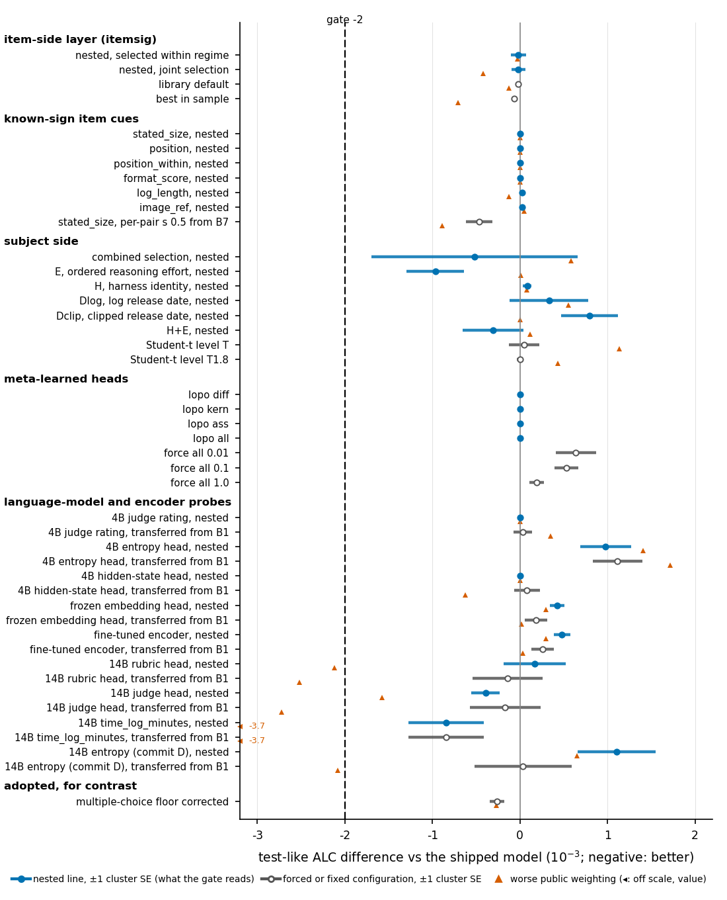

*Figure F1.* Each idea's TL ALC difference against hier-ship, with ±1 pair-cluster SE. Filled markers are the nested line the gate reads, hollow markers a forced or fixed configuration, and triangles the same line's worse public weighting. A triangle off scale sits at the edge with its value, as for the 14B model's estimate of an expert's time, part of its demand rubric (-0.0037). The dashed line is the gate, -0.002. No nested line reaches it. The best are the subject side's ordered reasoning effort (-0.0010 ± 0.0003) and the 14B model's estimate of an expert's time (-0.0008 ± 0.0004). The corrected multiple-choice floor, adopted as a bug fix, is drawn for contrast. Footings differ by idea (the table of ideas by footing, above).

**One correlation scale.** The gate's $r$ is a correlation with an *honest* difficulty, fitted on other subject folds. That difficulty is reliable (0.84 to 0.95 by split-half and fold-overlap estimates), so a correlation against full-sample difficulty is only 0.5% to 1.6% higher than one against the honest difficulty. The gate's $r$ and most correlations in App F.2 to F.9 differ instead in the unit over which they are taken. The gate reads a covariate within a test-like pair, where its bar is a within-pair $r$ of 0.25 (0.33 at an honest $r$ of 0.4), while those correlations are taken over a benchmark's whole range, within groups, or over text-bearing subsets.

The share of its correlation that a covariate keeps within a pair varies. The share is the within-pair $r$ divided by the *parent-scale* $r$, the Pearson $r$ with honest difficulty over a parent's items. A degraded oracle keeps 0.82 of its $r$ within a pair. The 14B's primary head, judged solve share, rubric sum and expert-time estimate, and its reasoning entropy, keep 0.57 to 0.65. Every covariate whose parent-scale correlation is clear of zero keeps 0.30 to 1.02. For TF-IDF, the 4B judge and the embedding kNN that correlation is near zero, so the share means nothing (`results/gate_and_ci.json`, `ci.unit_ratio`). The table gives the covariates on the gate's within-pair scale (`results/gate_and_ci.json`, `scale`):

| covariate | within-pair $r$ [95% cluster interval] |
|---|---|
| TF-IDF, leave one benchmark out | 0.07 [0.03, 0.10] |
| embedding ridge; kNN, leave one benchmark out | -0.11 [-0.13, -0.08]; -0.04 [-0.06, -0.02] |
| embedding ridge fitted within the same benchmark (cannot transfer) | 0.25 [0.23, 0.27] |
| 4B judge, four features (absolute value; the harness fits the sign) | 0.04 to 0.09 |
| 14B rubric: primary head; judged solve share; the two highest scales | 0.11 [0.08, 0.14]; 0.13 [0.10, 0.16]; 0.15 [0.12, 0.17] |
| 14B reasoning entropy, all four parents | 0.12 [0.09, 0.15] |
| 14B attempts' entropy (matharena only; it varies on 20% of appearances) | 0.32 [0.27, 0.35] |

No covariate that can be carried to a new benchmark reaches 0.25 within a pair. The attempts' entropy reaches it on one parent, where no slope can be transferred leave one parent out.

Figure F2 gives the per-benchmark correlations of the signals read off the item text, with their intervals.

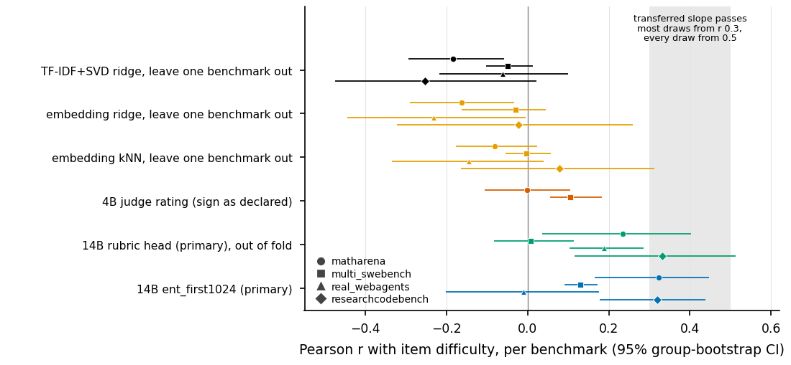

*Figure F2.* Per-benchmark Pearson $r$ with item difficulty, with 95% group-bootstrap intervals, for the text maps (TF-IDF, embedding ridge and kNN, each fitted on the other three benchmarks, against full-sample Rasch difficulty) and for the language-model studies (the 4B judge, rated on two benchmarks, and the 14B model's rubric head and reasoning entropy, each its study's declared primary, against honest difficulty). These are pooled correlations, not the within-group ones the text quotes for entropy. The grey band, honest $r$ 0.3 to 0.5, is where a transferred slope goes from passing most noise draws to passing every draw (Figure C1 (a)); no signal reaches 0.3 on every benchmark.

A centred covariate is zero at $B_0$, where only the level and subject priors act. The harness's uncentred $B_0$ term never passes the gate: even for the honest oracle, whose difference of -0.0027 clears the bar, it fails another of the gate's conditions. A per-pair slope is zero at $B_1$ too. A transferred slope does act at $B_1$: at the gate's honest $r$ of 0.3 it gains 0.0026 of Brier there, against 0.0027 to 0.0030 at $B_3$ to $B_{31}$ (`results/gate_and_ci.json`, `gate.b1`).

A slope transferred from other benchmarks acts at $B_1$ about as much as at later budgets: the honest oracle's transferred line gains 0.036 at $B_1$ (cluster SE 0.004; `results/gate_and_ci.json`, `gate.b1`).

### F.2 Item difficulty from text: TF-IDF and neural embeddings

With one benchmark left out, a TF-IDF map from item text correlates with the naive difficulty target (the solve-rate logit over all items) at 0.14 [0.06, 0.23] on matharena, 0.23 [0.16, 0.27] on multi_swebench, 0.09 [-0.13, 0.31] on real_webagents, -0.22 [-0.47, 0.07] on researchcodebench and 0.16 [0.13, 0.18] on swe_rebench. The brackets are 95% group-bootstrap intervals, except on swe_rebench, which has no groups and gets an item interval. Against Rasch difficulty on the items that carry text, which is the target the rest of this section uses, the correlations are 0.10 [0.01, 0.20], 0.14 [0.09, 0.23], -0.02 [-0.40, 0.28], -0.16 [-0.44, 0.10] and 0.11 [0.09, 0.14] (F§ "Intervals for every transfer correlation"; `results/gate_and_ci.json`, `ci.rows`). Within a test-like pair, where the gate reads it, the correlation is 0.07 [0.03, 0.10].

Within matharena (5-fold, text-bearing items) the same model reaches 0.80 [0.70, 0.86], but much of that comes from identifying which competition an item belongs to: removing the competition mean drops it to 0.58 [0.48, 0.66]. (The findings document first recorded 0.73 and 0.49 here; those values do not reproduce with the current code, and we quote the refitted ones.) Competition alone explains 40% of the variance of this difficulty target (F§ "What transfers between benchmarks"). On the Rasch scale, the variance component of App A.1 puts the competition's share at 0.50.

Qwen3-Embedding-0.6B embeddings do no better across benchmarks (F§ "Neural embeddings do not carry difficulty to an unseen benchmark"; 95% group-bootstrap intervals from `results/emb_transfer.json` and `results/gate_and_ci.json`):

- LOBO ridge correlations are -0.16 [-0.29, -0.03], -0.03 [-0.16, 0.04], -0.23 [-0.43, -0.01] and -0.02 [-0.31, 0.26] (matharena, multi_swebench, real_webagents, researchcodebench), and kNN correlations run from -0.08 [-0.21, 0.06] to +0.16 [-0.11, 0.38].
- $R^2$ as predicted is at most 0 everywhere, and the carried slope has the wrong sign.
- Within a benchmark (5-fold) the embeddings reach 0.66 [0.56, 0.73], 0.27 [0.20, 0.34], 0.38 [0.19, 0.52] and 0.51 [0.30, 0.66]. But the item_features group mean alone reaches 0.57 [0.39, 0.69], 0.12 [-0.06, 0.23], 0.41 [0.19, 0.55] and 0.52 [0.30, 0.67], and with whole groups held out the embeddings fall to 0.40 [0.29, 0.51], 0.16 [0.09, 0.25], -0.02 [-0.19, 0.15] and -0.09 [-0.30, 0.11]. So within a benchmark the embedding mostly identifies the group, which hier already learns from labels.

Figure F3 draws these correlations per benchmark.

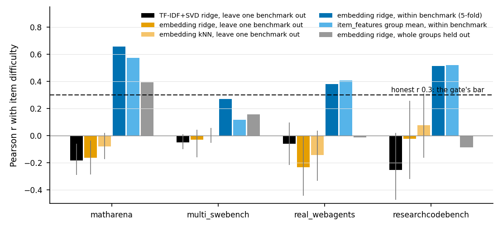

*Figure F3.* Pearson $r$ between predicted and full-sample Rasch item difficulty, per benchmark, with 95% group-bootstrap intervals. The figure compares leave-one-benchmark-out maps (TF-IDF+SVD ridge, embedding ridge, embedding kNN) with within-benchmark fits (embedding ridge, the item_features group mean, embeddings with whole groups held out). The TF-IDF bars show `experiments/emb_transfer.py`'s TF-IDF+SVD ridge, which differs from the `transfer.py` map quoted above. The dashed rule is the gate's honest $r$ of 0.3; within a test-like pair the bar is 0.25 (§4.3).

*Literature.* Amortized calibration fits one map from embedded question content to difficulty across 22 datasets and matches per-question calibration on held-out questions [Truong et al. 2025]. It does not test a held-out dataset. ADeLe reports that black-box predictors built on embeddings or fine-tuning are weaker than rubric-based demand levels, especially out of distribution [Zhou et al. 2026]. Our result is the out-of-distribution end of that picture on agentic and code benchmarks: the direction of difficulty in embedding space is not shared between benchmarks. For agentic coding tasks, Agent Psychometrics predicts task-level success on unseen benchmarks from issue statements *together with* repository context, solutions and test cases [Ge et al. 2026]. The competition's items carry the issue text and grouping metadata only.

### F.3 Language-model difficulty judgements

A language model rated 180 items across four benchmarks on a scale of 0 to 100, blind to their difficulty, and we compared the ratings with Rasch difficulty (F§ "Language-model difficulty judgement").

| benchmark | n | Pearson $r$ | 95% CI (Fisher) | 95% CI (group bootstrap) |
|---|---|---|---|---|
| matharena | 45 | 0.482 | [+0.22, +0.68] | [+0.25, +0.64] |
| multi_swebench | 45 | 0.133 | [-0.17, +0.41] | [-0.17, +0.48] |
| real_webagents | 45 | 0.210 | [-0.09, +0.47] | [+0.12, +0.41] |
| swe_rebench | 45 | -0.128 | [-0.41, +0.17] | (no groups) |
| pooled within benchmark | 180 | 0.174 | [+0.03, +0.31] | [+0.03, +0.33] |

Group intervals resample item_features groups (`experiments/gate_and_ci.py --stage ci`, `results/gate_and_ci.json`), and the Fisher intervals reproduce. A control on 60 fresh multi_swebench items with the full issue text (capped at 4,000 characters) gives Pearson $r$ +0.252 (interval touching zero) and Spearman $\rho$ +0.109, so truncation was not the explanation.

**The rater's prompt and protocol are undocumented.** The ratings are hard-coded in `experiments/llm_rating/ratings_main.py` and `ratings_control.py`. Both entered the repository in its first commit (2026-09-23), co-authored by Claude Opus 5 in a Claude Code session. The author confirms that the rater was the Claude model of that coding session (the commit's trailer names Claude Opus 5). Its prompt, the date and the sampling settings are recorded nowhere. The rater was blind to difficulty only: item ids carry the benchmark, and the texts name their domain. We cannot exclude that it saw measurement-db (which that session held) or the benchmarks' public leaderboards. The correlations re-derive from the stored ratings; the ratings themselves do not (App G.6).

*Literature.* Human-labelled difficulty of math and coding problems is linearly decodable from model activations [Lugoloobi and Russell 2025], and rubric-based LLM annotation of task demands predicts instance-level performance [Zhou et al. 2026]. We see the judge track difficulty where it is visible in the statement (competition mathematics) and not where it lies in the environment (repository size, files to touch, test harness).

The gate table (App C.4) needs an honest $r$ of 0.3 to 0.35 across benchmarks, and 0.25 within a test-like pair. The judge reaches 0.3 against full-sample difficulty on one benchmark of four. Full-sample difficulty does not flatter the correlations of this appendix: the honest difficulty is reliable (0.84 to 0.95), and a correlation against full-sample difficulty is at most 1.6% higher than one against the honest difficulty. With 45 items per benchmark the intervals on multi_swebench and real_webagents include 0.3, so on those two the result is inconclusive rather than negative. On swe_rebench the interval, [-0.41, +0.17], excludes 0.3.

**A larger 4B run is not needed to settle the question.** The review asked for the local 4B judge on several hundred items per benchmark. After that request, the 14B of App F.9 rated every item of the four parents, with the same judged solve share, so the item count does not limit the answer (F§ "Intervals for every transfer correlation"; `results/gate_and_ci.json`, `ci.power_4b`). Excluding $r = 0.3$ at 80% power would take 258 items on multi_swebench, but 847 on real_webagents, which has 233 items in all.

Where items are plentiful, both local judges sit below the bar, with intervals that exclude it. On multi_swebench the 14B's solve share reaches 0.07 [-0.04, 0.19] (Pearson $r$ with fold-averaged difficulty), and the 4B's rating reaches 0.11 [0.06, 0.21] (Spearman $\rho$ within language, sign as declared; the stored raw rating's is -0.11 [-0.21, -0.06]). Figure F2 draws a different statistic from the same file: the 4B rating's Pearson $r$ over all rated items in the same orientation, 0.11 [0.06, 0.18] (`results/llm4b_close.json`, `signs.features.rating.units.multi_swebench`). Where items are few, the 14B's solve share is 0.34 [0.13, 0.52] on researchcodebench and 0.18 [-0.03, 0.39] on real_webagents against fold-averaged difficulty, and it still fails the gate: within a test-like pair it reaches 0.13, and its best nested line is -0.00084. More 4B items could narrow an interval, but they could not change the verdict on a covariate that the 14B, rating every item, does not carry through the gate.

A fully specified local judge, Qwen3-4B-Instruct-2507, read each item once and rated it as a digit (`experiments/llm_features.py`). We closed it (F§ "The 4B judge, closed out"): no benchmark-equal test-like difference reached -0.001 through the harness, and on text-bearing matharena items every feature's partial correlation was below 0.2 with the declared sign. Its extraction covers matharena and 1,941 of 2,078 multi_swebench items only.

### F.4 A label-conditional text-similarity layer

The layer in `paiec/itemsig.py` carries hier's residuals on a pair's labelled items to unlabelled items with similar text. We ran it over a 480-configuration grid and redid the nested leave-one-parent-out selection in every bootstrap resample (F§ "Item signal from the pair's own labels").

Base ALCs are in parentheses, and the nested column gives ± run / cluster / stratified SE. Here R1-bf is runs 0 to 199 (0.2057), while App E.7 uses runs 0 to 149 (0.2051).

| regime (base ALC) | nested, selected within the regime | in-sample best of 480 |
|---|---|---|
| TL, runs 0-299 (0.1658) | -0.00002 ± 0.00002 / 0.00008 / 0.00008 | -0.00006 |
| TL-mix, runs 0-199 (0.1711) | -0.00028 ± 0.00005 / 0.00021 / 0.00019 | -0.00037 |
| R1-bf, runs 0-199 (0.2057) | -0.00003 ± 0.00012 / 0.00049 / 0.00046 | -0.00071 |
| R1-pu, runs 0-99 (0.2020) | -0.00076 ± 0.00018 / 0.00031 / 0.00029 | -0.00112 |

The layer cannot act at $B_0$ or $B_1$ by construction: there are no labels at $B_0$, and at $B_1$ centring within the pair zeroes the single residual. At $B_{31}$ it takes 0.5% of the gap between the pair-rate oracle and the item oracle. That gap is 0.063 of Brier on test-like runs, and the base already matches the pair-rate oracle there. Selected on the public runs of the other parents, the layer picks aggressive settings that lose on held-out researchcodebench (+0.0019 ± 0.0007). The submission does not include it. Figure F4 draws the two oracles and hier-ship by regime.

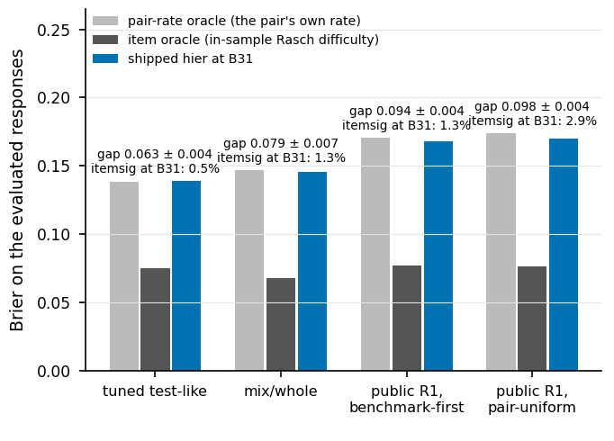

*Figure F4.* Brier on the evaluated responses per regime for the pair-rate oracle, the item oracle (in-sample Rasch difficulty) and hier-ship ("shipped hier") at $B_{31}$. The gap between the two oracles (± cluster SE) is what an item-difficulty model could add. The itemsig layer's nested line recovers 0.5% of it at $B_{31}$ on TL runs and 1.3% to 2.9% elsewhere. Run sets: TL runs 0 to 299, TL-mix 0 to 199, R1-bf 0 to 199 and R1-pu 0 to 99.

*Literature.* Generic assessors that transfer instance-level performance from reference instances do well in distribution, but out of distribution "no clear winner emerges and the overall performance is worse" [Pacchiardi et al. 2024].

### F.5 Meta-learned heads on frozen embeddings

In an episode-trained study we put linear and low-rank heads on frozen Qwen3-Embedding-0.6B features, on top of hier-ship: a meta-learned difficulty direction, a learned-metric few-shot kernel, and an assessor-style subject-by-item term (F§ "Meta-learned heads on frozen embeddings"; `experiments/heads_eval.py`, `results/heads_eval.json`). Nested leave-one-parent-out chose the regularisation strength $\lambda$, and a head was used on the held-out parent only if its inner mean was below 0.

Nested, every head is off in every fold, both on the rows the study ran on and on the rows of the current library, so the nested difference is exactly 0. The smallest inner mean over folds and values of $\lambda$ is +0.000007. Forced on, the combined head costs +0.0002 to +0.0006 test-like.

The heads learn something where the benchmark has been seen, with subject folds inside the training benchmarks. There the best two of five configurations (the difficulty head at $\lambda = 0.001$, and all heads at PCA 256) gain 0.0005 and 0.0017 test-like and 0.0024 and 0.0046 TL-mix. Across all five the range is +0.0005 to -0.0017 test-like, where both $\lambda = 0.01$ variants lose to hier, and -0.0008 to -0.0046 TL-mix. None of it reaches a held-out parent.

The same head on in-sample Rasch difficulty gives -0.0437 test-like (cluster SE 0.0037) and -0.0557 TL-mix, which is the acceptance target the harness reproduces (App C.4).

The study first ran from a session's scratch files, and the script reproduces all 21 of its result files bit for bit.

### F.6 Item covariates with a known sign

The module `paiec/itemcov.py` reads benchmark-agnostic cues off the item dict, each with its sign declared in advance: ordinal difficulty fields, problem position, answer format, text length, stated amount of work and image references. The plan allowed a transferred slope only if a cue had the declared sign *and* agreed with the other benchmarks' mean on 4 of 5 units, the benchmarks of the sign-check table below (F§ "Item covariates with a known sign"; computed on the legacy harness rows, which predate the corrected multiple-choice floor and the solver's floored-fit fix). Three facts decide the result:

- Most cues cannot be tested across benchmarks. No public item carries a difficulty-named field, and position, format and stated size each vary on one benchmark only.
- The one universal cue is unstable. Text length is present everywhere but changes sign: +0.28 on matharena, +0.36 on real_webagents, -0.43 within paper on researchcodebench, whose item_features groups are papers.
- Nothing passes the gate: through the harness, nested test-like differences are between 0 and +0.00003.

The one cue with real item signal is researchcodebench's stated size ("Approximately 7 line(s) of code"). It has a within-pair $r$ of +0.41, and a forced per-pair slope from $B_7$ gives -0.0022 ± 0.0005 (cluster SE) on its pairs, against a placebo of +0.0008. That sits where the gate table says a covariate with an $r$ of 0.3 to 0.5 should. But the cue exists on one public benchmark, so it cannot be selected leave-one-parent-out. If one hidden benchmark in seven carried such a cue, the run-level value would be about 0.0003.

*Literature.* Task length in human time predicts agent success on software tasks [Kwa et al. 2025], and stated lines of code is a crude, benchmark-specific proxy for it. Agent Psychometrics finds that repository state, tests and the solution patch add predictive power beyond the issue text [Ge et al. 2026], but none of these is visible in the competition's item input.

**Sign check.** The table gives each covariate's Spearman $\rho$ with honest difficulty, ± a bootstrap SE over item_features groups (over items on swe_rebench), with the $\rho$ within item_features groups in parentheses (F§ "Item covariates with a known sign"):

| covariate | matharena | multi_swebench | real_webagents | researchcodebench | swe_rebench |
|---|---|---|---|---|---|
| position_within | +0.12 ± 0.05 (+0.15) | absent | absent | absent | absent |
| format_score | +0.19 ± 0.13 (+0.07) | constant | constant | 3 items off | 3 items off |
| log_length | +0.28 ± 0.08 (+0.06) | -0.02 ± 0.05 (+0.00) | +0.36 ± 0.08 (+0.29) | -0.10 ± 0.17 (-0.43) | +0.04 ± 0.01 |
| stated_size | absent | absent | absent | +0.50 ± 0.06 (+0.43) | absent |
| image_ref | -0.04 ± 0.09 | +0.05 ± 0.03 (+0.05) | absent | -0.08 ± 0.15 | +0.05 ± 0.01 |

### F.7 The subject side at budgets 0 and 1

Against hier-ship we measured four changes to the priors that act at $B_0$ and $B_1$ (F§ "Subject side at budgets 0 and 1"): harness identity (H), ordered reasoning effort (E), the form of the release-date trend (D: clip, hinge, both, log) and a Student-t level (T).

| selection | folds on | TL | R1-bf / R1-pu | TL-noshift | worst held-out parent |
|---|---|---|---|---|---|
| E vs hier-ship | 4 | -0.00097 ± 0.00033 | -0.00002 / +0.00001 | -0.00005 | 0 |
| H vs hier-ship | 1 | +0.00008 | +0.00005 / +0.00008 | +0.00005 | +0.0004 |
| Dlog vs hier-ship | 3 | +0.00033 | +0.00048 / +0.00056 | +0.00050 | +0.0044 |
| all ten, selected on test-like alone | E 4, Dlog 3 | -0.00052 ± 0.00118 | +0.00047 / +0.00058 | +0.00043 | +0.0044 |

None passes the gates:

- H cannot be measured leave-one-parent-out: harness strings exist on one multi-subject benchmark. Within multi_swebench the harness is the largest attribute (+0.75 for Agentless, -0.75 for MSWE-agent), and Ge et al. likewise find a sizeable additive scaffold component, with Agentless above SWE-agent [Ge et al. 2026]. That is within-benchmark transfer, which is not what the hidden test asks for.
- E is switched on in every fold but gains half the bar, and all of that gain comes through a lower date slope under the synthetic date shift.
- The date form is decided by the shift rather than by the data. On real dates the hinge fits held-out standings best and gains 0.0004 to 0.0007; under the shift it loses.
- The Student-t level ties or loses, at five to nine times the cost.

*Literature.* Observational scaling laws predict benchmark performance from a few capability dimensions shared across model families [Ruan et al. 2024], which supports putting subject attributes in the prior. No public run can check how far hidden subjects lie past the public release dates. That distance sets the $B_0$ error; the attribute model does not.

### F.8 Post-hoc maps and acquisition under the official protocol, and the offline bank

We measured two families of cheap levers on top of hier-ship under the official protocol: post-hoc maps of its predictions, and acquisition policies that replace the platform's random choice of labels. No post-hoc map reaches the gate's test-like bar, $\Delta \le -0.002$ (§4.3, App C.4). No acquisition policy reaches it against the mean of two random arms, and the single comparisons that cross it are of the size by which two random arms differ. <!-- src: results/posthoc_family.json family.any_meets_tl_bar (false); results/acquisition_official.json summary.range.any_meets_tl_bar_vs_two_arm_mean (false), summary.range.meets_tl_bar_vs_random, summary.range.largest_abs_placebo_minus_random, about.tl_bar -->

Both families began as exploratory probes on 2026-10-06. Two committed scripts port them and recompute every number from files in the repository: `experiments/posthoc_family.py` writes `results/posthoc_family.json`, and `experiments/acquisition_official.py` writes `results/acquisition_official.json`. Of the post-hoc probes' 685 printed or quoted values, 682 reproduce at their precision and the results file explains the other 3. Of the acquisition probes' 37 summary values, 36 reproduce and 1 is explained. <!-- src: results/posthoc_family.json checks[3].got (match 682, explained 3, differs 0; 685 derived as their sum); results/acquisition_official.json checks[4].got (match 36, explained 1, differs 0; 37 derived as their sum) --> Neither script selects, tunes or ships anything. Both score archive-3's code at LEVEL, with priors fitted leave one parent out on the five public benchmarks.

**Post-hoc maps of hier-ship's predictions.** Every lever here acts on hier-ship's stored per-item predictions at each checkpoint, so hier is not refitted. The rows are the harness rows of App C.4, scored with archive-3's code (library `3f75a549673aae6a`): TL (seed 2, 300 runs), TL-mix (seed 3, 150 runs), and R1-bf and R1-pu (seed 0, 100 runs each), 5,371 pair appearances in all. <!-- src: results/posthoc_family.json about.regimes; about.harness_rows_library; maps.n_appearances; checks[0].got.appearances --> A lever is fitted per budget on the TL and TL-mix appearances of the other parents and scored on the held-out parent, leave one parent out. Public runs are scored with the fit that leaves out the target's benchmark. Because swe_rebench has no test-like parent, its appearances are scored with a fit on all four parents. Write $\hat p^{(k)}_i$ for hier-ship's prediction at checkpoint $k$ and $q^{(k)}_i$ for the mapped one. The levers fall into five groups:

- The first group maps the prediction: a per-budget temperature, $\operatorname{logit} q^{(k)}_i = b_k \operatorname{logit}\hat p^{(k)}_i$; an affine map, $\operatorname{logit} q^{(k)}_i = a_k + b_k \operatorname{logit}\hat p^{(k)}_i$; an isotonic map; blends $q^{(k)}_i = (1 - w_k)\,\hat p^{(k)}_i + w_k\,s_k$, where $s_k$ is the Smooth-cal or the Smooth estimate from the pair's own first $k$ labels; and a run-level shift, $\operatorname{logit} q^{(k)}_i = \operatorname{logit}\hat p^{(k)}_i + c_k R$. Here $R$ is the label-weighted mean, over the run's other pairs, of the logit of their smoothed own-label rate minus the logit of their mean $B_0$ prediction, so the shift reads only other pairs' labels.
- The second group sets the update speed: damping toward the item's own $B_0$ prediction, $\operatorname{logit} q^{(k)}_i = \operatorname{logit}\hat p^{(0)}_i + \lambda_k\big(\operatorname{logit}\hat p^{(k)}_i - \operatorname{logit}\hat p^{(0)}_i\big)$, on the logit scale, on the probability scale, and with $\lambda_k$ bounded to $[0.3, 1.6]$; and a blend with a Beta-binomial learner anchored on hier-ship's mean $B_0$ prediction for the pair. <!-- src: results/posthoc_family.json family.rows.damp.label ([0.3, 1.6]) -->
- The third group makes the update speed conditional: $\lambda_k$ set by whether the pair's own labels so far agree, or scaled by the dispersion of the run's other pairs' labels; and a within-pair spread, $\operatorname{logit} q^{(k)}_i = \operatorname{logit}\bar p_k + \kappa_k\big(\operatorname{logit}\hat p^{(k)}_i - \operatorname{logit}\bar p_k\big)$, with $\bar p_k$ the pair's mean prediction.
- The fourth group stretches the $B_0$ predictions: a factor on the spread of the pairs' mean $B_0$ logits about a fixed centre, a factor on the spread within each pair about the pair's mean, and the first with its centre fitted.
- The fifth group switches configurations by budget: at each budget it takes one of the 11 configurations of the RS study, read on its stored rows (seed 11). `predict` can read the budget from the pair's own label count, so a switch is a legal predictor. <!-- src: results/posthoc_family.json budget_switch.TUNED.configs_in_rows (11 entries); checks[2]; about.budget_switch_rows (seed 11) -->

$\Delta = \mathrm{ALC}(\text{lever}) - \mathrm{ALC}(\text{hier-ship})$ is the mean over runs of each run's pair-mean difference, negative when the lever helps. The cluster SE is a bootstrap over (parent, subject) clusters, with 2,000 resamples for the maps and 1,000 for the other groups. It holds the fit fixed, so it is a lower bound, and the intervals below are correspondingly too narrow. <!-- src: results/posthoc_family.json about.sign; about.se --> The fits weigh each run equally for the maps and the bounded damping, and each regime equally for the other groups. <!-- src: results/posthoc_family.json about.weights --> The table gives each lever's primary reading.

| lever | TL $\Delta$ (cluster SE) | TL 95% interval | TL-mix | R1-bf | R1-pu | verdict |
|---|---|---|---|---|---|---|
| per-budget temperature $b_k$ | +0.00020 (0.00069) | [-0.00115, +0.00154] | +0.00206 (0.00070) | +0.01091 (0.00115) | +0.01165 (0.00099) | negative |
| affine logit map | +0.00133 (0.00161) | [-0.00184, +0.00449] | +0.00307 (0.00129) | +0.01503 (0.00192) | +0.01732 (0.00195) | negative |
| isotonic map | +0.00239 (0.00165) | [-0.00085, +0.00562] | +0.00290 (0.00113) | +0.01239 (0.00167) | +0.01514 (0.00184) | negative |
| blend with Smooth-cal | +0.00157 (0.00110) | [-0.00059, +0.00374] | +0.00336 (0.00099) | +0.00507 (0.00087) | +0.00763 (0.00105) | negative |
| blend with Smooth | $+1.6 \times 10^{-6}$ ($7.6 \times 10^{-7}$) | [$+8.8 \times 10^{-8}$, $+3.1 \times 10^{-6}$] | $+5.0 \times 10^{-6}$ ($1.7 \times 10^{-6}$) | $+3.8 \times 10^{-6}$ ($1.3 \times 10^{-6}$) | $+9.5 \times 10^{-6}$ ($1.9 \times 10^{-6}$) | null |
| run-level shift $c_k R$ | -0.00034 (0.00018) | [-0.00069, +0.00001] | +0.00005 (0.00025) | +0.00003 (0.00048) | +0.00042 (0.00039) | null |
| damping $\lambda_k$, logit scale | +0.00091 (0.00027) | [+0.00038, +0.00144] | +0.00149 (0.00040) | +0.00002 (0.00016) | -0.00033 (0.00019) | negative |
| damping $\lambda_k$, probability scale | +0.00102 (0.00030) | [+0.00042, +0.00161] | +0.00167 (0.00039) | +0.00011 (0.00017) | -0.00024 (0.00018) | negative |
| damping $\lambda_k \in [0.3, 1.6]$ | +0.00071 (0.00022) | [+0.00028, +0.00115] | +0.00117 (0.00030) | +0.00011 (0.00014) | -0.00024 (0.00016) | negative |
| blend with a Beta-binomial learner | +0.00088 (0.00027) | [+0.00035, +0.00142] | +0.00135 (0.00040) | -0.00024 (0.00013) | -0.00043 (0.00017) | negative |
| $\lambda_k$ by the pair's label pattern | +0.00092 (0.00027) | [+0.00038, +0.00145] | +0.00155 (0.00040) | +0.00003 (0.00016) | -0.00028 (0.00019) | negative |
| $\lambda_k$ by the run's label dispersion | +0.00072 (0.00021) | [+0.00031, +0.00113] | +0.00107 (0.00032) | $-1.5 \times 10^{-6}$ (0.00012) | -0.00023 (0.00015) | negative |
| within-pair spread $\kappa_k$ | +0.00018 (0.00006) | [+0.00007, +0.00029] | $-3.0 \times 10^{-6}$ (0.00004) | $+4.7 \times 10^{-6}$ (0.00007) | +0.00003 (0.00004) | negative |
| $B_0$ between-pair stretch | +0.00004 (0.00019) | [-0.00033, +0.00040] | +0.00044 (0.00023) | +0.00260 (0.00037) | +0.00312 (0.00042) | negative |
| $B_0$ within-pair stretch | $\lvert\Delta\rvert < 10^{-17}$ | $\lvert\Delta\rvert < 10^{-17}$ | $\lvert\Delta\rvert < 10^{-17}$ | $\lvert\Delta\rvert < 10^{-17}$ | $\lvert\Delta\rvert < 10^{-17}$ | null |
| $B_0$ stretch, centre fitted | +0.00050 (0.00058) | [-0.00065, +0.00164] | +0.00165 (0.00053) | +0.00861 (0.00087) | +0.00983 (0.00090) | negative |

Source: `experiments/posthoc_family.py`, `results/posthoc_family.json`, `family.rows.<lever>.{delta, se, verdict}`, with the levers in the order tonly, temp, iso, blend, blend22, runshift, upd, updp, damp, bba, pat, disp, spr, bw, wi, bwa. The primary reading fits on TL and TL-mix of the other parents. The TL interval is $\Delta \pm 1.96$ cluster SE, derived. <!-- src: results/posthoc_family.json family.rows.{tonly,temp,iso,blend,blend22,runshift,upd,updp,damp,bba,pat,disp,spr,bw,wi,bwa}.{delta,se,verdict}.{tl,mix,r1b,r1p}; intervals derived as delta.tl ± 1.96 se.tl -->

We wrote the verdict rule when we ported the probes, after their numbers existed. The P2 plan describes the family as null or negative (`docs/plans/p2_final_plan.md`, section 2) but fixes no rule for it, so the rule is not pre-registered. A lever is *negative* if its TL $\Delta$ exceeds both twice its cluster SE and 0.0001, or if it loses more than 0.001 on either public weighting. It would pass only at a TL $\Delta$ of -0.002 or less with that public guard held, and it is *null* otherwise. <!-- src: results/posthoc_family.json about.verdict_rule --> Under this rule 13 of the 16 levers are negative and 3 are null, and none passes. <!-- src: results/posthoc_family.json family.rows.*.verdict (counted, derived); family.verdicts -->

The best lever is the run-level shift. Over all 44 variants fitted leave one parent out (fit on TL and TL-mix, or on all four regimes, with either fit weighting), the best TL $\Delta$ is the shift's -0.00034 (0.00018), whose interval reaches +0.00001. The only other variant below zero at TL is the $B_0$ between-pair stretch fitted on all four regimes, at -0.00006 (0.00021). <!-- src: results/posthoc_family.json family.lopo_variants; family.best_tl_lopo.{delta,se,variant}; family.lopo_variants_with_tl_delta_below_0[1] --> The shift costs +0.00042 (0.00039) on R1-pu. <!-- src: results/posthoc_family.json family.rows.runshift.delta.r1p; family.rows.runshift.se.r1p -->

The fitted parameters differ by held-out parent, so the optimum belongs to the parent. Across the five folds, the $B_0$ temperature ranges from 1.57 to 3.81. The Smooth-cal blend weight at $B_0$ is 0.09 when multi_swebench is held out and 1.0 when matharena is. The run shift's $c_1$ ranges from 0.05 to 0.38. The damping $\lambda_1$ is 0.65 when multi_swebench is held out, against 0.95 to 1.06 for the other folds. In sample, the $B_0$ between-pair slope ranges from 0.52 to 20.1 across parents. <!-- src: results/posthoc_family.json family.parameter_spread.{tonly_b0_temperature_range, blend_b0_weight_by_fold.multi_swebench, blend_b0_weight_by_fold.matharena, runshift_c_range_over_folds[1], upd_lambda1_without_multi_swebench, upd_lambda1_range_other_folds, b0_between_pair_slope_by_parent_range} -->

An affine map fitted and scored in sample, which bounds what a map of this kind could gain, would gain 0.0043 on TL, 0.0044 on TL-mix, 0.0031 on R1-bf and 0.0030 on R1-pu, 45% to 60% of it at $B_0$. <!-- src: results/posthoc_family.json family.parameter_spread.affine_in_sample_ceiling_alc.{tl,mix,r1b,r1p} (-0.0043, -0.0044, -0.0031, -0.0030); share at B0 derived as 0.1 maps.calibration.<regime>[0].gain_in_sample over the sum of w_k gain_in_sample (0.49, 0.45, 0.45, 0.60) --> Its $B_0$ slope is 2.5 to 3.2 in every regime, but hier-ship's $B_0$ calibration error has opposite signs on the two kinds of run. On TL and TL-mix, hier-ship's mean $B_0$ prediction exceeds the mean outcome by 0.137 and 0.138; on R1-bf and R1-pu it falls short of it by 0.082 and 0.099. <!-- src: results/posthoc_family.json family.parameter_spread.calibration_b0_slope_range; family.parameter_spread.calibration_b0_mean_p_minus_mean_y.{tl,mix,r1b,r1p} --> A map fitted on test-like runs therefore moves the $B_0$ level the wrong way for public runs, which is consistent with the four maps' losses of 0.00507 to 0.01732 there. <!-- src: results/posthoc_family.json family.rows.{tonly,temp,iso,blend}.delta.{r1b,r1p} (range derived) -->

Budget switching was read in sample, so it is optimistic. Chosen per regime, the best switch gains between 0.0038 (TUNED) and 0.00003 (READING). The minimax schedule, chosen once on all seven RS regimes to minimise the worst one, keeps hier-ship at $B_0$ to $B_{15}$ and takes hier-rec at $B_{31}$. It gains between $3.3 \times 10^{-7}$ and $1.7 \times 10^{-5}$ in every regime. <!-- src: results/posthoc_family.json family.budget_switch.{in_sample_gain_range, robust_schedule, robust_worst_regime_gain, robust_best_regime_gain}; budget_switch.TUNED.in_sample_switch_gain; budget_switch.READING.in_sample_switch_gain; experiments/regime_sensitivity.py CONFIGS["aggr"] is hier-rec (mu0 -3.0, sigma_mu 2.5, attr_scale 0.25) --> No SE is stored for the switch.

The update-speed, conditional, $B_0$ and damping groups were also fitted and scored with hidden-$V$ weights. These weights give each regime's appearances the formative runs' composition in $V_{sb}$. Its 26 values, exact for run 1 and estimated at $B_0$ for runs 2 and 3, fall into three bins with shares 0.192, 0.462 and 0.346. These are the bin counts of S4's hidden-$V$ weights (App G.6), and no id is read. <!-- src: results/posthoc_family.json update_speed.hidden_v.{n, shares}; about.feedback_use; experiments/posthoc_family.py V_EDGES (0.10, 0.20); results/ablations_at_level.json summary.hidden_v.{bins, counts, shares} (the same edges and shares) --> Scored with these weights, the best TL $\Delta$ of any variant fitted leave one parent out is -0.00007 (0.00021). <!-- src: results/posthoc_family.json update_speed.levers."upd|lopo4|fit_w_raw".score_hv.tl.{delta,se} (minimum over the stored score_hv.tl readings of every lopo and lopo4 variant and damping.*.tl_hidden_v, derived) -->

**Acquisition policies.** We asked whether any simple policy beats the platform's random acquisition, which archive-3 takes. We scored hier-ship at LEVEL, over priors fitted leave one parent out, on TL runs 0 to 89 (seed 2) with the official replica: budget-major scoring, one shared `labeled` list, fresh instances per checkpoint and split scope 'pair'. <!-- src: results/acquisition_official.json about.regime; about.config; about.split_scope; summary.fixed.runs; summary.salted.runs --> The policies have no fitted parameters. Each run is scored under five arms, so every comparison is paired:

- random, the platform's rule (§2, App A.3);
- placebo, the same rule on a salted key, which draws another uniformly random subset of the same size; placebo minus random is therefore the noise floor of a policy comparison;
- balanced, which, while it has slack, prefers a candidate whose feature group the pair has not labelled yet;
- distinct, which, while it has slack, skips a candidate visibly identical to one the pair has already labelled;
- uncertain, BLE's rule on hier-ship's own prediction at acquisition time: while it has slack, it takes a candidate only if $\lvert\hat p_i - 0.5\rvert \le 0.15$. <!-- src: results/acquisition_official.json about.references; experiments/acquisition_official.py docstring and line 189 (the band 0.15, a design constant) -->

An arm has slack while labels remain and the pool holds more candidates than the allowance. Without slack it takes every remaining candidate, so every pair received 31 labels under every arm, and no call returned hier-ship's fallback prediction. <!-- src: results/acquisition_official.json summary.{fixed,salted}.mean_labels_per_pair (31.0 for every arm); summary.{fixed,salted}.failures (0); checks[2] --> Two batches score the same 90 runs. The fixed batch uses the replica's persistent split and stream order (seed 0), so a pair that recurs across runs keeps one label subset per arm. The salted batch uses seed $1000 + i$ on run $i$, so recurring pairs get other splits and stream orders. <!-- src: results/acquisition_official.json summary.fixed.seed; summary.salted.seed ("1000 + i"); provenance.seeds --> Because the batches share their runs, they are not independent replications. The cluster SE is a bootstrap over 95 (parent, subject) clusters with 2,000 resamples. <!-- src: results/acquisition_official.json about.se; summary.fixed.placebo_minus_random.clusters -->

| batch | arm | minus random | minus placebo | minus the two-arm mean | 95% interval, two-arm mean | runs identical to random |
|---|---|---|---|---|---|---|
| fixed | placebo | +0.00213 (0.00096) | | | | 0 of 90 |
| fixed | balanced | -0.00022 (0.00091) | -0.00236 (0.00076) | -0.00129 (0.00071) | [-0.00267, +0.00010] | 0 of 90 |
| fixed | distinct | $-2.1 \times 10^{-6}$ (0.00005) | -0.00214 (0.00099) | -0.00107 (0.00048) | [-0.00201, -0.00013] | 49 of 90 |
| fixed | uncertain | +0.00023 (0.00104) | -0.00190 (0.00105) | -0.00083 (0.00090) | [-0.00260, +0.00093] | 0 of 90 |
| salted | placebo | -0.00089 (0.00100) | | | | 0 of 90 |
| salted | balanced | -0.00195 (0.00080) | -0.00106 (0.00080) | -0.00151 (0.00062) | [-0.00271, -0.00030] | 0 of 90 |
| salted | distinct | -0.00007 (0.00008) | +0.00082 (0.00101) | +0.00038 (0.00050) | [-0.00061, +0.00137] | 46 of 90 |
| salted | uncertain | -0.00237 (0.00109) | -0.00148 (0.00099) | -0.00192 (0.00091) | [-0.00370, -0.00015] | 0 of 90 |

Source: `experiments/acquisition_official.py`, `results/acquisition_official.json`, `summary.<batch>.placebo_minus_random` and `summary.<batch>.<arm>.{minus_random, minus_placebo, minus_two_arm_mean}.{D, cluster_se, identical_runs}`. Each cell is $\Delta$ (cluster SE) in ALC, the arm minus its reference. The two-arm mean is the mean of the random and placebo arms, per run and per pair. The interval is $\Delta \pm 1.96$ cluster SE, derived. Random scores 0.1606 ALC in the fixed batch and 0.1623 in the salted one. <!-- src: results/acquisition_official.json summary.{fixed,salted}.placebo_minus_random.{D,cluster_se,identical_runs}; summary.{fixed,salted}.{balanced,distinct,uncertain}.{minus_random,minus_placebo,minus_two_arm_mean}.{D,cluster_se}; summary.{fixed,salted}.{balanced,distinct,uncertain}.minus_random.identical_runs; summary.{fixed,salted}.mean_ALC.random; intervals derived as minus_two_arm_mean.D ± 1.96 cluster_se -->

Two uniformly random arms differ by +0.00213 in the fixed batch, 2.2 cluster SEs, and by -0.00089 in the salted one. <!-- src: results/acquisition_official.json summary.fixed.placebo_minus_random.{D,cluster_se} (z derived); summary.salted.placebo_minus_random.D --> So a comparison against a single random arm can show a difference of about 0.002 by chance at this size. The table shows it in both batches. Against the placebo, the fixed batch's balanced and distinct arms reach -0.00236 and -0.00214, although distinct is identical to random in 49 of the 90 runs. Against random, the salted batch's uncertain arm reaches -0.00237 (0.00109), but in the fixed batch the same arm is +0.00023. <!-- src: results/acquisition_official.json summary.fixed.{balanced,distinct}.minus_placebo.{D, meets_tl_bar}; summary.fixed.distinct.minus_random.identical_runs; summary.salted.uncertain.minus_random.{D,cluster_se}; summary.range.meets_tl_bar_vs_random; summary.fixed.uncertain.minus_random.D -->

The mean of the two random arms is a less noisy reference than either arm alone. Against it the three policies range from -0.00192 to +0.00038 over the two batches, and none reaches the bar of -0.002. <!-- src: results/acquisition_official.json summary.range.policies_minus_two_arm_mean; summary.range.any_meets_tl_bar_vs_two_arm_mean --> The balanced arm lies below this reference in both batches, by 0.00129 and 0.00151, short of the bar. Three of the six intervals exclude 0: balanced and uncertain in the salted batch, and distinct in the fixed batch. <!-- src: results/acquisition_official.json summary.fixed.balanced.minus_two_arm_mean.D; summary.salted.balanced.minus_two_arm_mean.D; summary.{fixed,salted}.{balanced,distinct,uncertain}.minus_two_arm_mean.{D,cluster_se} (intervals derived as D ± 1.96 cluster_se) --> The fixed batch's distinct arm shows why. It differs from random by $2.1 \times 10^{-6}$, so its gap of 0.00107 to the two-arm mean is half the placebo's gap of 0.00213 to random in that batch. <!-- src: results/acquisition_official.json summary.fixed.distinct.minus_random.D; summary.fixed.distinct.minus_two_arm_mean.D; summary.fixed.placebo_minus_random.D --> Its interval excludes 0 only because the fixed batch's placebo arm landed 2.2 cluster SEs above random. <!-- src: results/acquisition_official.json summary.fixed.placebo_minus_random.{D, cluster_se} (z 2.22, derived); summary.fixed.distinct.minus_two_arm_mean.cluster_se (0.00048, half of the placebo's 0.00096) --> With six intervals and one placebo draw per batch, an interval that excludes 0 against the two-arm mean does not by itself show a gain over random acquisition.

The policies' differences sit mostly at $B_1$ and $B_3$. For the five arms that lie below the two-arm mean, $B_1$ and $B_3$ carry 62% to 82% of the difference in ALC and $B_7$ up to 34%. <!-- src: results/acquisition_official.json summary.{fixed,salted}.{balanced,distinct,uncertain}.minus_two_arm_mean.by_budget with about.weights (shares derived as w_k by_budget[k] over D; B1 plus B3 0.618 fixed distinct to 0.818 salted balanced; B7 at most 0.338, fixed uncertain; salted distinct, above the mean, excluded) --> In the salted batch, against the two-arm mean, balanced gains 0.0045 and uncertain 0.0042 of Brier at $B_1$, each with cluster SE 0.0020. From $B_{15}$ on, every arm is within 0.0009 of the two-arm mean in both batches. <!-- src: results/acquisition_official.json summary.salted.{balanced,uncertain}.minus_two_arm_mean.{by_budget[1], by_budget_cluster_se[1]} (-0.004506 (0.001989), -0.004227 (0.001971)); summary.{fixed,salted}.{balanced,distinct,uncertain}.minus_two_arm_mean.by_budget[4], by_budget[5] (largest magnitude 0.000821, salted balanced at B31; derived) --> Per parent, researchcodebench carries the largest gains: -0.0052 for salted uncertain and -0.0035 for salted balanced, against the two-arm mean. <!-- src: results/acquisition_official.json summary.salted.uncertain.minus_two_arm_mean.per_parent.researchcodebench; summary.salted.balanced.minus_two_arm_mean.per_parent.researchcodebench -->

As for the post-hoc maps, the references and the reading against the bar are ours, set when the measurement was made, and no plan fixed them in advance. The bar is only the test-like condition of the gate. The gate also needs public runs and per-parent checks (App C.4), which were not run here, so these are readings against its test-like bar, not gate verdicts. Against the two-arm mean, no policy gains the 0.002 that the gate asks for. <!-- src: results/acquisition_official.json about.tl_bar; summary.range.any_meets_tl_bar_vs_two_arm_mean (false) --> archive-3 takes the platform's rule (it ships no `labeling.py`), a choice made before these measurements on the legacy replica's evidence, and these readings give no reason to change it.

**On the legacy replica.** The report's first version measured acquisition and post-hoc calibration on the legacy replica only (F§ "Acquisition and calibration"; `experiments/acquisition.py`, whose output is printed and not stored, App G.4). A-optimal acquisition targeting the evaluation pool was worse than random, because it starved the shared difficulty estimate of distinct items. Coverage-first selection moved ALC by -0.0000 ± 0.0013. A post-hoc temperature and slip, fitted on four benchmarks and applied to the fifth, lost 0.0007 ± 0.0011, and the fitted temperatures ranged from 0.8 to 1.6, so the constant was itself a property of the benchmark. These three legacy numbers come from no results file: they are the printed output of `python experiments/acquisition.py --seeds 4`, recorded in F§ "Acquisition and calibration", a disclosed exception to the convention of App H.1. <!-- src: no results file; F§ "Acquisition and calibration" (printed output of `python experiments/acquisition.py --seeds 4`, App G.4), carried unchanged from draft.md v1.0.1 App F.8 --> The measurements under the official protocol replace these as the evidence and are consistent with them: no policy showed a gain beyond the noise of random against random, and the fitted calibration constants differ by held-out benchmark.

**The offline bank.** Of the organisers' 161 inventory benchmarks, 5 publish per-item outputs for at least nine models, and only one of them (capability) was judged to publish them graded (F§ "The offline bank"). <!-- src: results/inventory.csv (161 rows); results/strong_repos.csv (5 rows with n_models >= 9: phyblock, engdesign, atmossci_bench, mmdocrag, capability); the judgement has no results file, F§ "The offline bank" --> The record does not say how that judgement was made for the five (phyblock, mmdocrag, atmossci_bench, capability, engdesign): `results/strong_repos.csv` has no producing script, and the step may have inspected their files (App G.6). The rules also restrict competition-specific training to the public pool. App G.6 states what the scan read and that nothing from it entered any model or selection.

*Literature.* Active and anchor-point selection choose informative items for a population of models [Li et al. 2025; Vivek et al. 2024; Maia Polo et al. 2024]. Here the evaluation items are a fixed half, and the first label is worth 0.9 of a budget's weight in the ALC. <!-- src: results/acquisition_official.json about.weights (0.9 derived as the sum of the weights of the budgets from 1 to 31) --> The level of a new benchmark dominates the error, and the ranking of items matters less. Under the official protocol the policies' small differences sit mostly at $B_1$ and $B_3$, and none reaches the bar against the mean of two random arms.

### F.9 Closed probes, and Qwen3-14B on free GPUs

Six language-model and encoder studies are closed, each by the rule its plan fixed; an earlier version of this report listed them as in progress. The rows of App F.1's table summarise them, and the list below gives each verdict with its evidence (F§ "The 4B judge, closed out", "Attempting instead of judging", "Entropy profiles and hidden-state probes", "Few-shot prompting", "Fine-tuning an encoder"):

- The 4B zero-shot judge (rating, digit, entropy, nll) is closed: no benchmark-equal test-like difference reached -0.001 (App F.3).
- A 4B model's own attempts fall below the plan's floor. Graded accuracy was 2.3% answering at once and 7.8% with a short chain of thought, so the attempts are mostly forced guesses and the design cannot show whether they carry difficulty. A post-hoc feature met the plan's thresholds for GO on 32 extreme items, and we discount it.
- The entropy and hidden-state heads give a replicated null. Leave-one-benchmark-out $r$ is -0.05 [-0.24, 0.14] for the entropy head (random-effects mean over the parents; positive on 2 of 4) and +0.12 [-0.004, 0.24] for the hidden-state head (none at 0.2; `results/hidden_state_probe.json`, `heads.<head>.random_effects`). The nested harness lines, for the transferred and then the per-pair slope, are +0.00098 and +0.00003 for the entropy head, and 0 and -0.000001 for the hidden-state head.
- In-context learning over the pair's labels is closed. It learns from the labels (+0.158 ± 0.059 in $r$ over zero-shot) but reaches an $r$ of 0.206 ± 0.040 (both ± are SEs over pair appearances), below 0.3 on every parent, and mostly duplicates what hier learns from the same labels.
- Pairwise (anchored) comparisons were dropped at pooled q 0.540, against a bar of 0.60; q is the share of comparisons in which the model's answer matches the sign of the honest difficulty gap.
- The fine-tuned encoder is closed: 0 of 4 parents reach a held-out $r$ of 0.3. Its correlations are -0.08 [-0.22, 0.06], +0.05 [-0.01, 0.10], -0.09 [-0.32, 0.15] and -0.11 [-0.41, 0.10] (matharena, multi_swebench, real_webagents, researchcodebench; group intervals), and random effects give -0.05 [-0.14, 0.05] (`results/finetune_encoder.json`, `eval.per_cov.finetuned`). The transferred harness line is +0.00048.

The escalation that the plan set after the 4B's floor also ran: a stronger model on a free GPU (F§ "Strong model on Kaggle: Qwen3-14B rubric and attempts"; `experiments/strong_llm_eval.py`, `results/strong_llm_eval.json`). We ran Qwen3-14B (4-bit AWQ under vLLM, on two Kaggle T4s) in two sessions. In the first session, whose script ran 10.7 hours, it rated all 4,326 items of the four parents on a ten-scale demand rubric (eight ADeLe-style demands, a judged solve share and an expert's time). It also made four reasoning attempts of up to 4,096 tokens on 270 of the 819 checkable matharena texts, starting with the 147 probe texts. In the second session (the entropy job, whose script ran 4.9 hours by the same measure), it reasoned once over every item of the four parents, to record its token entropy.

The attempts pass their correlation rule, which we fixed together with the primary feature before any output existed for the probe texts. The primary feature, the mean token entropy of the raw distribution, reaches a within-competition Spearman $\rho$ of 0.372 [0.209, 0.516] against difficulty, with graded accuracy at 20.5%: GO. On the 2026 contests, which post-date the model and so cannot have been memorised, it is 0.585. On the other contests it is 0.29, so the pooled value leans on the 2026 ones. On all 270 texts it is 0.352 [0.251, 0.448]. It is the first item-side signal to pass its correlation bar. Of the attempts, 97% were truncated at 4,096 tokens, so the feature reads how the model starts to reason, and it does not see whether the model finishes.

Neither the rubric nor the attempts pass the gate. The rubric's primary head reaches a leave-one-parent-out $r$ of 0.19 (0.11 within a pair), and the best nested harness line of any rubric covariate is -0.00084. The attempts cover one parent, so no transferred slope can be fitted leave one parent out, and their forced per-pair lines give -0.0001. A covariate with an honest $r \approx 0.3$ on all four parents' items would sit just past the gate at this coverage (-0.0025, passing on 6 of 8 noise draws). The remaining question was whether the entropy reached that on the three parents that are not mathematics.

The entropy job was the variant with a chance to pass, because a slope transferred leave one parent out needs the feature on every parent. We held it while it was unclear whether a model may run at predict time, then ran it as a measurement for this report (F§ "Commit D: reasoning entropy on all four parents"). Its reading rule and primary feature were committed (`78e303e`) before any output existed. The primary feature is the mean raw entropy over the first 1,024 reasoning tokens after a generic prompt. The job covered all 4,078 units (distinct items, standing for 4,326 items) in 4.8 hours of generation, within the script's run time given above, at 1.28 times the planned throughput. The recorder check, which compares the recorded log-probabilities with the engine's own, passed on all 89 shards.

On all four parents the entropy is NULL: within a test-like pair its $r$ is 0.12, half of the 0.25 at which the reference (honest difficulty degraded on the items the entropy covers) reaches the gate. Within group it orders difficulty on mathematics (+0.29; +0.40 on the 2026 contests' text-bearing items) and on research code (+0.33), weakly on multi_swebench (+0.12) and not on real_webagents (-0.03). On mathematics it reads nearly what the attempts read (Spearman $\rho$ 0.87 with the attempts' entropy over the same window of reasoning tokens), and one sample is stable (test-retest intraclass correlation, ICC, 0.81). Nested, the transferred slope is switched on only in the fold that holds out real_webagents, where it costs (+0.00110 overall), and the per-pair slope is neutral (+0.00001). Forced on, the transferred slope gains on the other three parents and on public runs but loses 0.0058 on real_webagents.

Nothing from the Kaggle study enters the submission, and the line is closed. The other 549 attempt texts are also matharena texts, so they cannot change any call, and no further commit is planned.

*Literature.* Token-entropy profiles carry some difficulty signal within benchmarks but little across them: on 17 agentic benchmarks their Spearman $\rho$ falls from 0.19 under K-fold to 0.14 leave-one-benchmark-out [Krsteski and Meyer 2026]. Pre-generation activations predict a model's *own* success better than length or TF-IDF [Lugoloobi et al. 2026] and better than embedding assessors and verbalised confidence, though not on mathematical reasoning [Moreno Cencerrado et al. 2026]. Our subjects are other systems. A 4B proxy's signal did not transfer to them. A 14B's reasoning entropy tracks their difficulty on mathematics and research code and barely on the two agentic benchmarks, in line with the weak cross-benchmark transfer Krsteski and Meyer report for agentic tasks. Rubric-based demand levels predict instance-level performance [Zhou et al. 2026]. Here nine of the ten scales carry the declared sign on at least three of the four benchmarks, but weakly: within a test-like pair they correlate 0.03 to 0.15 with difficulty.

## Appendix G: reproducibility

### G.1 Environment

Development ran on an Apple M1 Pro (8 cores, 16 GB; macOS 26.5.1, Darwin 25.5.0) that other jobs shared. The environment was Anaconda's Python 3.10.8 with numpy 1.26.4 (OpenBLAS 0.3.23.dev), scipy 1.10.1, scikit-learn 1.7.2, pandas 2.2.2, pyarrow 23.0.1, huggingface_hub 0.36.2 and pytest 9.0.3. In every command, `python` is the interpreter of this Anaconda environment (`docs/report/provenance_facts.md`, section 1.3).

We used torch 2.6.0, transformers 4.57.6, tokenizers 0.22.2 and safetensors 0.8.0 only for the offline language-model features, and torch alone for the meta-learned heads of App F.5 (`experiments/heads_eval.py`). None of these libraries is in `pyproject.toml`, and re-running those studies needs them installed separately. The feature extraction ran on the M1 Pro's GPU through torch's MPS (Metal Performance Shaders) backend (`experiments/llm_features.py`, whose `--device` defaults to `mps`).

The Kaggle study of App F.9 ran `kaggle/strong_probe/strong_probe.py` on Kaggle's two T4 GPUs in two sessions. The notebook installed vLLM 0.9.2, torch 2.7.0 and transformers 4.53.2 (`results/strong_llm_eval.json`, `run.notebook` and `entropy.run.notebook`). Reading its outputs locally needs nothing beyond the Anaconda environment.

`tools/report_figures.py` draws the figures with matplotlib 3.9.2, which the `report` extra of `pyproject.toml` pins. The committed bytes of the figures are tied to that version.

    pip install -e ".[dev]"            # add ",report" to redraw the figures

The submission needs numpy alone (`requirements.txt`).

### G.2 Data and pinned inputs

Access to measurement-db is gated. Accept the terms on the dataset page, then run:

    export HF_TOKEN=...          # or huggingface-cli login
    python -m paiec.fetch        # the core tables of six benchmarks into data/, at the pinned revision

Every result in this report except the pool evaluation of §7 and App C.6 used measurement-db at revision `bc8204d811823da849c6686bf124d4ca9f82e4de`, downloaded on 2026-09-24. For all 24 parquet files, the local sha256 equals the etag (the Hugging Face hub's per-file hash) recorded at that revision, so `data/` is byte for byte the pinned dataset. `paiec/fetch.py` downloads the pinned revision by default (`REVISION`), and `PAIEC_DATA_REVISION` or `--revision` overrides it. `tests/test_fetch.py` checks the pin without network. `python tools/check_pins.py` checks both pins online and appends each check to `results/pins.json` (F§ "The pins, checked online (P2, R6)"). On 2026-10-06 measurement-db's `main` was still `bc8204d8` and the baseline repository's head still `82d330dd`. On 2026-10-07 measurement-db's `main` had moved to `54074453` (last modified 2026-10-07T00:19:43Z), and the baseline repository was unchanged. <!-- src: results/pins.json checks[0].{checked_utc, measurement_db.sha, paiec_baseline.sha, status}; checks[1].{checked_utc, measurement_db.{sha, last_modified}, paiec_baseline.sha, status} -->

The organisers' baseline repository (validator and streaming client) has no license, and we do not redistribute it. Clone it at the commit the replica mirrors:

    git clone https://github.com/aims-foundations/paiec_baseline third_party/paiec_baseline
    git -C third_party/paiec_baseline checkout 82d330ddcdb16016a3ae9e048db7e588ba2c6a39

At that commit, `tools/streaming_ingestion.py` has sha256 `c6f2610f…` and `check_submission_zip.py` has `abe3cae0…`.

`pytest` needs neither the data nor the baseline repository; it runs on synthetic data. At the release commit of report v1 (`v1.0.0`) the suite had 528 test functions over 24 files and 729 collected tests. All 729 passed on 2026-10-03 with the data and the baseline repository present. At the release commit of report v2 (`v1.1.0`) it had 790 test functions over 35 files and 1,090 collected tests (`docs/release.md`, section 10), and at that of `v1.2.0`, which sets report v2 in the NeurIPS 2026 template, it has 809 test functions over 35 files and 1,113 collected tests (`docs/release.md`, section 11).

The pool evaluation of §7 and App C.6 used measurement-db at revision `54074453da7b9911be0f48e4c560be547bc84d21`, fetched by `tools/fetch_pool.py` on 2026-10-07 and 2026-10-08 into `data/pool/` (gitignored), with the item tables of every public benchmark but cseo_bench and qatch, which it does not use (manifest sha256 in `results/pool_fits.json`). No candidate fitted on it was carried, so the submission depends on `bc8204d8…` alone. <!-- src: results/pool_fits.json revision, manifest.{sha256, items_skipped, fetched_utc}; docs/plans/p2_pool_eval.md §11 (the App G.2 sentence); results/pool_eval.json selection.outcome -->

### G.3 Rebuilding the submission

    python tools/build_submission.py        # fit prior.json, bake LEVEL, zip dist/paiec.zip, run every check
    python third_party/paiec_baseline/check_submission_zip.py dist/paiec.zip

`dist/paiec.zip` exists only if every check passed (§5.4, App B.2). The flag `--legacy` builds the rollback to LegacyP. The flag `--pool`, added in `831ef7d`, builds an archive-4 with a pool-refitted prior only once the pool evaluation has carried a candidate, and none was carried (App C.6). That commit added lines to the script and changed or removed none. Archive-3's members other than `prior.json` (the eight shipped modules, `submission/model.py` and `requirements.txt`) are unchanged since `4d2cc4f`, and on 2026-10-19, at `2af8fcd`, whose code report v2's release commit keeps, the default path rebuilt archive-3 byte for byte (`docs/release.md`, section 10). <!-- src: git diff --stat 4d2cc4f 2af8fcd over paiec/{__init__,hier,prior,predict,fitting,irt,subjects,mcq}.py, submission/ and requirements.txt (empty) and over tools/build_submission.py (619 insertions, 0 deletions, all from 831ef7d); the rebuild: docs/release.md section 10 -->

The archive writer is deterministic: rebuilding commit ee5085a from `git archive` with that tree's own build script reproduces run 2's archive byte for byte.

The fit of `prior.json` is not bit-stable across BLAS threading. With OpenBLAS, OMP and vecLib held to one thread, the fit differs in its last bits (at most $2.1 \times 10^{-11}$ relative), and so does the archive hash. A byte-identical rebuild needs the same BLAS and thread count as the build machine (App G.1). We have shown such a rebuild on that machine, with the default thread settings, and on no other hardware (F§ "Formative feedback, runs 1 and 2", Archives).

| archive (sha256) | code | used for |
|---|---|---|
| `8e28d930d45b16aee351bfbbc75531a6d12079667793232d4bd74a17f9d47b9f` | b68492c, LegacyP | formative run 1 (the file downloaded back from the platform has these bytes) |
| `2c64eaada491cbf85bd54ae190cdbb28f9d0a13870df0dc77a3a850f90cf661f` | ee5085a, hier, old floor, solver before the floored-fit fix | formative run 2 (the file downloaded back from the platform has these bytes) |
| `4a882cc7d410e6a9085e4b1044b3e45aa50c370b74901bb55fa30cb1054a5090` | 4d2cc4f, hier, corrected floor and floored-fit fix | archive-3, the final submission; formative run 3, a regression and latency check only (the file in `dist/` has these bytes and every tracked member matches 4d2cc4f; it was not downloaded back from the platform, `results/formative_run3.json`, `archive`) |

### G.4 Re-running the experiments

Wall times are as recorded on the shared machine above. Every results file records its commands and code digests under `passes`, and `--summarise` rebuilds a file's summary from its stored rows.

| result | command | wall time | output |
|---|---|---|---|
| official baselines (§2, App A.2, App E.1) | `python experiments/official_baselines.py --runs 600 --jobs 6` | 12 min, 6 processes | `results/official_baselines.json` |
| hier-fit vs LegacyP, ablations (App E.1, App B.3) | `python experiments/hier_eval.py --jobs 8 --skip 'r2\|researchcodebench\|pair\|hier t3 level'`, then `--summarise` | 2 h 16 min, 8 processes, 4 resumed invocations | `results/hier_eval.json` |
| test-like regime check (§4.1, App C.1) | `python experiments/testlike_check.py --phase tune --jobs 5`, then `--phase check --resume --validate --jobs 5` | about 6 CPU hours | `results/testlike_check.json` |
| level calibration (App C.5) | `python experiments/level_calibration.py --stage S --resume --jobs 6` for S = grid, grid2, r1base, eb, t3, prob, eb, screen, confirm, final; then `--summarise` | 3 h 11 min, 6 processes | `results/level_calibration.json` (19 MB) |
| level audit (App C.5, App E.2) | `python experiments/level_audit.py`, then `--stage extra --jobs 1` | 5 s; 1,414 s, 1 process, 1.9 GB | `results/level_audit.json` |
| regime sensitivity, the RS study (§6.3, App C.3, App E.2) | `python experiments/regime_sensitivity.py lock`, `smcal`, `regimes --grid`, `reproduce`, then `score --shard 0/2` and `score --shard 1/2` side by side, then `summarise`; `review` after scoring (commands in the script's header) | scoring 31 to 40 s a run (all eleven configs), 520 runs on two processes, rows written over 2 h 31 min; at most 1.0 GB a process | `results/regime_sensitivity.json`; rows in `data/regime_sensitivity_rows` |
| script versions behind stored results (App C.3, App D.4) | `python experiments/script_revisions.py --stage replay`, then `--stage reread` | instant; 40 s, 0.3 GB | `results/script_revisions.json` |
| hier-ship, confirmed (§6.3, App D.2, App E.2) | `python experiments/ship_confirm.py` | about 5 s, 0.56 GB; reads `data/subject_side_rows` | `results/ship_confirm.json` |
| formative feedback (App D) | `python experiments/formative_feedback.py --stage record`, `--stage prereg`, `--stage read` | seconds, 0.3 GB | `results/formative_feedback.json` |
| formative run 3 (App D.1, App E.7) | `python experiments/formative_run3.py` (`--archive PATH --archive-how TEXT` to record a copy downloaded back from the platform) | 0.3 s, 1 process; reads no data; needs `dist/` to hold the `4a882cc7…` archive unless given `--archive` | `results/formative_run3.json` |
| itemsig layer (App F.4) | `python experiments/itemsig_eval.py --stage run --jobs 4 --rows DIR`, then `--stage oracle`, `--summarise`, `--stage verify`, `--summarise` | 38 min, 4 processes | `results/itemsig_eval.json` |
| acceptance harness (§4.3, App C.4) | `python experiments/harness.py --stage collect --jobs 1`, `--stage verify --legacy data/harness_rows_legacy`, `--stage table --resume`, `--stage show` | 39 min collection, 1 min verification, 44 min table | `results/harness_thresholds.json` |
| meta-learned heads (App F.5) | `python experiments/heads_eval.py --rows legacy`, then `--rows current` | 54 and 52 min, 1 process, 1.07 GB | `results/heads_eval.json` |
| known-sign cues (App F.6) | `python experiments/itemcov_eval.py --stage signs`, `--stage harness --rows data/harness_rows_legacy`, `HARNESS_SCALE=pooled ... --stage harness --scale train --rows data/harness_rows_legacy`, `--stage inventory`, `--stage show` | 11 min, 1 process | `results/itemcov_eval.json` |
| subject side (App F.7) | `python experiments/subject_side.py --stage verify`, `--stage diag`, `--stage run --jobs 2` (plus `--configs` passes), `--summarise` | about 4 h 25 min over four invocations, 2 processes | `results/subject_side.json` |
| multiple-choice floor (App B.4) | `python experiments/mcq_floor.py --stage items`, `--stage run --harness-rows data/harness_rows_legacy`, `--stage summary` | about 50 min, 2 processes | `results/mcq_floor.json` |
| floored fits (App B.1, App B.6) | `python experiments/hier_floor_replay.py --stage compare --both`, `--stage timing`, `--stage synthetic`, `--stage modes`, `--stage hidden`, `--stage summary` | about 1 hour over the stages (34 min for the replay, on two shards) | `results/hier_floor.json` |
| embedding transfer (App F.2) | `python experiments/llm_features.py --download` then `--resume`; `python experiments/emb_transfer.py` | see the notes below the table: model download 41 s and 390 s, by a one-off script; embeddings 20 min, 1 process on the GPU (MPS), in one `--resume` run that an out-of-memory error stopped; probe 232 s, 480 MB | `results/emb_transfer.json` |
| LLM rating study (App F.3) | `python experiments/llm_rating/analysis.py` | seconds | printed |
| closed language-model and encoder studies (App F.9) | `experiments/llm4b_close.py`, `attempt_probe.py`, `hidden_state_probe.py`, `icl_probe.py`, `pairwise_probe.py`, `finetune_encoder.py`, each with the stages in its F§ section | see F§ | `results/<script>.json` |
| a 14B on Kaggle: rubric and attempts (App F.9) | on Kaggle, `kaggle/strong_probe/strong_probe.py` (its README); then `python experiments/strong_llm_eval.py --stage S` for S = check-schema, ingest, signs, harness, reference, attempts (by default both readings: every attempted text and the probe texts), verdict, run, show | one Kaggle session on two T4s (the script ran 10.7 h); locally about 1.5 hours, 1 process (signs 14 min, harness 68 min, reference 8 min) | `results/strong_llm_eval.json` |
| a 14B on Kaggle: the entropy job (App F.9) | on Kaggle, the same notebook with `ARGS = ["--jobs", "entropy", "--no-prefix-caching"]` (README, "Коммит D", that is "Commit D", the entropy job); then `python experiments/strong_llm_eval.py` with `--stage check-schema` and `--stage ingest` on `--kaggle data/features/kaggle_d`, `--stage signs`, `harness`, `reference` with `--job entropy`, `--stage consistency`, `--stage verdict --job entropy`, `--stage run` | one Kaggle session on two T4s (the script ran 4.9 h, 4.84 h of it generation, about 5.0 h from the first cell to the export; planned 7.1 h, 9.3 h slow); locally about 1.2 hours, 1 process (signs 12 min, harness 40 min, reference 23 min) | `results/strong_llm_eval.json` (`entropy`) |
| inventory classes (App A.1) | `python experiments/inventory_classes.py` (`--out`, `--out-csv` to write elsewhere) | seconds, no network | `results/inventory_classes.json`, `.csv` |
| data counts (§2, App A.1) | `python experiments/data_counts.py` | 2 s, 0.2 GB | `results/data_counts.json` |
| baselines: plain 1PL, empirical mean, BLE (§6.3, App B.5, App E.4) | `python experiments/baselines_p1.py ble`, then `score` (repeat while it exits with 75), then `summarise` | final pass 21 min, 1 process, at most 0.67 GB; reads the RS study's rows | `results/baselines_p1.json`; rows in `data/baselines_p1_rows` |
| pooling decomposition (§2, App A.2, App A.3, App B.5, App E.6) | `python experiments/pooling_decomposition.py score`, `recheck`, `summarise` | 208 tasks in 84 min, 1 process, under 1 GB | `results/pooling_decomposition.json`; rows in `data/pooling_decomposition_rows` |
| gate, intervals, single-subject breakout (§4.3, §6.4, App C.3, App C.4, App E.6, App F) | `python experiments/gate_and_ci.py --stage S` for S = gate, evidence, scale (by `--families`), ci, single | under 4 min a stage, 1 process, under 0.7 GB; reads stored results, rows and features | `results/gate_and_ci.json` |
| row export (App G.4) | `python tools/export_rows.py`, then `verify`; `restore` to unpack | minutes | `data/release_rows` (gitignored): eight tar.xz archives, `MANIFEST.json`, `SHA256SUMS` |
| figures (Figures 1 and 2, A1, B1, C1, C2, D1, D2, E1 to E3, F1 to F4) | `python tools/report_figures.py`, `--check` to rebuild and compare | about 5 s for report v1's twelve, under 300 MB; reads `results/*.json` only | `docs/report/fig/*.svg`, `*.png`, `manifest.json` |
| this report's PDF | `python tools/build_report_pdf.py --strict` (`--check-deterministic` builds twice and compares); needs pandoc 3.1 or later, XeLaTeX, pdftotext for its check that every number and word of the draft is in the PDF, and `tools/report_pdf/neurips_2026.sty` from the official NeurIPS 2026 zip, which carries no license and is not committed; the build checks its sha256 (`README.md`, "The report") | not recorded | `dist/report/paiec_report.pdf` and `build.json` (gitignored) |
| legacy-replica results (App F.8) | `python experiments/ceilings.py`, `ladder.py --seeds 4`, `transfer.py`, `order_sensitivity.py`, `pool_robustness.py`, `acquisition.py --seeds 4` | minutes each | printed |
| offline bank (App F.8) | `mkdir -p data/scan && cp results/inventory.csv data/scan/ && cd data/scan && python ../../experiments/inventory_scan.py` (the script reads `inventory.csv` in the working directory and appends to `clone_scan.csv` there. It skips the slugs already in that file and needs network to clone the others. App G.6 describes the scan.) | not recorded; it ran before 2026-09-23 19:14 UTC | `data/scan/clone_scan.csv` (gitignored); the scan's committed output is `results/clone_scan.csv` |
| the hidden runs through the identity (§3, §6.1, §6.2, App D.5 to D.10) | `python experiments/hidden_runs.py`; `--no-rows` skips the two blocks that read gitignored rows, and `--no-requirement` the synthetic requirement block | 200.7 s with every block, 1 process | `results/hidden_runs.json` |
| S1, the exact posterior predictive at dense $B_1$ and $B_3$ (§5.2, App B.7) | `python experiments/dense_b1_check.py score`, then `summarise` (resumable; `status` reports progress) | 76 to 285 s per checkpoint, 1,933 s over the 12 (derived), 1 process | `results/dense_b1_check.json` |
| S3, archive-3 under stress (§5.4, App B.8) | `python tools/stress_archive.py`; needs the archive-3 file in `dist/` and the baseline repository | 1,660.9 s | `results/stress_archive.json` |
| S4, ablations at LEVEL (§6.3, App B.1, App B.3) | with BLAS held to one thread and `PYTHONHASHSEED=0`: `python experiments/ablations_at_level.py lock`, `calib`, `regimes`, `reproduce`, then `score --shard k/3` for k = 0, 1, 2 side by side (repeat while it exits with 75), then `summarise` | 38 to 46 s a task (16 configurations), 520 tasks on 3 processes, at most 0.62 GB a process; `summarise` 2.4 s | `results/ablations_at_level.json`; rows in `data/ablations_at_level_rows` |
| E1 (§6.3, App E.4) | `python experiments/e1_baselines_rs.py lock`, `score --shard k/3` for k = 0, 1, 2 (repeat while it exits with 75), `summarise` | 400 tasks, 1,441 s of task time summed (derived; the second scoring, App E.4), at most 0.30 GB a process; `summarise` 2.5 s | `results/e1_baselines_rs.json`; rows in `data/e1_baselines_rs_rows` |
| the calibration-by-model factorial (§6.3, App E.4) | `python experiments/factorial_rs.py` | 2.3 s; reads the RS study's rows | `results/factorial_rs.json` |
| post-hoc maps and update speed (§6.4, App F.8) | `python experiments/posthoc_family.py` | 650.5 s, 1 process; reads the harness rows and the RS study's rows | `results/posthoc_family.json` |
| acquisition under the official protocol (§6.4, App F.8) | `python experiments/acquisition_official.py --jobs 3`; `--summarise-only --from-results` rebuilds the summary from the rows the results file embeds | 1,570.8 s on 3 processes (4,669.5 s of policy time) | `results/acquisition_official.json` |
| the pins (§2, App G.2) | `python tools/check_pins.py` (network) | 13 s and 29 s | `results/pins.json` |
| the pool evaluation (§7, App C.6) | with BLAS held to one thread and `PYTHONHASHSEED=0`: `python -m paiec.pool --fit --jobs 4`; then `python experiments/pool_eval.py` with `split`, `regimes --jobs 3`, `fits-extra`, `reproduce`, `timing`, `lock`, `score --stage S` and `score --stage RS` on three shards each (repeat while a shard exits with 75), and `select` (the commands of F§ "Amendment 4: hier's priors refitted on the expanded pool; no candidate carried (P2)"); the pool from `tools/fetch_pool.py` (network) | split 6.2 s, regimes 400.6 s, fits-extra 1,820.9 s, reproduce 2,815.0 s; S and RS scored from 2026-10-13T22:50:43Z to 2026-10-14T00:38:12Z on three workers | `results/pool_fits.json`, `results/pool_eval.json`; rows in `data/pool_eval_rows` |

<!-- src: results/hidden_runs.json provenance.wall_s; results/dense_b1_check.json commands, checkpoints.<checkpoint>.secs (76.3 to 284.5, summed 1,933.4, derived); results/stress_archive.json provenance.{command, wall_s}; results/ablations_at_level.json summary.rows.{task_s, max_rss_gb}, summary.wall_s; results/e1_baselines_rs.json commands, rows.regimes.<R>.{task_s_total, max_rss_gb} (summed 1,441.4, derived), wall_s; results/factorial_rs.json provenance.wall_s; results/posthoc_family.json provenance.wall_s; results/acquisition_official.json provenance.{command, wall_s, scoring.sum_of_policy_wall_s}; results/pins.json checks[*].provenance.wall_s; results/pool_eval.json split.wall_s, regimes.wall_s, fits-extra.wall_s, reproduce.wall_s, checks (score:S, score:RS); docs/findings.md "Amendment 4: ..." (commands; scoring span) -->

The extraction ran once, on 2026-09-26, as one `experiments/llm_features.py --resume` process on the M1 Pro's GPU through MPS, while other jobs shared the machine. Its log, `data/features/extract.out`, and the times of its output files under `data/features/`, all gitignored, give its stages. The log first reports 21 s of tokenisation. The embeddings of the four multi-subject benchmarks (4,078 unique items, 1,663,952 tokens in 18 shards) then took 20 min, and App F.2 uses only these. The 4B judge then rated items for 6 h 48 min, with shard rates from 17 to 302 tokens per second, until an MPS out-of-memory error ended the process after 28 of its 39 rating shards. By then it had rated matharena and 1,941 of 2,078 multi_swebench items (App F.3). The script runs swe_rebench's embeddings and ratings last. We did not resume the run. So swe_rebench has no embeddings or ratings, real_webagents and researchcodebench have no ratings, and the wall time of a complete run is unknown.

A one-off script downloaded the two models before `experiments/llm_features.py` was written, with the same `snapshot_download` call that `--download` makes. Its timer printed 41 s for Qwen3-Embedding-0.6B and 390 s for Qwen3-4B-Instruct-2507 in the session that ran it, and the file times in the local Hugging Face cache span 7 min 10 s for both.

Two rebuilds of archive-3 by `tools/build_submission.py` (App G.3) took 80 s and 102.8 s, with a peak resident memory of at most 1.0 GB in the largest process (`docs/release.md`, section 6). The script's rebuilds of archive-2 at ee5085a and of archive-1 at b68492c, the second with BLAS held to one thread, took 41 s and 12 s (`results/formative_feedback.json`, `archives.run2.how` and `archives.run1.how`). The wall time of `experiments/inventory_scan.py` is not recorded: the scan ran before the repository's first commit (2026-09-23 19:14 UTC), and no log of that run is kept.

The rating study's input files, `results/rate2_truth.json` and `results/ctrl_truth.json`, hold no item text. For each rated item they keep its measurement-db item id, its Rasch difficulty and the sha256 digest and length of the excerpt the rater read. `docs/release.md`, section 9, rebuilds the excerpts from measurement-db.

The scripts above regenerate the large per-row files, which are gitignored: `data/harness_rows`, `data/harness_rows_legacy`, `data/itemsig_eval_rows`, `data/subject_side_rows`, `data/hier_floor`, `data/regime_sensitivity_rows`, `data/baselines_p1_rows`, `data/pooling_decomposition_rows`, and those of the P2 checks, `data/ablations_at_level_rows`, `data/e1_baselines_rs_rows`, `data/acquisition_official_rows` and `data/pool_eval_rows`. The one exception is `data/harness_rows_legacy`, which comes from `experiments/harness.py --stage collect` run at a checkout of `bd0be67` (library `0c05d35e…`). At the current commit the collection writes `data/harness_rows`, which differs on 157 of 300 test-like runs (F§ "Acceptance harness", Provenance). The numbers of `heads_eval.py --rows legacy`, `itemcov_eval.py` and `mcq_floor.py` depend on the legacy rows. `experiments/ship_confirm.py`, `formative_feedback.py`, `level_audit.py` and `script_revisions.py --stage reread` read `data/subject_side_rows`, so they need `experiments/subject_side.py`'s rows first.

`tools/export_rows.py` packs eight row sets into deterministic tar.xz archives with a manifest of member sha256s, and `restore` unpacks and checks them. The eight are subject side, the RS study, the current and legacy harness rows, the floored-fit replay, the 14B's derived tables, and the rows of the baseline study and the pooling decomposition. When re-run on restored rows, `experiments/ship_confirm.py` passes every check with identical numbers, and the summaries of `baselines_p1.py` and `pooling_decomposition.py` are identical except for their timestamps (F§ "Row files for release"). The export never copies measurement-db, the language-model features under `data/features/` or `third_party/`, and the manifest carries measurement-db's terms. We do not host the archives, and we do not release the language-model features. A reader without the archives regenerates the rows from measurement-db with the scripts above and can pack them with `tools/export_rows.py`. The 14B's derived tables also need the Kaggle job of App F.9, and the legacy harness rows need a checkout of `bd0be67`. The itemsig rows cannot be packed: they were written to a scratch `--rows` directory instead of `data/itemsig_eval_rows`.

`formative_feedback.py --stage record` verifies the two formative archives only when it is given them (`--archive1`, `--rebuild1`, `--archive2`, `--rebuild2`). The paths we used are in the results file's command record (`passes`) and point into the scratch directory of the working session, which is not durable. Without the archives the script keeps the stored `archives` entry, so the hashes in `results/formative_feedback.json` are the durable record, and re-verifying needs the archives themselves.

`formative_run3.py` checks run 3's archive in `dist/` unless it is given a downloaded copy (`--archive`), and it records which file it read (`results/formative_run3.json`, `archive`). `dist/` is gitignored and `tools/build_submission.py` rebuilds it, so re-verifying needs it to hold the `4a882cc7…` file. When the script reads from `dist/`, the archive checks are required, and it writes nothing if that file is missing. Without `--replace-archive-record`, it never replaces a stored record whose archive matched with one whose archive does not.

The times of the P2 rows are as their results files record them. E1's are those of its second scoring, on 2026-10-07, which reproduced the first scoring's values bit for bit (App E.4). `experiments/hidden_runs.py --no-rows` and the pool's fetch have no recorded wall time.

### G.5 Seeds and determinism

- Public formative-like runs use `official.sample_run` with seed 0. Test-like runs use seed 2 (primary), seed 3 (sensitivities), seed 1 (tuning) and seed 5 (the level audit's two extra regimes).
- The RS study uses two seeds that nothing had used before. Seed 10 set its regime knobs from run composition alone, with no predictor. Seed 11 drew every scored run, test-like and public. The baseline study rescored the RS study's seed-11 runs. The pooling decomposition drew its formative-size runs at seed 11 too, so its runs 0 to 59 are the RS study's R1-bf runs.
- In `official`, seed 0 is the persistent 50/50 split, and other seeds stand in for other hidden splits.
- Bootstraps use 2,000 resamples.
- The replica's acquisition is the platform's sha256 rule. Every hash is a digest, never Python's salted `hash()`.
- The LLM features use no sampling, fixed batches and pinned model revisions.
- Every task in the long experiments is a pure function of its key, so an interrupted run resumes bit for bit.
- The P2 checks: S4 drew its runs at seed 20261006, a regime-sensitivity seed nothing had used (App B.3); S1 and S3 use seed 0. `experiments/hidden_runs.py` records its seeds in `provenance.seeds`: 7 for the bootstraps, 8 for the distinct-pair sensitivity, 11 for the ideal learner, 3 for the requirement, and 0 for the entry and the curve test. App C.6 gives the pool evaluation's seeds. <!-- src: results/ablations_at_level.json plan.seed; results/dense_b1_check.json design.split_seed; results/stress_archive.json params.seed; results/hidden_runs.json provenance.seeds -->

### G.6 Conduct and disclosure

**Training data.** We trained only on measurement-db, the public training pool, at the revisions of App G.2: `bc8204d8…` for archive-3, the final submission, and for every result up to it, and `54074453…` for the pool evaluation of §7 and App C.6, which fitted candidate priors on it. None of those candidates was carried, so the submission trains on `bc8204d8…` alone. We used no external per-item data.

**Formative feedback, every use.** The organisers have scored three formative submissions (F§ "Formative feedback, runs 1 and 2", Uses, and "Formative run 3"; `results/formative_feedback.json`, `submissions`; `results/formative_run3.json`; and `experiments/hier_design/levels.json`, `r1`, which holds run 1's lower-root reading that App D.1 and D.4 quote).

Run 1 (LegacyP) set the test-like regime's defaults: its lower-root $B_{31}$ reading, whose root the tables do not identify (§3.1), gave the level target, the date shift is the grid point whose LegacyP $B_0$ and $B_1$ come closest to the run's own, and the run's shape motivated two run-shape settings. Its composition (5 pairs alone, 4 sharing a benchmark) weighted the first verdict of App E.1. The level calibration chose three global hyperparameters on runs of that regime. It also estimated each candidate's score on run 1 by adding the candidate's paired difference to run 1's budgets, as a sanity check rather than as a selection criterion. The level audit then read run 1 per pair and moved the shipped level between two guarded configurations (App C.5). So run 1 was read twice per pair, as well as through its aggregate statistics, and every use set global quantities only.

Run 2 (hier-ship) motivated the subject-side study, which shipped nothing, and the pooled reading of runs 1 and 2, which changed nothing (App C.5, App D.4). We fixed and hash-locked that reading's decision rule before the reading was computed, but after both runs' tables had been seen. Afterwards we revised the descriptive outputs of the reading code twice, and the earlier versions give the same decision (App C.3). The RS study, which also changed nothing, then took the level targets of three of its regimes, READING, AUDIT and MIXTURE, from that reading and from the level audit's reading of run 1 (App E.2). No hyperparameter has changed since run 2: `LEVEL` and `submission/prior.json` are byte-identical to those in run 2's archive. The two library changes made after that run (the multiple-choice floor and the floored-fit fix) came from public-data findings.

Run 3 (archive-3, built at `4d2cc4f`, and the final submission) was uploaded as a regression and latency check only, a purpose stated in `results/formative_feedback.json` (`submissions`, first committed in `00bdf04`) three days before the run was scored. Its table is recorded (`experiments/formative_run3.py`). No level reading, matching against replica pairs or tuning was done on run 3, the RS study does not use it, and nothing has changed because of it. Two descriptive uses came later. First, the pooling study (§2, App A.2) counts, in runs 1 to 3, how many pairs of a run share a benchmark (16 of 26 alone, 10 with one companion), and it reweights its replica differences to those shares; this use reads no Brier, level or label, and it sets nothing. Second, after the code was frozen on archive-3 (2026-10-06), run 3's table entered, with those of runs 1 and 2, a root-free analysis of per-pair Brier and ECE ($V$ and ALC minus $V$; §3, §6.1, §6.2, App D.5 to D.10), which uses the anonymous ids only to find the one subject-benchmark pair that appears in two runs and to group pairs by benchmark in its bootstraps, and which chose, tuned and changed nothing (wording confirmed by the author in plan P2's amendments 2 and 3, 2026-10-06 and 2026-10-07). Figures 1 and 2 draw only aggregate quantities of that analysis (`results/hidden_runs.json`).

**Hidden-$V$ weights.** S4 (App B.3) and the post-hoc family (App F.8) used one further quantity from the tables: the counts of the 26 formative appearances in three bins of $V_{sb} = B_0 - \mathrm{ECE}_0^2$ (below 0.10, 0.10 to 0.20, and 0.20 or above: 5, 12 and 9), with $V_{sb}$ exact for run 1 and estimated at $B_0$ for runs 2 and 3. No id was read. In S4 the weights give a descriptive second table, and the rule reads the equal weights. In the post-hoc family some levers were also fitted with these weights; none passed, and nothing was shipped or selected from them (`results/ablations_at_level.json`, `summary.hidden_v`; `results/posthoc_family.json`, `about.feedback_use`). <!-- src: results/ablations_at_level.json summary.hidden_v.{bins, counts, shares, source}; results/posthoc_family.json about.feedback_use, update_speed.hidden_v.{n, shares}, family.verdicts -->

**The leaderboard.** The live leaderboard was read once, on 2026-09-24. Its two values, the organisers' entry (0.1801) and the best entry (0.1172), enter only the bound of §3.3 and App D.9, which is a property of runs and predictors and says nothing about any entry, and Figure A1, which draws the organisers' entry at the $\mathbb E[p(1-p)]$ an empirical mean would need to score it. <!-- src: results/hidden_runs.json entry.leaderboard.{organisers_entry, best_entry, read}; results/official_baselines.json r1.leaderboard.entries."organisers' entry" (Figure A1, docs/report/figures.md D10) -->

**The pool evaluation (§7, App C.6).** Three global, id-free quantities from the feedback were reused to decide whether a refitted prior ships, a new use (`docs/plans/p2_pool_eval.md`, section 11; amendment 4, section 4.6):

1. the RS study's level targets: READING and MIXTURE from the pooled reading of runs 1 and 2, AUDIT from the audit's reading of run 1, and TUNED the realisation of the regime that run 1's lower-root reading set, quoted from `experiments/regime_sensitivity.py` and not recomputed;
2. the test-like run shape (`paiec/testlike.py`): 5 to 12 pairs, a repeat probability of 0.25, at most 160 items a pair, and the 1,000-entry cap;
3. the 1.25-year date shift, the grid point closest to run 1's $B_0$ and $B_1$, used by the date-shifted twins and by C1m's matching.

Under C1m the date shift therefore also set a parameter: C1m's $\mu_0$ solves the matching of its $B_0$ centre to archive-3's under the shift, and archive-3's LEVEL was itself set by the feedback. $\mu_0$ is a global hyperparameter of the level distribution, one of the three numbers §5.3 allows, and nothing keyed on a benchmark or a subject was set. The design also allowed, after its gate, one descriptive read of `results/hidden_runs.json` (`describe-hidden`, which would have placed each run's $V$ and runs 2 and 3's ALC minus $V$ in the pool regimes), and, had archive-4 shipped, run 4's table. Neither happened. No candidate was carried, so the gate was not read; on 2026-10-14 the author decided not to change locked code to run `describe-hidden` without a gate record, and no archive-4 was built (App C.6; F§ "Amendment 4: hier's priors refitted on the expanded pool; no candidate carried (P2)"). The pool evaluation never opened `results/hidden_runs.json`, and it used no per-pair value, no anonymous id, no formative table and no hidden-$V$ weight. Nothing else from the feedback was read for this evaluation (confirmed by the author in the commit of amendment 4, `3d38232`, 2026-10-11 UTC). <!-- src: docs/plans/p2_pool_eval.md section 11 (items 1 to 5 and "Not used"); docs/plans/p2_final_plan.md amendment 4, section 4.6 ("The author confirms, in the commit of this amendment, that nothing else from the feedback was read for this evaluation"), amendment 4a (commit 1 dated 2026-10-11 21:24 UTC, 3d38232); docs/findings.md "Amendment 4: ...", "Deviation, disclosed: C-extra and describe-hidden did not run" --> Design section 11 fixed two more sentences for §5.3, which the author confirmed; §5.3 keeps the sentence before them, and they stand here, with their pointer to this appendix cut ([...]): "For the expanded-pool evaluation [...] the feedback's global level targets, run shape and date shift also defined the regimes that decided whether a pool-refitted prior ships. Beyond what each candidate keeps of archive-3's level prior (C1 all three numbers, C1m $\sigma_\mu$ and $\gamma$, C2 $\gamma$), they set no parameter of such a prior, except that under C1m the date shift, through that level prior, set $\mu_0$ by the matching rule." <!-- moved from §5.3 on 2026-10-20; docs/plans/p2_pool_eval.md section 11 -->

Runs 1 to 3 are our only formative submissions. We used their feedback only as this section lists, through the committed scripts. We gave the tables to the Claude Code sessions that wrote and ran those scripts, and used no number or id from them anywhere else, for example in a notebook or a hand calculation. We made no attempt to identify an anonymous benchmark or subject, and we made or shaped no submission to probe hidden labels (each statement of this paragraph confirmed by the author, 2026-10-04).

The organisers' tables are stored verbatim as a record (`results/formative/`), with their anonymous subject and benchmark ids. The research code (`paiec/testlike.py`'s `FEEDBACK`) and `docs/findings.md` use relabelled letters; this report gives no benchmark label for a hidden pair. The ids are used only to check the runs' overlap, to give the same letter to the same benchmark, to group pairs by benchmark in the pooled reading (App D.4; the reading's bootstrap resamples the 7 benchmark ids) and in the bootstraps of the root-free analysis (App D.9), to find the one pair that appears in two runs (App D.9), and to count how many pairs of a run share a benchmark (§2). No model input, prior, hyperparameter or selection is keyed on an id. Nothing in `paiec/`, `submission/` or `tools/` reads `results/formative/`, and `prior.json` holds no item- or benchmark-keyed table. `tools/report_figures.py` reads each run's mean Brier by budget from `results/formative_feedback.json` and `results/formative_run3.json` to draw Figures D1 and D2. For Figure D2 alone it also reads each pair's Brier by budget and each run's counts of pairs and benchmarks. Figures 1 and 2 read only aggregate blocks of `results/hidden_runs.json`, no other figure reads the feedback, and no figure reads `results/pool_eval.json`. A search on 2026-10-04 of `paiec/`, `submission/` and `tools/`, at each of the repository's 22 commits up to and including the release commit of report v1, found none of the tables' 32 anonymous ids. The only per-pair feedback values in those directories are run 1's Brier rows in `FEEDBACK`, which only scripts in `experiments/` read and no shipped module imports.

**The inventory scan.** `experiments/inventory_scan.py` (first commit, 2026-09-23) cloned each GitHub repository of the organisers' 161-benchmark inventory with `--filter=blob:none --depth 1`. For each repository it listed the tracked files, matched regular expressions against the file *paths* (results-like directories, data extensions, model names), stored counts and up to three example paths, and deleted the clone. The script opened no file's contents, but a blobless clone checks out the default branch, so each repository's files were downloaded to a temporary directory and deleted with the clone. The inventory holds candidates for both pools, so the scanned repositories may include hidden-test benchmarks.

Two steps that followed the scan are not recorded. The first wrote `results/strong_repos.csv`, which no script in the repository produces. It lists the 15 repositories whose matched paths name a model, each with a model count, a model list, a file count and a sample path. Its rows follow the scan: in all 15 the sample is the scan's first example path, and in 14 the file count equals the scan's count of matched paths that name a model (mmdocrag has 346 against the scan's 354). The model lists, however, need each repository's full list of matched paths, which `results/clone_scan.csv` does not keep. So that step listed the 15 repositories' files again, or kept the lists from a run of the scan that we did not commit.

The second step is the judgement that, of the five repositories with outputs for nine or more models (phyblock, mmdocrag, atmossci_bench, capability, engdesign), only capability publishes graded outcomes. The recorded paths do not settle it: atmossci_bench's include `instance_acc.jsonl`, and mmdocrag's include files whose names end in `_llm-judge.jsonl`, names that suggest graded outcomes. The judgement was made in the Claude Code session that made the repository's first commit (2026-09-23), the commit in which `results/strong_repos.csv` entered the repository. No record of how the judgement was made is kept with the repository. So we cannot reproduce the judgement, and we cannot exclude an inspection of those repositories' files. Of the five, mmdocrag is a public benchmark, and the other four may be hidden-test benchmarks.

Nothing from the scan, its outputs, these steps or the inventory enters `paiec/`, `submission/` or `tools/`, and no per-item data from any inventory repository was kept or used. A search on 2026-10-04 of those directories, at each of the repository's 22 commits up to and including the release commit of report v1, found no reference to the inventory, the scan or its outputs. It found none to the five repositories either, apart from mmdocrag's name as a public benchmark of measurement-db. Nothing seen in the inventory repositories influenced code, priors, hyperparameters or selections, and no copy of a cloned repository, or of a per-item file from one, was kept anywhere, on any machine (confirmed by the author, 2026-10-04).

The scan assessed an offline bank, which we closed both on feasibility grounds and because the rules restrict competition-specific training and curation to the public pool (App F.8). The inventory's titles, rather than the scan, feed two descriptive analyses, neither of which sets a model, prior or hyperparameter: the task-type shares of App A.1, and a keyword scan for difficulty cues (App F.6).

**Blind LLM difficulty ratings (App F.3).** The rater was the Claude model of the Claude Code session that made the repository's first commit, as the author confirmed; the commit's trailer names Claude Opus 5. Its prompt, the date and the protocol are undocumented. The rater was blind to difficulty, but benchmark identity was visible to it, and we cannot exclude its exposure to measurement-db or public leaderboards. The fully specified replacement is the local Qwen3-4B judge (App F.3).

**Inventory validation labels (App A.1).** The 80 labels in `results/inventory_hand_labels.csv` come from an AI agent that read each title; no person assigned them. We report them as agent labels (confirmed by the author, 2026-09-28), and the agreement figures of App A.1 are agreement with that agent.

**LLM coding assistant.** We developed the code, the experiments, `docs/` and this report with Claude Code (Anthropic). Commit trailers record Claude Opus 5 and Claude Opus 5.5 as co-authors.

**Pretrained models.** Qwen3-Embedding-0.6B (revision `97b0c614be4d77ee51c0cef4e5f07c00f9eb65b3`) and Qwen3-4B-Instruct-2507 (revision `cdbee75f17c01a7cc42f958dc650907174af0554`) produced offline research features only. Qwen/Qwen3-14B-AWQ (revision `31c69efc29464b6bb0aee1398b5a7b50a99340c3`) ran on Kaggle for the research features of App F.9. None of them is part of the submission, which uses no pretrained model. The Kaggle notebook downloaded measurement-db itself with the author's Hugging Face token, into a directory outside the notebook's Output directory (the files Kaggle saves with each notebook version). The Kaggle kit, whose README is `kaggle/strong_probe/README.md`, asks that the notebook and its versions stay private. The notebook's Output directory holds no reference answer and no correctness flag, and the kit's tests check this.

**Community code.** We read the organisers' baseline repository at commit `82d330dd` (validator, streaming client and reference predictors) and ran it locally; we do not redistribute it.

**Other teams.** No other team contributed code, data, features or results (stated by the author, 2026-10-14).

## Appendix H: provenance

### H.1 Glossary, convention and internal labels

We use one name per model (Table H.1a) and one per term or run set (Table H.1b) throughout, and Table H.1c gives the symbols of the hidden-run analysis. Figure legends keep older names, which each caption explains. Report v1 gave the first two tables in its section 2.1.

*Table H.1a: Models.*

| name | what it is |
|---|---|
| **LegacyP** | Our first submission's predictor (`paiec/predict.py`): a per-pair logistic model with a multiple-choice floor, a subject ability around a relative attribute prior, and item difficulty from a joint item response theory (IRT) fit once a benchmark has 64 labelled items. Scored in formative run 1. |
| **hier** | The hierarchical item-response model of §5 (`paiec/hier.py`). |
| **hier-fit** | hier with every hyperparameter from the empirical-Bayes fit, including its level prior (no LEVEL). |
| **hier-ship** | hier with the level prior LEVEL: centre $\mu_0 = -2.5$, sd $\sigma_\mu = 2.5$ and attribute scale $\gamma = 0.5$, the weight of the subject-attribute prediction in a subject's prior (`LEVEL` in `submission/model.py`). Our submission, scored in formative runs 2 and 3. |
| **hier-rec** | hier with $\mu_0 = -3.0$, $\sigma_\mu = 2.5$, $\gamma = 0.25$: the level calibration's recommendation, which an audit replaced before shipping (App C.5). Its numbers never stand for hier-ship's. |
| **hier-argmax** | hier with $\mu_0 = -3.5$, $\sigma_\mu = 2.5$, $\gamma = 0.25$: the selection rule's choice. |
| **hier-ship σ3.5, hier-ship σ5** | hier-ship with $\sigma_\mu = 3.5$ or $\sigma_\mu = 5.0$. |
| **hier-EB** | hier whose new-benchmark level centre is re-estimated by empirical Bayes at every checkpoint, on a stated base prior: hier-EB on hier-ship, or on $\mu_0 = -3.0$, $\gamma = 0.5$ (App E.3). |
| **hier-nosubj** | hier-ship without its subject prior (attribute prior and identity link off). |
| **1PL-ship, 1PL-fit** | A plain one-parameter logistic model refitted from `labeled` (one pooled level per benchmark, one ability per pair, one difficulty per item), at hier-ship's level or at its own leave-one-parent-out public level. |
| **Smooth** | The $\mathrm{Beta}(2, 2)$-smoothed mean of the pair's labels. |
| **Smooth-cal** | A smoothed mean whose Beta prior (mean $m_0 = 0.25$, strength $n_0 = 2$) was chosen by LEVEL's selection rule on the TL selection half, regardless of the guard (App E.4). |
| **EmpMean** | The organisers' empirical-mean baseline. |
| **BLE** | The organisers' language-model predictor (we did not run it; App E.5). |
| **LegacyP+fix** | LegacyP with a level fix (offset, scale and variance; values in the tables). |
| **oracles** | Base-rate oracle: every pair at its true rate $p$, so its Brier is $\mathbb E[p(1-p)]$. Pair-rate oracle: every response at its pair's rate. Item oracle: the in-sample Rasch probability per item. The pair-rate oracle's Brier on a pair is $V_{sb}$ (Table H.1c). |
| **ideal pair-rate learner** | A simulated reference that knows a logit-normal population prior over pair rates, sees only the pair's own labels (no subject attributes, no other pairs' labels, no item features) and predicts the exact posterior mean of the pair's rate for all its items (§3.2, App D.7). |
| **label-mean learner** | A learner that predicts the plain mean of its 31 labels at $B_{31}$; its expected $\mathrm{ECE}_{31}^2$ is $F_{sb}$ (App D.10). |
| **C1, C1m, C2** | The pool evaluation's candidates (§7, App C.6): hier with priors refitted on the expanded public pool, keeping LEVEL (C1); with $\mu_0$ moved to -2.046, so that its $B_0$ centre matches archive-3's under the 1.25-year date shift (C1m); or with the pool's empirical-Bayes level, $\mu_0 = 0.131$, $\sigma_\mu = 2.35$, $\gamma = 0.5$ (C2). None was carried. |

<!-- src: docs/findings.md "Amendment 4: ..." (C1m mu0 -2.046; C2 mu0 0.131, sigma_mu 2.35, attr_scale 0.5); results/pool_fits.json bundles.{C1,C1m,C2}.level, hyper.C2 -->

*Table H.1b: Terms and run sets.*

| term | meaning |
|---|---|
| subject $s$, item $i$, pair $(s, b)$ | an evaluated AI system (eight visible string fields); one item of a benchmark $b$; a subject on one benchmark. ALC averages pairs equally. |
| appearance | one pair in one run. Replica runs redraw pairs, so a pair has many appearances. |
| budget $B_k$ | the checkpoint after $k$ labels per pair, $k \in \mathcal K = \lbrace 0, 1, 3, 7, 15, 31\rbrace$; $B_k$ also names the Brier score there. $\mathrm{ALC} = 0.1\,B_0 + 0.2\,(B_1 + B_3 + B_7 + B_{15}) + 0.1\,B_{31}$. |
| level; LEVEL | a benchmark's mean pair-accuracy logit; hier-ship's prior on the level of a new benchmark. |
| R1 (R1-bf, R1-pu); R2 | public formative-like runs, drawn with benchmark-first or pair-uniform weighting; dense runs: every eligible pair of one benchmark. Figure legends and results keys write R1B and R1P, and App C.6 RS-R1B and RS-R1P for the RS guard's public regimes; legends write P1a for the RS study. |
| parent; pseudo-benchmark | a public benchmark (the four multi-subject parents carry every test-like number); a group of one parent's items given its own anonymous id in a test-like run. |
| TL; TL-mix; TL-noshift; TL-1.2, TL-2.0 | test-like runs at the defaults; with item groups merged at random and whole parents; without the date shift; with the target level mean (level_mean) at -1.2 or -2.0. |
| LA-0.8, LA-flat | the level audit's two extra regimes: target level mean -0.8, and no level tilt. |
| RS regimes | TUNED, READING, AUDIT, MIXTURE and FLAT: the regime-sensitivity (RS) study's test-like regimes (§4.1, App C.1). TUNED is TL redrawn at seed 11. |
| selection, confirmation, held-out runs | TL runs 0 to 99, 100 to 199 and 200 to 299; the held-out runs were never used to choose the level. |
| date shift; level tilt | test-like runs shift visible release and access dates 1.25 years later; they tilt the draw of pairs toward a target level distribution. |
| split scope | whether the 50/50 acquisition / evaluation split is drawn per pair ('pair') or per benchmark item ('benchmark'). |
| LOPO; strict run-LOBO; nested LOPO | fitted without the target's parent (leave one parent out); without every benchmark of the run (leave one benchmark out, run-level); selection redone inside each held-out parent and bootstrap resample. |
| guard; gate; rule | the guard: a configuration may lose at most 0.003 ALC to LegacyP, on both R1 weightings. The gate: the four acceptance conditions of §4.3. The rule: the RS study's decision rule (App C.2). |
| honest $r$; within-pair $r$ | correlation with item difficulty fitted on other subject folds ($\tilde d_i$); the same correlation within a test-like pair, the gate's scale. |
| single-run sd | the spread of one run's ALC over a regime's runs: the noise of one formative run. |
| run-2 library; current library | hier as in formative run 2's archive (old multiple-choice floor, solver before the floored-fit fix); hier with both fixes, as in archive-3 (`4d2cc4f`), also called the archive-3 library. |
| lower-root reading (superseded); pooled reading | run 1's pair rates read from $p(1-p) = B_{31}$ at the lower root, a root the tables do not identify (§3.1); it set only TL's target level mean (§3.4). The reading of runs 1 and 2's 17 pairs against matched replica pairs (App C.5, App D.4). |
| S1, S2, S3, S4; E1 | plan P2's checks: S1, hier against the exact posterior predictive at dense $B_1$ and $B_3$ (App B.7); S2, a multiple-choice floor for A to J options, not run (plan P2, amendment 1); S3, archive-3 under stress (App B.8); S4, ablations at LEVEL on a fresh seed (App B.3); E1, EmpMean and 1PL-ship in the four other RS regimes (App E.4). |
| archive-1 to archive-4 | the archives of formative runs 1, 2 and 3 (App G.3); archive-3 is the final submission. Archive-4, the archive a passed pool gate would have built, was not built (App C.6). |
| the pool; S and C | measurement-db at revision `54074453`, with 252 public benchmarks, 137 of them eligible (§7); its selection half S (44 benchmarks) and confirmation half C (88), split by whole source families (App C.6). |
| P- and D- regimes; the twins | the pool evaluation's regimes on held-out pool benchmarks: P-READING and P-AUDIT, where a candidate must gain; P-TUNED, P-MIXTURE and P-FLAT at formative size, and the dense D-READING and D-FLAT, with bounded losses; the twins P-READING-DS and P-AUDIT-DS, the same runs with every subject's dates shifted 1.25 years later, where a candidate must not lose (App C.6). |
| $D$; X*; M(X); $\mathrm{SE}_g$ | the pool evaluation's paired ALC difference, a candidate minus archive-3 on the same runs (the $\Delta$ of §4.2); the candidate that selection would carry to the gate on C (none was); the mean $D$ of a candidate X minus archive-3 over P-READING and P-AUDIT; the larger of the family-cluster bootstrap SE and the two-way SE (App C.6). |
| RS guard | in the pool evaluation, the RS study's seven regimes on the five original benchmarks, scored for each candidate on stored rows (App C.6). |
| hidden-$V$ weights | weights that give a regime's appearances the formative runs' shares in three bins of $V_{sb}$ (5, 12 and 9 of 26); descriptive only (App B.3, App G.6). |

<!-- src: docs/findings.md "Amendment 4: ..." (the split, the rule, SEg, M(X)); results/pool_eval.json split.halves.{S,C}; results/ablations_at_level.json summary.hidden_v.counts -->

*Table H.1c: Symbols of the hidden-run analysis.*

| symbol | meaning | where |
|---|---|---|
| $\bar y_{sb}$ | a pair's success rate over its evaluated responses, every repeated trial counted, as in the Brier score | §3.1 |
| $V_{sb}$ | $\bar y_{sb}(1 - \bar y_{sb})$, the Brier score of the pair-rate oracle; read from the organisers' tables as $B_0 - \mathrm{ECE}_0^2$, exact for one prediction per pair (LegacyP, run 1) and estimated at $B_0$ for hier-ship (runs 2 and 3) | §3.1, App D.5 |
| $V$ | the run mean of $V_{sb}$ (`v` in the results files) | §3.1 |
| $\mathrm{ECE}_k$ | the expected calibration error at budget $k$, response-weighted over ten equal-width bins | §3.1, App D.5 |
| $R_k$ | the within-pair resolution, $V_{sb} - (B_k - \mathrm{ECE}_k^2)$, zero for one prediction per pair, so that $B_k - V_{sb} = \mathrm{ECE}_k^2 - R_k$ | §3.2, App D.5 |
| ALC minus $V$ | the cost of not knowing each pair's rate, net of the within-pair resolution, with $V$ from $B_0$ | §3.2, App D.6 |
| item-level share | $V$ minus the item oracle over ALC minus the item oracle, with the ratio of item oracle to pair-rate oracle borrowed from the replica (0.438 to 0.542), so an estimate | §3.3 |
| $F_{sb}$ | the label-mean learner's expected $\mathrm{ECE}_{31}^2$, $2V_{sb}/n + (V_{sb}/31)(n - 31)/(n - 1)$ for $n$ items per half; not a floor | App D.10 |
| $\tau$ | the item spread: the sd of the item logits within a pair, in the synthetic populations of the requirement | App D.9 |
| $z$ | a hidden run's placement in a regime: the hidden mean of $B_k - V$, or of ALC minus $V$, minus the regime's run mean, over the regime's single-run sd | App D.8 |

**Convention, in brief.** Every number traces, through the script that produced it, to `docs/findings.md` (cited as F§ and a section title), `docs/protocol.md` (P§) or a committed `results/` file, with stated exceptions: some wall times (App G.4), the platform's resources (App A.3), values that the code's docstrings and tests document (§5.2, App A.3, App B.1), App C.6's planning figures, commit times and code constants, and App F.8's legacy-replica numbers, printed by `experiments/acquisition.py` (App H.3). The paragraph below gives the convention in full, and App H.2 maps each number to its code. <!-- moved from the title block on 2026-10-20 -->

**Convention.** Every number in this report comes from `docs/findings.md` (cited as F§ plus the section title), from `docs/protocol.md` (P§) or from a file in `results/`. Each table names the script that produces it, its results file, or the appendix table that names them. App G.4 and App H.2 map the results files to their scripts, and App H.2 also maps each number of §2, §3, §5, §6 and their appendices to the script, results file and code that produced it, and to the submission archives. We mark the few numbers derived in this report as "derived", with their inputs, and quote none that exists only in the scratch files of our working sessions. The wall times in the notes under App G.4's table are an exception to this convention. Their build times come from `docs/release.md` and `results/formative_feedback.json`. The extraction's stages come from its gitignored log and the times of its output files, and the download's span from the file times of the local Hugging Face cache. The two download times exist only in the record of the session that ran the download. The other exceptions are named where they occur: the platform's resources (App A.3), read from the competition page [PAIEC organisers 2026]; values that the code's docstrings and tests document (§5.2, App A.3, App B.1); App C.6's *planning* figures, from the pool design and its notes, its commit times, from the repository's history, and its code constants; and App F.8's legacy-replica numbers, the printed output of `experiments/acquisition.py` (App H.3).

The script `tools/report_figures.py` draws the figures from `results/` only (App G.4). The file `docs/report/figures.md` gives each drawing an id from D1 to D15 and maps Figures 1 and 2, A1, B1, C1, C2, D1, D2, E1 to E3 and F1 to F4 to those drawings (its table "Placement in the draft"), with their full captions and the results keys each panel reads. The SVG and PNG files are in `docs/report/fig/`.

Results files record, in their `passes` field, each invocation's command, wall time and digests of the code it ran, and the `--summarise` option rebuilds every summary from the stored rows. Some scripts changed after one of their stages had written results (`formative_feedback.py`, `level_audit.py`). For these, `experiments/script_revisions.py` rebuilds each earlier version from a log of the edits and checks it against the recorded digest.

The report uses these internal labels:

- R1 uses seed 0. TL uses seeds 2 (primary), 3 (sensitivities), 1 (tuning) and 5 (the level audit's two extra regimes). The regime-sensitivity (RS) study uses seeds 10 (setting the regimes' knobs) and 11 (scored runs).
- Archive-1 is `8e28d930…` (LegacyP, run 1), archive-2 is `2c64eaad…` (hier-ship, run 2) and archive-3 is `4a882cc7…` (hier-ship, run 3), the final submission. Archive-4, archive-3's runtime with a pool-refitted prior, was not built (App C.6).
- The "run-2 library" is hier 70a3a81a with the old multiple-choice floor and the solver before the floored-fit fix. The "current library" is that of `4d2cc4f`.
- The harness collected its "legacy rows" at `bd0be67` (library `0c05d35e…`) and its "current rows" at the head of the report's branch at the time of writing.
- In the labels above and in App H.2, a seven-character hexadecimal id names a commit of this repository's history before its one rewrite, on 2026-10-03; a tag of the same name resolves it (see the paragraph after this list). An eight-character id after "hier", "library" or "script", and each archive id above, with or without a trailing "…", is the start of a sha256 of that file's contents (for "library", of the library's files concatenated). Elsewhere, `82d330dd` is a commit of the organisers' baseline repository and `bc8204d8…` the dataset revision.
- F§ and P§ cite sections of `docs/findings.md` and `docs/protocol.md` by title.
- "The precision deviation" is the review's deviation D1: the RS study's reproduction check compared at stored precision (App C.3).
- "The entropy job" is the 14B's second Kaggle session, called "commit D" in its README.
- "The 4B", "the 14B" and "the blind rater" are the judges of App F.3 and App F.9.
- `docs/report/review_map.md`, outside this report, maps the items of the internal review (`docs/report/review_v0.md`) to the sections of report v1.0.1.

We rewrote the repository's history once before publishing it, on 2026-10-03 (`docs/release.md`, section 9). Otherwise the history would have published the e-mail address of the development machine's git configuration, the measurement-db item text quoted in two results files and a third-party access token. The rewrite set the author and committer address of every commit to the address of the title block. It replaced the item excerpts in `results/rate2_truth.json` and `results/ctrl_truth.json` by their sha256 digests and lengths, and the access token in one link of `results/inventory.csv` by a marker. No other file changed, but every commit id did. Each seven-character commit id in this report resolves in the published repository through a lightweight tag of the same name, and `docs/commit-map.txt` lists the earlier and the rewritten ids. The digests recorded for the three files are of their earlier bytes, and `docs/release.md`, section 9, shows how to re-check them.

The results keys behind each paragraph of the main text are listed in `docs/report/sources_main.md`, by section and the paragraph's opening words. The appendices carry theirs as comments in the Markdown source, which the PDF does not print. The report's revision history and its commits, report v1's appendix H.4, are in `docs/report/revision_history.md`, outside this report.

### H.2 Which code produced each number

"Old floor" is the multiple-choice floor before `f7e7d87`, and "pre-fix solver" is `paiec/hier.py` before the floored-fit fix of `4d2cc4f`. Where Newton converges, the fix changes nothing, bit for bit. On runs 0 to 199 its measured effect on ALC is 0 (test-like), -0.0000002 (public benchmark-first) and -0.000008 (public pair-uniform) (`results/hier_floor.json`). In the same three regimes the corrected floor moves ALC by -0.00026, -0.00027 and -0.00045 (`results/mcq_floor.json`).

| number (section) | script | results file | code it ran | relation to the archives |
|---|---|---|---|---|
| formative run 1, all budgets and pairs (§6.1, App D.1) | platform; recorded by `experiments/formative_feedback.py --stage record` | `results/formative/run1.txt`, `results/formative_feedback.json` (`record.run1`) | b68492c, LegacyP | archive `8e28d930…`, verified byte for byte against the file downloaded from the platform and against b68492c |
| formative run 2, all budgets and pairs (§6.1, App D.1, App E.7) | platform; same | `results/formative/run2.txt`, `record.run2` | ee5085a: hier 70a3a81a, old floor, pre-fix solver | archive `2c64eaad…`, verified byte for byte against ee5085a |
| formative run 3, all budgets and pairs (§6.1, App D.1, App E.7) | platform; recorded by `experiments/formative_run3.py` | `results/formative/run3.txt`, `results/formative_run3.json` (`run3`, `three_runs`, `overlap`) | 4d2cc4f: hier with the corrected floor and the floored-fit fix | archive `4a882cc7…`, checked member by member against 4d2cc4f in `dist/`; not downloaded back from the platform |
| run 2's placement, single-run sds (App D.2, App E.7) | `experiments/ship_confirm.py` | `results/ship_confirm.json` (`run2_placement`, `single_run_sd`) | rows of `experiments/subject_side.py` at bd0be67: hier 70a3a81a, old floor, pre-fix solver | the run-2 archive's library; not re-run for `4a882cc7…` |
| run 3's placement (App D.2) | `experiments/formative_run3.py` | `results/formative_run3.json` (`placement`) | the regime means and sds of the row above | the run-2 archive's library; run 3's archive differs by at most 0.00046, not added |
| matched estimates on run 1; the pooled reading (App C.5, App D.3, App D.4) | `experiments/formative_feedback.py --stage read` (script `93cb6a84…`; earlier versions give the same decision, `experiments/script_revisions.py`); `experiments/level_audit.py` | `results/formative_feedback.json` (`reading`); `results/level_audit.json` (`feedback`, `mild`); `results/script_revisions.json` | rows of `level_calibration.py` (head bba726c, hier 70a3a81a) and `subject_side.py` (same hier), old floor, pre-fix solver | the run-2 archive's library |
| baselines (App E.1) | `experiments/official_baselines.py` | `results/official_baselines.json` | b68492c, inferred: the results file records no commit, and it entered the repository in b68492c unchanged since; no hier | LegacyP is the run-1 archive's predictor |
| hier-fit vs LegacyP; ablations (App B.3, App E.1) | `experiments/hier_eval.py` | `results/hier_eval.json` | bba726c library: hier f3f4e7da, old floor | neither archive's hier or LEVEL |
| unconstrained families, guarded configurations, hier-rec's sensitivities (App C.5, App E.2) | `experiments/level_calibration.py` | `results/level_calibration.json` | head bba726c with hier 70a3a81a, old floor, pre-fix solver | the run-2 archive's hier.py; other LEVELs |
| hier-ship's own numbers (§6.3, App E.2) | `experiments/ship_confirm.py` | `results/ship_confirm.json` | rows of `subject_side.py` at bd0be67 (hier 70a3a81a, old floor, pre-fix solver; prior.py and subjects.py at f7e7d87) | the run-2 archive's library; `4a882cc7…` differs by the two changes above, not added |
| hier-ship minus hier-rec (App C.5, App E.2) | `experiments/level_audit.py --stage mild` | `results/level_audit.json` (`mild`) | the same rows as above, and `level_calibration.py`'s | the run-2 archive's library |
| LA-0.8 and LA-flat (App E.2) | `experiments/level_audit.py --stage extra` (script `40ed9e5b…`; the file since differs in the `analyse` stage and the docstring only, `results/script_revisions.json`) | `results/level_audit.json` (`extra`) | the library at 4d2cc4f: corrected floor, floored-fit fix | the current archive's library |
| the RS study: hier-ship against ten alternatives in seven regimes; the Smooth-cal row of App C.5 (§6.2, §6.3, App B.5, App C.5, App E.2, App E.4) | `experiments/regime_sensitivity.py` (rows and summary under script `0bef6bf0…`; earlier stages under `dbbf63b6…` and `316f8e91…`, re-run identically under the final script, `review.rerun`) | `results/regime_sensitivity.json` | the library at 4d2cc4f (hier d9a95612, corrected floor, floored-fit fix), with `paiec/testlike.py`'s `level_mix` added | the current archive's library |
| hier-ship across regimes (App E.7) | `experiments/subject_side.py` | `results/subject_side.json` | bd0be67 working tree: hier 70a3a81a, old floor, pre-fix solver | the run-2 archive's library |
| the corrected floor (App B.4) | `experiments/mcq_floor.py` | `results/mcq_floor.json` | bd0be67 (library 2a58be15), legacy harness rows, pre-fix solver | the first change between the two archives |
| the floored-fit fix (App B.1, App B.6) | `experiments/hier_floor_replay.py` | `results/hier_floor.json` | hier at f7e7d87 against 4d2cc4f, corrected floor | the second change between the two archives |
| latencies (§5.4, App B.5) | `experiments/subject_side.py`; `experiments/level_calibration.py`; `experiments/hier_floor_replay.py --stage timing`; `experiments/pooling_decomposition.py` (dense); `experiments/baselines_p1.py` (the 1PL) | the five results files | as above, and the library at 4d2cc4f for the last two | hier-ship on the run-2 library; hier-rec; the fix; hier-ship and the 1PL on the current archive's library |
| plain 1PL, EmpMean, BLE; the withdrawn split of the tuned-regime gain (§6.3, App E.4) | `experiments/baselines_p1.py` (script `9825bb14…`) | `results/baselines_p1.json` | the library at 4d2cc4f (hier d9a95612); the RS study's rows for the other configs (the two smoothed means re-scored bit for bit on every run, hier-ship, hier-nosubj and LegacyP on the first and last run of each regime, hier-fit as stored) | the current archive's library |
| pooling on and off; the platform-composition reweighting (§1, §2, App A.2, App A.3, App B.5, App E.6) | `experiments/pooling_decomposition.py` (rows scored under script `b4504d05…`, summary under `4143835a…`; the `recheck` stage re-scored five tasks with the current script, bit-identical) | `results/pooling_decomposition.json` | the library at 4d2cc4f (hier d9a95612), with a research-only wrapper for pooling off | the current archive's library |
| the single-subject benchmark (§8, App E.6) | `experiments/gate_and_ci.py --stage single` | `results/gate_and_ci.json` (`single`) | seed 0: the rows of `subject_side.py` and `ship_confirm.py`'s arms (hier 70a3a81a, old floor, pre-fix solver); seed 11: the RS study's rows (hier d9a95612) | the run-2 archive's library and the current archive's, labelled apart |
| the hidden runs through the identity: $V$, ALC minus $V$, the ideal learner, the item-level share, placement, the bound and the late budgets (§3, §6.1, §6.2, App D.5 to D.10) | `experiments/hidden_runs.py` (script `8e5a3e46…`) | `results/hidden_runs.json` | the organisers' tables in `results/formative/` and committed results files; the replica side reads the RS study's rows (the archive-3 library) and the subject-side rows (the run-2 library) | describes archives 1 to 3 as they ran |
| S1 (§5.2, App B.7) | `experiments/dense_b1_check.py` (script `899c46fd…`) | `results/dense_b1_check.json` | hier d9a95612 at LEVEL, with priors fitted without the scored benchmark | the current archive's library |
| S3 (§5.4, App B.8) | `tools/stress_archive.py` (script `fad97c01…`) | `results/stress_archive.json` | the archive file `4a882cc7…` itself, through the organisers' loader | archive-3 |
| S4 (§6.3, App B.1, App B.3) | `experiments/ablations_at_level.py` (script `9f5478ed…`) | `results/ablations_at_level.json` | hier d9a95612 | the current archive's library, at LEVEL and its neighbours |
| E1 (§6.3, App E.4) | `experiments/e1_baselines_rs.py` (script `7da0c84d…`) | `results/e1_baselines_rs.json` | hier d9a95612; the RS study's stored rows for hier-ship | the current archive's library |
| the factorial (§6.3, App E.4) | `experiments/factorial_rs.py` (script `d912a672…`) | `results/factorial_rs.json` | the RS study's stored rows | the current archive's library |
| the post-hoc family (§6.4, App F.8) | `experiments/posthoc_family.py` (script `c543e587…`) | `results/posthoc_family.json` | the harness rows of library `3f75a549…` and the RS study's rows | the current archive's code |
| acquisition under the official protocol (§6.4, App F.8) | `experiments/acquisition_official.py` (script `9bdb6e65…`) | `results/acquisition_official.json` | hier d9a95612 at LEVEL | the current archive's library |
| the pins (§2, App G.2) | `tools/check_pins.py` | `results/pins.json` | | |
| the pool evaluation (§7, App C.6) | `paiec/pool.py`; `experiments/pool_eval.py` (script `7b951b0e…`) | `results/pool_fits.json`, `results/pool_eval.json` | archive-3's runtime with priors fitted on measurement-db `54074453…` | archive-3 is the comparator; no candidate was built into an archive |

<!-- src: results/hidden_runs.json provenance.{script_sha256, inputs_sha256}; results/dense_b1_check.json provenance.{script_sha256, lib_sha256."paiec/hier.py"}, design.{prior, level}; results/stress_archive.json provenance.{script_sha256, inputs."dist/paiec.zip"}; results/ablations_at_level.json lock.provenance.{script_sha256, lib}; results/e1_baselines_rs.json provenance.{script_sha256, lib}; results/factorial_rs.json provenance.script_sha256; results/posthoc_family.json provenance.{script_sha256, harness_rows_lib_digest}; results/acquisition_official.json provenance.{script_sha256, code_sha256}; results/pool_eval.json timing.provenance.script; results/pool_fits.json revision -->

**The confirmation table of App E.2.** Its rows come from hier with the old multiple-choice floor and the solver before the floored-fit fix, which is the code of run 2's archive. The selection-half row reproduces `results/level_calibration.json`'s `summary.selection` exactly.

**The code behind App E.7's rows.** We scored them at commit `bd0be67` with `paiec/hier.py` 70a3a81a and the old multiple-choice floor. That is the library of run 2's archive, before the corrected floor (`f7e7d87`) and the floored-fit fix (`4d2cc4f`). The files `paiec/prior.py` and `paiec/subjects.py` are at their `f7e7d87` versions, whose new terms are off by default and leave the prior and the predictions unchanged (F§ "Subject side at budgets 0 and 1"). Formative run 3 used archive-3, `4a882cc7…`, which adds both changes. The corrected floor moves ALC by -0.00026 (test-like), -0.00027 (benchmark-first) and -0.00045 (pair-uniform) (`results/mcq_floor.json`). The floored-fit fix changes nothing where Newton converges, and on runs 0 to 199 it moves ALC by 0, -0.0000002 and -0.000008 (`results/hier_floor.json`). We add neither shift to those rows.

**Base ALCs across tables.** Base ALCs differ between the report's tables because the run sets differ. On TL runs 0 to 299 (seed 2) hier-ship scores 0.1658, and on TUNED (seed 11, current library) it scores 0.1690. On R1-bf it scores 0.2051 on runs 0 to 149 and 0.2057 on runs 0 to 199 (seed 0, run-2 library), and 0.2114 on 60 runs at seed 11 (current library).

### H.3 Provenance gaps

The record behind this report has these gaps:

- A few design inputs exist only as recorded outputs: we did not rerun `item_signal.py` or `predictor_check.py`.
- Two checks in the Caveats of F§ "Acceptance harness" exist only as scratch files and are marked indicative there. We do not quote them.
- The legacy-replica numbers of App F.8 (acquisition and post-hoc calibration) come from no results file: they are the printed output of `experiments/acquisition.py`. App F.8 re-measures both families under the official protocol.
- The blind rater's prompt and date are undocumented (App F.3).
- An AI agent assigned the 80 inventory validation labels (App A.1).
- How five inventory repositories were judged to publish raw or graded outputs is not recorded (App G.6).
- The extraction and download times in the notes under App G.4's table rest on records that are not committed: a gitignored log, file times and a session record (App H.1).
- We did not paste the platform's headline score for run 3 into the record, and we recorded its archive from the file in `dist/` rather than from a copy downloaded back from the platform (App D.1).
- The RS study has two gaps of its own (App C.3). The study hashed its plan, rule and constants block to lock them. The evidence for that lock is local file times and copies, and no commit made before scoring records it. Its outcome also assumes the precision deviation, which we accepted on 2026-10-02. If the rule is read literally, without that deviation, it was not applied. Under either reading there is no candidate.
- An earlier version of the pooling study's script scored its rows, and the script's summary code changed afterwards. Five of its scoring tasks, each one run under one split scope, are bit-identical when re-scored by the version of the script that wrote the summary (F§ "Pooling under the verified protocol").
- Two correlations (TF-IDF within matharena, 0.73 and 0.49) were first recorded in the findings document from `experiments/transfer.py`, which prints its output and writes no results file. The code at the head of the report's branch, at the time of writing, does not reproduce them, and we quote the refitted values from `results/gate_and_ci.json` (App F.2).
- E1's first scoring wrote its rows into a session scratch directory that a restart of the machine cleared; the stored statistics come from a second scoring whose digests equal the first's (App E.4).
- No results file records when plan P2's commits were pushed. That the pool evaluation's lock commit was public before scoring rests on a local record, this clone's remote-tracking reflog (`git reflog refs/remotes/origin/official-protocol`), which has `831ef7d` pushed before scoring began; the repository's history shows commit times, not push times, and the outside record is the hosting service's push event (App C.3).
- The pool evaluation's C-extra arms and its descriptive placement of the hidden runs (`describe-hidden`) did not run, and no row of its confirmation half exists (App C.6).
- `experiments/hidden_runs.py --no-rows` has no recorded wall time (App G.4).

## Appendix I: open items

### I.1 Open items and known gaps

- We did not run BLE, the empirical mean with BLE acquisition or amortized calibration (App E.5).
- We did not run three experiments related to the P1 items of the review. They are hier-ship at a target level mean (level_mean) of -2.0, hier-ship at the feedback's level reading without the synthetic date shift, and a level calibration for the 1PL itself (1PL-ship borrows hier's $\mu_0$, App E.4).
- We did not run the full gate under TL-mix, with selection on TL-mix and each draw's worst parent kept (App C.4). It needs a change to `experiments/harness.py`, a script that the P1 revision did not change.
- F§ "Acceptance harness" dates from draft v1, before the gate was tightened. F§ "The gate, tightened" holds the tightened gate (§4.3, App C.4).
- App E.7 describes the run-2 library, not the current library that `4a882cc7…` holds. The gap is measured (App E.7, App H.2), but we did not re-score the 'ship' arm of the subject-side study at `4d2cc4f`. Formative run 3 shows that `4a882cc7…` runs end to end on the platform. It does not show what that archive scores across the regimes; the RS study (App E.2) and S4 (App B.3) score its library in seven regimes on seeds 11 and 20261006.
- Two pooling costs from P1.11 were open in report v1. S1 closed hier's cost at $B_1$ on dense real_webagents (+0.015 ± 0.010 of Brier): the exact posterior predictive of hier's own model pays it too, so if real it is the model's, not an error of hier's approximations (App B.7). LegacyP's cost at $B_1$ on dense multi_swebench (+0.004 to +0.009) is still unexamined (§8). At the platform's composition, hier-ship's cost against LegacyP is mostly swe_rebench's (App E.6, App A.2). What remains for pairs alone on a multi-subject benchmark is within about one cluster SE. The open question is therefore the single-subject one (P1.15), rather than how many pairs of its benchmark a run holds.
- We do not host the row archives of App G.4, and we do not release the language-model features under `data/features/` (App G.4).
- Six entries of the figure plan are not drawn: its Figs. 1 (a schematic), 2, 4, 7, A2 and A5 (`docs/report/figures.md`, "Open questions"). The plan's figure numbers are its own and do not match the report's.
- In `experiments/regime_sensitivity.py`, `Maker.__call__` does not iterate over sorted parents, so the order of the empirical-Bayes (EB) traces inside its rows depends on `PYTHONHASHSEED`. No number depends on that order. We left the scored version as it is, because the rows record its digest.
- The pooled interval of `experiments/llm_rating/analysis.py` subtracts 3 from $n$ twice (`ci(r, len(df) - 3)`). The difference does not show at two decimals (App F.3).
- `experiments/harness.py --stage verify --scratch` expects the scratch row format of the meta-learned heads study. `data/harness_rows_legacy` holds the same predictions in another format, so it cannot stand in for those rows without a code change (F§ "Meta-learned heads on frozen embeddings", Caveat).
- `paiec/hier.py` calls the target's line read "INLA's Gaussian strategy" (in the docstring, line 67, and in a comment near line 1609), and it calls a refit at each node "INLA's Laplace strategy" (line 99). App B.1 uses the corrected term. We left the comments as they are, because changing them would change the bytes of the submission archive, which ships `paiec/hier.py`.
- Closed in report v2: S3 found no failure in the tested envelope (App B.8), and S2 did not run (plan P2, amendment 1); S4 found no configuration that would pass the RS rule (App B.3); E1 filled the comparator table (App E.4); the post-hoc family and the acquisition policies were re-measured under the official protocol (App F.8); the pins were checked online (`results/pins.json`, App G.2) and the platform's resources recorded (App A.3).
- The pool evaluation closed with no candidate carried, so archive-3 stays the final submission. The gate on the confirmation half was not read, and C-extra and `describe-hidden` did not run (§7, App C.6).
